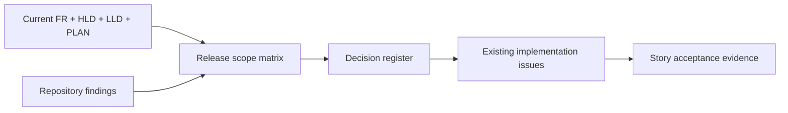

# AG-01 — Reconcile next-stage scope and decision log

Date: 12 November 2026 · P0 · 1 point · Leads: John + Abu · Dependencies: none · Type: refinement

**Status: user-reviewed plan, with PDF-only final export and Jev selection accepted.** Other policy questions explicitly marked proposed below remain open; Phase 1 local documents are published ([release scope](release-scope.md), [decision register](decision-register.md)) with navigation links added to the README, tenancy plan and solo-export contract. Shared-source (Google Doc) corrections, the John + Abu review and feature implementation have not occurred. AG-01 remains open. See [research and source provenance](ag-01-scope-reconciliation-research.md).

## 1. Decisions carried into this plan

1. **Final export is PDF only**, per the user decision on 12 November 2026 (D-PDF-EXPORT). PPTX and final HTML/DOCX/CMS output are outside this release. Preserve HTML as an internal preview where already used. This explicitly changes the earlier source baseline requiring PPTX; record a focused FR-EXP-05/backlog correction rather than claim the old requirement has been implemented.
2. Retain HTML, summary/DOCX and CMS as distinct deferred capabilities. Their historical Want classifications and summary-format conflict remain documented, but no non-PDF final-output adapter is part of this release. An HTML preview or concise PDF preset does not complete those features.
3. Preserve workspace authorization, generation, editing/version acceptance, evidence and output boundaries. Extend existing services through their assigned issues.
4. Keep unresolved policy choices explicit with proposed owners and review targets. They block only dependent final publication or implementation decisions.
5. Use `typesafe/jev-1.13` as the System One model for AI-generated claim evaluation and evidence-linked flags (user decision, 12 November 2026). This selects the evaluator; final-export blocking and override policy remain open under D-CLAIMS.
6. AG-01 changes documentation only. No new tables, services, UI, packages, credentials, deployment or database migration are required to complete this refinement.

## 2. Current-state audit and recommendation status

The repository can support reconciliation, but does not currently satisfy AG-01's documentation/decision outcome or all required release functionality.

| Recommendation                                                         | Status in this plan          | Current evidence / consequence                                                                                                                                        |
| ---------------------------------------------------------------------- | ---------------------------- | --------------------------------------------------------------------------------------------------------------------------------------------------------------------- |
| Reuse workspace and document authority                                 | Adopted                      | `app/services/workspaces/access_service.ts`; owner check in `workflow_service.ts:74`.                                                                                 |
| Reuse version/approval/task/evidence services                          | Adopted                      | `version_service.ts`, `workflow_service.ts`, `task_service.ts`, `evidence_service.ts`, `document_export_service.ts`. Reuse is subject to story-specific verification. |
| Treat PDF support as complete release evidence                         | Rejected                     | Code exists; actual branded artifacts and acceptance results were not verified here.                                                                                  |
| PDF-only final export                                                  | Adopted — user decision      | Existing final route is PDF. D-PDF-EXPORT supersedes the prior presentation requirement for this release; formal FR/backlog alignment remains a documentation task.   |
| Treat historical schema/validators as active features                  | Rejected                     | Brand/claim/export records exist in migrations, but the active workflow does not call `CanonicalContentService`.                                                      |
| Preserve solo PDF behavior while recording conflict                    | Adopted for this audit       | `document_export_service.ts:37–46`, `:186–202`; `docs/solo-export-contract.md`. No behavioral change is authorized by this plan.                                      |
| Choose claim override, collection authority or durable BYOK implicitly | Rejected                     | These require explicit decisions; initial proposals are registered below.                                                                                             |
| Rewrite the complete HLD/LLD or audit all Must requirements here       | Deferred to appropriate work | AG-01 adds focused deltas; OUT-01 audits implemented baseline coverage.                                                                                               |

### Defects and gaps to address first

These identifiers are local audit findings, not new functional requirements.

| ID  | Gap                                                                                                                                | AG-01 action                                                                                          |
| --- | ---------------------------------------------------------------------------------------------------------------------------------- | ----------------------------------------------------------------------------------------------------- |
| D1  | No single current release matrix; the source requires PPTX while the user now selects PDF-only final export.                       | Publish the PDF-only release baseline and record the explicit source/backlog change.                  |
| D2  | Unsupported-AI sign-off, collection approval, actual brand approval and credential retention lack a consolidated owner/review log. | Publish the register below; confirm responsibility and review timing.                                 |
| D3  | Summary format conflict and stale FR references in touched source sections.                                                        | Record exact current IDs; resolve or assign the summary clarification without inventing replacements. |
| D4  | Solo final export conflicts with FR-EXP-08; historical claim policy can be mistaken for active enforcement.                        | Record both mismatches and route policy/integration follow-up to APR-01 and OUT-01.                   |
| D5  | Collection approval and BYOK are missing from the active path; PPTX absence is outside the revised release scope.                  | Record active gaps under PRT-04 and OPS-02; record EXP-01 as deferred by D-PDF-EXPORT.                |

## 3. Draft release scope matrix

“Required” records existing Must requirements. “Release P0 extension” records the proposed feedback backlog priority; it is not a new FR. Read the [current P-FR, P-HLD, P-LLD and embedded PLAN](https://docs.google.com/document/d/1hcQO6PWB23ojrTVPm2IJ-SfIzZFZ9rt4aBjLS7iRki4/edit) alongside this matrix.

| Behavior                                                        | Scope and exact source                                                                                                                                   | Repository assessment                                                                                                                                            | Existing issue(s)                                         |
| --------------------------------------------------------------- | -------------------------------------------------------------------------------------------------------------------------------------------------------- | ---------------------------------------------------------------------------------------------------------------------------------------------------------------- | --------------------------------------------------------- |
| Single structured document, validated generation and evidence   | Required: FR-GEN-01/03/04/05/06/07; FR-RAG-04/05                                                                                                         | TipTap, generation and retrieval exist. Publication projection, factual support and diagnostics need targeted verification.                                      | OUT-01/02/03/05                                           |
| Configurable brand/tone and consistent outputs                  | Required: FR-GEN-02, FR-EXP-06. Versioned brand assets and detailed layout controls are refinements.                                                     | Outline files and historical brand schema exist; approved asset bundle is unverified.                                                                            | TPL-01, TPL-04A/04B; D-BRAND                              |
| Downloadable PDF case study                                     | Required: FR-EXP-01/03/06/07/08                                                                                                                          | Active renderer, queue/private artifact and download path exist; release acceptance still required.                                                              | RND-01A/01B/02/03, APR-01, QA-02                          |
| Short partner-facing PPTX, including preview                    | Outside this release by accepted D-PDF-EXPORT. Historical FR-EXP-05 is Must and requires an explicit scope amendment.                                    | No active implementation found; no PPTX adapter or viewer acceptance is required in the PDF-only release.                                                        | EXP-01 deferred; AG-01 records source delta; D-PDF-EXPORT |
| HTML website portfolio output                                   | Want: FR-EXP-02; final output remains subject to FR-EXP-08                                                                                               | HTML preview exists. Final HTML export is only planned in existing local documents.                                                                              | OUT-01 records gap; no dedicated HTML issue ID verified   |
| One-page summary / DOCX                                         | Want: FR-EXP-04; P-FR §12 item 5 says DOCX while §10 table says PDF                                                                                      | No dedicated summary exporter found. A one-page case-study PDF layout is not this requirement. Format clarification pending.                                     | AG-01; no dedicated summary issue ID verified; D-SUMMARY  |
| Direct website/CMS publishing                                   | Want: FR-EXP-09                                                                                                                                          | No CMS publication path found. Requires separate integration and access.                                                                                         | OUT-01 records gap; no dedicated CMS issue ID verified    |
| Manual edits and authorship                                     | Required: FR-EDIT-01/02/03/04/07                                                                                                                         | Editor/version/image paths exist. Preserve user-authored exemption from automated evidence validation; schema, asset and permission checks still apply.          | EDT-01/03, TPL-08                                         |
| Section regeneration and confirmable AI edits                   | Required: FR-GEN-08, FR-EDIT-05/06                                                                                                                       | Generation/revision services exist; verify confirmation and stale-base behavior in their stories.                                                                | EDT-02, OUT-05                                            |
| Owner review/approval, audit, meaningful-edit invalidation      | Required: FR-CS-01, FR-APR-01/02/03/04/05/07, FR-SEC-05                                                                                                  | Owner approval/version/audit foundations exist. Solo export exception requires reconciliation.                                                                   | APR-01, QA-02; D-SOLO                                     |
| Unsupported AI claims at owner sign-off                         | FR-RAG-05 requires flagging; FR-GEN-06 requires evidence verification. Stricter final-export blocking or an override is an unresolved policy refinement. | Historical claim validator exists; active readiness is issue/warning driven. Jev evaluation is selected but not implemented; final sign-off policy remains open. | OUT-02/05, APR-01; D-CLAIM-MODEL, D-CLAIMS                |
| Readable citations and internal-only reviewer notes             | Related FR-RAG-03/04/06/07, FR-GEN-05/06, FR-FM-04/07/08; detailed footnotes/client projection are feedback extensions                                   | Citation hydration exists; PDF currently includes chunk labels (`pdf_service.ts:30`).                                                                            | OUT-03/04, RND-02                                         |
| Concise/standard PDF layouts, page fit, fonts and image budgets | Release P0 feedback extensions; related FR-EXP-03/06/07                                                                                                  | Existing PDF CSS is a base, not proof of the requested layout/size acceptance.                                                                                   | TPL-02/03/04A/04B/05, RND-01A/01B/02/03                   |
| Portfolio wrapper and ordered collection                        | Release P0 feedback extension; related FR-EXP-01/03/06                                                                                                   | No collection manifest/composition service found. Existing “portfolio” outline is one document.                                                                  | PRT-01                                                    |
| Collection review and approval authority                        | Release P0 feedback extension; entry-level basis FR-APR-02/05 and FR-EXP-08                                                                              | New wrapper/order/configuration approval needs an explicit policy and later persistence design.                                                                  | PRT-04; D-COLLECTION                                      |
| Product/research/news types, presets and selected work          | Feedback extensions, not additional FRs. P1/P2 selection follows the refined backlog.                                                                    | Some outline choices exist; they do not establish the new publication contracts or collections.                                                                  | TPL-06A/06B/06C/07, PRT-02/03                             |
| Safe provider configuration and user keys                       | Required environment-secret baseline FR-SEC-03; BYOK settings UX is a meeting-feedback extension                                                         | Global environment config exists; actor/session BYOK resolver not found. Durable retention is not implicitly accepted.                                           | OPS-02/03; D-CREDENTIALS                                  |
| Durable stage progress, recovery and release acceptance         | Required progress FR-GEN-09, export restrictions FR-EXP-08; checkpoint/budget/release details refine these contracts                                     | Durable task/dispatch services exist; verify reuse in OUT-01. Broader FR-SEC-06 operational logging remains Want.                                                | OPS-01A/01B, QA-01/02/03, REL-01                          |

The release retains P-HLD §3.23's broader Must baseline, including authentication, workspaces, ingestion, library and RAG, with the explicit PDF-only scope amendment above. The original 68-Must count includes PPTX and is historical; do not claim all original Must requirements are fulfilled under the revised scope. This matrix does not certify those areas. URL ingestion remains explicitly out of current scope despite its Want listing. Optional FR-GEN-10, FR-RAG-08, FR-CS-03 and FR-APR-06 are not promoted to Must by this reconciliation.

## 4. Draft decision register

Statuses are **proposed**, **accepted**, or **superseded**. “Accepted” below identifies either an explicit current source requirement or an explicit user decision, with its source recorded; it does not establish implementation. New policy choices remain proposed until John/Abu record the reviewer, date, rationale and evidence. A superseded record is retained with its replacement ID; do not erase history. D-FORMATS is superseded by the accepted D-PDF-EXPORT decision; other pending policies remain proposed.

The following owners and **13 November 2026 team refinement** target are proposals to confirm, not assignments or a meeting already booked. If that review cannot occur, record its replacement date and owner; do not leave the target blank. Review timing does not authorize a policy by default.

| ID / status              | Decision or options                                                                                                                                                                                                                                                                                                                                                | Owner / target review                                                                                         | Affected issues and sources                                                                                | Migration consequences / interim treatment                                                                                                                                                                                                                   |
| ------------------------ | ------------------------------------------------------------------------------------------------------------------------------------------------------------------------------------------------------------------------------------------------------------------------------------------------------------------------------------------------------------------ | ------------------------------------------------------------------------------------------------------------- | ---------------------------------------------------------------------------------------------------------- | ------------------------------------------------------------------------------------------------------------------------------------------------------------------------------------------------------------------------------------------------------------ |
| D-FORMATS — superseded   | Earlier baseline required PDF and PPTX. Superseded for this release by D-PDF-EXPORT; retain the historical FR-EXP-05 statement as source evidence.                                                                                                                                                                                                                 | Replaced by explicit user decision on 12 Nov 2026                                                             | AG-01, EXP-01, REL-01; historical FR-EXP-03/05                                                             | None. Preserve history; no PPTX implementation is part of this release.                                                                                                                                                                                      |
| D-PDF-EXPORT — accepted  | Final export must be PDF. Defer PPTX and final HTML/DOCX/CMS output; existing internal HTML preview remains available. Other plan content is retained. Replaces D-FORMATS for the release target.                                                                                                                                                                  | User explicitly confirmed on 12 Nov 2026; John + Abu carry the scope correction into formal documents/backlog | AG-01, EXP-01 (deferred), REL-01, QA-02; FR-EXP-03, scope amendment to FR-EXP-05; optional FR-EXP-02/04/09 | No migration or artifact deletion. Reuse PDF pipeline; do not add non-PDF adapters. Amend only touched requirement/backlog references; remote sources are unchanged by this local plan.                                                                      |
| D-CLAIM-MODEL — accepted | Use `typesafe/jev-1.13` for AI-generated claim/evidence decisions and flags. Preserve human approval and the manual-authorship exemption. This does not accept automatic approval, blocking thresholds or overrides.                                                                                                                                               | User explicitly selected model on 12 Nov 2026; proposed implementation leads John + Abu                       | AG-01, OUT-02/05, APR-01, QA-01/02; FR-RAG-05, FR-GEN-06, FR-EDIT-07; user refinement                      | No migration now. Later audit existing validation/issue records for model identity, input hashes and typed evaluation results; add only missing persistence. See the evaluation contract below.                                                              |
| D-CLAIMS — proposed      | Choose final sign-off handling for unsupported/contradicted AI claims: resolve before publication, or a specifically authorized and audited exception. Recommendation: keep affected new outputs in internal preview pending decision; retain flags. Manual authorship is a separate category under FR-EDIT-07, not an automatic conversion of rejected AI claims. | Abu drafts examples; John reviews enforcement; product/stakeholder review at 13 Nov refinement                | AG-01, OUT-02/05, APR-01; FR-RAG-05, FR-GEN-06, FR-EDIT-07; P-FR §12 item 9, P-LLD A.3                     | None now. Later assess existing claim/issue/audit schema; add fields only if accepted policy needs them. No retroactive evidence fabrication or clearing old warnings.                                                                                       |
| D-COLLECTION — proposed  | Decide who approves wrapper/order/branding and how all required entry-owner approvals combine. Recommendation: a designated collection reviewer may approve the manifest but cannot bypass any entry owner's approval or access.                                                                                                                                   | John drafts authority/options; Abu coordinates product review at 13 Nov refinement                            | AG-01, PRT-01/04, APR-01; feedback extension with FR-APR-02/05, FR-EXP-08 basis                            | None now. PRT-04 likely needs manifest/review/audit persistence after confirming no reusable equivalent. Preserve entry IDs and snapshots; no migration invented here. Until settled, fixture composition/internal preview can proceed.                      |
| D-BRAND — proposed       | Confirm actual supplied company assets, spelling/glossary, fonts, usage rights, slide template and authorized publisher of shared brand/preset versions. Existing source promise of asset supply is not asset acceptance.                                                                                                                                          | Abu coordinates HumbleBee asset review; John checks binding/version consequences; target 13 Nov refinement    | AG-01, TPL-01/04A/04B/07, EXP-01; FR-GEN-02, FR-EXP-06; P-LLD A.3                                          | Reuse/audit historical `workspace_brand_versions` first. No schema change now. Pin approved versions in later review bundles; new brand versions must not rewrite old accepted output. Pilot uses fixtures/current reviewed assets with provenance recorded. |
| D-CREDENTIALS — proposed | Initial recommendation: protected actor/session-bound credential references. Confirm expiry, revoke/logout/restart behavior and provider destination allowlist. Durable encrypted retention is deferred until an explicit retention/deletion/key-management decision. Infrastructure environment secrets remain separate.                                          | John prepares policy; Abu reviews provider needs; target 13 Nov refinement                                    | AG-01, OPS-02/03, OPS-01B; FR-SEC-03 plus meeting extension; P-LLD §4.3/A.3                                | No credential table or encryption change in AG-01. OPS-02 chooses protected storage after policy acceptance. Tasks/snapshots must not contain keys. Global environment configuration does not satisfy per-user BYOK.                                         |
| D-SUMMARY — proposed     | Reconcile FR-EXP-04's PDF note with §12 item 5's DOCX clarification and A.3's DOCX treatment. Recommendation: record client confirmation and amend the touched table consistently; keep it optional.                                                                                                                                                               | Abu obtains clarification; John records it at 13 Nov refinement                                               | AG-01; optional summary follow-up has no verified issue ID; FR-EXP-04                                      | None now; later format adapter/dependency review only if scheduled. Do not count concise case-study PDF as summary acceptance.                                                                                                                               |
| D-SOLO — proposed        | Reconcile intentional solo draft PDF export with Approved-only FR-EXP-08. Options: approved-only final export for everyone, a labeled draft-download channel, or an explicit approved requirement exception. Do not silently remove established solo behavior or claim formal compliance.                                                                          | John presents existing contract/tests; Abu coordinates scope decision at 13 Nov refinement                    | AG-01, OUT-01, APR-01, EXP-01, QA-02; FR-EXP-08, FR-APR-02/05                                              | None now. A later accepted choice may change export-mode/API rules and artifact eligibility; retain historical tasks/audits and prevent newly disallowed downloads according to the accepted transition policy.                                              |

Each accepted update records: decision ID, status, source/related FR or feedback label, rationale/options, owner, actual review date/reviewer, affected issue IDs, migration consequence (including “none”), and replacement ID when superseded. Local decision IDs above are not functional requirements.

### Accepted evaluator selection and proposed integration contract

The user selected **`typesafe/jev-1.13` on 12 November 2026**. Pin this ID rather than a moving latest alias; record the actual resolved model identity returned by the provider. Selection is accepted; the integration details below are proposed implementation work in OUT-02/05 and APR-01, not application changes made by AG-01.

Official references checked 12 November 2026: [OpenRouter model listing](https://openrouter.ai/typesafe/jev-1.13), [OpenRouter Decisions tutorial](https://openrouter.ai/docs/guides/community/jev-tutorial), and [TypeSafe introduction](https://docs.typesafe.ai/introduction). Jev returns typed choices/probabilities, not generated explanations. The tutorial documents `POST https://openrouter.ai/api/alpha/decisions`; reverify that alpha contract before implementation. Do not assume the current chat-generation adapter accepts this model. These API facts support integration feasibility, not claim-evaluation accuracy.

Proposed contract:

1. Evaluate each AI-authored factual claim against its authorized, pinned source excerpts, retaining claim ID/hash and evidence identity/hash. Keep questions narrow; preserve units, dates, scope and qualifiers such as “up to.” Missing citations and unauthorized evidence are deterministic application checks, not facts the model may infer away.
2. Use a typed choice with `supported`, `contradicted`, and `insufficient_evidence`, defined against the supplied evidence only. Keep the probability distribution and available confidence alongside the verdict. No arbitrary numeric confidence threshold is accepted yet.
3. Present flagged claims with the exact claim, linked evidence and a fixed application label. Do not promise a Jev-written rationale, reasoning trace, or newly located supporting excerpt. Human reviewers may add their own rationale. Low-confidence outcomes receive an explicit review-needed flag under a policy calibrated on the reference set.
4. Re-evaluate when claim text, evidence revisions or evaluator/rubric identity changes. Associate results with the exact accepted version and inputs; stale results cannot clear current flags. Preserve human review history and make clear which judgment is automated.
5. Keep user-authored text exempt from automated evidence validation under FR-EDIT-07. Mixed-authorship changes must preserve provenance; accepting a model proposal does not silently relabel it as manually authored.
6. Treat timeout, rate limit, unavailable credentials and malformed results as `unable_to_evaluate`, separate from the three semantic verdicts. Show an unresolved check and bounded retry; never turn an evaluation failure into “supported” or silently substitute another model. Reuse existing task/access/budget boundaries and the approved credential policy.
7. Jev does not approve the document, rewrite a claim, or grant an export exception. D-CLAIMS still decides whether unresolved flags block final export or permit a specifically audited owner exception. Until settled, affected new outputs retain the existing proposed internal-preview restriction.

Implementation touchpoints to audit: `generation_service.ts` for AI candidate validation; `evidence_service.ts` for authorized source context; `readiness_service.ts` and `workflow_service.ts` for displaying/consuming current flags; existing validation-report/issue/claim-review persistence for durable results. Keep a decision adapter separate from `open_router_service.ts`'s text-generation role. Endpoint configuration and secrets stay server-side; do not put credentials in evaluation snapshots. Inspect schema constraints and applied migrations before proposing any additive change; historical claim-review rows represent human judgments and must not be repurposed as model approvals.

Acceptance for the later evaluation slice: human-labeled fixtures covering all three verdicts, missing evidence, contradictory numbers, changed qualifiers, mixed/manual authorship, stale claim/source hashes, cross-workspace evidence denial and provider failures. Report per-class mistakes, especially false “supported” decisions, latency and usage. Select review thresholds from those results; no accuracy or latency promise is made here. Routine tests use controlled adapter responses; one controlled live contract check confirms the selected model/API before enablement. Update the decision register separately when final-export handling is accepted.

## 5. Target documentation and preserved boundaries



This is a documentation relationship, not a replacement application architecture. Workspace access remains the authorization boundary. Generation proposes/validates candidates; editing/version services own accepted content; evidence owns provenance; approval owns exact reviewed owner sign-off; output rendering derives artifacts without rewriting facts; durable tasks coordinate execution. Credentials are resolved separately from content and evidence snapshots.

Target files after plan agreement:

- `docs/release-scope.md`: one authoritative local release matrix, source baseline, explicit remaining release gaps, links to decision IDs and existing issues. Link to this audit for detailed findings rather than duplicate it.
- `docs/decision-register.md`: the small register above, confirmed responsibilities and review targets, dated acceptance evidence and supersession links.
- `docs/workspace-tenancy-implementation-plan.md`: retain historical tenancy scope; annotate the touched presentation-deferral row with the new required release baseline.
- `docs/solo-export-contract.md`: add a reference to D-SOLO and document the outcome only after acceptance; retain the current behavior description until then.
- `README.md`: link the release matrix/register so contributors can find the current baseline.
- P-FR touched §10/§12 summary/reference statements, P-HLD §3.23 delta if necessary, P-LLD A.3: prepare focused correction text for document maintainers. Writing to the shared source is a separate publication action; no remote edit is part of this audit.

The existing `docs/html-exports-research.md` and `docs/html-exports-implementation-plan.md` remain intact. The release matrix will reference them as optional planning and flag their inherited solo-export assumption for D-SOLO review.

### Data model, APIs and UI

AG-01 has **no database migration, generated model, route, UI component or new dependency**. Decision rows live in Markdown. Use existing IDs and code paths as evidence; do not create decision tables or a settings screen for this refinement. Later implementation belongs to the existing issues above, in an isolated worktree using the repository's Adonis CLI and layered-service conventions.

In touched text only: v2.1 FR-AUTH-02 describes equal ordinary-user capabilities; FR-TEN-01/02/03 are the active workspace requirements; FR-FM-01–09 are the defined file-management set. Old FR-AUTH-06, FR-ING-11/12 and FR-CS-05/07 references are stale. Map the actual behavior to a verified current requirement, or mark it as an extension; do not mechanically renumber historical text. P-LLD's old “FR-AUTH-02 absent” assertion must not be copied into the new baseline.

## 6. Phases and acceptance

### Phase 0 — Establish the audit baseline (D1–D5)

Prepared in this review: source precedence, current code evidence, scope matrix and draft register. Preserve unrelated schema and HTML-plan work (committed as `fadae67` during this audit). No configured database or live provider is needed.

Acceptance: every assertion distinguishes a requirement, a proposal, code presence and tested behavior. John/Abu can follow the source headings and repository paths. The PDF-only scope amendment, deferred PPTX path and solo policy conflict are visible.

### Phase 1 — Publish local scope and register (D1–D4)

Create the two target documents, add navigation links and annotate only touched stale local statements. Carry the matrix/register seeds forward; replace provisional owner/target values with confirmed ones. Keep decisions proposed when agreement is absent. Prepare minimal formal-document corrections rather than redesigning HLD/LLD.

Acceptance: one contributor-facing scope; PDF as the sole final export format, with PPTX/HTML/summary/CMS deferrals explicit; each policy has a responsible owner and explicit target review; each changed behavior has real FR references or a feedback-extension label; every register row includes status, affected issues and migration consequences.

### Phase 2 — Team reconciliation and closeout (D2–D5)

John + Abu review against P-FR §§5, 8–12, P-HLD §3.23, P-LLD A.3 and PLAN. Record actual review evidence. Resolve policies where possible; otherwise confirm owner/target and affected-path restrictions. Link follow-ups to existing backlog items without creating imaginary issue/FR IDs. Mark superseded decisions only when their replacement is accepted.

Acceptance: AG-01 may close when the team accepts one scope and each open decision has confirmed ownership/review timing. Completion does not require collections/BYOK code or deferred PPTX implementation, a resolved answer to every policy, or completion of all 68 Must requirements. Those remain visible under their implementation issues.

## 7. Risks, independent work and rollback

- Older sources still require PPTX: D-PDF-EXPORT explicitly supersedes that release scope, preserving the historical requirement and identifying the focused formal/backlog correction. Do not treat missing PPTX as implemented or silently change the source requirement.
- The summary contradiction could become two competing implementations: clarify the optional requirement before scheduling an adapter.
- Historical claim/brand tables could prompt duplicate infrastructure or accidental policy revival: audit active call paths and applied schema inside the relevant implementation issue.
- Silent solo-export changes could break existing workflows: D-SOLO is a separate recorded decision with transition consequences; this plan changes no export behavior.
- Policies could stall the whole backlog: OUT-01, QA-01, semantic fixtures, citation presentation, internal previews and layout work proceed independently. Final claim-policy publication, collection approval, brand acceptance and credential persistence wait only for their relevant decisions. EXP-01 is deferred under D-PDF-EXPORT; independent PDF layout and approval integration can proceed within their policy boundaries.
- Documentation can be reverted independently without touching data. Accepted history is preserved through supersession records; later schema changes require their own compatibility/rollback plan.

## 8. Verification and evidence limits

For this plan: inspect referenced code and source excerpts, check local links/formatting, and run `git diff --check`. No runtime acceptance or test pass is claimed. Application suites are unnecessary for Markdown-only AG-01 changes.

During Phase 1, run:

```sh
git diff --check
rg -n 'PDF|PPTX|HTML|DOCX|CMS|FR-EXP-0[234589]' docs/release-scope.md
rg -n 'proposed|accepted|superseded|review|migration|D-SOLO' docs/decision-register.md
rg -n 'FR-AUTH-06|FR-ING-11|FR-ING-12|FR-CS-05|FR-CS-07|FR-FM-10|FR-FM-11' docs/release-scope.md docs/decision-register.md
```

The last command should find no active mappings to undefined/stale IDs; an explicitly labeled historical correction is allowed. Human review must verify that IDs also mean the claimed behavior, not merely that they exist.

Manual closeout checklist:

- [ ] John + Abu accept the release matrix and actual review date is recorded.
- [ ] PDF is the sole final export format; PPTX and final HTML/DOCX/CMS outputs are deferred, with the FR-EXP-05 source amendment recorded. Existing HTML preview remains distinct.
- [ ] Jev model selection is carried forward as accepted, with evaluation flags distinct from owner approval and unresolved export policy.
- [ ] Four requested policy topics have an accepted resolution or confirmed owner and target review; D-SUMMARY and D-SOLO are also tracked.
- [ ] Every changed behavior maps to current FR text or an explicit feedback extension.
- [ ] Each decision includes status, affected issue IDs and migration consequences.
- [ ] Touched stale references are corrected; historical documents are not broadly renumbered.
- [ ] P-HLD boundaries and broader Must baseline remain intact; independent work can proceed.
- [ ] Required feature gaps remain open under their implementation issues; no documentation-only release-readiness claim.

For later behavior changes, reuse relevant coverage in `tests/functional/document_exports.spec.ts`, `solo_pdf_export.spec.ts`, `workspace_workflows.spec.ts` and isolation/task tests. Verify actual PDF files, viewer behavior and stakeholder acceptance in their own stories; controlled rendering tests alone do not establish those results.
