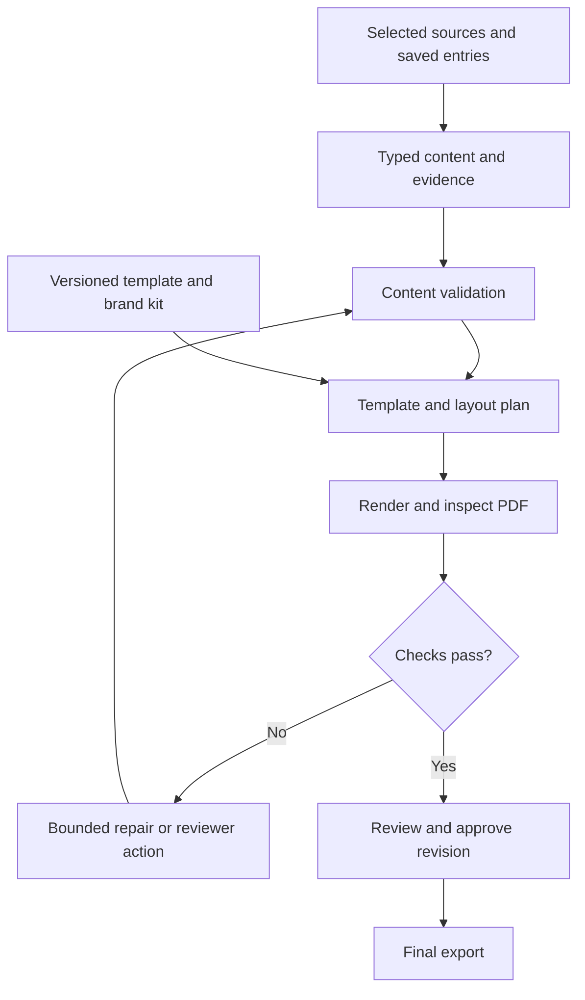

# Next-stage plan: reliable, production-ready portfolio outputs

**Project:** AI-Powered Case Study and Portfolio Generator · CodeCanvas / HumbleBee AI  
**Planning date:** 9 November 2026  
**Proposed delivery window:** 9 November–14 December 2026  
**Status:** Proposed implementation plan derived from stakeholder feedback; estimates and acceptance thresholds below are planning decisions, not measured results.

## 1. Stage objective

Turn the working generation workflow into a dependable publishing workflow: selected evidence becomes concise, editable, correctly qualified content, then a branded document with predictable pagination and a reviewable final export.

The next stage should deliver a professional case-study PDF and a composed portfolio first. The reusable template foundation should support other content types without forcing research, products, or news into case-study sections. Preserve evidence inspection, version history, manual editing, AI-assisted changes, and owner approval.

The feedback is strongly positive about grounding, but it is not a formal factual-accuracy evaluation. Keep evidence-quality checks alongside presentation improvements. Replacing the generation model alone would not resolve the formatting, pagination, or portfolio-assembly problems.

“Production-ready” for this stage means suitable for controlled internal use and stakeholder testing: valid content, dependable PDF output, safe handling of credentials and private sources, recoverable jobs, and approval tied to the exact exported revision. Public SaaS operations and arbitrary-scale deployment are outside this stage.

## 2. Evidence and priorities

The figures below are reported in the 7 November feedback document. We have not independently remeasured the original 173-page portfolio in this planning exercise.

| Feedback or observed issue | Required project response | Priority |
| --- | --- | --- |
| 173 pages for 41 entries; 16 near-empty pages | Explicit page budgets, measured overflow checks, and content fitting | P0 |
| About 950 inline chunk references | Superscript citations and concise per-entry source blocks; full evidence in the reviewer view | P0 |
| 84 sentences beginning “The source…” | Separate publication copy from internal reviewer notes | P0 |
| No stat callouts; important numbers buried in paragraphs | Structured result fields, evidence labels, and a stat-row block | P0 |
| One layout for case studies, products, research, and news | A content-type contract and compatible templates | P0 foundation; P1 additional types |
| No cover, contents, or contact page | Portfolio-level composition with live page references | P0 |
| Inconsistent brand spelling and limited branding | Versioned brand kit, approved assets, and brand glossary | P0 |
| 24 MB output; Type 3 fonts reported | Image optimization and font inspection on final PDFs | P0 |
| Timeouts, retries, slow large-file runs in the platform review | Stage-based job status, bounded retries, checkpoints, and measured performance | P0 |
| Selectable brand kit, template choices, Q&A editing | Previewable presets and controlled edits with validation | P0 basic; P1 richer customization |
| User-supplied API keys and testable deployment | Secure provider settings and a reproducible internal deployment | P0 |

**Scope decision:** perfect one case-study format before expanding layouts. The first template should work on both image-rich and image-free entries, and on entries with and without numerical results.

## 3. Scope and deliverables

### P0: required for the release

- A structured publication-content contract with separate evidence and reviewer notes.
- One branded case-study template family: **concise one-page** and **standard two-page** presets, with image and no-image variants.
- Deterministic layout blocks and a selectable, versioned HumbleBee AI brand kit.
- A template picker with preview, compatible options, saved workspace presets, and clear page-budget feedback.
- Footnotes, preserved evidence-strength labels, and a reviewer evidence panel.
- A portfolio wrapper: cover, company introduction, category-aware contents, entries, and back cover.
- Validation, content fitting, preview, approval, and final PDF export from the same revision.
- A small but representative regression set, operational checks, and an internal deployment or Docker fallback.

### P1: complete after the P0 case-study path passes its gates

- Product, research, and company-news schemas and layouts, implemented one at a time.
- Selected-work export with filtering, ordering, and prospect-specific selection.
- Optional category dividers and reviewer-only evidence appendix.
- Template duplication, optional-block reordering within allowed regions, and richer Q&A edits.
- Duplicate-entry suggestions and a comparison of candidate generation models.

### Defer

Freeform page-canvas editing, arbitrary user HTML/CSS, automatic illustration generation, additional source crawling, embedding-model replacement, broad retrieval experimentation, CMS publishing, resume formats, and new presentation-generation work.

The proposal lists HTML, summaries, and presentations as requested outputs, with priorities still to be confirmed. Track their status explicitly in the final report. This stage prioritizes PDFs; internal HTML rendering does not count as a completed public HTML or CMS feature. Do not silently remove any already committed deliverable: record a scope decision with the mentor if necessary.

## 4. Proposed output pipeline

Keep the current application and RAG workflow. Add clear contracts between content, design, validation, and export rather than rebuilding the system.

The model generates or edits content fields. Code decides valid blocks, layout slots, pagination rules, footnote numbering, and rendering. A model may suggest a content type or suitable preset, but the application validates compatibility and the user can correct the choice.

### 4.1 Content and evidence contract

Use shared fields plus a type-specific payload. Avoid a single object with every possible section optional.

| Group | Suggested fields | Rules |
| --- | --- | --- |
| Identity | `entry_id`, `revision_id`, `doc_type`, `schema_version`, `source_revision_ids` | Type is one of client case study, product, research, or news; source revisions are pinned |
| Publication copy | `hero`, type-specific sections, `results[]`, `figures[]`, `cta` | Structured text; no pipeline diagnostics or raw chunk IDs |
| Evidence | `claims[]`, `evidence_links[]`, source locators | Claims map to source revision, chunk, page when available, and source URL when available |
| Result qualifiers | value, unit, label, evidence kind, scope, baseline, period | Preserve “up to,” approximate values, conditions, and target/estimate status |
| Internal review | `reviewer_notes[]`, unresolved issues, reviewer decisions | Excluded from the client render payload |
| Composition | selected template version, brand version, options, page budget | Pinned independently from source text and content revision |

Evidence kinds should include `measured`, `estimated`, `client_reported`, and `design_target`, following the feedback. “Measured” means a reported measurement exists with supporting context; it must not imply independent verification. Track the reporting source separately. Missing evidence remains unresolved and blocks publication of that claim.

Missing information produces an empty optional field and a reviewer note. It must not produce invented results or a paragraph explaining missing data in client copy. However, material qualifications stay public: an estimate label or relevant limitation cannot be moved into internal notes merely to make the copy cleaner.

Treat research results as research results. A benchmark improvement must retain dataset, metric, baseline, and conditions where relevant; it cannot become a claim of realized business impact.

### 4.2 Citation and reviewer behavior

- Use stable internal evidence IDs, then assign display footnote numbers during composition.
- Deduplicate repeated citations where supported, while preserving the mapping of every factual claim.
- Render superscripts and a compact source block per entry. Full chunk identifiers and extraction notes belong in the internal view.
- Do not hardcode “two footnotes per entry.” The redesign is an example, not a limit on evidence.
- Do not create source URLs when missing. Use available document titles and page locators.
- Keep source files private. Public-facing references must not contain signed storage URLs or internal paths.
- Show reviewer notes, evidence excerpts, quality failures, and before/after edits together.
- Export reviewer notes only through a separately selected internal review output, never through the client PDF path.

### 4.3 Content checks and repairs

Validate schema, required fields, title duplication, malformed citations, missing evidence, unsupported numerical claims, brand spelling, and suspicious pipeline commentary. Phrase checks such as “the source does not…” are useful targeted lint rules, but should not globally ban the word “source” or silently delete whole sentences.

Repairs should target failing fields. Permit at most two automatic content-repair attempts per entry in the initial implementation. Revalidate evidence and qualifiers after any rewrite; unresolved issues return to the reviewer. Keep the original revision and repair history.

## 5. Template system design

### 5.1 Separate the parts that change for different reasons

| Layer | Responsibility | Example |
| --- | --- | --- |
| Content type | Which information is meaningful and required | Research has authors and benchmark context; news has an event date |
| Template definition | Allowed blocks, slots, order, constraints, page size | Case-study standard, two A4 pages |
| Brand kit | Approved logo, colors, font files, names, contact details | HumbleBee AI identity |
| Preset | A saved compatible combination of options | Concise, image-free, results-first |
| Document instance | Actual content and chosen versions | Customs entry revision 7 using template version 2 |

Use the feedback’s navy/yellow direction as a starting reference, then confirm actual assets and brand values with marketing. Accenture is a layout-quality reference; do not import its purple/blue identity. Confirm canonical company spelling rather than normalizing proper names with an unchecked global replacement.

### 5.2 Initial template catalog

| Template | Page budget | Main blocks | Delivery |
| --- | --- | --- | --- |
| Client case study — concise | 1 page including citations | Hero, supported result row if available, challenge, solution, selected capabilities, CTA, sources | P0 |
| Client case study — standard | Up to 2 pages including citations | Hero, results, challenge, steps, capabilities, optional figure/proof/roadmap, CTA, sources | P0 |
| Product profile | 1–2 pages | Audience, features, workflow, screenshots, verified availability, CTA | P1 |
| Research brief | 1 page | Title, authors, venue, plain-language summary, key figure, qualified metric, implications, paper reference | P1 |
| News / partnership | Half-page block or 1 page | Headline, date, summary, optional photo/logos, source link | P1 |
| Portfolio collection | Overall page budget | Cover, about, contents, grouped entries, optional dividers, back cover | P0 basic; P1 richer assembly |

Unsupported types must be clearly unavailable in the first release. They must not silently fall back to the case-study template. A mixed-content release is complete only when every included type has passed its own validation and layout tests; otherwise export a clearly scoped case-study collection.

### 5.3 Reusable block library

Build hero, result row, text section, step flow, capability cards, figure with caption, proof/quote, roadmap strip, CTA, and sources. Portfolio layouts additionally reuse cover, contents, divider, and contact blocks.

Each block declares its accepted content fields, empty-state behavior, minimum readable typography, allowed variants, and page-break rules. Empty optional blocks collapse without leaving reserved whitespace. Never fabricate a quote, number, screenshot, or award to fill a slot.

For images, retain source identity, caption, aspect ratio, crop/focal-point settings, and permission status where relevant. Use source-backed figures or approved illustrations. Decorative illustration must not appear to be evidence of a real deployment. Preserve labels and fine detail in charts and screenshots during compression.

### 5.4 User-facing template workflow

1. Choose an entry type or confirm the suggested type.
2. Select a compatible template using a thumbnail and page-budget description.
3. Choose a brand kit and options: image/no image, optional blocks, concise/standard, CTA.
4. Generate or map existing content into the selected structure.
5. Preview actual pages and inspect evidence and quality findings.
6. Edit manually or ask for a targeted change; validate the affected content and layout again.
7. Approve the exact revision and export.

P0 saved presets should let a workspace reuse a name, base template version, brand version, and allowed option values. P1 can add duplication and limited block reordering. Do not begin with a general drag-and-drop designer.

Switching between compatible layouts should reuse content and evidence without a new retrieval or generation call. If a shorter layout requires rewriting, show the proposed revision, retain the original, and require renewed review.

### 5.5 Versioning and maintenance

Published template versions are immutable. Existing documents retain their template and brand versions until an explicit upgrade. Template changes require preview fixtures and approval before publication. An update to content, citations, source selection, brand, template, layout options, or selected entry ordering invalidates the approval of the resulting export.

Maintain a migration path for existing editor documents: convert representative entries, compare text and citation coverage, retain original versions, then migrate the rest. Unknown editor nodes or unmapped evidence produce visible migration issues instead of silent content loss. Keep a semantic editing document separate from layout instructions so users can continue to edit text naturally.

## 6. Rendering and portfolio composition

### 6.1 Fit content to the selected page budget

Treat one or two pages as a measured constraint. Word and character limits guide generation, but rendered dimensions decide whether content fits. The reviewer’s 60-character headline and 160-character subhead suggestions are starting limits to test, not guarantees of fit.

Use this fitting order:

1. Remove empty optional blocks and unused spacing.
2. Apply an approved compact variant within typography and spacing limits.
3. Shorten lower-priority copy with claim and qualifier preservation checks.
4. Suggest the standard two-page layout when the one-page preset cannot fit; require the user to accept the change.
5. Return an unresolved fit issue when the maximum budget still fails.

Never clip text, hide citations, remove a necessary qualification, use unreadably small type, or silently add a third entry page. Footnotes and source blocks count toward the entry budget.

Keep headings with following text, lists with lead sentences, result labels with values, and captions with figures. Detect unintended blank pages, clipping, overlaps, and orphaned headings. Pages with fewer than 120 words and no figure are review candidates; covers, contact pages, intentional dividers, and news blocks need appropriate exceptions.

### 6.2 Compose a whole portfolio

Use one collection manifest containing selected entry revisions, order, grouping, wrapper content, template versions, and brand version. Prefer saved, reviewed entries for assembly rather than regenerating all text on every export. If a source is a research paper or a news article, generate or use its corresponding typed entry first.

Calculate contents links and page numbers from the actual composed output. A change in entry length must update the contents. Check internal links after PDF assembly. Aggregate company statistics only from explicit, deduplicated evidence; do not count 41 portfolio entries as 41 delivered client projects.

The selected-work target in the feedback is 6–10 entries in roughly 12–20 pages. That is a collection budget, including cover, contents, and back cover. Ten two-page entries already require 20 pages before the wrapper, so the UI must show the arithmetic and offer fewer entries or concise presets.

### 6.3 PDF production rules

Use a shared, versioned render path for preview and final output; final export can remove the draft watermark after approval. Verify that page layout and content otherwise match the approved preview. Include checks for selectable text, expected embedded static fonts, readable images, working references, and the absence of reviewer-only information.

Follow the feedback’s under-8-MB target for the email portfolio preset. Test it on a declared reference collection; do not promise the same size for arbitrary images and collections. Offer a separate high-resolution preset when needed, with an explicit estimated size and no silent downgrade of essential figures.

Pin rendering dependencies and font files. Cache render artifacts by content, template, brand, options, assets, and renderer version. Existing approved artifacts should remain available even if a newer renderer changes pagination.

## 7. Reliability and controlled deployment

### 7.1 Jobs and generation providers

- Expose stages such as preparing sources, retrieving evidence, drafting, validating, rendering, and ready for review. Avoid invented percentage completion.
- Record stage durations, failures, retries, token use, and cost where supplied by the provider.
- Use bounded retries for transient provider failures, with backoff and cancellation. Do not retry invalid credentials indefinitely.
- Checkpoint completed entries in a collection so one failed entry does not force every entry to regenerate.
- Make retries idempotent: one logical run must not create duplicate document revisions, exports, or duplicate successful provider calls where avoidable.
- Validate provider outputs against the same schema. Failed structured output follows the repair policy or returns a useful error.
- Keep the embedding model fixed during this stage. Measure retrieval problems before changing the retrieval approach or rebuilding embeddings.

The meeting recommends a stronger generation model, but it does not establish which candidate is best. Compare the current model with one or two available candidates on the same fixtures for support, qualifier retention, schema success, latency, and cost. Choose based on results. Do not silently change provider or send private evidence elsewhere through automatic fallback.

### 7.2 Provider settings and access

Provide user-supplied API-key settings, a connection test, clear supported-provider choices, and actionable configuration errors. Reuse the existing OpenRouter path first; support direct OpenAI and Google connections when adapters pass the same tests. Treat Anthropic as a separate adapter task if needed. Do not imply every model or endpoint is interchangeable.

Mask keys, exclude them from logs and export payloads, and encrypt persisted secrets server-side. Apply workspace permissions to sources, evidence views, templates, jobs, and downloads. Test cross-workspace isolation. An owner’s approval must not grant unauthorized access to original source files.

### 7.3 Release package

Deliver a reproducible application build, migrations, pinned fonts/assets, documented configuration, and a working internal test environment. Use available hosting if suitable; otherwise provide the Docker deployment described in the meeting. Include health checks, bounded worker concurrency appropriate to available memory, rollback instructions, backup/restore procedure, and a short reviewer guide.

Do not treat “more than 90% functional” in meeting notes as a measured production-readiness score. Audit the actual implementation before marking a backlog item done. The proposal and latest meeting mention AdonisJS; this plan makes no framework migration and assumes no uninspected code is already complete.

## 8. Five-week delivery sequence

The feedback proposes a 14 December finish. The schedule below uses that window and prioritizes an end-to-end sample early. Estimates assume the existing workflow can be extended; confirm effort after the first implementation audit.

| Window | Main work | Reviewable deliverable | Exit condition |
| --- | --- | --- | --- |
| **9–15 Nov** | Audit current content/export path; preserve baseline; define typed contract; separate notes; citations; build one initial branded sample | Entry 01 before/after, plus sparse-evidence and no-image samples | No raw chunk IDs or internal notes in client copy; qualifiers retained; all three samples render |
| **16–22 Nov** | Reusable blocks, brand tokens, template registry, picker, concise/standard presets, saved settings | Users can choose a preset and render the same entry through both layouts | Same source claims/evidence preserved; empty blocks collapse; fonts and brand assets load reliably |
| **23–29 Nov** | Measured page fitting, targeted repairs, editor integration, approval snapshots, case-study regression fixtures | First five case-study entries ready for marketing review | Each entry within its budget, no clipping/orphans, no unsupported displayed claims, approval invalidation works |
| **30 Nov–6 Dec** | Portfolio wrapper, contents, full/selected assembly; add product/research/news layouts in priority order after P0 gates | A composed portfolio with working navigation; typed sample set where implemented | Contents correct; selected revisions/order correct; unsupported types cannot use the wrong layout |
| **7–13 Dec; handoff 14 Dec** | Regression evaluation, PDF compression/fonts, provider/job failures, isolation checks, deployment, stakeholder UAT | Release candidate, reviewer guide, quality report, demo | P0 acceptance checks pass; no critical failures; remaining P1 scope explicitly recorded |

Hold a weekly review using the same baseline entries and record feedback as reproducible issues. Reserve the final week for fixes and verification. If time slips, reduce catalog breadth, decorative dividers, and advanced customization before weakening evidence, page-fit checks, or approval behavior.

## 9. Implementation backlog

Dependencies describe delivery order. Roles are suggested from the proposal, not newly assigned commitments. P0/P1 are next-stage priorities and do not replace the formal functional-requirement numbering.

| ID | Task and acceptance | Priority | Depends on | Suggested lead |
| --- | --- | --- | --- | --- |
| OUT-01 | Audit existing generation, editor, citations, export and job code; preserve baseline outputs; list reusable components and actual gaps | P0 | — | John + QA |
| OUT-02 | Define versioned typed content/evidence schema; valid and invalid fixtures; missing data creates internal issues, not invented copy | P0 | OUT-01 | Abu + John |
| OUT-03 | Add separate client/reviewer render payloads; leakage tests pass for PDF and preview; material caveats remain public | P0 | OUT-02 | John |
| OUT-04 | Implement stable evidence links and display footnotes; citations resolve after editing, reordering, and collection assembly | P0 | OUT-02 | John + Abu |
| OUT-05 | Add schema, numerical-qualifier, repeated-title, brand and commentary checks with bounded targeted repair | P0 | OUT-02 | Abu |
| TPL-01 | Confirm assets, canonical name, palette and static fonts; create versioned brand configuration | P0 | OUT-01 | Frontend + marketing review |
| TPL-02 | Implement template registry, compatibility checks, block contracts, page budgets and immutable published versions | P0 | OUT-02, TPL-01 | John + frontend |
| TPL-03 | Build the shared block library; fixtures cover long titles, empty results, absent images, long footnotes and dense figures | P0 | TPL-02 | Frontend |
| TPL-04 | Ship concise/standard case-study presets and image/no-image variants; no mandatory fabricated statistic or illustration | P0 | TPL-03, OUT-04 | Frontend + Abu |
| TPL-05 | Add template/brand picker, real preview, saved workspace presets and visible fit errors | P0 | TPL-04 | Frontend |
| TPL-06 | Add product, research and news schemas/layouts sequentially; each passes its own content and visual fixtures | P1 | TPL-04, OUT-05 | Abu + frontend |
| TPL-07 | Duplicate presets and reorder allowed optional blocks; preserve pinned versions on older documents | P1 | TPL-05 | Frontend + John |
| RND-01 | Unify preview/final rendering; deterministic footnotes, typography, images and page breaks | P0 | TPL-03, OUT-04 | John + frontend |
| RND-02 | Add layout measurements and bounded fitting; budget failures remain visible; no clipped text or hidden evidence | P0 | RND-01, TPL-04 | John + QA |
| RND-03 | Optimize images; inspect embedded fonts, text and links; reference email portfolio under 8 MB | P0 | RND-01 | John + QA |
| EDT-01 | Map existing editor nodes to semantic fields; round-trip representative entries without lost text/evidence; preserve original revisions | P0 | OUT-02, TPL-04 | John + frontend |
| EDT-02 | Manual and Q&A edits revalidate affected content; approval binds to content/template/brand/assets and is invalidated by changes | P0 | EDT-01, OUT-05, RND-02 | John + frontend |
| PRT-01 | Compose cover, about, contents, grouped entries and back cover; references use actual final pages | P0 | RND-01, EDT-02 | Frontend + John |
| PRT-02 | Select/filter/reorder saved entry revisions; calculate whole-collection budget; omit deselected entries from output and contents | P1 | PRT-01 | Frontend |
| PRT-03 | Suggest duplicate/product-family groupings; require explicit reviewer choice before merging | P1 | OUT-02, PRT-01 | Abu |
| OPS-01 | Add stage status, timings, checkpoints, cancellation and bounded idempotent retries; test timeout/restart recovery | P0 | OUT-01 | John |
| OPS-02 | Add secure BYOK settings and provider tests; supported adapters pass common contract; current provider path remains usable | P0 | OUT-02, OPS-01 | John |
| QA-01 | Build representative fixtures and claim audit sheet; baseline results and reviewer rubric recorded before tuning | P0 | OUT-01 | Davron + Abu |
| QA-02 | Run content, layout, export, workflow, isolation and failure tests; publish measured results and defects | P0 | QA-01; incrementally all P0 tasks | Davron + team |
| REL-01 | Package and deploy the internal release or Docker fallback; rehearse backup/restore and rollback; hand off test guide | P0 | OPS-01, OPS-02, QA-02 | John + QA |

Suggested role mapping from the proposal: John Paul Paredes for integration/backend; Abu Sufiyan for generation/evidence; 전종현 for frontend/layout; Ergashev Davron Zokir Ugli for QA and demo evidence. Marketing validates brand and publication suitability, while the existing authorized owner remains responsible for final approval.

## 10. Evaluation and acceptance gates

### 10.1 Reference set

Freeze the original review draft as the visual baseline when it is available. Begin with the first five case-study entries identified in the feedback. Add targeted fixtures for a long title, no image, no result metric, estimated results, a long source block, contradictory evidence, and a repeated entry. Fixtures can overlap.

For the expanded catalog, include at least two representative examples per additional content type, including a missing-field case. Freeze one selected-work collection for navigation, page count, and size checks. Run one full-corpus composition test on the 41-entry set when all intended types are supported. Before that, use a clearly labeled supported subset.

For generation comparisons, use three runs per fixture under declared source sets, provider/model settings and environment. Keep content accuracy, generation latency, rendering latency, file size and visual quality as separate measurements. Do not mix OCR-heavy ingestion time with generation from already prepared evidence.

### 10.2 Acceptance checks

| Area | Proposed gate | How to verify |
| --- | --- | --- |
| Structural validity | Every exported entry matches its selected type/schema | Runtime validator plus invalid fixtures |
| Evidence resolution | Every factual claim in evaluated outputs has a resolvable evidence link | Automated link checks and human claim audit |
| Evidence correctness | No unresolved unsupported or contradictory claim in the release reference set | Human S/C/U audit; report S, C and U counts rather than only an aggregate score |
| Numerical honesty | Every displayed result preserves units, qualifiers and evidence kind | Audit result objects against the cited excerpts |
| Client copy | Zero raw chunk IDs, internal diagnostics or reviewer-only notes | Payload tests, PDF text extraction and human review |
| Layout | Every reference entry within selected budget; no clipping, overlap or unintended orphan pages | Rendered-page inspection and automated layout checks |
| Type handling | Every included content type has a compatible, tested template | Type/template matrix and mixed collection test |
| Navigation | Contents, internal links, order and page numbers match final PDF | PDF link/page audit after final composition |
| Brand | Approved assets, fonts, spelling and contact information used | Brand checklist and font inspection |
| Email export | Reference email portfolio below 8 MB with readable figures | Byte size plus visual review; declare entry count and page count |
| Approval | Final export blocked for changed or unapproved snapshot | Workflow and permission tests |
| Operational success | At least 19 of 20 reference export jobs complete without manual restart | Fixed local/staging test batch; report failures and retries separately |
| Recovery | Timeout, cancellation and worker restart do not lose completed entries or create duplicate exports | Failure-injection scenarios |
| Access and secrets | Cross-workspace access denied; keys absent from logs/client artifacts | Integration tests and configuration review |
| Stakeholder review | No unresolved critical issue; marketing accepts layout and client copy | Recorded UAT checklist on the reference outputs |

The 19/20 batch is an initial capstone release check, not evidence of a long-term availability guarantee. Traceability alone does not prove factual support. The zero-unresolved-claim gate applies to the audited reference set and does not justify claiming all future outputs are error-free.

Performance targets should be set after the first-week baseline. Report median and p95 for retrieval, drafting, validation, rendering and whole-collection assembly, along with retry counts, file sizes, hardware and model settings. Retain the proposal’s timing goals as provisional until tested on declared workloads. A 41-entry portfolio cannot inherit a single-entry “under one minute” expectation.

### 10.3 Export behavior when a check fails

Keep failed output available as a watermarked internal preview with actionable issues. Block final client export for invalid schema, unresolved factual support, broken required citations, overflow/clipping, missing assets that prevent a valid render, or stale approval. Informational layout warnings can be resolved by the reviewer where appropriate. Never use approval to bypass unresolved factual or severe rendering failures.

## 11. Immediate action list

1. **John + QA:** audit the implementation and preserve current sample outputs before modifying the pipeline.
2. **Team:** turn the feedback checklist into a shared issue board using the backlog above; map items to existing requirements without inventing new FR identifiers.
3. **Marketing review:** confirm the logo, colors, static font files, canonical spelling, contacts and first case-study sample. Use the supplied mockup as the initial visual direction.
4. **Abu + John:** implement the typed content contract, evidence kinds, reviewer notes and footnote mapping.
5. **Frontend + John:** render entry 01 through an initial deterministic template, including a no-metrics and no-image fixture.
6. **QA:** compare before/after for factual support, public qualifications, page count, orphan pages, font embedding, file size and readability.
7. **Team:** review the first vertical slice, then expand the shared blocks and catalog. Record tradeoffs in a short decision log and update affected HLD/LLD sections after each accepted increment.

The first demo should show a real entry moving from its existing multi-page format into a concise branded output, with source evidence still inspectable, reviewer notes kept internal, the selected page budget enforced, and approval required for final export.

## Appendix A. Source grounding and limits

| Source reviewed | Material used in this plan |
| --- | --- |
| **Portfolio-Generator-Feedback.pdf**, Odil, 7 Nov 2026; printed pp. 1–11, plus cover | Baseline counts; issue lists; entry-01 mockup; four content types; target pipeline; delivery window and release checklist. The mockup is on PDF page 7 / printed page 6. |
| **Weekly-Meeting.txt** | Deterministic brand templates; retaining HumbleBee colors; portfolio wrapper; footnotes and reviewer notes; testable deployment; provider-quality concern. |
| **Weekly-meeting-week-8.txt** | Urgent professional portfolio; API-key configuration; Docker/repository fallback; HTML/CMS deferred. |
| **AI Case-Study Platform Review.txt** | Existing evidence/editing/approval workflow; multi-entry portfolios; template selection; timeout and progress issues; fixed embedding default and configurable generation providers. |
| **capstone-design-project-proposal.md** | Internal-use/BYOK scope; current documented application approach; proposed team roles; requested output types; 14 Dec handoff window. |

This is a source-grounded plan, not a repository audit. No private repository, live deployment, original 173-page export, or formal current requirements document was inspected here. Implementation status, exact effort, migration details and formal requirement IDs must be confirmed during OUT-01. The external brochure references listed in the feedback were not independently reviewed for this plan.
