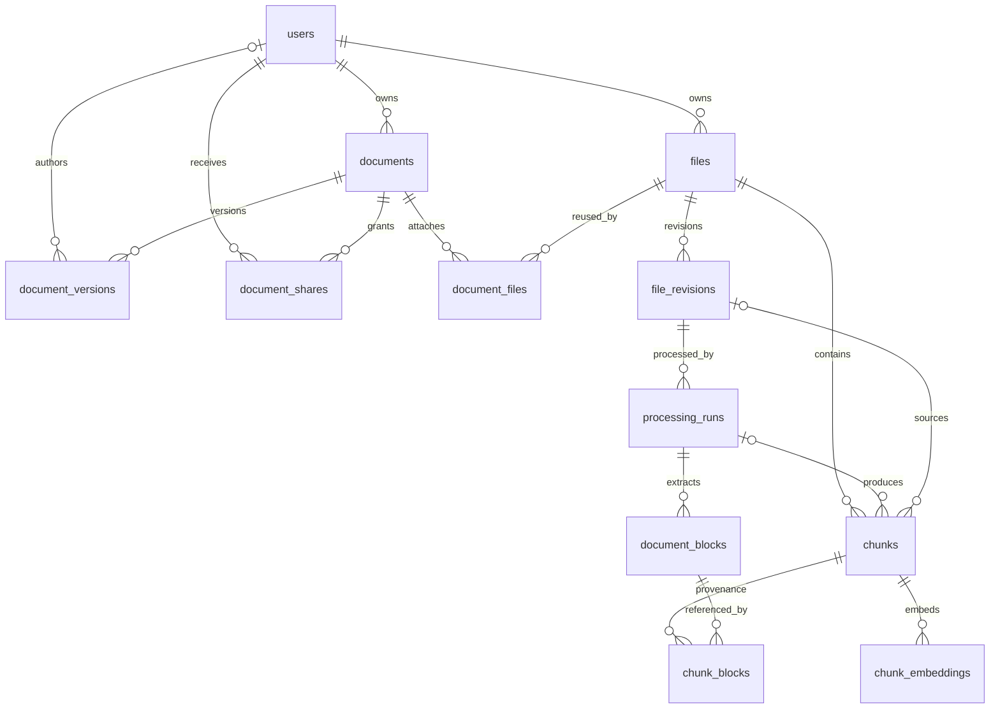

# Database Low-Level Design

Reviewed: 2026-10-08

## Scope and source of truth

This document describes the database defined by the checked-in migrations, cross-checked against Lucid models and the processing, retrieval, and generation code. It is an implementation inventory, not a proposed replacement schema. The deployed database was not queried; migration application in any environment is not verified.

Sources:

- [Migrations](../database/migrations/): physical columns, defaults, constraints, indexes, and deletion rules.
- [Models](../app/models/): ORM relationships and application types.
- [Database configuration](../config/database.ts): PostgreSQL (`pg`), configured through `DB_URL`.
- [Processing service](../app/services/documents/processing_service.ts), [retrieval service](../app/services/documents/retrieval_service.ts), and [generation service](../app/services/documents/document_generation_service.ts): persistence and query behavior.

`database/schema.ts` is generated and currently contains only the seven original tables and their original columns. It omits the five newer RAG tables, added chunk columns, and document generation columns. Consequently, it does not describe the complete migration-defined schema. Some models extend its base classes and explicitly declare additional columns; newer models extend `BaseModel` directly.

## Storage design

The database has 12 application tables. Users own authored documents and uploaded files. Documents have versioned JSON content, sharing permissions, and reusable file attachments. Files have revisions; each revision can have multiple processing runs. Runs produce source blocks, retrieval chunks, provenance links, and embeddings.

File bytes and generated media are held in object storage. The database stores keys, URLs, metadata, extracted text, and vectors. Database cascades do not delete object-storage assets or queue jobs.

Most entities use UUID primary keys with `gen_random_uuid()` defaults. `users` and `document_files` use auto-increment integer keys; `chunk_blocks` uses an auto-increment bigint key. PostgreSQL must support UUID generation and the `vector` extension, which the embedding migration requests.

## Entity relationships

A `document_block` is an extracted block of a source file, not an editor block of an authored `document`. Its association is through a processing run. The `document_files` pivot deliberately uses the physical column name `files_id`; both ORM many-to-many relationships configure that name explicitly.

## Column dictionary

Notation: **NN** means `NOT NULL`; **NULL** means nullable. **PK**, **FK**, and **UQ** denote primary key, foreign key, and unique constraint. Defaults are database defaults. A TypeScript non-null declaration does not strengthen a nullable database column.

### Common columns

All 12 tables have `created_at` and `updated_at`.

| Table group | `created_at` | `updated_at` |
| --- | --- | --- |
| `users` | timestamp, NN, no DB default | timestamp, NULL, no DB default |
| `documents`, `document_versions`, `document_shares`, `files`, `chunks`, `document_files` | timestamp, NULL, no DB default | timestamp, NULL, no DB default |
| `file_revisions`, `processing_runs`, `document_blocks`, `chunk_blocks`, `chunk_embeddings` | timestamptz, NN, default current time | timestamptz, NN, default current time |

Lucid models use automatic creation/update timestamps. Database timestamp defaults do not automatically advance `updated_at` on subsequent raw SQL updates; no update trigger is defined in these migrations.

### `users` — accounts

| Column | Type | Constraints / purpose |
| --- | --- | --- |
| `id` | integer, auto-increment | PK, NN |
| `full_name` | varchar(255) | NULL |
| `email` | varchar(254) | NN, UQ; login identifier |
| `password` | varchar(255) | NN; authentication hash, excluded from model serialization |

### `documents` — authored documents and generation state

| Column | Type | Constraints / purpose |
| --- | --- | --- |
| `id` | uuid | PK, default `gen_random_uuid()` |
| `user_id` | integer | NN, FK → `users.id` |
| `title` | varchar(255) | NULL |
| `description` | text | NULL |
| `status` | enum-style field | NULL; allowed values `pending`, `draft`, `editing`, `approved` |
| `generation_status` | varchar(24) | NN, default `ready` |
| `generation_error` | text | NULL; failure detail |
| `generation_lease_at` | timestamptz | NULL; generation worker heartbeat |

Business status and generation status are separate. Application generation values are `uploaded`, `processing`, `generating`, `ready`, and `failed`; the generation field has no database enum/check restricting these strings.

### `document_versions` — content snapshots

| Column | Type | Constraints / purpose |
| --- | --- | --- |
| `id` | uuid | PK, default `gen_random_uuid()` |
| `document_id` | uuid | NN, FK → `documents.id` |
| `user_id` | integer | NULL, FK → `users.id`; author attribution |
| `version` | integer | NULL, default `0` |
| `content` | jsonb | NULL; editor document content |

UQ (`version`, `document_id`) prevents duplicate non-null version numbers within a document. No JSON shape or positive version constraint is defined. Deleting an author sets attribution to null when the version survives.

### `document_shares` — access grants

| Column | Type | Constraints / purpose |
| --- | --- | --- |
| `id` | uuid | PK, default `gen_random_uuid()` |
| `document_id` | uuid | NN, FK → `documents.id` |
| `user_id` | integer | NN, FK → `users.id`; recipient |
| `role` | enum-style field | NULL; allowed values `view`, `edit` |

UQ (`user_id`, `document_id`) permits one grant per recipient/document pair. Ownership is stored on `documents`, independently of these grants.

### `files` — stored source objects

| Column | Type | Constraints / purpose |
| --- | --- | --- |
| `id` | uuid | PK, default `gen_random_uuid()` |
| `user_id` | integer | NN, FK → `users.id` |
| `filename` | varchar(255) | NULL |
| `filetype` | varchar(255) | NULL |
| `object_key` | varchar(255) | NULL; storage key |
| `object_url` | text | NULL; source/object URL |

### `document_files` — reusable attachments

| Column | Type | Constraints / purpose |
| --- | --- | --- |
| `id` | integer, auto-increment | PK |
| `files_id` | uuid | NN, FK → `files.id` |
| `document_id` | uuid | NN, FK → `documents.id` |

No unique constraint on (`document_id`, `files_id`) is defined, so duplicate attachments are possible at the database level.

### `file_revisions` — source revision metadata

| Column | Type | Constraints / purpose |
| --- | --- | --- |
| `id` | uuid | PK, default `gen_random_uuid()` |
| `file_id` | uuid | NN, FK → `files.id` |
| `revision` | integer | NN, default `1` |
| `source_hash` | varchar(64) | NULL; source hash |
| `source_url` | text | NULL |
| `mime` | varchar(255) | NULL |
| `byte_size` | bigint | NULL |
| `retrieved_at` | timestamp | NULL; source retrieval time |

UQ (`file_id`, `revision`). A revision is distinct from a processing attempt: multiple runs can use the same revision. The processing service fills or updates source metadata during extraction; the schema does not enforce immutability.

### `processing_runs` — pipeline execution records

| Column | Type | Constraints / purpose |
| --- | --- | --- |
| `id` | uuid | PK, default `gen_random_uuid()` |
| `file_revision_id` | uuid | NN, FK → `file_revisions.id` |
| `pipeline_version` | varchar(64) | NN |
| `status` | varchar(24) | NN, default `queued` |
| `stage_timings` | jsonb | NN, default `{}`; stage duration map |
| `warnings` | jsonb | NN, default `[]` |
| `embedding_model` | varchar(255) | NULL |
| `embedding_dimensions` | integer | NULL |
| `error` | text | NULL |
| `started_at`, `lease_at`, `completed_at` | timestamptz | NULL; execution and heartbeat times |

Application statuses are `queued`, `processing`, `ready`, and `failed`; no database enum/check enforces them. JSON types do not enforce object/array shapes. No uniqueness rule prevents concurrent runs for the same revision and pipeline version.

### `document_blocks` — canonical extraction output

| Column | Type | Constraints / purpose |
| --- | --- | --- |
| `id` | uuid | PK, default `gen_random_uuid()` |
| `processing_run_id` | uuid | NN, FK → `processing_runs.id` |
| `block_type` | varchar(32) | NN |
| `text` | text | NN |
| `raw_reference` | text | NULL |
| `order_index` | integer | NN; order within the run |
| `section_path` | jsonb | NN, default `[]`; heading hierarchy |
| `source_locator` | jsonb | NN, default `{}`; source coordinates and media metadata |
| `extraction_method` | varchar(64) | NN |
| `confidence` | real | NULL |

UQ (`processing_run_id`, `order_index`). Application block types are `heading`, `paragraph`, `list_item`, `table_row`, `image`, and `code`. `source_locator` carries `fileKey`, `fileUrl`, `fileName`, and `mediaType`, with optional `pageNumber`, `element`, `headingLevel`, and `lineNumber`. These values and JSON shapes are application contracts rather than database checks.

### `chunks` — retrieval units

| Column | Type | Constraints / purpose |
| --- | --- | --- |
| `id` | uuid | PK, default `gen_random_uuid()` |
| `file_id` | uuid | NN, FK → `files.id` |
| `chunk_index` | integer | NULL; order within processing output |
| `content` | text | NULL |
| `file_key` | text | NULL; source/media key |
| `embedding` | text | NULL; legacy representation |
| `run_id` | uuid | NULL, FK → `processing_runs.id` |
| `file_revision_id` | uuid | NULL, FK → `file_revisions.id` |
| `kind` | varchar(32) | NN, default `text`; application uses `text` or `image` |
| `token_count` | integer | NN, default `0` |
| `content_hash` | varchar(64) | NULL |
| `content_tsv` | tsvector | Stored generated expression: `to_tsvector('english', coalesce(content, ''))` |

Nullable run/revision links permit legacy chunks. The current processor writes both links and stores vector data in `chunk_embeddings`, leaving legacy `embedding` null. There is no uniqueness constraint on (`run_id`, `chunk_index`), and no composite constraint ensuring file, revision, and run refer to the same source.

### `chunk_blocks` — chunk provenance

| Column | Type | Constraints / purpose |
| --- | --- | --- |
| `id` | bigint, auto-increment | PK |
| `chunk_id` | uuid | NN, FK → `chunks.id` |
| `document_block_id` | uuid | NN, FK → `document_blocks.id` |
| `row_start`, `row_end` | integer | NULL; optional row boundaries |
| `char_start`, `char_end` | integer | NULL; optional character boundaries |

UQ (`chunk_id`, `document_block_id`). This bridge allows a chunk to combine multiple blocks and a block to contribute to multiple chunks. The current processor inserts the two foreign keys and leaves ranges null. Range validity and matching processing runs are not database-enforced.

### `chunk_embeddings` — model-specific vectors

| Column | Type | Constraints / purpose |
| --- | --- | --- |
| `id` | uuid | PK, default `gen_random_uuid()` |
| `chunk_id` | uuid | NN, FK → `chunks.id` |
| `model` | varchar(255) | NN |
| `version` | varchar(64) | NN; pipeline/version discriminator |
| `dimensions` | integer | NN |
| `embedding` | vector(1024) | NN; fixed physical dimension |
| `input_hash` | varchar(64) | NN; embedding cache key component |

UQ (`chunk_id`, `model`, `version`, `dimensions`). Multiple model/version records can exist per chunk. The vector column enforces 1024 elements; no check ties `dimensions` to 1024. A different vector size requires a migration, even if application configuration changes.

## Index design

Primary keys and unique constraints create their own backing indexes. Additional indexes explicitly declared by migrations are:

| Table | Index / columns | Intended access pattern |
| --- | --- | --- |
| `file_revisions` | (`file_id`, `created_at`) | Revisions by file and creation time |
| `processing_runs` | (`file_revision_id`, `created_at`) | Latest run for a revision |
| `processing_runs` | (`status`, `updated_at`) | Status/time scans |
| `document_blocks` | (`processing_run_id`, `order_index`) | Ordered extraction blocks; duplicates the unique constraint's column order |
| `chunk_blocks` | (`document_block_id`, `chunk_id`) | Reverse provenance lookup |
| `chunk_embeddings` | (`model`, `version`, `dimensions`, `input_hash`) | Compatible cached embeddings |
| `chunk_embeddings` | `chunk_embeddings_hnsw`, HNSW (`embedding vector_cosine_ops`) | Approximate cosine similarity |
| `chunks` | `chunks_content_tsv_gin`, GIN (`content_tsv`) | English full-text matching |
| `chunks` | `chunks_run_index`, (`run_id`, `chunk_index`) WHERE `run_id IS NOT NULL` | Ordered run chunks and run-scoped deletion |

PostgreSQL does not automatically index referencing foreign-key columns. The migrations define no additional indexes for owner document/file lists or either `document_files` foreign key. The revision unique index (`file_id`, `revision`) supports revision-number lookups separately from its creation-time index.

Although HNSW exists, the current retrieval transaction sets `enable_indexscan = off` to keep dense retrieval exact until scoped recall is evaluated. Index existence alone does not imply current HNSW use.

## Persistence and retrieval flows

### Document creation and processing dispatch

1. The generation service creates a document with business status `pending` and generation status `uploaded` inside a transaction.
2. It attaches selected files through `document_files`, resolves each file's highest-numbered revision, and selects the newest processing run. Missing revisions/runs are created as needed.
3. The transaction commits before queue dispatch. Dispatch failures are recorded on the document; queue delivery and database commit are separate operations.
4. File workers process runs and dispatch generation when the required processing is ready. Leases/heartbeats and conditional updates support job claiming and retry handling.

### File extraction and indexing

1. The processor resolves the run, revision, and file, then extracts canonical source blocks and prepares text/image chunks.
2. An extraction transaction persists blocks, revision metadata, the source URL, and extraction timing. Persisted blocks can be reused during a retry.
3. Embeddings are reused by (`model`, `version`, `dimensions`, `input_hash`), or requested externally for missing inputs.
4. A second transaction deletes the run's existing chunks, cascading their provenance and embeddings, inserts replacement chunks and links, inserts vectors, and marks the run `ready` with completion/timing metadata.
5. Errors are recorded; job failure handling can mark the run and dependent documents `failed`. External extraction/storage/provider operations are outside database atomicity.

### Hybrid retrieval

1. Scope source rows to selected file IDs and file owner. Only `ready` runs with the configured pipeline version are eligible.
2. Rank up to 40 dense candidates using cosine distance (`<=>`) with matching embedding model/version/dimensions.
3. Rank up to 40 lexical candidates using English `plainto_tsquery` and `ts_rank_cd` on the generated search column.
4. Combine ranks using reciprocal rank fusion with constant 60, then join provenance blocks for citation/media metadata.
5. Supplement image candidates, resolve storage URLs, and select context within the token budget (default 10,000), maximum 20 chunks and four images.

There is no explicit latest-revision/latest-run filter in retrieval. Multiple eligible ready runs or revisions can contribute results. Legacy chunks without the run/revision/provenance links are excluded by the current inner joins.

### Generated document versions

The generation job conditionally claims a document, moves it to `generating`, and refreshes its lease. After generation, a transaction reads the latest version, inserts the next content snapshot, and updates the document to business status `draft` and generation status `ready`. The unique version constraint is a final collision guard; reading the latest version inside a transaction alone does not serialize all possible concurrent version writers.

## Referential integrity and deletion

All foreign keys use `ON DELETE CASCADE` except `document_versions.user_id`, which uses `ON DELETE SET NULL`.

| Deleted entity | Database consequence |
| --- | --- |
| User | Deletes owned documents/files and recipient shares; surviving version authorship becomes null |
| Document | Deletes versions, shares, and attachment rows; files remain |
| File | Deletes attachment rows, revisions, and chunks; downstream runs, blocks, provenance, and vectors cascade |
| File revision | Deletes its processing runs and directly linked chunks |
| Processing run | Deletes extracted blocks and linked chunks |
| Source block | Deletes its provenance links; chunks themselves remain |
| Chunk | Deletes its provenance links and embeddings |

Deleting an attachment row does not delete its document, file, or processing history. Sharing a document does not alter file ownership. Policies enforce authorization in application code: document owners and recipients can open a shared document; owner or `edit` grants permit updates; only owners can delete documents or update/delete files. Retrieval also applies owner filters. The checked-in migrations do not define PostgreSQL row-level-security policies.

## Integrity gaps and design considerations

These observations describe limits of the current schema; no schema changes are included in this document.

- **Generated schema drift:** regenerate `database/schema.ts` against a database with all migrations applied before relying on it as a complete schema reference.
- **Attachment duplication:** consider a unique (`document_id`, `files_id`) constraint if attachments should be a set.
- **Nullable legacy fields:** title, role, version, content, chunk order, and original timestamps accept null even where models or normal flows assume values. PostgreSQL's default unique-null behavior allows multiple null version numbers for a document.
- **Application-only invariants:** status strings, block/chunk kinds, JSON shapes, positive sizes/counts, confidence bounds, and provenance range ordering lack explicit checks.
- **Source consistency:** independently valid chunk file/revision/run foreign keys can point at different sources. Provenance links can also cross runs unless application code prevents it.
- **Concurrency:** revision numbering, version numbering, and reusable run selection need coordinated writes or uniqueness/conflict handling. There is no database uniqueness rule limiting active processing runs.
- **Vector compatibility:** physical vectors are fixed to 1024 dimensions; the metadata field and configuration must agree with that storage type.
- **Revision selection:** retrieval can mix historical ready runs. A latest-ready selection rule or explicit active-run reference would be needed if only one source snapshot should be searchable.
- **Query scaling:** assess owner-list, attachment, and cascade access patterns before adding foreign-key/composite indexes; remove redundant block indexing only after inspecting the actual database indexes.
- **Storage lifecycle:** cascading metadata deletion cannot clean source objects or extracted media. Asset cleanup and queue retry behavior require application coordination.

## Verification

The column dictionary, relationship diagram, explicit indexes, and cascade rules were checked against all 14 migration files and the 11 Lucid models. Application behavior was checked against processing/retrieval/generation services, worker jobs, and document/file policies. This review did not execute migrations or modify database/application code.
