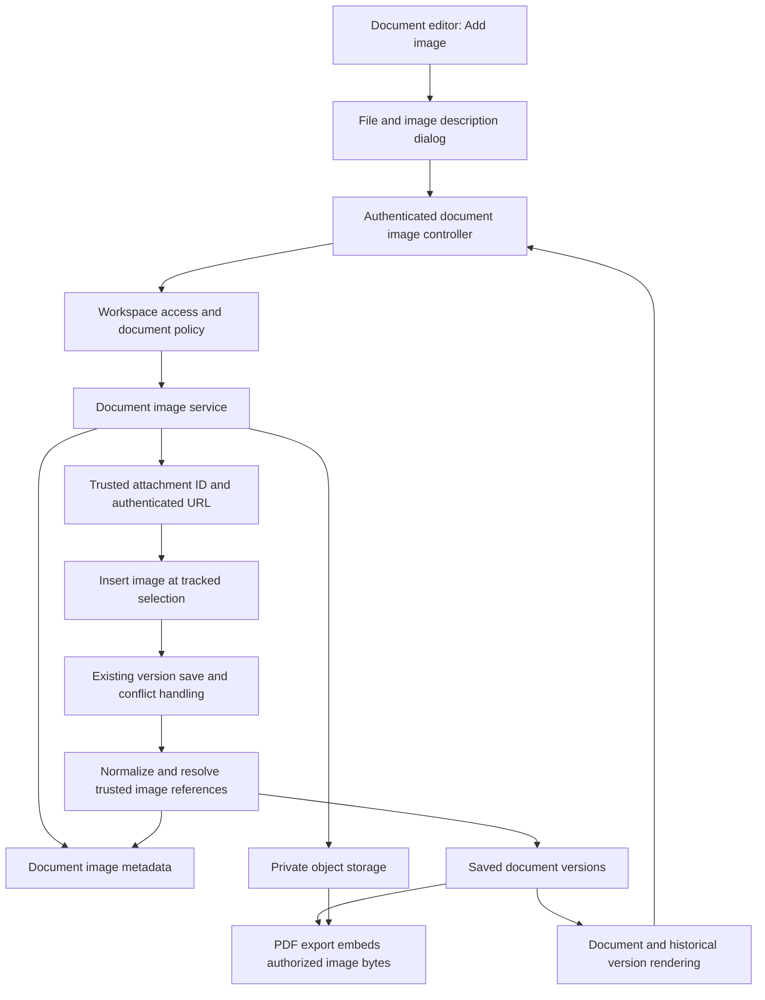

# Document image uploads: architecture

Date: 2026-10-24. Status: approved and implemented using the configured S3 bucket.

The dialog owns transient file/error/progress state; editor selection tracking
belongs to the toolbar integration. Durable attachment identity belongs to the
database; alt text and layout belong to versioned TipTap content. Object keys
remain server-only. A removed node does not delete bytes used by older versions.

The image service provides upload, scoped metadata resolution and private stream
access, without HttpContext. Existing evidence hydration delegates attachment
resolution while preserving source chunk authorization. Resolve referenced IDs in
batches and validate them against both workspace and document. Keep generation's
source-chunk schema separate from editor-created attachment references.

Upload succeeds only after metadata and bytes exist. If metadata creation fails,
remove the just-written object. If upload fails, keep the dialog draft and do not
insert a broken node. If version save fails, retain the local node and the existing
save recovery behavior. If generation starts during upload, retain the receipt and
require an explicit insert once editable. Objects remain private after membership
revocation because every stream request rechecks access.

Rollback: remove the toolbar entry to disable new uploads; keep schema, authorized
reads and resolution available for saved versions. Reverting the database table
while versions reference attachments would break their images and is not safe.
