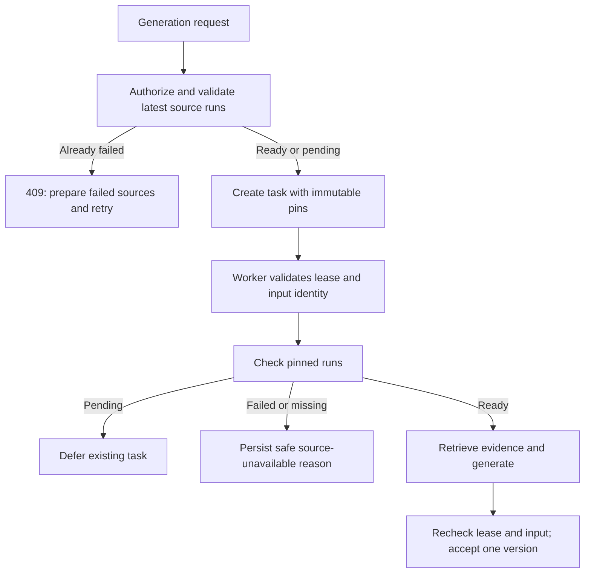

# Document generation 409 fix plan

Status: approved and implemented on 2026-10-20; local verification passed. Evidence: [research](generation-409-research.md). DOCX extraction and reprocessing are complete and were left intact. Runtime generation and original-repository Git integration remain unverified/blocked as detailed below.

## Decisions

- Treat DOCX extraction as complete; make no extraction or ingestion changes.
- Immediate recovery is a fresh generation task using the latest ready source. Historical task pins stay immutable; no code change is required to issue this request.
- Retain existing job exception logging and the general `errorStatus` label.
- Detect already-failed sources before queue acceptance; keep execution checks for races.
- Separate local failure reasons from HTTP status. Preserve actionable, explicitly selected safe messages.
- Retain membership, lease, input/version, and evidence checks. No frontend, migration, or new dependency is proposed.

## Current-state audit

| Recommendation | Status | Evidence / action |
| --- | --- | --- |
| DOCX extraction and source preparation | Complete; out of scope | New source run `392aeb91-dd8e-4c8b-bf35-afb78b1997a1` is `ready`, verified in the configured development database |
| Fresh generation against ready source | Recovery step | Historical task `a856a209-f0de-45d3-b1aa-0d1fc2197afe` remains terminal and pins the older failed run |
| Original exception and general status in logs | Already present in working tree | `app/jobs/generate_document.ts:22`; preserve |
| Failed-source request preflight | Proposed | `app/services/documents/generation_service.ts:59`; latest run query does not select/check status |
| Actionable asynchronous failure | Proposed | `app/jobs/generate_document.ts:30`, `app/services/documents/generation_service.ts:218`, `app/services/workspaces/task_service.ts:210` |
| Automatic revival / switching historical pins | Rejected | Terminal task/run identities must remain historical |
| Provider or model change | Deferred | No evidence that it caused this incident |

## Defects to fix first

- **D1 — Generation accepts already-failed evidence.** Select the latest run's status in the existing scoped query and reject `failed` before `TaskService.create`, workflow invalidation, or document generation-state writes. Preserve queued/processing acceptance and deferred execution. Do not fall back to an older ready run.
- **D2 — Status alone determines failure meaning.** Replace `status === 409` stale classification with explicit local reasons for changed inputs, unavailable sources, and lost lease. Carry a typed internal reason on relevant exceptions, keeping shared workspace exceptions compatible. Only exceptions explicitly tagged by local guards receive those meanings. A provider status alone must not produce an input-conflict error.
- **D3 — Failure persistence discards the useful safe reason.** Allow the caller's deliberately chosen safe message to survive conflict persistence; retain the existing default for other callers. Map typed reasons to fixed public strings, never arbitrary exception messages. Logs retain the original exception and task/document/run identifiers without prompts, credentials, or source text.

The old terminal generation task is expected historical state, not a fourth defect. Do not auto-revive it, replace its pins, or automatically accept new output after source preparation.

## Target architecture



The existing route/controller/service/task layers remain. Classification stays in services and job handling; persistence stays in `TaskService`. No new architecture layer is required.

## Data model and API behavior

No columns or migrations. Existing `workspace_tasks.safe_error`, task status, and document generation error fields carry the result. Keep asynchronous unavailable-source tasks terminal under the existing `conflict` state, with an accurate safe error. Preserve existing defaults for render/ingestion callers of `TaskService.fail`.

`POST /workspaces/:workspaceId/documents/:documentId/generation` keeps its request fields and 202 task envelope for eligible sources. Already-failed sources now receive the existing JSON 409 error envelope, or the existing Inertia flash/redirect behavior, before a new task is created. Keep mutation replay handling ahead of preflight so reusing an accepted mutation ID returns its original task. Immediate recovery uses a fresh generation mutation ID and the current base version ID. The previously reported document currently has a null base version; read it again before submission. No source retry is needed while its latest run is ready.

## Phases and acceptance

### Recovery — Fresh generation using the completed source preparation

This can run independently of the code phases through the existing authorized generation action. Read the document's current base version and latest source run, then submit generation with a fresh mutation ID. Confirm the new task pins ready run `392aeb91-dd8e-4c8b-bf35-afb78b1997a1` or a newer eligible run. Do not resubmit the old task or retry source preparation while it is ready.

Acceptance: a new task succeeds, one version becomes current, and original failed/conflict records stay unchanged. This is a proposed runtime check involving provider use, not an action performed during this planning turn. If a new failure occurs, diagnose its captured stage and exception.

### Phase 1 — Reject known failures at request time (D1)

Implement in a dedicated worktree that includes the relevant existing changes without reverting them. Limit code changes to generation failure handling and its shared task error support; exclude DOCX extraction and ingestion.

Extend the latest-run query with status and reject failed sources with an actionable fixed message. Preserve existing idempotency ordering, source selection rules, transaction rollback, and pending-source behavior. Extend the existing document-generation functional suite.

Acceptance: failed latest run returns JSON 409 and Inertia flash/redirect as applicable, creates no new task/dispatch, and changes no document workflow state. A queued/processing source still creates a task that defers. A newer failed run must not cause fallback to older evidence. An existing mutation replay still returns its original task.

### Phase 2 — Preserve failure identity and safe messages (D2–D3)

Tag the relevant local guards and map them in generation failure handling. Public messages: changed inputs → `Inputs changed. Start a new request.`; unavailable source → `A selected source could not be prepared. Retry source preparation, then generate again.`; lost lease → `This task no longer owns its execution lease. Start a new request.` The lease message is shared with other task kinds. Keep task-token fencing: failure from an old lease must not overwrite a new worker's state.

Acceptance: a run failing after acceptance produces an actionable source error and no document version; genuine changed inputs still conflict; expired/replaced leases cannot publish or overwrite another execution. A provider exception carrying 409 never becomes a changed-input conflict solely because of its number. Existing auth, transient-provider, maximum-attempt, and render-task behavior remains covered.

### Phase 3 — Verify generation behavior (D1–D3)

Run the generation and shared-task suites with controlled adapters. Include an old failed pin followed by a newer ready run: a fresh generation request must choose the newer run while the old mutation replays its original task. Verify failure after acceptance, pending-source deferral, changed input, and lease replacement. Validate the provider error path against the checked-in simulation when transport testing is available.

Acceptance: D1–D3 tests pass, idempotency and task fencing remain intact, and provider 409 is never presented as changed input solely because of its status. If a runtime generation check is also performed after loading these changes, report it separately from local/mock checks. No parser reproduction or extraction rework is required.

## Verification

Run against the separate migrated `capstone_tenancy_test` database; the functional fixtures truncate their data. Use controlled provider adapters for local workflow assertions. If exercising real HTTP clients, follow the checked-in Postman simulation instead of using live credentials:

```bash
QUEUE_DRIVER=sync PORT=3345 node ace test unit functional
node ace codegen
npm run typecheck
npm run lint
git diff --check
```

The existing `postman/README.md` documents simulation startup and the opt-in transport test. Add a synthetic provider-409 case to that simulation when verifying transport classification. Its prior startup was blocked by access to `~/.postman/`; report any current limitation rather than treating skipped transport tests as passing. No API client was invoked during planning, so no simulation was needed for this investigation.

## Risks and open questions

- Request preflight can race with later processing failure: retain the worker check and test both paths.
- Shared `TaskService.fail` affects other tasks: preserve defaults and verify existing task suites.
- Input and lease checks are correctness boundaries: improve reporting without bypassing them.
- The current ready run establishes completed preparation. It does not establish successful retrieval, provider generation, or version publication; verify those through fresh generation.
- Git metadata and `.agents` are read-only in this session. Documents are saved under `docs/`; implementation and integration limitations are recorded below.

## Implementation results

- D1–D3 are implemented. `TaskConflictException` identifies fixed local reasons without inferring them from HTTP status or a provider-supplied error code. Shared task failure persistence retains caller-selected safe messages and preserves its previous default for existing callers.
- Generation preflight rejects failed latest runs before task creation and workflow mutation. Pending runs still defer, and mutation replay remains ahead of preflight. Existing membership, immutable pin, version, and lease guards are retained.
- Generation logs retain the original exception, general error status, document ID, task ID, and pinned source-run IDs. No extraction, ingestion, frontend, schema, or dependency changes were introduced by this fix.
- The preflight regression tests failed before implementation (202 instead of the expected 409, and missing Inertia error flash); all four phase-1 tests passed afterward. The final new suite contains 13 passing tests covering preflight, deferred sources, failures after acceptance, newer ready runs, replay, changed inputs before/during generation, provider 409 bounded retries, expired/replaced leases, and the shared default message.
- `QUEUE_DRIVER=sync PORT=3345 node ace test unit functional`: **94 passed, 2 skipped**. The existing opt-in provider transport and local SMTP checks were skipped. Tests used the separate configured `capstone_tenancy_test` database.
- `npm run typecheck`, `npm run lint`, and `git diff --check` passed. `node ace codegen` generated seven files and reported success but did not exit; it was interrupted after success. The test runner independently generated its indexes and exited successfully.
- Postman CLI 1.73.0 simulation startup failed because it cannot access local dataset files under `~/.postman/`. Actual HTTP transport to the simulation remains unverified. Provider-error workflow checks used controlled adapters; no real provider request was made.
- The managed worktree was created successfully, but filesystem policy denied writing into its directory. Implementation instead used branch `codex/generation-409-fix` in an isolated worktree under `/private/tmp/capstone-generation-409-fpy3_we1/`, based on original `main` at `1aaa1c7b2036addca2da9308ffe36e2f87f6acd4`, with existing changes carried forward for testing.
- Original `main` is checked out in `/Users/johnpaul/projects/capstone_demo`. A Git write probe there failed with `Operation not permitted: .git/index.lock`. Verified fix files can be applied to its working tree, but this session cannot commit or merge in that repository. The isolated branch's fix commit excludes the existing DOCX/ingestion edits.
- The existing application document and task records were not changed. The source already has a ready run; immediate recovery remains a fresh generation request with a new mutation ID. Successful live document generation has not been claimed.

## Completing integration on main

All eight fix files were applied to the original `main` working tree and checked byte-for-byte against the isolated branch. Existing DOCX and ingestion changes remain untouched. Importing the isolated branch was then attempted and rejected with `cannot open '.git/FETCH_HEAD': Operation not permitted`; a merge in the original repository was not possible.

The following commands finalize the already-applied fix directly on `main` from a terminal with Git write access. They stage only this fix's files and stop if another staged change exists. The isolated branch remains available in `/private/tmp/capstone-generation-409-fpy3_we1/repository` for inspection.

```bash
cd /Users/johnpaul/projects/capstone_demo
if [ "$(git symbolic-ref --short HEAD)" = main ] && git diff --cached --quiet; then
  git add -- app/exceptions/task_conflict_exception.ts \
    app/jobs/generate_document.ts \
    app/services/documents/generation_service.ts \
    app/services/workspaces/task_service.ts \
    tests/functional/generation_conflicts.spec.ts \
    docs/generation-409-research.md \
    docs/generation-409-implementation-plan.md \
    docs/workspace-tenancy-implementation-plan.md &&
  git commit -m 'Fix document generation conflict classification and source checks'
fi
```
