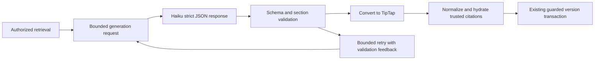

# Haiku generation reliability implementation plan

Status: Phase 0 implemented after user approval. Phase 1 remains proposed.
Research: [audit](haiku-generation-research.md).

## Applied repair and verification

- Paragraph, heading and code-block text is converted into editable text nodes;
  inline citations and existing children are preserved.
- Outline output must contain every section once and readable prose per section.
  Freeform output must contain readable body prose. Invalid output is retried with
  format feedback, within one three-call budget shared with network retries.
- Revision uses the same retry budget. The guarded generation transaction rejects
  empty output after live input checks; exhausted unusable output fails safely
  without replacing the prior draft or automatically repeating another task budget.
- `documents:recover-prose` restores an explicitly selected malformed historical
  version through the authorized, optimistic-concurrency-checked VersionService.
  It defaults to dry run and refuses a changed base or a current draft with prose.
- Restored the reported document from version 4 into new version 6,
  `1c4fbfa8-ed48-445e-8952-96427cb4e10c`; historical versions remain unchanged.
  Read-only verification: ready, 4,825 renderable body characters, 17 citations,
  no misplaced text, valid TipTap/ProseMirror schema. A repeated recovery was refused.

Verification in the isolated worktree: unit/API suite 231 passed, 3 skipped.
Integrated checkout: unit suite 159 passed; API suite 110 passed, 3 skipped;
the final generation-conflict suite passed 18 tests including the additional
existing-draft preservation regression. Typecheck, lint on changed files and
diff whitespace checks passed. The API suite used port 3357 because 3344 was occupied.
Full lint encounters existing formatting errors in `database/schema.ts` and
`app/models/document.ts`. Browser setup fails in the host Chromium environment;
connected browser access also requires unavailable tool approval. No new paid
provider generation call was made.

Development occurred in `/private/tmp/capstone-generation-prose`; the scoped patch
was applied to the active checkout, preserving its ongoing publication work.
The environment rejected Git staging/commit at the worktree `index.lock`, so the
applied changes remain uncommitted. No strict-provider schema rewrite or embedding
change was included in this repair.

## Decisions and current state

Adopt bounded validation retries and a strict nonrecursive model contract (D1–D5).
Keep generation on Haiku 5.5 and embeddings on the current Perplexity model.
Reject strict mode on the existing recursive schema (D2). Defer embedding/provider
changes: no evidence connects them to this parser failure. Add diagnostic metadata
without logging source contents or credentials (D6).

## Target architecture



Keep provider I/O in `OpenRouterService`. Put the pure generation schema/conversion
in a documents service generated with `node ace make:service documents/generation_output`.
Keep saved TipTap content, current authorization, source pins, transaction guards,
mutation replay and immutable terminal tasks. No database migration, new package,
controller, route or UI component is proposed.

## Phase 0: bounded recovery

Ownership: `app/services/open_router_service.ts`,
`app/services/documents/content_service.ts`, `config/open_router.ts` and existing
unit tests for those services.

- Retry only known unusable structured output with concise validation-path feedback;
  preserve original authorized messages and call the task guard before every attempt.
- Keep a single three-call budget for parser/network errors, at most two timeout
  calls, and remove the revision-specific loop that would multiply attempts.
- Keep authentication, billing, unsupported schema and other client failures terminal.
- Validate duplicate, unknown and missing section keys within the retry boundary;
  unsupported facts still receive explicit unavailable-information content.
- Repair unambiguous paragraph/heading text into inline text nodes without losing
  existing children; do not fabricate section membership for malformed entries.
- Test the exact reported malformed section, malformed-then-valid recovery,
  repeated failures, cancellation/guard rejection, timeout limits and revision budgets.
- Check existing elapsed task/deadline limits before adding any retry cost.

Acceptance: those regression cases pass; invalid output never silently publishes
an empty draft or overwrites an existing version.

## Phase 1: strict provider contract

Ownership: generation-output service, `OpenRouterService`, `config/open_router.ts`,
`start/env.ts`, `.env.example`, generated service tests and existing outline tests.

- Define finite block structures for paragraphs, headings, lists, quotations,
  code, separators, citations and authorized image chunk references. Use closed
  objects and a bounded schema without recursive references or arbitrary records.
  Apply content-size and exact section-set rules locally rather than sending
  unsupported numerical/array constraints to Claude.
- Deterministically map blocks into the existing TipTap shape, preserving supported
  inline styling and ordered citation placement. Do not request source URLs.
- Apply compatible contracts to outline, freeform, title and revision output;
  preserve narrow revision behavior and unchanged blocks.
- Use `method:'jsonSchema'`, `strict:true`, and
  `provider:{require_parameters:true}` after checking the installed adapter's
  model profile and live endpoint compatibility. Do not silently fall back to
  unconstrained JSON or another model.
- Retain raw response metadata internally to distinguish refusal, token exhaustion
  and malformed results; configure an explicit output cap sized to current task
  deadlines. Avoid unsupported sampling parameters.
- Test serialized requests through the real adapter with mocked fetch, including
  schema restrictions, finish reasons, unknown citations and all supported blocks.

Acceptance: no recursive provider schema; captured requests require formatting
support; valid output becomes editable TipTap content; bad content cannot publish.

## Verification and acceptance

Implement after plan agreement in a dedicated worktree. Account for current
uncommitted changes; do not revert or copy unrelated work. This session's `.git`
and `.agents` paths are read-only, so Git worktree creation/integration requires
an environment with the necessary access; documentation is reviewable in `docs/`.

```bash
node ace test unit --files=tests/unit/open_router_service.spec.ts
node ace codegen
npm run typecheck
npm run lint
npm test
git diff --check
```

Also run the new service/content regression tests using their generated paths.
Before using uploaded material, perform a tiny synthetic live strict-schema probe
and record actual model, provider, finish reason and usage. Then exercise a fresh
authorized generation request with a ready pinned source and a fresh mutation ID;
verify the saved version, browser rendering/editability, citation access and image
hydration. Do not alter historical failed tasks. Verify that exhaustion leaves
the previous version usable and shows a recoverable error. Local tests do not
constitute live-provider or browser acceptance.

Risks: additional attempts consume time/tokens; strict-schema complexity may exceed
provider limits; provider metadata conflicts with Claude documentation; a finite
contract may accidentally drop supported editor formatting. Mitigate with one
retry budget, small schemas, actual wire tests and conversion fixtures.
