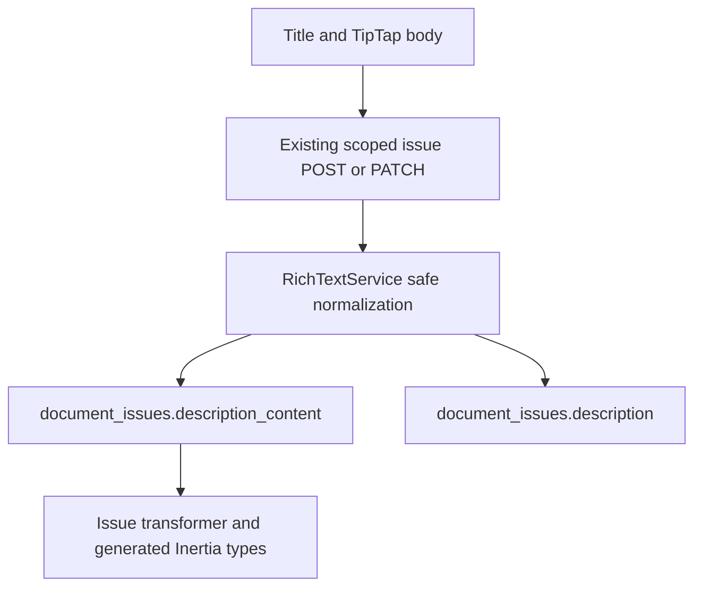

# Document-style issue and information editors

## Decisions and current-state audit

User-requested refinement: remove the Writing direction control, widen project
information, give issues a title and one free-form TipTap body, and use rounded
corners like the supplied Linear reference. Reuse the installed TipTap editor and
shadcn dialog. Keep HumbleBee tokens and both themes.

- D1: Writing direction duplicates the information document. Remove its UI; retain
  the existing generation brief when metadata is saved so this visual change does
  not erase previously supplied content.
- D2: Issue descriptions are plain text. Add nullable JSONB `description_content`,
  normalize rich input using RichTextService (10,000 plain characters), derive the
  existing description, and include rich content in transformer responses.
- D3: Issues use a small input/textarea dialog. Replace with a large document-title
  input, one borderless rich body, compact blocking option, and save footer. Track
  formatting-only changes for unsaved-change protection.
- D4: Dialog surfaces have no radius. Add rounded corners and borders to the shared
  shadcn dialog; widen information/issues to `max-w-4xl` with responsive padding.

## Contract, architecture and implementation order

Existing scoped issue POST/PATCH endpoints accept optional nullable
`descriptionContent`. Non-null rich input is authoritative; safe normalization
rejects evidence nodes and unsafe links with 422. Store both JSON and derived plain
description. State-only writes preserve both; unchanged legacy plain descriptions
preserve rich JSON, changed legacy plain descriptions clear it. Explicit null rich
content clears formatting and retains the supplied/current plain body. Existing
membership, revision-conflict, blocking-review and actor-timestamp rules remain.

1. Ace scaffold additive migration and functional tests. Implement persistence and
   transformer contract; verify rich round trips and state-only preservation.
2. Remove Writing direction, widen dialogs, and add rounded geometry. Replace issue
   textarea with existing rich editor, prominent title and responsive footer.
3. Apply migration to the isolated test database; run regression tests, typecheck,
   lint, and build. Apply the additive migration to the separate local development
   database after tests pass. Regenerate schema/types and format generated schema.

## Risks and verification

Legacy issue bodies load as paragraphs without rewriting existing rows. No new
packages or operational inputs. Dropping the added column loses formatting, while
derived plain bodies survive. No production databases or storage are involved.

Verify POST/PATCH rich persistence, transformer output, safe input rejection,
formatting changes, plain compatibility, state-only resolve/reopen, stale revision,
and cross-workspace rejection with local functional HTTP tests. Run `npm test`,
`npm run typecheck`, `npm run lint`, `npm run build`, and `git diff --check`.
Browser access was previously denied: visual/keyboard checks remain unverified.

## Verification results

The additive migration was applied to the separate local development and test
databases. Schema classes and transformer types were regenerated. All 78 tests
pass, with two optional checks skipped. The new HTTP regressions verify formatted
issue creation/editing, transformer output, resolve/reopen preservation, legacy
plain-text behavior, conflict/isolation handling, and invalid-content rejection.
Typecheck, lint, production build, and `git diff --check` pass. Browser appearance and keyboard interaction remain
unverified.
