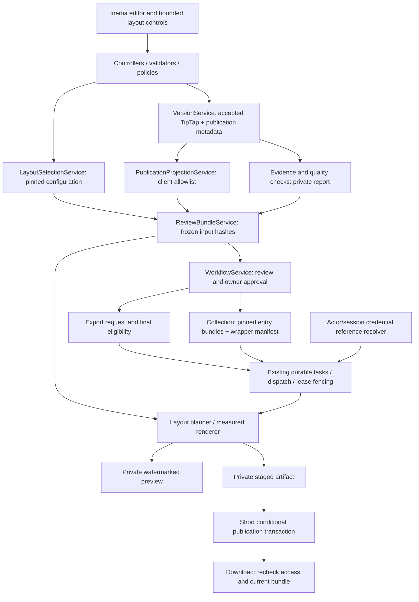

# Next-stage output architecture

> **Closing-state update:** [Implementation overlap at handoff](handoff-snapshot.md) records code and migrations that appeared concurrently. Reuse those files; the opening audit and future scaffold lists are not instructions to recreate them.

14 November 2026 · Proposed implementation; scope in [index](implementation-plan.md), schema in [data-model](data-model.md).

## Boundaries and data flow

`shared/publication/*`, `shared/layout/*`, `shared/ops/*` contain browser-safe types and deterministic logic. No database, filesystem, provider client or credentials enter shared modules. Server services resolve evidence/assets, compute trusted input hashes, persist state and enforce authority. UI never supplies trusted authorship, source excerpts, approval hashes or arbitrary asset URLs.

## Interface ownership

| Interface                 | Owner                                                 | Contract                                                                                                                                                                                                                                                                         |
| ------------------------- | ----------------------------------------------------- | -------------------------------------------------------------------------------------------------------------------------------------------------------------------------------------------------------------------------------------------------------------------------------- |
| Accepted content mutation | Existing VersionService                               | `{baseVersionId,mutationId,content}`; replay hash and no-op semantics retained; server-derived authorship. Extend a transaction-aware internal acceptance method for candidates, rather than nesting an independent commit.                                                      |
| Layout selection          | New `app/services/layout/layout_selection_service.ts` | `resolve/save/applyPreset`; exact test-facing methods in plan 02; independently revisioned, invalidation in same transaction.                                                                                                                                                    |
| Client projection         | Existing PublicationProjectionService                 | Exact content version in; allowlisted ClientRenderData plus separate private mapping/findings out. LayoutPlan contains no private mapping.                                                                                                                                       |
| Layout measurement        | New render adapter                                    | LayoutPlan plus resolved brand/fonts/assets in; measured block/page geometry and PDF bytes out. Heuristic estimate and actual inspection have distinct labels.                                                                                                                   |
| Review bundle             | New `app/services/documents/review_bundle_service.ts` | Build from server inputs; canonical hash; immutable payload. Pin source manifests, public projection, brand/template definition hashes, asset checksum/derivative config, render settings/version and validation state. Exclude keys and reviewer-note text from public payload. |
| Review/approval           | Existing WorkflowService + ReadinessService           | Compare captured base/review/bundle, owner capability and current policy; write approval + event atomically.                                                                                                                                                                     |
| Task progress             | Existing TaskService                                  | Preserve `/workspaces/:workspaceId/tasks/:taskId`, add allowlisted stage/timings/errors/counters; resource authorization as well as membership.                                                                                                                                  |
| Collection                | New `app/services/layout/collection_service.ts`       | Immutable revision manifest, optimistic `baseHash`, ordered pins and wrapper; entry owners keep approval authority.                                                                                                                                                              |
| Credentials               | New server provider credential service                | Opaque actor/session reference only in task; resolver enforces owner, live session, provider allowlist, expiry/revocation.                                                                                                                                                       |

## Transaction and failure rules

Keep the existing workspace/access/document locking convention. For multi-document operations: workspace -> authorization membership -> collection -> documents ordered by UUID -> task/bundle rows. Audit each combined code path for a consistent order before enabling; no browser/provider/storage I/O while these locks are held.

Export: capture exact reviewed bundle and task intent in a short transaction, render outside it, upload to an immutable attempt-specific private key, then lock/recheck lease, access, approval and full bundle and atomically publish the artifact pointer/outcome. A late worker cannot overwrite an accepted key. Failed publication leaves no downloadable pointer; a bounded orphan cleanup removes staged bytes. Download looks up the authoritative accepted record and rechecks resource permissions and policy. Storage reads may occur after validating a captured immutable pointer; never return a public permanent URL.

Validation: preserve editable drafts when evaluation fails, but persist `pending/complete/incomplete/failed` for the captured version. A later report updates eligibility only if its hashes still match. `supported` is a model judgment against supplied evidence, never an approval. Generation success must not imply all claims were evaluated.

Candidate: generate outside transactions against a saved base; candidate payload immutable, decision state conditional pending->accepted/rejected. Confirm invokes transaction-aware version acceptance and records candidate outcome/event together. Changed base returns 409 and preserves candidate/local content.

Collection: compose frozen entry snapshots; bounded contents-pagination passes determine offsets. Preview may proceed with incomplete approvals and clear draft labels. Final publication/download checks each dependency against the accepted D-COLLECTION policy and current access; wrapper approval cannot grant entry/source access.

## State and rollout

Accepted versions, bundle snapshots, manifests and artifacts are durable. Preview UI state and local unsaved recovery are separate. Reuse DB stage/checkpoint/telemetry fields and dispatch intent. Transport may redeliver; task lease and conditional accepted outcome remain authoritative. Cumulative budgets survive retry, worker restart and credential replacement.

Flags: reuse `PUBLICATION_LAYOUT=pilot` for pilot; proposed `PUBLICATION_LAYOUT_ENABLED`, `PUBLICATION_COLLECTIONS_ENABLED`, `PUBLICATION_CANDIDATES_ENABLED`, `PUBLICATION_BYOK_ENABLED` must be registered in `start/env.ts`/config before use. Do not add overlapping switches without migrating the pilot switch explicitly. Flags select entry points, not weakened authorization. Unconfirmed brand or policy-dependent operations stay private until decisions are recorded.

Rollback disables new creation/selection while preserving accepted snapshots, old renderer assets and downloads eligible under current policy. Additive migrations stay installed; never roll back into a version that cannot interpret newly accepted bundles. No rewriting historical approvals to fabricate complete bundle hashes.
