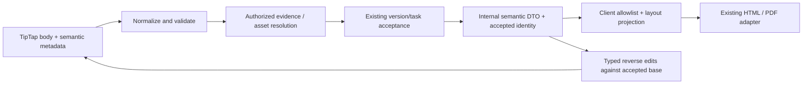

# OUT-02 — Define the first publication-content contract

12 November 2026 · P0 · 3 points · Leads: Abu + John · Dependency: OUT-01 **implemented**.

**Proposed implementation; no application/schema changes applied in this planning turn.** [Research](out-02-publication-content-research.md) documents the existing path and defects D1–D6. Build on the current pilot, existing save/evidence services and TipTap. Keep company guides read-only; this work defines content meaning, not a template designer.

## Decisions and delivery boundary

1. `document_versions.content` remains the only editable document. Semantic annotations live under `content.attrs.publication`, with stable block IDs in that same TipTap tree.
2. Introduce publication schema v1 in a new namespace. Do not change the meaning of historical `shared/templates/content.ts` v1 or database `content_schema_version=1`.
3. Internal semantic DTOs resolve text and assets from the accepted document. The pilot's client DTO is a downstream allowlisted view; it cannot round-trip by itself.
4. Enable only `case_study`. Reserve `product`, `research`, `news`; requests to enable them return a field error until their implementations exist.
5. No PostgreSQL migration or new table is needed for this slice. Deliver one reversible legacy mapping fixture and a dry-run-first, single-document migration command.
6. No new provider, package or factual-approval policy. OUT-05 owns evaluation/correction; EDT-02 owns comprehensive manual-authorship tracking; APR-01 owns complete approval bundles.

A three-point first slice includes the contract, round-trip adapter, identity/metadata survival, field errors, fixtures and one migration mapping. General semantic authoring forms, automatic sentence extraction, bulk migration and additional document types remain separate work.

## Contract and authoritative storage

The following is a proposed internal shape. Implement strict bounded Zod schemas in `shared/publication/content.ts`; infer types from them. It is separate from the older `shared/templates/` contract.

```ts
type ReservedDocType = 'case_study' | 'product' | 'research' | 'news'
type NodeRef = { nodeId: string }
type TextRef = {
  nodeId: string
  from: number
  to: number
  textHash: string
}
type Qualifier = 'measured' | 'estimated' | 'client_reported' | 'design_target'

type PublicationMetadataV1 = {
  schemaVersion: 1
  docType: 'case_study' // registry reserves other types; acceptance enables this one
  hero: { title: NodeRef; summary?: NodeRef }
  sections: Array<{
    id: string
    type: 'narrative' | 'challenge' | 'solution' | 'capabilities' | 'results' | 'limitations'
    heading?: NodeRef
    nodeIds: string[]
  }>
  claims?: Array<{
    id: string
    text: TextRef
    authorship: 'ai' | 'user' | 'unknown'
    evidenceRefIds: string[]
  }>
  results?: Array<{
    id: string
    claimId: string
    value: TextRef
    qualifier: Qualifier
    comparison?: 'exact' | 'up_to' | 'at_least' | 'range'
    units?: string
    scope?: string
    baseline?: string
    period?: string
    methodology?: string
  }>
  figures?: Array<{
    id: string
    image: NodeRef
    asset: { kind: 'source_chunk' | 'document_image'; id: string }
    caption?: NodeRef
    // Registry lookup is required; supplied URL is never an asset identity.
  }>
  reviewerNotes?: Array<{
    id: string
    nodeId?: string
    message: string
  }>
  references?: Array<{
    id: string
    chunkId: string
    // Server resolves immutable file/revision/run, locator and hashes.
  }>
}
```

IDs are bounded UUID strings, unique in their respective registries; block `attrs.nodeId` identifies paragraphs/headings/lists/list items/blockquote/code blocks/images/rules as applicable. Inline text nodes are not given IDs; `TextRef` anchors to one textblock using UTF-16 offsets matching JavaScript/ProseMirror tooling. Define flattened text as text plus hard-break newline, excluding atom citations; test Unicode, emoji and breaks explicitly. Never mix ProseMirror document positions with these local offsets without conversion.

`TextRef.textHash` binds the selected substring; claim hash additionally binds semantic qualifiers and evidence hash binds sorted immutable reference tuples. A claim ID is not proof that its current text/evidence is reviewed. A `value` reference resolves an exact original value phrase; do not turn “up to 30%” into an unqualified numeric 30. Preserve baseline, period, scope and units where supplied; absent context stays absent and can produce internal review diagnostics. A claimed measured result without its required evidence/context is not silently downgraded or relabeled.

In the derived internal DTO, `sourceVersionId` and content hash come from the saved version envelope, not user-supplied metadata. `hero`, sections, results and figures expose resolved content for layout consumers; renderers do not query the editor or invent missing facts. References carry server-resolved provenance internally. Client output receives render numbers/source descriptions and resolved approved assets, never reviewer notes, private provenance tuples or authenticated storage URLs. Retain the existing pilot allowlist and strengthen it where this contract introduces new fields; do not assume arbitrary prose diagnostics can be solved by schema validation alone (OUT-03).

Optional arrays/properties remain absent when not supplied. Do not inject nulls, empty strings, made-up results or “information not provided” prose. Required structural fields (`schemaVersion`, enabled `docType`, a valid hero title anchor, sections) must validate; missing required values get field errors. A legacy draft without a title anchor remains editable through the legacy path and gets a mapping report rather than a fabricated title.

### Stable identity rules and edits

- Server assigns IDs for first annotated acceptance; renderer never generates them. One mapping replay against the same version produces the same IDs (document/version namespace + original node location). After acceptance, reordering preserves stored IDs; node positions are not ongoing identity.
- Unchanged nodes/claims keep IDs; newly inserted/pasted copies get new IDs. Split/join behavior is explicit: keep the original ID on the surviving node, allocate on new nodes, reconcile anchors. Undo/redo restores matching content/metadata; reject duplicate unresolved IDs at acceptance.
- Initial missing IDs are allocated deterministically from the mutation identity and structural key before request hashing, so uncertain-save replay cannot create a second version or different ID set.
- Existing source IDs and image IDs never change merely because display numbers, filenames or layout change. `attachChunkMetadata` must preserve new identity attrs while replacing only hydrated fields.
- On an ordinary manual edit, preserve the raw content and unaffected identities. Anchors that cannot be safely mapped become internal `needs_review` diagnostics; do not throw away the paragraph or silently rebind a claim to different words. Stale result metadata is excluded from structured result rows while its original prose remains visible. Keep unresolved annotation data in the versioned envelope for repair, not in a second editable document.
- Invalid explicitly supplied metadata/patches (dangling IDs, out-of-range spans, unknown types) get 422; a stale version/hash patch gets 409. Distinguish safe reconciliation of a normal editor transaction from accepting arbitrary invalid annotations.
- Do not infer all text is AI from a generation task, or that saving an entire block makes it user-authored. Keep uncertain legacy authorship `unknown`; preserve explicit manual-authorship exemption. This slice stores/retains provenance and staleness, while finer automatic authorship tracking remains EDT-02.

Implement a persisted annotation state (`active` or `needs_review`) with safe reason codes on anchored claim/result records in the strict schema. The shape above shows active fields; validation must explicitly model unresolved records as a discriminated union so stale data is not accepted accidentally as renderable active data. Unknown qualifier is never a fifth result label: leave the prose unstructured or retain a `needs_review` annotation until human clarification.

## Mapping to and from TipTap without a second authority

Two distinct operations:

1. `derive(acceptedDocument, versionIdentity, authorizedEvidence, registeredAssets)` validates and returns internal semantic projection + diagnostics. Original TipTap tree remains unchanged. Client projection is derived afterward.
2. `applyEdits(baseDocument, projectionIdentity, typedPatches)` checks base/version/hash, maps explicitly supported field edits to that exact TipTap tree/metadata, validates the whole candidate and returns **TipTap JSON** to the normal save boundary. Never accept an arbitrary render DTO as the new document.

Supported first patches: replace a bound hero/title/summary text span, update an explicitly bound result's qualifier/context, add/update/remove a reviewer note. Body edits use existing TipTap operations. Reverse edits preserve unsupported-by-layout but valid editor content (marks, lists, quotes, code, rules, links, citations, images); remove nothing merely because the pilot does not display it. Complex section operations can remain TipTap-native until separately implemented.

Round-trip laws:

- `applyEdits(base, derive(base).identity, [])` returns the same authoritative content/metadata, aside from documented server hydration/canonical key ordering.
- Derive → patch one field → save → derive changes only the target and explicitly affected hashes/diagnostics.
- Save/load/TipTap `getJSON()` preserves metadata and IDs.
- Client DTO alone is intentionally insufficient for reverse mapping; missing base/identity is rejected.

No independent publication-save endpoint is needed initially. Typed metadata edits execute as editor transactions and submit the existing `{content, baseVersionId, mutationId}` payload. A future server-side patch endpoint must delegate to this same adapter/version service, never write projection copies.

## Validation, evidence and error contract

Use a shared domain validator for annotation structure/reference integrity and the existing server authorization services for resources. Vine validates the request envelope; Zod/domain checks validate persisted content. Do not expose the server asset/evidence resolver to the browser bundle.

```json
{
  "error": {
    "code": "E_PUBLICATION_CONTENT",
    "message": "Check the highlighted content fields.",
    "retryable": false
  },
  "errors": [
    {
      "field": "content.attrs.publication.results.0.qualifier",
      "message": "Choose measured, estimated, client_reported or design_target."
    }
  ]
}
```

Reuse `app/exceptions/handler.ts` support for `failure.messages`; adapt Zod paths to `{field,message}` and cap returned error count. Error messages contain no source excerpts/provider payloads. Strict unknown-field/type validation applies to the new schema; keep legacy/model normalization as an explicit compatibility adapter. Do not silently strip a new semantic field then report success.

For active annotations, validate duplicate IDs, dangling node/claim/result/figure/reference IDs, bounded text ranges/hashes, incompatible node type, excessive lengths/counts, unsupported version/docType and unsafe link protocols. Existing 2 MB/depth/node caps remain; add bounded metadata counts within those caps. Validate reference membership and source lineage against document workspace/selected or authorized historical evidence. Registered figure IDs resolve to `document_images` or authorized image chunks; MIME/size/access checks still apply. Missing or forbidden resource responses follow existing non-disclosure conventions; do not leak cross-workspace resource existence as a detailed field error.

Malformed generated annotations cannot be published by structural repair. Continue current model output compatibility, then run deterministic annotation mapping/validation before task acceptance. Model-proposed IDs/URLs/authorship are untrusted; server owns stable identity and authorization. Factual support decisions and corrective retries are OUT-05, not a side effect of passing schema validation.

## Database schema and migration mapping

**Proposed DDL: none.** Store the annotation envelope in the existing `document_versions.content` JSONB. Retain UUID domain keys, int4 user/attachment keys, int8 chunk mapping keys and current composite workspace/version/approval constraints. Do not rename `document_files.files_id` as part of OUT-02.

Leave historical `canonical_content`, `content_schema_version`, template/brand snapshots and their immutability constraints unchanged. New publication metadata does not set historical canonical-envelope columns. Existing read-time `LegacyTemplateService.history` remains compatible; conversion of an old canonical record requires a separately reviewed adapter and is not inferred from a null new metadata object.

“One migration mapping” is a **content-format mapping** with before/after fixture, not necessarily a database migration:

| Legacy input | V1 mapping | Preservation |
| --- | --- | --- |
| First actual h1 and following summary paragraph | Hero anchors to original node IDs | Do not replace with document list title or synthesize absent summary. |
| Heading-bounded body / preamble | Section refs; ambiguous roles remain `narrative` | Preserve heading levels, order, body blocks and every supported mark. |
| Citation UUID and hydrated source data | Stable evidence reference to same chunk; immutable tuple resolved server-side | Preserve source identity; hydrated name/URL/text is not trusted identity. |
| Source image / uploaded document image | Figure anchor + matching registered asset union | Preserve alt/caption/size/align; no automatic public-rights approval. |
| Estimated/target prose | Original prose retained; typed result only when explicitly annotated and verified | Do not infer measured category, numeric baseline or period. |
| Internal comment inside legacy prose | Leave body unchanged; report for review | No regex deletion or automatic conversion to private note. |
| No authorship record | `unknown` / pending annotation, or no claim annotation | No fabricated human author or support verdict. |

Use QA-01 sanitized entry-01 fixture if it is finalized; otherwise add a dedicated OUT-02 frozen fixture and coordinate before moving shared paths. The historical real entry can be mapped read-only for comparison, never silently edited. Test legacy→metadata→derive→no-op reverse mapping and compare original text, order, marks, image IDs and evidence tuples.

Optional proposed command `publication:map-document` defaults to dry-run and requires explicit actor/workspace/document/baseVersion inputs. Dry-run reports changed identities, preserved nodes and unresolved semantics. Explicit apply uses `AccessService` and `VersionService.save`, normal mutation replay, locks, latest base and workflow invalidation to append a new ordinary version. It cannot assume the owner identity or bulk-convert all documents as a system bypass. Preserve all old versions, terminal tasks and approvals as history; an approved current document cannot remain approved after the mapped content changes. No command is run against working records during planning.

Rollback: disable new authoring/render branch while keeping the forward-compatible metadata reader. Do not roll back to a validator/editor that silently strips accepted new metadata. Preserve newly accepted versions and render them through their supported contract/legacy fallback; never reverse a DDL migration or erase versions to remove metadata.

## Components, paths and integration work

| Path | Proposed responsibility |
| --- | --- |
| `shared/publication/content.ts` (new) | Strict browser-safe metadata/ref types, reserved/enabled type registry and error paths; no database imports. |
| `app/services/documents/publication_content_service.ts` (new) | Authoritative validation, reference/asset resolution, derive/apply-edits and deterministic legacy mapping. Keep pure helpers reusable in tests. |
| `app/services/documents/publication_projection_service.ts` | Consume validated semantic fields with legacy compatibility; retain current client allowlist/numbering; do not introduce a competing body store. |
| `app/services/documents/content_service.ts`, `structured_model_output_service.ts`, `chunk_metadata_service.ts` | Preserve/validate root annotations and stable attrs; separate legacy/model repair; prevent hydration loss. |
| `version_service.ts`, `generation_service.ts` | Reuse acceptance transactions/base/replay checks and invalidation; validate full candidate before publishing. |
| `app/services/exports/document_export_service.ts`, `pdf_service.ts` | Resolve version-bound projection through existing path; layout consumes meaning, never controls metadata or approval. |
| `inertia/components/extensions/publication_metadata.ts` (new) | Extend existing TipTap Document/global attributes; carry root metadata/node IDs and transaction reconciliation. Replace default Document in StarterKit configuration; do not register duplicate Document extensions. |
| `inertia/components/documents/content_validation.tsx` (new small component) | Safe field/anchor errors with focus links and unresolved annotation status. |
| `inertia/components/documents/editor.tsx`, `shared/ui_feedback.ts` | Register extension; preserve local dirty content/retry/conflict and show field errors through existing transport. |
| `commands/map_publication_document.ts` (new) | Thin scoped dry-run/apply adapter; no direct table rewriting. |

UI primitives needed are already installed: `Alert`, `Button`, `Badge`, `Popover` and existing `ActionFeedback`. Extend citation/evidence inspection to focus a semantic anchor where useful; keep immutable source identities internal. No template management screen, type selector for disabled types, generalized layout designer or new shadcn package is needed. Authoring UI for every result field is deferred; contract fixtures and bounded adapters prove behavior first.

The small validation component must provide an accessible error summary, exact node/field navigation, loading/empty/unavailable states, retry for transient failures and retained local content. Browser keyboard focus, undo/redo and narrow-screen error wrapping are acceptance checks. Do not render internal reviewerNotes in public preview/HTML/PDF; authorized note authoring, if enabled, changes the same versioned metadata via a normal editor transaction. No independent autosaving notes/body pair.



## Phases and acceptance

| Phase | Scope / defect | Acceptance |
| --- | --- | --- |
| 0 — contract and compatibility | Abu + John: freeze schema/ref grammar, unknown handling and one before/after fixture (D2/D4/D6) | Strict valid/invalid fixture tests pass; historical schema untouched; legacy mapping preserves all supported content/evidence. |
| 1 — survival and validation | Browser/server extension + normalizer/hydration + safe errors (D1/D5) | Editor save/load/getJSON, duplicate/paste/split/undo and model mapping retain identities; field errors do not discard drafts. |
| 2 — semantic mapping | Derive/reverse patches + server evidence/asset checks (D2/D3) | No-op round trip; qualifier/context preservation; stale patches rejected; unknown assets/types fail safely; manual/unknown provenance retained. |
| 3 — acceptance integration | Save/generation/projection wiring + scoped mapping command (D1/D4/D6) | One disposable document mapped via dry-run/apply/replay; old history unchanged, approval invalidated on actual change; current preview still works, all existing relevant regressions pass. |

The dependency OUT-01 is not reopened. QA-01 fixtures may be reused when available, but OUT-02 has no new dependency on finishing the entire QA-01 measurement/handoff story. Keep changes isolated from its current in-progress files.

## CLI and verification

These are **planned commands**; only installed generator `--help` and baseline tests were executed in this turn. After agreement, use a writable isolated worktree and existing framework generators. Do not run migrations on the working database.

```sh
git worktree add -b feature/out-02-publication-content /private/tmp/capstone-out02
# Run subsequent commands from that worktree.
bun install --frozen-lockfile
node ace make:service documents/publication_content
node ace make:command map_publication_document
node ace make:test publication_content --suite=unit
node ace make:test publication_mapping --suite=unit
node ace make:test publication_content --suite=functional
node ace codegen
```

Normalize generated service filename/imports to repository `_service.ts` convention. Shared schema and TipTap extension are utility modules, not framework scaffolds. No `make:migration`, model, table, controller or route scaffold is planned.

Proposed mapping command usage (not available until implemented):

```sh
node ace publication:map-document --actor=ACTOR_ID --workspace=WORKSPACE_UUID --document=DOCUMENT_UUID --base-version=VERSION_UUID
node ace publication:map-document --actor=ACTOR_ID --workspace=WORKSPACE_UUID --document=DOCUMENT_UUID --base-version=VERSION_UUID --mutation-id=MUTATION_UUID --apply
```

No default global scan; dry-run is the first command. Apply/replay must use the same mutation identity and unchanged base. Log IDs/safe codes/hash differences, not source excerpts or provider secrets.

| Unit/functional test | Required checks |
| --- | --- |
| `tests/unit/publication_content.spec.ts` | Strict enabled version/type, missing optional values remain absent, malformed/unknown fields yield exact paths, duplicate/dangling IDs, range/hash bounds including Unicode, metadata size limits. |
| `tests/unit/publication_mapping.spec.ts` | One full legacy before/after mapping; no-op round trip; plain text/marks/order/refs/images preserved; deterministic IDs; reorder versus copy; repeated refs; missing hero reported; ambiguous metrics/authorship not invented. |
| Result fixtures | All four qualifier labels, exact/up-to/range, units/scope/baseline/period retention; missing context not fabricated; stale active spans become explicit unresolved state and are not rendered as structured results. |
| Projection fixtures | Notes/private IDs/paths excluded; unknown asset rejected; missing figure/citation cannot disappear silently; original body remains unchanged. |
| TipTap schema tests | Root/global attr persistence after serialization, split/paste/undo; no duplicate Document registration; hydration/repair retains stable IDs. Use the actual extension schema, not a mocked JSON echo. |
| Functional `publication_content.spec.ts` | Existing save envelope with field errors, authorized resource resolution, cross-workspace failure, replay/no-op/stale base, generation guard, scoped migration dry-run/apply/replay, original history preserved and approval invalidation. |
| Existing suites | Canonical v1 history, content repair, pilot projection, document images, workflow, generation conflicts and solo/approved exports remain compatible. |

```sh
node ace test unit --files='tests/unit/publication_content.spec.ts' --files='tests/unit/publication_mapping.spec.ts'
PORT=3397 node ace test functional --files='tests/functional/publication_content.spec.ts' --files='tests/functional/workspace_workflows.spec.ts' --files='tests/functional/document_exports.spec.ts' --files='tests/functional/solo_pdf_export.spec.ts'
node ace test unit --files='tests/unit/canonical_content.spec.ts' --files='tests/unit/content_structure.spec.ts' --files='tests/unit/services/publication_projection_service.spec.ts' --files='tests/unit/services/chunk_metadata_service.spec.ts'
bun run typecheck
bun run lint
bun run test
bun run build
```

Use only the configured separate disposable test database for resetting functional/full suites. Existing baseline unit checks above passed **18/18** during planning; proposed tests/metadata are not yet implemented. No new provider call, record migration or native PDF run occurred. Browser round-trip checks and an actual HTML/PDF smoke in a Chromium-capable runtime are needed after integration; a unit render mock is not native PDF evidence.

## Needed decisions and completion

Recommendations for agreement: use TipTap JSON metadata as the authority; start with anchored spans and only `case_study`; treat unknown legacy semantics as reviewable prose; use content-format mapping without DDL; keep the existing company guides read-only. Abu owns field vocabulary/qualifier fixtures; John owns acceptance/error/authorization and compatibility implementation.

Confirm the initial semantic section vocabulary and who may apply/review a real-record mapping. No decision about brand assets, collection approval, solo-download policy or claim-support overrides is required to validate this contract; keep those existing decisions separate. Do not turn the proposed metadata schema into implicit agreement on final-export eligibility.

OUT-02 completes when valid/invalid fixtures, real TipTap metadata survival, evidence/asset authorization and one non-destructive migration round trip pass, with unchanged legacy support and no second editable content store. The documents do not claim those outcomes have already been implemented.
