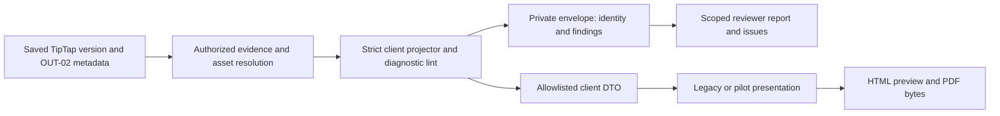

# OUT-03 — Client/reviewer separation implementation plan

P0 · 2 points · John · Depends on OUT-02. See [research and current defects](out-03-client-reviewer-separation-research.md).

**Proposed work, not an implemented feature.** Retain the existing frameworks, authoritative TipTap versions, evidence services, reviewer workflow and PDF renderer. Reconcile the OUT-02 handoff first: its contract is currently a plan in this checkout.

## Decisions and scope

| Recommendation | Decision |
| --- | --- |
| Client DTO constructed field by field | Adopted; no spreads of content metadata, task/candidate/version records into templates. |
| Separate internal diagnostics | Adopted; scoped reports/issues with exact version and anchor identity. |
| Both layouts use safe projection | Adopted; presentation flag cannot disable privacy checks. |
| Preserve estimated/design-target/client-reported labels | Adopted; qualifiers travel with the associated value, scope, units and period. |
| Global word deletion / automatic factual repair | Rejected; report exact fields and preserve the original content. |
| New content table, template editor or framework | Rejected; no duplicate editable source or template CRUD. |
| New claim evaluator / approval policy | Deferred; reuse current evaluator; OUT-03 is not a replacement factual-review system. |

## Target boundary and interfaces



Extend `PublicationProjectionService` rather than adding a parallel projector. Put pure DTO schemas/types in proposed `shared/publication/client.ts`, next to the OUT-02 contract. Add a small pure `publication_diagnostic_service.ts` for linting and a `publication_review_service.ts` for persistence/orchestration. Templates and `ExportPdfService` import the client types only, not reviewer content or model types.

The intended service result is `{ identity, client, diagnostics }`; only `client` reaches layout functions. `identity` includes document/version, authoritative content hash and projector/linter versions, and stays private. `client` and `diagnostics` are freshly constructed; do not clone and subtract fields from the internal model. Runtime strict schema parsing is required in addition to TypeScript.

```ts
// Proposed contract sketch; finish exact semantic fields against landed OUT-02.
type ClientRenderData = {
  schemaVersion: 1
  docType: 'case_study'
  title?: string
  summary?: ClientBlock
  body: ClientBlock[]
  sources: Array<{ number: number; label: string; page?: number }>
}
type Diagnostic = {
  code: string
  field: string
  blockId?: string
  range?: { from: number; to: number }
  severity: 'warning' | 'error'
  message: string
}
```

`ClientBlock` is a closed discriminated union, not `TipTapDocument['content']` or generic JSON. Enumerate only supported paragraph, heading, list, quote, break, rule, image and text/reference nodes actually used by installed extensions. Marks have explicit per-mark attributes. Internal block IDs are used for reviewer anchors; they need not be printed or encoded in client HTML.

Use an internal adapter from safe blocks to TipTap JSON if keeping `generateHTML`; its input is exclusively the client union. The DTO does not carry reviewerNotes, raw chunk IDs, source excerpts, file URLs, authenticated routes, storage keys, prompts, provider settings or job payloads. Layouts cannot recover those fields from a hidden reference to the original record.

## Defects to fix first and projection rules

| Defect | Concrete fix and acceptance |
| --- | --- |
| D1: default bypass | Change `ExportPdfService.html/generate` to consume `ClientRenderData`; project once in orchestration. Legacy and pilot layouts must pass the same malicious-input fixture. Remove `as DocumentVersion` content-only casts at these call sites. |
| D2: open node/mark/label data | Reject unknown node/mark types and malformed attributes with field errors. Reconstruct allowed marks; safe `https/http/mailto` links only under existing URL policy, excluding private routes/credentials/paths. Images originate only from authorized registered assets, with MIME/size limits and fresh embedded bytes. No arbitrary editor `src` is trusted. |
| D3: diagnostic prose | Lint publication title, summary, narrative, result labels, captions, alt/title text, source display titles and link labels/targets; return exact field/range/code, never globally replace substrings. |
| D4: missing facts | Omit absent optional blocks and create internal warnings where appropriate. Change company guide instructions to distinguish internal gaps from material client limitations. Do not insert placeholder prose or infer numbers. |
| D5: missing acceptance | Add hostile payload, HTML and independently extracted native-PDF assertions; mock tests remain useful but cannot satisfy PDF acceptance. |

Omit an optional image/result only when it is genuinely absent. A supplied but malformed/dangling reference is an error, not an excuse to silently discard accepted content. Required hero/identity failures follow OUT-02 validation. If a whole result is omitted, its value and qualifier disappear together; retaining an unqualified number is forbidden. Measured, estimated, client-reported and design-target meanings survive as visible text, not only color, metadata or a tooltip. Preserve original “up to”, range, baseline, units, period and scope phrases.

Number evidence references deterministically by first appearance and deduplicate using private evidence identity. Construct public source labels from safe display metadata; neutral `Source N` is a presentation label, not an invented source fact. Raw paths in a filename cannot be fixed by blindly taking a basename and assuming it is safe. Validate the resulting title too. Evidence lookup remains available internally against the same version.

Lint rules start with narrow, versioned matches: explicit reviewer/TODO markers, retrieval/debug traces, known private route/storage prefixes, and raw evidence-ID patterns in publication fields. Match UUIDs in their context; do not ban every UUID or the word “estimated”. Include punctuation, whitespace, line-break and case variations in fixtures. Escaping HTML is necessary for safety but does not remove confidential text. Do not claim a phrase list detects every possible secret.

Ambiguous language such as “results have not been independently measured” may be a material caveat; flag for classification without deleting it. Confirmed private fields/paths or invalid DTOs prevent client rendering with a safe error code; internal excerpts remain only in authorized review responses. Suspicious ordinary prose remains a warning until classified under the chosen policy. If acknowledgment of a false positive is needed, bind it to exact version/content/rule hashes in the existing internal report; it expires after edits. This is not an approval of the underlying factual claim.

## Data model and persistence

**No new tables, columns or migration are proposed.** Verify current catalog/migration status before coding.

| Existing storage | Proposed use |
| --- | --- |
| `document_versions.content` | Authoritative body and OUT-02 semantic metadata, unchanged by projection/lint. |
| `document_validation_reports` | Append-only phase `publication`, versioned validator, input/report hashes, structured diagnostics and summary. Keep reviewer snippets private. |
| `document_issues` | Existing version/code/origin/block/fingerprint fields associate actionable diagnostics. Use an origin compatible with current schema/transformer, e.g. existing `ai`; code distinguishes deterministic lint from factual evaluation. |
| Existing approvals/tasks/exports | Preserve current snapshot, actor, lease and readiness checks. Do not mutate accepted versions or old artifact bytes. |

Human issue CRUD is not an automatic finding writer. Persist findings through the small review coordinator with explicit version and code. Under the existing document transaction/lock, deduplicate using `(workspace, document, version, validatorVersion, code, field/range, contentHash)` fingerprint; the current DB has no uniqueness constraint on it, so a check outside the lock is insufficient. Replays must not create duplicates. Do not automatically resolve human issues or old-version findings when a new version is checked.

Preview GETs must stay read-only. Save/generation orchestration can record the review report after a version exists; preview and export always rerun the pure check over their exact saved input. A renderer must reject a hard leak even if no persisted report exists. Worker retries must not repeatedly append findings or store a PDF after validation failure. If an explicit blocking issue is recorded, use current workflow invalidation rules; resolving it does not automatically restore approval. Keep existing factual-review behavior and the solo-export policy intact.

## Files, UI and routes

| Path | Planned change |
| --- | --- |
| `shared/publication/client.ts` | Strict client DTO, closed node/mark unions and schema version. |
| `app/services/documents/publication_projection_service.ts` | Internal OUT-02/legacy adapter to safe client content; no database access. |
| `app/services/documents/publication_diagnostic_service.ts` | Pure versioned lint rules, anchored findings and safe failure codes. |
| `app/services/documents/publication_review_service.ts` | Scoped report/issue persistence with idempotency; no render logic. |
| `app/services/exports/document_export_service.ts` | Resolve authorized inputs, derive safe DTO, check identity before/after rendering; never pass full record into layout. |
| `app/services/exports/pdf_service.ts` | Both layouts accept client DTO only; retain Playwright/network restrictions. |
| `resources/document_templates/{portfolio,technical,vision}.md` | Keep no-invention instructions; optional omissions versus material caveats explicitly separated. |
| Existing save/generation orchestration | Run lint against saved version; persist private findings without changing publication text. |
| `app/transformers/document_issue_transformer.ts` | Explicitly expose only needed origin/code/version/anchor fields to authorized reviewers. |
| `inertia/components/documents/inspector.tsx` | Extend existing IssuesPanel with publication diagnostics and field navigation. |
| Existing editor/export feedback components | Show safe “Repair publication fields” response and focus internal findings. |
| QA service and fixture tests | Adapt calls to safe DTO boundary and extend fixture checks; preserve old baseline identities. |

Reuse installed `Alert`, `Badge`, `Button`, `Tooltip`, `Skeleton` and existing `ActionFeedback`; no new primitive installation or page is needed. Label diagnostics as internal and distinguish warning/error from factual verdict. Render loading, empty, unavailable/retry, stale-version and permission states. Link to the exact block/field; do not copy internal excerpts into PDF preview banners. Preserve draft content on save failure; keyboard focus must return from the issues panel, long messages wrap on mobile, and status is never color-only.

Keep existing preview/export/issues endpoints and policies. Extend internal error responses through the established field-error envelope; never expose task records or diagnostic snippets in PDF/HTML responses. Do not introduce a public DTO inspection endpoint solely for testing. Inspect the payload through a captured renderer argument in functional tests and the offline artifact harness.

## Delivery phases

1. **Contract and pure checks (D2–D4):** reconcile landed OUT-02 API; implement DTO, strict projector and linter. Valid absent-optionals and all qualifier fixtures pass; internal fields fail recursive payload assertions; original content is byte-equivalent after projection.
2. **Shared render boundary (D1):** adapt both layouts, preview, worker and QA harness together. Snapshot/lease/authorization tests pass; no legacy bypass or unsafe model cast remains; invalid input cannot produce/store client bytes.
3. **Review integration (D3–D4):** persist version-bound findings and expose minimal anchors in existing reviewer UI. Two retries yield one issue per finding; no writes on preview GET; human issues survive; edits invalidate stale acknowledgments.
4. **Native acceptance (D5):** run hostile corpus through both layouts; independently extract PDF text and verify forbidden sentinels absent and required qualifications present. Hand off payload/HTML/text/report artifacts and exact commands.

Each phase leaves the existing feature usable; do not land the new PDF signature without updating all callers. Preserve working records; no bulk cleanup/backfill or automatic deletion. Historical artifacts remain an explicit decision, not a hidden side effect.

## CLI and verification

These are **planned scaffolding commands**, not commands executed in this planning turn. Use an isolated worktree after agreement; Git metadata writes require an environment that permits them. Normalize generated service names to the repository `_service.ts` convention without overwriting existing files.

```bash
git worktree add -b feature/out-03-client-reviewer /private/tmp/capstone-out03
cd /private/tmp/capstone-out03
node ace make:service documents/publication_diagnostic
node ace make:service documents/publication_review
node ace make:test publication_client --suite=unit
node ace make:test publication_diagnostics --suite=unit
node ace make:test publication_exports --suite=functional
node ace make:test publication_pdf_leakage --suite=unit
```

Do not generate a new projector, migration, controller or route. No new Ace command is needed: extend the existing `qa:output-baseline` harness to accept a separate sanitized OUT-03 manifest with the same validation/report format. Freeze it as `tests/fixtures/output/out03-v1/manifest.json`; retain QA-01 files/hashes unchanged.

```bash
node ace qa:output-baseline --mode=validate --manifest=tests/fixtures/output/out03-v1/manifest.json
node ace qa:output-baseline --mode=render --manifest=tests/fixtures/output/out03-v1/manifest.json --layout=both --output=/private/tmp/out03-run-01
node ace test unit --files='tests/unit/publication_client.spec.ts' --files='tests/unit/publication_diagnostics.spec.ts'
PORT=3397 node ace test functional --files='tests/functional/publication_exports.spec.ts' --files='tests/functional/document_exports.spec.ts' --files='tests/functional/solo_pdf_export.spec.ts'
node ace test unit --files='tests/unit/publication_pdf_leakage.spec.ts'
node ace codegen
npm run typecheck
npm run lint
npm test
```

The new manifest/tests do not exist yet. Extend the harness where needed to check safe payload and extracted text; current `forbiddenPatterns` alone is not the whole acceptance. Functional tests must use the guarded disposable test database, never working records. The native PDF test launches real Chromium and extracts using the existing PyMuPDF inspector; it must fail or report explicitly unavailable when Chromium/inspector is missing. A mock PDF test cannot substitute for this acceptance. The normal unit suite should retain its fast, dependency-free checks; isolate the native test with an explicit opt-in/run guard and require it in a capable CI job.

## Fixture and acceptance matrix

Each fixture has stable ID, revision, content/source/expectation hashes and original authorship metadata. Use synthetic sentinels and paths only; no production evidence or personal details.

| Fixture case | Required assertions |
| --- | --- |
| ReviewerNotes containing `OUT03_PRIVATE_NOTE` | Visible internally; absent recursively in client DTO, HTML and extracted PDF text. |
| Raw chunk UUID, excerpt and private paths in citation attrs | Private lookup still works; client contains only reference numbers and safe source display labels. |
| Hostile marks, links, image src/alt/title, filenames and unknown nodes | Exact field errors or documented safe neutral source label; no private URL/data attributes in rendered HTML. |
| Diagnostic prose in title/body/caption | Exact lint code/location; original untouched; confirmed leak blocks bytes; no silent sentence removal. |
| No image/no metric/absent optional context | No invented result, placeholder or empty optional heading; internal warnings where specified. |
| Estimated/design-target/client-reported/up-to/range | Required qualification visible beside its value in payload, HTML and PDF extraction. |
| Legitimate “review”, “target”, quoted gap language and technical identifiers | No blanket deletion; ambiguous matches classified internally; no false assertion of factual support. |
| User-authored text | Original authorship preserved; publication hygiene finding separate from automated factual evaluation. |
| Same saved version: legacy/pilot/preview/export | Same content identity and allowed fields; layout selection cannot bypass lint/allowlist. |
| Retry/edit/revocation/cross-workspace | Idempotent findings, stale-version conflict, original approval semantics and no evidence leakage. |

Inspect serialized client data structurally, not just via substring tests; assert exact allowed keys/node/mark shapes recursively. Search HTML attributes and links as well as visible text. PDF text extraction must check both forbidden sentinels and required qualifiers; also inspect PDF annotations/metadata for private links or titles. Absence from extracted text alone does not prove absence from a PDF artifact. Record page count/bytes/timings/environment but retain the original 173-page feedback as reported feedback until independently remeasured.

## Decisions and handoff

Before implementation, confirm the OUT-02 branch/API and the policy for ambiguous diagnostic warnings. Recommended defaults are in the research document: hard-fail confirmed private data/invalid structure; warn on ambiguous prose; use neutral source labels only for unusable display metadata. Decide separately on withdrawal of any historical unsafe PDF. None of these decisions authorizes changing accepted content automatically.

OUT-03 exits with both layouts consuming only the strict DTO, actionable internal diagnostics, qualifiers retained, and reproducible client-payload plus native-PDF evidence. Until those checks pass, status remains **planned**, not implemented.
