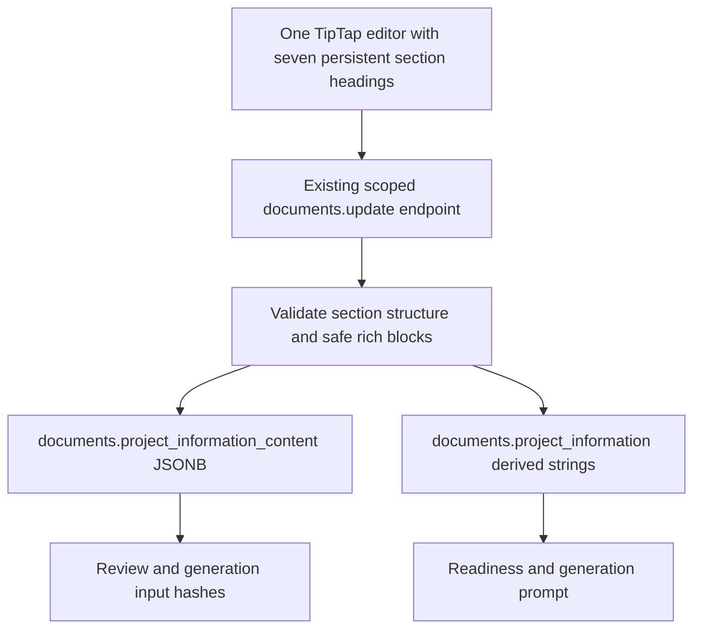

# Project information as a document

## Research and decisions

The requested experience is a continuous Notion-style TipTap document. Today the
seven required information fields are separate plain-text textareas, so rich
formatting cannot survive a save. The checkout already uses TipTap 3.31 and its
StarterKit; no dependency is needed. Use one editor with the field names rendered
as persistent subheadings and free-form blocks beneath them. Separate rich inputs
would retain the form-like interaction; a heading-only text parser would make
readiness depend on users preserving exact heading text. Both are rejected.

## Current-state audit and defects

- D1: `project_fields.tsx` renders seven textareas. Replace with one TipTap surface.
- D2: `documents.project_information` stores only strings. Preserve rich JSON in a
  new nullable `project_information_content` JSONB column, deriving those strings
  on the server for generation and readiness. Existing data remains intact.
- D3: review/generation hashes do not include rich information. Add conditional
  hashing so formatting edits invalidate reviews and fence stale generation.
- D4: generic rich-editor editable-state updates can emit synthetic changes. Stop
  those updates from marking untouched forms dirty.

## Architecture and data model



`PUT /workspaces/:workspaceId/documents/:id` accepts optional nullable
`projectInformationContent` alongside the existing metadata. Non-null rich input
is authoritative over client-supplied plain fields. It contains a `doc` with seven
ordered section nodes (one per field). Section bodies support the safe description
block schema, without evidence nodes. Invalid content is 422; membership/scoping and
metadata-revision conflicts retain their existing behavior. Transformer responses
include the nullable JSON. Legacy plain updates clear rich content only when their
text changes; omitted or unchanged plain information preserves it. Legacy records
render a lossless paragraph-based template until saved with the new editor.

## Dependency-ordered implementation

1. Scaffold the service, additive migration and regression tests with Ace.
2. Normalize and persist rich information; keep all seven derived values compatible
   with readiness and prompts. Extend transformer and hashes. Verify round trips,
   invalid payloads, stale revisions and review invalidation.
3. Replace textareas with one accessible editor, quiet formatting toolbar, persistent
   h2 section names and editable paragraphs/lists. Widen the dialog and keep save,
   unsaved-change protection, deadline and project controls.
4. Run migration on the dedicated local test database, generate schema/types, run
   tests, typecheck, lint and build. Apply the additive migration to the separate
   local development database after passing checks.

## Risks, operational inputs and verification

- Required headings are structural and cannot be accidentally renamed/deleted;
  body content is free-form. Custom sections are confined to metadata, never sent
  into generated document rendering/export.
- Rich JSON is server-normalized, size-bounded and rejects unsafe links/evidence.
- Rollback drops only the rich column; the derived plain values remain available,
  but formatting would be lost. Do not roll back after accepting rich edits without
  first preserving the column data.
- No new infrastructure or secrets. Browser access was previously denied, so real
  browser interaction/visual verification remains unavailable in this session.

```bash
NODE_ENV=test node ace migration:run
node ace migration:run
node ace schema:generate
node ace codegen
PORT=3345 npm test
npm run typecheck
npm run lint
npm run build
git diff --check
```

Regression criteria: legacy multiline text survives, lists/marks survive save and
reload, empty sections remain incomplete, rich input overrides spoofed plain text,
unsafe/missing/duplicate sections fail, unchanged input preserves review, edits
invalidate review, stale revision and cross-workspace writes are rejected. Editor
schema tests cover persistent headings and valid empty content. Manual follow-up:
keyboard traversal, paste/lists/undo, save/reopen, close/discard, light/dark/mobile.

Reference: [TipTap Node API](https://tiptap.dev/docs/editor/extensions/custom-extensions/create-new/node).

## Implementation verification

Implemented in `/private/tmp/capstone_demo_workspace_tenancy`. The additive migration
has been applied to the separate local databases `capstone_tenancy_test` and
`capstone_tenancy_dev`. Schema classes and shared transformer types were regenerated.

- Full suite: 75 passed, 2 optional tests skipped (SMTP and Postman transport).
- Eight new regression checks cover the editor schema, HTML serialization, scoped
  HTTP persistence, legacy compatibility, safe input, and review/approval safeguards.
- Typecheck, lint, production build, and `git diff --check` pass.
- No browser verification was performed; keyboard/pointer behavior and responsive
  appearance still require a real browser review.
