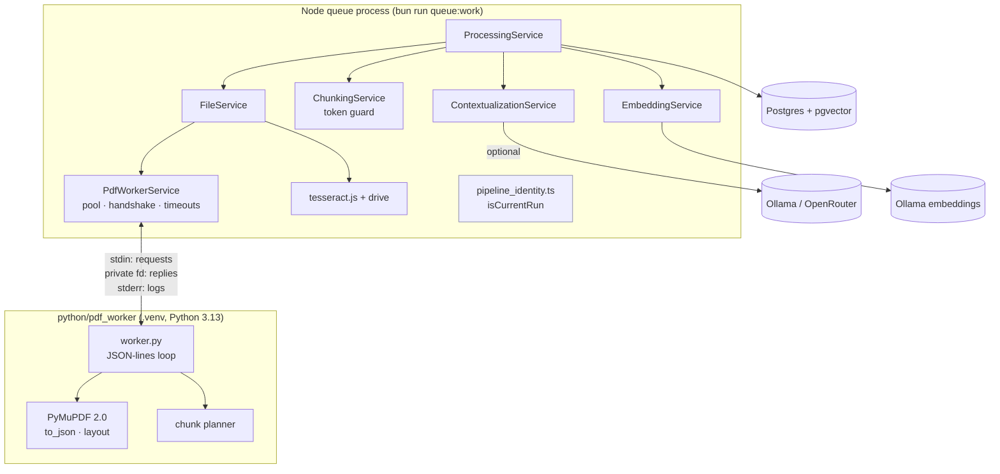
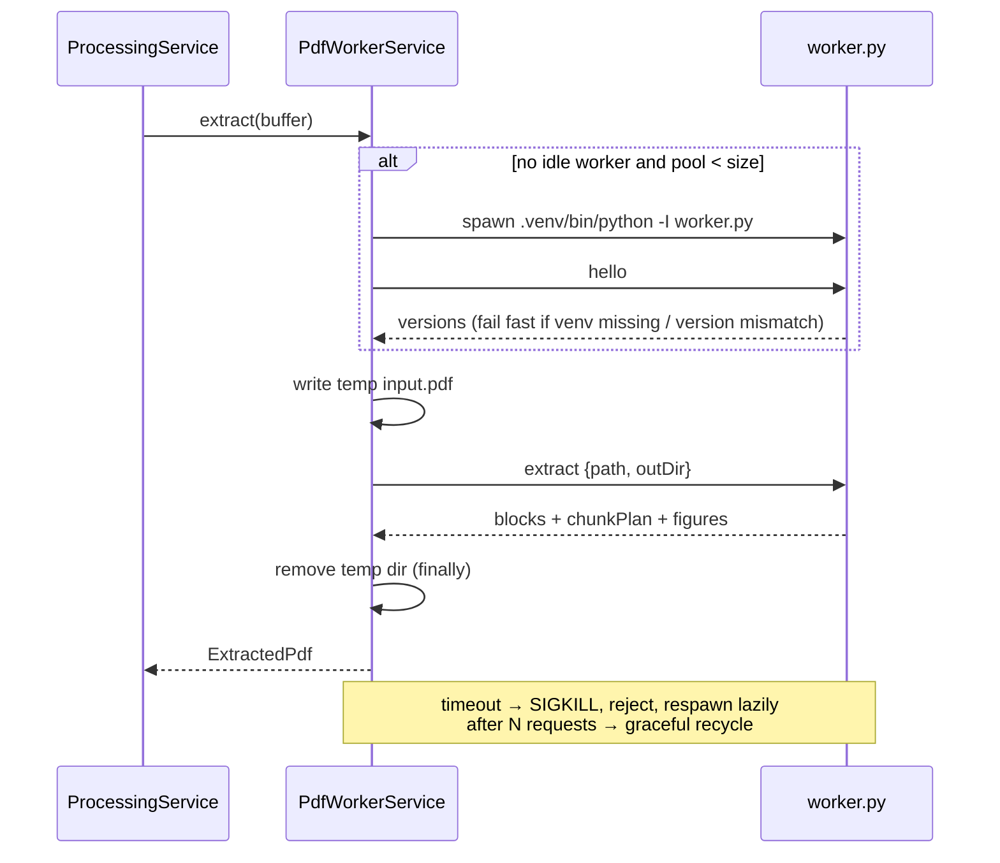

# PyMuPDF extraction and contextual chunking: architecture

Status: for review with the implementation plan (2026-10-28).

## 1. Component boundaries



| Component                  | Owns                                                                 | Must not                                             |
| -------------------------- | -------------------------------------------------------------------- | ---------------------------------------------------- |
| `worker.py`                | Opening PDFs, layout, block mapping, chunk plan, figure crops        | Touch the network, the DB, secrets or provider calls |
| `PdfWorkerService`         | Process lifecycle, request routing, timeouts, temp dirs              | Interpret PDF content                                |
| `FileService`              | Strategy dispatch by extension; figure upload and OCR                | Spawn processes directly                             |
| `ChunkingService`          | Final token budget, re-split, `IndexedChunk` shape                   | Call providers                                       |
| `ContextualizationService` | Structural and LLM context, validation, fallback                     | Change `content`                                     |
| `pipeline_identity.ts`     | Run-currency fields (pipeline, embedding, contextualizer, extractor) | —                                                    |

Layering follows the `design-patterns` skill: everything new is a service under
`app/services/documents/`, configuration goes in `config/*.ts`, and controllers do not change.

## 2. Worker protocol (JSON lines)

The worker starts with `.venv/bin/python -I -X utf8 python/pdf_worker/worker.py`. Before importing
PyMuPDF, it duplicates fd 1 for replies and points fd 1 at fd 2, so diagnostics printed by the C
library can never corrupt the protocol:

```python
reply = os.fdopen(os.dup(1), "w", buffering=1)
os.dup2(2, 1)
import pymupdf  # noqa: E402  (after the fd swap, deliberately)
```

Requests on stdin, one JSON object per line:

```json
{"id": "7f…", "op": "hello"}
{"id": "8a…", "op": "extract", "path": "/tmp/capstone-pdf/8a…/input.pdf",
 "outDir": "/tmp/capstone-pdf/8a…/out", "options": {"layout": true, "chunkTargetTokens": 450}}
```

Replies on the private fd:

```json
{"id": "7f…", "ok": true, "result": {"protocol": 1, "python": "3.13.16", "pymupdf": "2.0"}}
{"id": "8a…", "ok": true, "result": {"pages": 20, "blocks": [...], "chunkPlan": [[...]], "figures": [...], "timingsMs": {"open": 3, "layout": 1090}}}
{"id": "8a…", "ok": false, "error": {"code": "encrypted" , "message": "The PDF is password protected."}}
```

- Error codes form a closed set: `encrypted`, `corrupt`, `too_many_pages`, `timeout`, `internal`.
  Node maps them to user-safe preparation errors, and raw Python tracebacks go to logs only.
- The PDF is passed as a **path to a temp file** Node wrote, not as base64 on the pipe, to avoid
  doubling memory for 10 MB files. Figures come back as file paths inside `outDir`.
- Each block in the reply is already shaped like `CanonicalBlock` (`blockType`, `text`,
  `sourceLocator.pageNumber/headingLevel/bbox`, `extractionMethod: 'pymupdf-layout'`), so Node
  validates it with a zod schema rather than transforming it.

## 3. Lifecycle



- **Lazy start:** no Python process exists until the first PDF. Web server processes never spawn
  workers; only the queue worker does.
- **Warm reuse:** the import (≈0.24 s) and the layout model load happen once per worker.
- **One request per worker at a time.** Concurrency comes from the pool size (default 2), not from
  threads inside Python.
- **Timeout:** `PDF_WORKER_TIMEOUT_MS` (default 120 s). The process is killed, the request rejected
  with `timeout`, and the slot freed. The task's retry policy decides whether to try again.
- **Recycle:** after `PDF_WORKER_MAX_REQUESTS` (default 200) or RSS above a limit, to bound memory
  growth.
- **Shutdown:** on `SIGTERM` the pool closes stdin, waits 5 s, then kills the worker.
- **Lease guard:** `tasks.check(lease)` runs before extraction and before any provider disclosure,
  as today.

## 4. Data flow and state

| State                   | Where it lives                                                              | Lifetime                                                   |
| ----------------------- | --------------------------------------------------------------------------- | ---------------------------------------------------------- |
| Python environment      | `python/pdf_worker/.venv` (from `uv.lock`)                                  | Until `python:setup` re-runs                               |
| Temp input and figures  | `os.tmpdir()/capstone-pdf/<requestId>/`                                     | One request; removed in `finally`                          |
| Figures (persisted)     | Drive, via existing `saveToDrive`                                           | Same as today; cleaned on failure via `generatedAssetKeys` |
| Blocks, chunks, context | `document_blocks`, `chunks(context, context_source)`                        | Per processing run                                         |
| Embeddings              | `chunk_embeddings` of `context + content`                                   | Per run and embedding space                                |
| Run identity            | `processing_runs(pipeline_version, embedding_*, contextualizer, extractor)` | Compared by `isCurrentRun`                                 |

What is embedded and indexed versus what is shown:

```text
embedding input  = context + "\n\n" + content      → chunk_embeddings
content_tsv      = tsvector(context || ' ' || content)
evidence/citation = content only                     → generation prompt, UI
```

## 5. Dependencies

- **New runtime:** uv (setup only) and CPython 3.13 (uv-managed). Python packages come from
  `uv.lock`: `pymupdf==2.0` plus its layout dependencies (`onnxruntime`, `numpy`, `networkx`, …),
  about 219 MB.
- **Dev only:** `pytest` (uv dependency group `dev`).
- **Unchanged:** tesseract.js (OCR), Ollama embeddings, Postgres/pgvector, Redis queue.
- **Removed in Phase 5:** `pdf-parse` (and its pdf.js font/CMap plumbing in `files_service.ts`).
- **Not required:** system Tesseract (PyMuPDF OCR stays off), Docker, any HTTP service.

## 6. Failure and rollback

| Failure                                   | Behaviour                                                                                                                                                                                                                                                    |
| ----------------------------------------- | ------------------------------------------------------------------------------------------------------------------------------------------------------------------------------------------------------------------------------------------------------------ |
| `.venv` missing or wrong version          | Worker handshake fails → run fails with "PDF processing is not set up: run `bun run python:setup`"; other file types are unaffected                                                                                                                          |
| Worker crash or timeout                   | Request rejected and worker respawned; the task's existing retry and backoff apply                                                                                                                                                                           |
| Bad PDF (encrypted or corrupt)            | Closed error code → user-safe message on the file; no retry                                                                                                                                                                                                  |
| LLM contextualizer down or invalid output | Per-chunk structural fallback; run still becomes _ready_; warning recorded                                                                                                                                                                                   |
| Regression found after rollout            | Set `PDF_EXTRACTOR=pdf-parse` (Phases 2–4) and/or `CONTEXTUALIZER=off`; restart the queue worker. Runs re-prepare through the run-currency check, with no data migration needed. After Phase 5 removes `pdf-parse`, rollback is a `git revert` of that phase |
| Schema rollback                           | Phase 4 migrations have `down()` restoring `content_tsv` to content-only and dropping the new columns                                                                                                                                                        |
