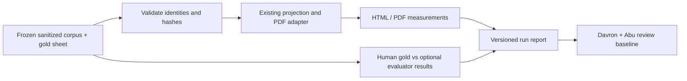

# QA-01 — Freeze representative output fixtures and baseline measurements

12 November 2026 · P0 · 2 points · Leads: Davron + Abu · Dependencies: none; refine with OUT-01

**Proposed implementation, not applied.** [Research](qa-01-output-fixtures-research.md) records the inspected checkout, source limitations and defects D1–D5. Deliver a small versioned corpus, claim sheet and offline measurement command, reusing the active TipTap/projection/PDF path. No replacement HLD, live-model CI dependency, new product screen or database migration.

## Decisions and current-state reconciliation

| Recommendation | Disposition | Reason |
| --- | --- | --- |
| Freeze six stable cases and their expected facts/qualifiers | Adopt | Covers every QA-01 condition without generating a large catalog. |
| Retain exact entry 01 internally; use separately sanitized/fictionalized CI equivalent | Adopt | Original source lineage remains inspectable without copying private assets into CI. |
| Record both legacy and pilot layout results | Adopt | Current `publication_projection_service.ts` / `pdf_service.ts` already support the pilot; OUT-01 predates those changes. |
| Store baseline and human claim labels in versioned files | Adopt | Reviewable independent of active database; no need for new QA persistence tables. |
| Use current evaluator predictions as gold labels | Reject | Human evidence review establishes expected labels; Jev results are measured separately. |
| Infer historical model/settings/timing from today's config | Reject | Use null plus reason; config defaults are not historical execution proof. |
| Add an admin QA dashboard / production telemetry fields | Defer | Outside two-point fixture work; existing components and OPS-01A cover later integration. |

D1–D5 are addressed in the phases below. No application behavior change is needed to begin fixture review. Keep source captures, current working documents and existing approval/task records intact.

## Fixture identities and expected behavior

Freeze schema version `1`, corpus version `qa01-v1`; identity is `(fixtureId, revision, contentHash, sourceManifestHash, assetHashes)`. Never reuse a revision after changing content, a source, expected claim or asset. Preserve old versions; publish a new revision with a review reason.

| ID | Input / coverage | Required expectation |
| --- | --- | --- |
| `qa01-entry-01` | Internal source-backed customs automation entry; full title/body/evidence and current version from OUT-01 capture | Preserve estimated/up-to processing reduction and stated capacity target; compare against the historical four-page preview without treating that page count as an acceptance budget. |
| `qa01-no-image` | Fictional no-image TipTap entry and matching text evidence | Zero image nodes/assets; no invented illustration or empty image block. |
| `qa01-no-metric` | Fictional qualitative results; sources contain no numeric business result | No invented number/percentage or fabricated result row; useful qualitative content remains. |
| `qa01-long-title` | Fixed 180-character fictional title including one 40-character unbroken token; recorded literal content/hash | Full title survives extraction and wraps without clipping. Do not truncate merely to pass a screenshot comparison. |
| `qa01-estimated-result` | Fictional source: “Estimated reduction of up to 30% in processing time; no deployment measurement.” | Retain estimated, up to, unit/scope and missing-method caveat; include controlled negative claims for scoring only. |
| `qa01-long-citations` | Six fictional source labels of at least 160 characters each, two pages per source, repeated/nonadjacent citations | Stable evidence identities; deterministic first-appearance numbering; all 12 chunk/page descriptions represented; no raw IDs/excerpts/private URLs in pilot client payload. |

The sanitized CI `qa01-entry-01` is a **separate variant**: same structural stress, fictional organization/content and synthetic diagram, deterministic local UUIDs, no original excerpts or source URLs. Its metrics and human labels are not claimed to be measurements of the real project. Record `variant: internal | sanitized`; do not compare their sizes/page counts as though they were identical inputs. Negative altered claims are evaluation probes, not mutations to the publication body.

Initial case identity is fixed; Davron/Abu may improve literal fixture text during phase 1, then freeze exact hashes. No browser network, provider or private bucket is required by sanitized fixtures.

## Files and responsibility boundaries

```text
tests/fixtures/output/qa01-v1/
  manifest.json
  cases/<fixture-id>/content.json
  cases/<fixture-id>/sources.json
  cases/<fixture-id>/expectations.json
  assets/diagram.png
  claim-review.csv
  expected/<environment-id>/baseline.json
app/services/qa/output_baseline_service.ts        # proposed measurement orchestration
commands/qa_output_baseline.ts                    # proposed thin Ace adapter
tests/unit/output_fixture_contract.spec.ts        # proposed
tests/unit/services/output_baseline_service.spec.ts # proposed
python/pdf_worker/tests/test_output_measurement.py # proposed, only if adding Python measurement helper
output/qa01/<run-id>/                             # generated reports/HTML/PDF/previews
```

One service and one command are sufficient. Add pure parsing/hash/metric helpers beside that service only if needed; do not create repositories, queues or a QA domain model. Use `ExportPdfService.html/generate` with explicit `{publication, preview:true}` and deterministic fixture hydration through `attachChunkMetadata`. Do not duplicate renderer templates. Local assets must resolve only from the manifest directory and be embedded as data URIs; reject path traversal, unknown assets and remote fetches. Use a tiny in-repo synthetic diagram, not captured licensed artwork.

Keep exact real-entry data and provenance in the existing internal audit location or approved private fixture storage. Do not import `docs/audits/out-01` or `output/humblebee-portfolio` from the CI corpus. Derive public fixtures deliberately, not by running a broad string redactor over arbitrary originals.



HLD boundary: quality checks cover evidence/content, rendering and the existing workflow tests. The runner never approves content or writes live document state. Architecture stays within the current framework and service/command layers; no separate architecture document is needed.

## Data schema and database impact

**Database delta: none. No migration, model, index, constraint or seed is proposed.** Existing `file_revisions.source_hash`, processing runs, document versions and task payload/result/telemetry are read-only provenance sources for an internal capture. Existing `document_claim_reviews` is a production review/audit relation, not a place to insert QA gold labels. Existing `document_validation_reports` and `workspace_tasks.telemetry` do not imply those fields have historical measurements.

Proposed file schema (types illustrate the contract; implement validation locally with existing Zod):

```ts
type Availability<T> =
  | { status: 'measured' | 'recorded'; value: T; method: string }
  | { status: 'unavailable'; value: null; reason: string }

type FixtureIdentity = {
  schemaVersion: 1
  fixtureId: string
  revision: number
  variant: 'internal' | 'sanitized'
  origin: 'captured' | 'synthetic'
  contentHash: string
  sourceManifestHash: string
  sources: Array<{
    fixtureSourceId: string
    revision: number
    sha256: string
    // Internal variant may additionally retain original file/revision/run IDs.
    chunkIds: string[]
    pageNumbers: number[]
  }>
  assets: Array<{ path: string; sha256: string; mime: string }>
}
```

Each source hash covers frozen bytes (or the exact frozen excerpt file where original bytes are unavailable); record `hashBasis: original_bytes | frozen_excerpt` so an excerpt hash never masquerades as the original PDF checksum. Local source IDs must resolve exactly; use valid deterministic UUIDs where existing schemas require them. Hash canonical JSON with sorted object keys and preserved array order; preserve exact text/qualifiers, do not normalize them out of identity. Store lineage mapping only in the internal variant.

Every run report must include:

| Field group | Required data |
| --- | --- |
| Identity | Run ID, UTC timestamp, corpus/case revision, Git commit and dirty state, manifest/content/source/asset hashes |
| Environment | OS/architecture or image digest, Node/Bun, lockfile hash, Playwright package and actual Chromium version/revision, font file hashes, Python/PyMuPDF, concurrency/cache condition |
| Rendering | Effective legacy/pilot branch, projection version or null for legacy, renderer source hash, A4/margins/options, preview mode, explicit status, artifact paths/checksums |
| Generation provenance | Historical provider/model identity/settings if recorded; requested versus returned model separately; template/prompt identity; temperature/top-p/seed explicit or unavailable. Deterministic replay makes zero generation calls. |
| Workload | Source bytes/pages when known, formats, OCR class, source/chunk/image/citation counts; no substitution of output pages for source pages |
| Measurements | PDF page count/byte size, per-page extracted text and image counts, preview warning, supported qualifiers, reference coverage, observed defects |
| Timing | Monotonic measured HTML/PDF/inspection durations; queue/retrieval/inference/validation/acceptance timings only if actually captured; UTC correlation timestamps separately |
| Cost/usage | Generation input/output totals across recorded attempts; embedding usage separate; unavailable or explicitly estimated usage distinguished from measured values; do not infer counts from task-attempt fields |
| Review | Reviewer/date, known defects, unresolved checks, run eligibility for baseline comparison, label coverage and authorship coverage |

Unavailable page count after renderer failure must be null with reason, never zero. A failed run emits a report and nonzero exit. Task elapsed from creation to completion includes queue/retries and cannot be relabeled inference duration. Compare timing only within declared matching environments/cache classes; do not set a latency promise from one replay. Nondeterministic PDF metadata means byte checksum identifies an artifact rather than enforcing cross-run byte equality.

## Claim-review sheet

Proposed CSV columns:

```csv
corpus_version,fixture_id,variant,fixture_revision,claim_id,content_path,text,text_hash,authorship,gold_label,review_state,source_ids,evidence_hash,source_pages,qualifier_type,expected_qualifiers,scope,units,baseline_period,rationale,reviewer,reviewed_at
```

`authorship = ai | user | unknown`; `gold_label = supported | contradicted | unsupported | <blank>`; `review_state = pending | reviewed | disputed | exempt_user | needs_authorship`. Stable claim IDs are fixture-local and text hashes invalidate old labels after a text edit. Freeze relevant full excerpts/pages, not just citation captions. Spreadsheet-compatible output must quote CSV properly and neutralize formula-like text on display/export without altering the stored claim/hash.

| Synthetic probe | Authorship | Gold / handling |
| --- | --- | --- |
| “Estimated reduction of up to 30% in processing time.” against the exact estimated source above | ai | supported; estimated/up to/time scope must remain |
| “A measured 30% deployment improvement.” against that same source stating no deployment measurement | ai | contradicted; estimated evidence is not a measured deployment result |
| “Annual savings were $1 million.” with no financial evidence | ai | unsupported |
| “Our team prefers a blue dashboard.” entered as manual text | user | blank gold, exempt_user; validate structure/access, exclude from AI S/C/U denominator |
| Historical edited paragraph with no reliable authorship trail | unknown | blank gold, needs_authorship; report coverage gap and do not silently count as AI or exempt as user |

These are proposed controlled examples, not reviewed labels on the real entry. Abu reviews evidence/qualifiers; Davron records independent review; disagreement stays disputed. Do not mark real-entry authorship from its generation task alone.

Report reviewed AI counts S/C/U, eligible-but-unreviewed count, user count and unknown-authorship count. Compute `(C+U)/(S+C+U)` only for reviewed AI claims, with null/reason for denominator zero and explicit reviewed/eligible coverage. Never present an incomplete gold sheet as whole-corpus accuracy. Optional evaluator output lives in a separate predictions file: map `insufficient_evidence` to `unsupported` **for comparison**, while `missing_evidence` and `unable_to_evaluate` retain distinct execution states. A timeout is not a human unsupported verdict. Human approval and D-CLAIMS policy remain outside this sheet.

## UI components, routes and authorization

**Required new UI components: none.** Developers review generated HTML/PDF artifacts and the claim sheet; reviewers use existing authenticated editor, evidence inspection and preview. QA fixture files must not be mounted under public assets or exposed through a new API. Reuse current workspace policies for any manual in-app run, including cross-workspace/source/download denial checks.

If an in-app review screen is later requested, scope it separately: existing `Table`, `Badge`, `Select`, `Tabs`, `Dialog`, `Button`, `Alert` and `Skeleton` in `inertia/components/ui/` can support case selection, labels, evidence comparison and status. That follow-up needs a protected route/controller, server-derived permissions, loading/empty/error/retry states, accessible labels/focus and mobile review. Do not scaffold that screen or install shadcn components for QA-01.

## Implementation phases and acceptance

| Phase | Changes / owner | Acceptance |
| --- | --- | --- |
| 0 — freeze boundaries (D1–D3) | Davron + Abu: verify internal source checksum/locators; record historical entry sample separately from current legacy/pilot baseline; select reference environment | Original is unchanged; unknown model/settings/timing explicit; original F-PDF located or unavailable source recorded. |
| 1 — six cases + gold sheet (D1/D4/D5) | Abu authors fictional sources/claims and internal mapping; Davron reviews labels and edge coverage | Six IDs plus internal/sanitized variant boundary; no private paths/assets/real IDs in CI; every AI probe has evidence-based expected label; unknown/manual text handled separately. |
| 2 — one replay command (D2/D3) | John supports service/CLI wiring; Davron owns measurement report | Offline run validates hashes, uses current renderer, records both branches and emits failure report when Chromium is unavailable; no provider/DB writes. |
| 3 — native baseline + handoff (D3/D5) | Davron runs declared Chromium environment; Abu checks qualifiers/evidence | Real PDFs for all six sanitized cases/both layouts; page count/bytes/defects recorded; second member reproduces semantic/reference counts and investigates page/size changes; reviewed baseline committed deliberately. |

A blocked native render is useful diagnostic evidence but does not complete phase 3. Initial known defects are recorded rather than silently fixed in QA-01; route publication leaks/page-fit faults to OUT-03/04 or RND-02. Do not silently update expectations to make a regression pass.

## CLI commands and runbook

The commands below are **proposed until implementation**. Only generator `--help` checks and existing tests ran during planning. Framework scaffolds must be generated with Ace; no new package installation or migration is needed.

```sh
# After plan agreement, in an isolated writable worktree:
git worktree add -b feature/qa-01-output-fixtures /private/tmp/capstone-qa01
# Run subsequent commands from that worktree; use its own ignored env files.
bun install --frozen-lockfile
node ace make:service qa/output_baseline
node ace make:command qa_output_baseline
node ace make:test output_fixture_contract --suite=unit
node ace make:test services/output_baseline_service --suite=unit
node ace codegen
```

Implement command name `qa:output-baseline`; normalize the generated service filename to repository `_service.ts` convention and adjust imports. Explicit supported modes: `validate` (hashes/schema/claim integrity), `render` (new immutable run), `compare` (existing report against reviewed baseline). Proposed flags: `--manifest`, `--mode`, `--layout=legacy|pilot|both`, `--output` and `--baseline` (compare only). Inputs must be local allowed files; default to sanitized corpus. Do not add live capture/provider mode in this two-point slice. Internal capture remains a separately reviewed read-only step.

```sh
node ace qa:output-baseline --mode=validate --manifest=tests/fixtures/output/qa01-v1/manifest.json
node ace qa:output-baseline --mode=render --layout=both --manifest=tests/fixtures/output/qa01-v1/manifest.json --output=output/qa01/run-001
node ace qa:output-baseline --mode=compare --manifest=tests/fixtures/output/qa01-v1/manifest.json --output=output/qa01/run-001 --baseline=tests/fixtures/output/qa01-v1/expected/linux-reference/baseline.json
```

Pin/install Chromium in the reference image (for example `bunx --no-install playwright install --with-deps chromium` on the selected Linux image). Record the actual version; do not assume installing it bypasses host sandbox restrictions. Use the existing Python environment (`bun run python:setup`) and PyMuPDF to count PDF pages/extract text/images/rasterize review pages. Reuse its installed dependency; add measurement helper coverage only for newly introduced Python logic. The Ace command should call a bounded parser/inspection helper, not scrape console text from an unrelated command.

Each render uses a new output directory, refuses overwrite, writes no keys or raw internal task payloads and cannot promote a baseline automatically. Reviewer commits the reviewed JSON baseline and reasons separately; retain generated PDFs/contact sheets as review/CI artifacts. Environment mismatch produces “not comparable” with nonzero comparison exit, not a fabricated regression or pass. The baseline comparison checks corpus hashes, text/qualifier/reference coverage, page counts and declared size tolerances; timings and known defects remain observations unless explicitly adopted gates. Tolerances require recorded review; never compare exact PDF bytes across runs.

## Unit tests and broader verification

Proposed tests cover behavior, not a duplicate of the schema implementation:

| Test target | Meaningful cases |
| --- | --- |
| `output_fixture_contract.spec.ts` | Six required scenarios present; duplicate identities/dangling source/asset IDs fail; content/source/claim hash drift invalidates baseline; valid UUIDs; no-image/no-metric expectations match actual body; traversal and remote asset rejection; private identifiers/URLs/excerpts excluded from sanitized corpus. |
| `output_baseline_service.spec.ts` | Fake clock/renderer/inspector give deterministic duration/byte/page records; missing PDF returns null + reason and failure; incomplete timings stay unavailable; layout/renderer/environment mismatch not comparable; refuses overwrite; parser failure preserves diagnostic report. |
| Same unit suite: claims | S/C/U arithmetic, zero denominator, incomplete review coverage; user and unknown excluded/reported; changed text/evidence invalidates labels; disputed/pending not gold; evaluator timeout never converted to unsupported; correct insufficient_evidence comparison mapping. |
| Existing projection tests | Run corpus through projection without mutating body; repeated/reordered refs remain resolvable; long labels escaped; qualifiers survive; pilot output omits internal metadata. Extend existing tests only where fixture coverage adds a distinct case. |
| Native acceptance command | Actual Chromium/PyMuPDF HTML→PDF, all six cases × both layouts, text/citation/qualifier/font/image review. Unit mocks do not satisfy this check. |
| Existing functional tests | Save/review/approval/invalidation plus authorized/denied evidence/exports using disposable database; synthetic corpus does not prove live workspace access. |

```sh
node ace test unit --files='tests/unit/output_fixture_contract.spec.ts' --files='tests/unit/services/output_baseline_service.spec.ts'
node ace test unit --files='tests/unit/services/publication_projection_service.spec.ts' --files='tests/unit/services/chunk_metadata_service.spec.ts' --files='tests/unit/services/claim_evaluation_service.spec.ts'
PORT=3397 node ace test functional --files='tests/functional/workspace_workflows.spec.ts' --files='tests/functional/document_exports.spec.ts' --files='tests/functional/solo_pdf_export.spec.ts'
bun run typecheck
bun run lint
bun run test
```

Run functional/full tests only with the repository's separate disposable test-database guard in place; no working-data reset. Run `bun run python:test` if Python logic changes. A browser-visible app change would additionally require desktop/mobile/keyboard checks; none is proposed here.

Planning verification executed: current projection/citation/evaluator unit suites **9/9 passed** (mocked evaluator; no paid calls). This is existing coverage, not a completed QA-01 corpus test. Native rendering was not rerun in this planning turn; OUT-01's Chromium failure is historical evidence, not a fresh diagnosis.

## Decisions, risks and completion

Davron + Abu must choose the reference OS/image and baseline reviewer, approve sanitization/asset provenance, and settle any disputed real-entry labels/authorship. Recommend the six cases above, file-backed review, both layouts and a Linux Chromium reference. Brand-policy, solo-export and unsupported-claim sign-off remain in the existing decision register and are not resolved by creating gold labels.

Second-member handoff: checkout the recorded commit; install the frozen dependencies/browser/Python environment; validate corpus; replay both layouts; inspect PDF first/last and image/reference pages; compare report; independently confirm estimated qualifiers and one supporting excerpt; record name/date/environment and differences. Manual edits/approval/access checks use a disposable authenticated workspace, preserving originals.

QA-01 is done only when these six cases, reviewed gold sheet, complete run manifests and measured PDF samples can be reproduced by another member, with unavailable historical data and unresolved defects explicit. Keep the original **173-page collection metric as reported feedback** until the exact historical input set and artifact are independently remeasured. Entry-01 or six-fixture results cannot establish whole-collection quality or universal factual accuracy.
