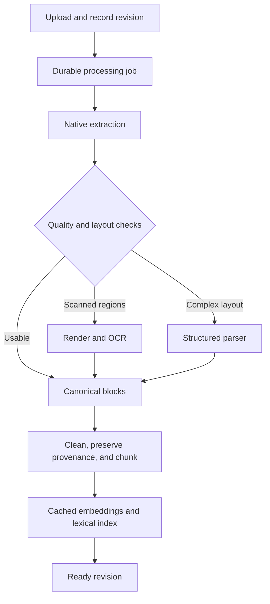

# Document processing for RAG: research and recommendations

**Project:** Case Study Generator · **Research date:** 2 October 2026  
**Purpose:** Compare document processing techniques, explain their trade-offs, and select a practical pipeline for the capstone and company-facing product.

## 1. Recommendation

Build a **native-first, structure-aware, evidence-preserving pipeline with selective OCR**. Extract typed blocks before chunking; retain headings, table relationships, page or slide locations, and original source references. Index token-bounded chunks in PostgreSQL/pgvector alongside lexical search. Add expensive enrichment only when evaluation shows a specific failure.

The recommended starting combination is:

1. Native extraction for readable PDF, DOCX, Markdown, and TXT.
2. Quality checks at page/block level, with OCR for scanned or defective regions.
3. A canonical block representation shared by every parser.
4. Structure-aware splitting with a recursive, token-bounded fallback.
5. Deterministic title/heading context for embeddings.
6. Exact source text, provenance, table units, and revision tracking.
7. Batched, cached embeddings and durable background processing.
8. Scoped hybrid retrieval, followed by bounded context expansion and evidence validation.

For complex PDFs and PPTX, **evaluate Docling as a Python worker**. Keep your existing TypeScript extraction path for simple files while measuring whether a unified converter reduces maintenance. Do not introduce a separate network service merely to call Python: a queued worker or controlled subprocess can be sufficient initially.

This is an engineering recommendation, not a measured result on our project. No project files were benchmarked during this research. Published results cannot establish our latency, cost, or retrieval quality.

## 2. Project requirements and assumptions

Based on the visible project context, the application uses AdonisJS with Inertia/React, Lucid, PostgreSQL/Supabase, S3-compatible storage, LangChain/LangGraph, OpenRouter, Tesseract.js, pdf-parse, and a TipTap editor. Users upload source material to generate case studies, then edit, approve, version, and export them.

The primary file scope is PDF, DOCX, Markdown, TXT, images, and URLs; PPTX is a useful extension. These are working assumptions from the conversation, not verification of the repository or company specification.

| Requirement | Processing implication |
| --- | --- |
| Generate case studies rather than answer isolated questions | Retrieve evidence separately for background, challenge, intervention, outcomes, and limitations |
| Business figures and outcomes | Preserve dates, currencies, units, denominators, table headers, and footnotes |
| Human approval and editing | Make every important factual claim inspectable against original evidence |
| Multiple documents and shared access | Scope retrieval to authorized source files and revisions |
| Small team and monolith | Prefer deterministic steps and existing infrastructure over multiple new services |
| Draft goals of processing under 30 seconds and generation under 1 minute | Define file-size/page limits and measure stages separately; these are targets, not guarantees |
| Low token usage | Remove irrelevant boilerplate and duplicate evidence without erasing facts |

The critical quality criterion is **faithful evidence**, not merely fluent output. A wrong table cell or lost qualifier can produce a convincing but incorrect case study.

## 3. Research method and evidence limits

This report uses official project documentation, maintainer repositories, original research papers, and first-party engineering descriptions. Sources were retrieved on the research date. Library versions and capabilities may differ from those installed in the project: pin and test the chosen releases before implementation.

Source references appear as `[S#]`, with clickable URLs in Section 16. Technique descriptions are source-grounded; fit ratings, priorities, schema designs, and tuning ranges are recommendations. No universal benchmark ranking or vendor cost estimate is asserted.

Processing and retrieval are separated below. Hybrid search and reranking do not extract files, but their needs determine what processing must preserve.

## 4. Extraction and document understanding techniques

### 4.1 Native text extraction

**Method:** Read existing text and document objects directly. For PDFs, extract page text and retain page boundaries. DOCX can be converted into semantic HTML; Markdown can be parsed into a syntax tree. [S1, S2]

**Advantages:** Avoids unnecessary recognition and preserves existing characters. Integrates naturally with the current Node/TypeScript stack.

**Trade-offs:** PDF text order may differ from visual reading order; scans may have no useful text layer. DOCX raw-text conversion discards structure. Extraction success is not a quality guarantee.

**Project fit: excellent; implement first.** Keep pdf-parse for straightforward PDFs, but assess each page. For DOCX, prefer semantic conversion over immediately reducing the file to one string. Preserve parser warnings.

### 4.2 OCR with image preprocessing

**Method:** Recognize text from raster images or rendered PDF pages. Correct rotation, skew, contrast, or noise only when required. OCRmyPDF documents workflows for searchable PDFs and image correction. Tesseract.js operates in Node/browser environments but does not directly support PDF input. [S3, S4]

**Advantages:** Enables scanned PDFs, photographs, and text inside images.

**Trade-offs:** Adds rendering and recognition work; can confuse digits, punctuation, and columns. Recognition confidence is not calibrated factual accuracy. Excessive preprocessing can remove thin characters or decimal points.

**Project fit: essential fallback.** Render the affected PDF pages before Tesseract.js, reuse a bounded worker pool, and select language packs deliberately. Flag uncertain numerical evidence for review. OCR extracts visible characters; it does not interpret a chart's trend reliably.

### 4.3 Selective page/region OCR

**Method:** Inspect native extraction first, then recognize only regions that lack usable text. A mixed PDF can contain both readable text and scanned pages.

**Advantages:** Avoids paying the OCR cost for every page and limits duplicate recognition.

**Trade-offs:** Text presence alone is insufficient: an existing OCR layer can be corrupt, and a page containing text can also contain an important screenshot. Region merging needs coordinates and deduplication.

**Project fit: excellent.** Use a combination of low text density, replacement characters, layout anomalies, and visible-image coverage. Treat thresholds as heuristics to tune. A sparse title page should not automatically be classified as broken.

### 4.4 Layout-aware partitioning

**Method:** Recover document elements such as headings, paragraphs, lists, tables, figures, and reading order. Unstructured offers partition strategies; Docling provides a unified document representation for supported formats. [S5, S6]

**Advantages:** Gives later chunking meaningful boundaries and improves handling of multi-column or visually complex material.

**Trade-offs:** Model dependencies and inference overhead; headings and tables can still be misclassified. PDF, DOCX, and PPTX have different source-location semantics.

**Project fit: high for difficult business documents.** Evaluate against simple extraction on actual sales reports and company slide decks. Retain the structured result so chunking can change without reparsing.

### 4.5 Table-aware extraction and serialization

**Method:** Preserve rows, columns, merged-cell relationships, captions, units, and notes. Index a small table intact; split a large table into row groups with repeated column headers. Docling's chunking documentation includes repeated table headers; pdf-parse exposes table extraction capabilities. Neither establishes perfect accuracy. [S7, S1]

**Advantages:** Makes numerical outcomes and comparisons retrievable with their meaning intact.

**Trade-offs:** Complex tables require validation. Markdown handles simple tables but loses some merged-cell semantics; flattening a table into prose can change meaning. Wide headers can consume much of a chunk budget.

**Project fit: very high.** Store canonical table JSON plus a retrieval serialization. Example: retain `Revenue | Q2 2025 | USD thousands`, not just `314`. Link split groups back to the complete table. Perform arithmetic deterministically against validated cells; do not assume embeddings can compute totals.

### 4.6 Slide-aware extraction

**Method:** Keep each slide's title, text, tables, figures, and relationships together, with a stable slide index. Docling lists PPTX among supported inputs. [S6]

**Advantages:** A slide is often a coherent evidence unit; useful for company presentation material.

**Trade-offs:** Text box order is not always visual order. Notes, grouped shapes, diagrams, and charts may need separate handling. Rendering slides first loses native object structure and adds recognition work.

**Project fit: high when PPTX enters scope.** Use native slide parsing first, then selective visual analysis. Verify whether the chosen parser captures speaker notes; do not silently claim notes are included.

### 4.7 HTML main-content extraction

**Method:** Fetch a page, isolate its main content, and retain headings and source URL. Mozilla Readability is an article extraction library. [S8]

**Advantages:** Removes navigation and repeated website material that would otherwise dilute retrieval.

**Trade-offs:** Article heuristics may omit product tables or useful sidebars; JavaScript-rendered content can require a browser. Pages can change after indexing.

**Project fit: good for URL ingestion.** Preserve an ingestion snapshot, retrieval timestamp, and content hash. Use content-specific selectors when article extraction is insufficient. Limit redirects and disallow internal/private-network destinations when fetching user URLs.

### 4.8 Vision-language parsing and figure descriptions

**Method:** Ask a vision-capable model to transcribe or describe a page, chart, diagram, or figure. Docling documents VLM pipeline options and picture enrichment. [S9]

**Advantages:** Can recover visual relationships that OCR cannot express.

**Trade-offs:** Introduces inference cost, latency, and possible invented values. A description may omit an axis label or uncertainty range; visual evidence must remain inspectable.

**Project fit: selective later addition.** Start with the figure caption and nearby text. Add a marked, derived description only for figures important to the case study. Never treat model-estimated chart numbers as verified source measurements.

## 5. Cleaning, normalization, and provenance

### 5.1 Conservative text normalization

Normalize Unicode and whitespace where safe; remove obvious soft hyphens; join line-wrapped words only with reliable evidence. Preserve paragraphs, list boundaries, and mappings back to source blocks.

**Benefit:** Reduces extraction noise. **Trade-off:** Aggressive cleanup changes identifiers, negative signs, or punctuation. **Fit: excellent.** Store raw and normalized forms separately and version the normalization rules.

### 5.2 Header/footer and boilerplate removal

Identify repeated text in similar page regions, then exclude confirmed running headers and footers from retrieval. Keep their original blocks for inspection.

**Benefit:** Fewer repetitive chunks. **Trade-off:** Repeated warnings, units, or confidentiality labels may matter. **Fit: high.** Use position, repetition, and block type together; avoid deleting every repeated sentence.

### 5.3 Exact and near-duplicate detection

Hash raw bytes for exact upload matches and normalized blocks for repeated text. Near-duplicate detection can identify almost identical versions but needs cautious thresholds.

**Benefit:** Avoids redundant parsing, embeddings, and prompt material. **Trade-off:** Similar reports may differ in one crucial date or value. Reuse across users also introduces permission complexity. **Fit: excellent for exact duplicates, optional for near duplicates.** Keep distinct source references even when computation is shared.

### 5.4 Evidence metadata and provenance

Store file revision, block IDs, section path, page/slide or document element reference, extraction method, and bounding box when available. Use canonical JSON rather than only a flattened Markdown string. Docling supports JSON export of its document representation. [S6]

**Benefit:** Makes citations, debugging, and reprocessing possible. **Trade-off:** Adds storage and data-model work. **Fit: mandatory.** Generated summaries and descriptions must point to original blocks. A DOCX element index is not a stable rendered page number.

### 5.5 Quality gates and graceful degradation

Detect unreadable output, suspicious numerical OCR, missing tables, broken order, unsupported content, and incomplete processing. Keep explicit warnings and stage status.

**Benefit:** Prevents silent failure. **Trade-off:** Heuristics produce false positives and require review. **Fit: mandatory.** A partially processed file should be visibly partial; do not label it ready just because some text was extracted.

## 6. Chunking techniques and trade-offs

| Technique | How it works | Main advantage | Main trade-off | Fit and decision |
| --- | --- | --- | --- | --- |
| Fixed character windows | Split every N characters | Simple baseline | Breaks meaning; characters do not equal model tokens | Low; use only as benchmark |
| Fixed token windows | Split using tokenizer limits | Predictable embedding input size | Can sever sentences, rows, and qualifiers | Medium; fallback for oversized blocks |
| Sentence/paragraph chunks | Group linguistic units | Keeps local meaning | Very small units lose context; long paragraphs need splitting | High within detected sections |
| Recursive splitting | Prefer paragraph/newline separators, then smaller units | Practical deterministic fallback | Cannot repair lost layout or table structure | High; retain current LangChain path [S10] |
| Structure-aware chunks | Split by headings, lists, tables, or slides | Preserves authored organization | Depends on parser quality | Excellent default [S7, S11] |
| Semantic chunking | Split where adjacent text embeddings indicate topic changes | Adapts to topical transitions | Extra embedding work; threshold sensitivity | Experiment only after baseline |
| Sliding overlap | Repeat text around boundaries | Protects boundary context | More embeddings and duplicate prompt content | Small, measured overlap for prose |
| Parent-child chunks | Search small children, expand to their section | Precise matching plus wider context | Parent expansion can inflate generation tokens | High after baseline; enforce a budget |
| LLM/agentic chunking | Model chooses coherent boundaries | Can handle weakly structured prose | Cost, variability, retries, and factual alteration if rewriting | Low for MVP |
| Proposition chunks | Extract atomic, self-contained claims | Fine-grained factual matching | Model-based decomposition can drop qualifiers | Later for validated facts [S12] |
| Late chunking | Contextualize token representations before pooling chunks | Preserves wider document context in vectors | Requires suitable embedding internals/model support | Research option [S13] |

### Recommended chunk policy

Preserve headings and typed blocks first. Within a section, combine compatible short paragraphs, then split oversized prose with the recursive splitter and enforce a token limit. Keep lists coherent where possible. Keep tables separate from unrelated prose and include relevant captions and notes.

**Initial experiment ranges, not universal best settings:** prose chunks of 350–700 embedding-model tokens; prose overlap of 0–80 tokens; parent sections of 1,000–2,000 tokens. Count contextual prefixes and table headers toward the limit. Use the embedding tokenizer where available; LangChain's default character-based length is not a token count. [S10]

Overlapping tables by arbitrary text is inappropriate: repeat headers while preserving distinct row groups. Merge very small chunks only when their section/type remains compatible.

For late chunking, a long input limit by itself is insufficient. A conventional API returning a single whole-document vector does not expose the contextual token representations needed for chunk-level pooling. Confirm implementation support before considering it. [S13]

## 7. Enrichment and advanced representations

| Technique | Mechanism and evidence | Benefit | Trade-off | Project recommendation |
| --- | --- | --- | --- | --- |
| Deterministic context prefix | Add source title and section path | Clarifies otherwise ambiguous chunks | Repeated context adds tokens; titles may be poor | Adopt first; short and source-derived |
| LLM contextualization | Generate explanatory context before indexing [S14] | Can disambiguate company, period, and topic | Per-chunk inference; context may invent facts | Test selectively on ambiguous chunks |
| Summary index | Index section/file summaries that link to raw blocks | Helps find broad topics | Summaries omit details and can mislead | Later; retrieve raw evidence afterward |
| RAPTOR | Recursively cluster and summarize into a retrieval tree [S15] | Supports broader document understanding | More indexing work and summary maintenance | Defer until long-corpus questions justify it |
| Entity/fact extraction | Extract people, organizations, dates, and metrics | Useful structured filters and fact validation | Entity resolution and qualifier errors | Add narrowly for dates/metrics first |
| GraphRAG | Build graph-derived representations and community reports [S16] | Useful corpus-wide relationship/theme exploration | Expensive indexing and considerable complexity | Defer; small case-specific sources may not need it |
| Visual multi-vector retrieval | Embed page images with late-interaction scoring, as in ColPali [S17] | Searches visual content without relying solely on extracted text | Multi-vector storage and scoring; image-based generation still required | Separate experimental track, not drop-in pgvector replacement |

Contextualization, summarization, and proposition extraction are **derived representations**, not replacements for source evidence. Keep raw text and source links independently. Anthropic's contextual retrieval results are vendor experiments; they are a reason to test the idea, not a promised improvement on our corpus. [S14]

An important distinction: **late chunking** produces context-aware chunk vectors, while **late interaction** scores multiple query/document vectors against one another. ColPali uses the latter; the two methods are not interchangeable. [S13, S17]

## 8. Tool selection for this project

| Tool/approach | Best use | Integration consequence | Limitations to verify | Decision |
| --- | --- | --- | --- | --- |
| pdf-parse | Straightforward native PDFs | Reuses current TypeScript code | Layout fidelity and table recovery on our samples; installed API version | Keep as fast path [S1] |
| Mammoth.js | DOCX semantic HTML | Node-based converter feeding block normalization | Does not reproduce full visual styling; validate images/tables | Good DOCX candidate [S2] |
| Tesseract.js | Image OCR | Existing Node integration | PDF rendering required; language/worker resources | Keep selective OCR [S3] |
| OCRmyPDF | Searchable scanned/mixed PDF workflow | Python/CLI plus external dependencies | Flags, resource use, and behavior on existing text layers | Evaluate when searchable PDF output helps [S4] |
| Docling | Unified complex PDF/DOCX/PPTX processing | Python worker and model assets | CPU latency, cold start, table/reading-order accuracy | Preferred structured-parser candidate [S6, S7] |
| Unstructured | Element partitioning and element-aware chunking | Python or service integration | Strategy dependencies and resource use; OSS versus hosted behavior | Compare with Docling [S5, S11] |
| Mozilla Readability | Article-like URLs | Node DOM integration | Non-article layouts and dynamic content | Good initial URL path [S8] |
| Hosted/VLM parsing | Difficult layout or figures | External request and provider constraints | Accuracy, data handling, cost, latency | Selective fallback only |

Do not compare a hosted product's advertised capabilities with an open-source library as if they are identical deployments. Model downloads, language assets, and warm/cold execution materially affect runtime. Record versions and licenses for the exact packages/models selected; verify their deployment terms before adoption.

## 9. Proposed architecture



### Responsibilities in the monolith

- **Upload service:** validates content type/size, stores bytes and source metadata, creates a durable job.
- **Processing worker:** fetches private object bytes, extracts blocks, applies quality checks, and persists versioned artifacts.
- **Chunk service:** converts canonical blocks into evidence-preserving search units.
- **Embedding service:** batches requests, retries transient failures, and caches by exact input/configuration.
- **Retrieval service:** checks source access, searches authorized active revisions, deduplicates evidence, and applies token budgets.
- **Generation service:** constructs section-specific evidence packs and produces validated TipTap content.

Keep CPU-heavy parsing/OCR outside the web-request path. An unawaited promise is not a durable job: a server restart can lose it. Begin with a durable job table/worker if that fits deployment; adopt additional queue infrastructure only as operational needs justify it.

Persist stage outputs. A failed embedding request should not force OCR to run again. Use bounded concurrency by workload and a lease/heartbeat for jobs, with idempotent stage writes and retries. Retry rate limits/timeouts with bounded backoff; deterministic corrupt-file failures need an actionable error or fallback.

## 10. Recommended processing data model

This is a proposed logical schema, not a migration verified against the current repository.

| Entity | Main fields | Reason |
| --- | --- | --- |
| `files` | owner/tenant, object key, original name, MIME, byte size, byte hash | Stable source identity |
| `document_files` | document ID, file ID, permitted/selected revision | Connect sources to generated documents |
| `file_revisions` | file ID, source hash, retrieval time for URLs | Preserve changes and citation targets |
| `processing_runs` | revision ID, pipeline version, status, timings, warnings, artifact keys | Separate extraction configurations and attempts |
| `document_blocks` | run ID, block type, text, raw reference, order, section path, source locator | Canonical evidence representation |
| `tables` | block ID, cells/headers/units/notes JSON | Retain numerical relationships |
| `chunks` | run ID, text, embedding input, token count, content hash, parent ID | Retrieval units |
| `chunk_blocks` | chunk ID, block ID, offsets or row range | Many-to-many provenance mapping |
| `chunk_embeddings` | chunk ID, model/version/dimension, vector, input hash | Support safe re-embedding |
| `generated_claim_sources` | generated version ID, claim/node ID, source block/chunk/revision | Persist factual evidence links |

Keep generated-document versions separate from source-file processing versions. Embeddings from different models or dimensions cannot be treated as one comparable vector space.

### Example canonical chunk

```json
{
  "chunkId": "chunk_42",
  "processingRunId": "run_8",
  "fileRevisionId": "revision_3",
  "kind": "table_rows",
  "sectionPath": ["Results", "Quarterly revenue"],
  "text": "Period | Revenue (USD thousands)\nQ2 2025 | 314",
  "embeddingInput": "Source: Company results. Section: Results > Quarterly revenue.\nPeriod | Revenue (USD thousands)\nQ2 2025 | 314",
  "sourceLocator": {"pageStart": 7, "pageEnd": 7},
  "blockRefs": [{"blockId": "table_4", "rowStart": 1, "rowEnd": 1}],
  "extractionMethod": "native_table",
  "warnings": [],
  "contentHash": "example-placeholder"
}
```

This is illustrative data, not a fact about the company. Use explicit locator conventions: PDF pages and presentation slides can be one-based; DOCX can use element references; HTML can use selectors and snapshots; TXT can use line/character spans. Store a coordinate system whenever bounding boxes are present.

Hash cache inputs with pipeline configuration, parser/version, language settings, normalization rules, chunker settings, exact embedding input, and embedding model/version. A file hash alone is not enough to detect configuration changes.

Use a transaction for publishing a completed index and switching the active run. Do not keep a database transaction open throughout OCR or external API requests. Unique stage/output keys should prevent duplicate writes after retries.

## 11. Retrieval and generation implications

### Hybrid search

Combine dense retrieval with lexical search to cover both semantic paraphrases and exact names, dates, or product identifiers. PostgreSQL provides full-text indexing; its native ranking is **not automatically BM25**. Label the first implementation “dense plus PostgreSQL full-text search,” unless an actual BM25 implementation is added. [S18]

Rank fusion can combine result lists without equating incompatible raw scores. Start with small bounded candidate pools; assess quality before adding a reranker. Reranking is a query-time cost, unlike ingestion-time enrichment.

pgvector offers exact and approximate search. Start with exact search for small scoped corpora; introduce HNSW when measurements justify it. Approximate index filtering can reduce returned results; pgvector documents iterative scans and filter-index approaches. Verify the deployed extension supports the selected options. [S19]

Access control must apply to both lexical and vector branches, parent expansion, figure access, and citation previews. Apply authorized source/revision constraints in the query, then validate results. Never let an LLM decide permissions.

### Case-study evidence packs

A single query based only on the document title can miss important material. For each template section, search for the specific evidence required: company background, original problem, intervention, chronology, measured outcomes, and limitations. Deduplicate across sections, preserving source diversity and contradictory evidence.

For small source sets, complete normalized content within a safe token budget may outperform selective retrieval. Include this as an evaluation baseline. For longer inputs, hierarchical retrieval and section-specific evidence packs are more controllable.

Use generated summaries to navigate, then cite original blocks. If outcome evidence is absent, leave the claim unsupported or mark the information missing. Validate citation existence, authorized revision, numeric consistency, and whether cited evidence actually supports the claim. Well-formed JSON or TipTap nodes alone do not establish factual accuracy.

Source content should be framed as evidence, not instructions. Preserve untrusted document text without allowing embedded requests to override the generation task. Escape/sanitize any extracted HTML rendered in previews.

## 12. Latency, token usage, and operational trade-offs

Processing time includes storage fetch, parsing, OCR/layout inference, normalization, chunking, embedding calls, and database writes. Some stages can overlap, so total wall time is not simply the sum of all recorded worker times. Measure critical-path latency and queue delay separately.

### Practical optimizations in priority order

1. Cache exact files and versioned stage outputs.
2. Prefer native text; OCR only failed or image-important regions.
3. Warm OCR/parser workers and preinstall model/language assets.
4. Bound page/file concurrency and memory usage.
5. Batch embeddings within provider token/request limits.
6. Remove confirmed boilerplate and duplicates.
7. Retrieve concise chunks and expand only when needed.
8. Add LLM enrichment only for demonstrated retrieval gaps.

For prose windows of size `s` with overlap `o`, the approximate token duplication multiplier is `s / (s - o)` for sufficiently long text. A 500-token window with 50-token overlap is about 1.11×; 200-token overlap is about 1.67×. Boundaries and short documents alter the exact count. This estimate describes duplicated input, not a guaranteed billing multiplier across providers.

Embedding contextual prefixes also adds tokens. LLM contextualization may repeatedly consume broader source content unless caching/batching reduces that work. Parent expansion can save index complexity while increasing generation context. Track those costs independently.

Do not promise 30-second processing for arbitrary scans. Define a supported envelope, for example native versus scanned documents, page limits, image resolution, worker hardware, and provider availability. Report p50 and p95 by input class. Upload completion and index readiness should be separate UI states.

## 13. Evaluation plan

### Representative test set

Build a legally usable set of 30–50 documents as an initial evaluation proposal, including native PDFs, multi-column PDFs, clean/noisy scans, mixed PDFs, table-heavy reports, DOCX with embedded images, Markdown/TXT, PPTX, and representative URLs. Include the languages the company actually needs. This is a suggested starting scale, not statistical proof.

Create human-reviewed questions and case-study requirements with gold source locations. Include numerical comparisons, dates, missing evidence, contradictory files, and visually encoded information.

| Layer | Metric/check | What it diagnoses |
| --- | --- | --- |
| Extraction | OCR character/word error on sampled ground truth | Recognition failure |
| Structure | Reading order and heading/list correctness | Layout failure |
| Tables | Correct cells, headers, units, and notes | Numerical evidence damage |
| Retrieval | Recall@k, nDCG@k, evidence diversity | Relevant evidence not found/ranked |
| Generation | Supported factual claims / factual claims checked | Unsupported output |
| Citations | Validity and actual support, scored separately | Broken or misleading citations |
| Performance | p50/p95 ready time, peak memory, queue delay | Operational bottlenecks |
| Cost | Embedding tokens, LLM input/output, retries per file | Spending drivers |
| Robustness | Restart, timeout, partial failure, duplicate job | Durable pipeline behavior |
| Access control | Cross-user and unauthorized-parent retrieval checks | Permission leakage |

### Controlled comparisons

- **A:** current plain extraction plus recursive splitter.
- **B:** canonical blocks plus structure-aware chunking and provenance.
- **C:** B plus selective OCR and table handling.
- **D:** C plus deterministic context prefixes and hybrid retrieval.
- **E:** D plus bounded parent expansion or a reranker.
- **F:** best baseline plus one advanced enrichment method at a time.

Keep the embedding model, generation model/prompt, source scope, and evidence token budget constant when testing chunking. Separate parser improvements from retrieval improvements. Record failure examples rather than reporting only an average score. Human checks remain necessary when an LLM judge is used.

Select a more complex technique only when the quality gain addresses a meaningful failure and fits the latency/cost envelope. No target score is prescribed without a baseline and agreed acceptance criteria.

## 14. Implementation roadmap

### Phase 1 — Reliable evidence baseline

Implement processing status, durable jobs, native extraction, canonical blocks, conservative normalization, token-bounded recursive/structural chunks, provenance, versioned embeddings, and scoped retrieval. Establish source inspection and numerical citation checks. Keep images/scans explicitly unsupported or partial until OCR is complete.

**Why:** These components make failures diagnosable and establish the measurable baseline.

### Phase 2 — Real-world document support

Add selective OCR, table-preserving serialization, DOCX/PPTX support as required, and a comparison of Docling versus Unstructured on difficult files. Add extraction warnings and retry-safe stage outputs.

**Why:** These changes address the source formats most likely to damage factual evidence.

### Phase 3 — Better case-study evidence selection

Add deterministic context prefixes, PostgreSQL lexical search with dense retrieval, section-specific evidence packs, and bounded parent expansion. Evaluate a reranker if relevant evidence is present but poorly ranked.

**Why:** Improve coverage while controlling generation tokens.

### Phase 4 — Targeted advanced methods

Test selective VLM descriptions, LLM contextualization, summaries, proposition extraction, late chunking, RAPTOR, GraphRAG, or visual retrieval only against recorded gaps. Each experiment needs a rollback path and raw-evidence grounding.

**Why:** Advanced methods add maintenance and inference work; their value depends on actual document characteristics.

## 15. Final decision matrix

| Priority | Technique | Why it fits our project |
| --- | --- | --- |
| Essential | Native-first extraction | Reuses current stack and avoids redundant OCR |
| Essential | Canonical blocks and provenance | Enables trustworthy case studies and source review |
| Essential | Structure-aware, token-bounded chunking | Preserves sections while respecting embedding limits |
| Essential | Table and numeric context preservation | Protects business outcomes and comparisons |
| Essential | Durable jobs, cache, pipeline versions | Supports asynchronous uploads and efficient retries |
| High | Selective OCR with quality gates | Extends support to scans without OCRing everything |
| High | Deterministic chunk context | Adds source meaning with little implementation complexity |
| High | Scoped hybrid search | Covers semantic queries and exact business terminology |
| High | Section-specific evidence packs | Matches the case-study generation task |
| Conditional | Docling/Unstructured structured worker | Worth adopting if complex inputs outperform current extraction |
| Conditional | Parent expansion and reranking | Helps when small chunks lack context or ranking is weak |
| Conditional | VLM figure understanding | Helps important diagrams/charts missing from text |
| Experimental | LLM contextualization and proposition extraction | May improve ambiguity/fact retrieval, with added verification |
| Defer | Late chunking, RAPTOR, GraphRAG, ColPali | Adopt only when corpus needs and measured gains justify complexity |

The best first investment is an inspectable document representation and reliable source mapping. Improvements there benefit every embedding model, retrieval strategy, and generation prompt used afterward.

## 16. Sources

All links below are primary sources: official documentation, maintainer repositories, original papers, or first-party engineering material. Accessed 2 October 2026. Report recommendations are not claims made by these sources.

- **[S1] pdf-parse maintainer repository:** native PDF text, images, rendering, and table APIs. https://github.com/mehmet-kozan/pdf-parse
- **[S2] Mammoth.js maintainer repository:** semantic DOCX-to-HTML conversion and limitations. https://github.com/mwilliamson/mammoth.js
- **[S3] Tesseract.js repository and FAQ:** OCR scope and lack of direct PDF input. https://github.com/naptha/tesseract.js · https://github.com/naptha/tesseract.js/blob/master/docs/faq.md
- **[S4] OCRmyPDF cookbook:** OCR workflows, rotation, and preprocessing. https://ocrmypdf.readthedocs.io/en/latest/cookbook.html
- **[S5] Unstructured partitioning:** document elements and partition strategies. https://docs.unstructured.io/open-source/core-functionality/partitioning
- **[S6] Docling supported formats:** common representation and exports. https://docling-project.github.io/docling/usage/supported_formats/
- **[S7] Docling chunking:** hierarchical/token-aware hybrid chunking and repeated table headers. https://docling-project.github.io/docling/concepts/chunking/
- **[S8] Mozilla Readability:** main-content extraction. https://github.com/mozilla/readability
- **[S9] Docling official documentation:** VLM pipelines and picture enrichment examples. https://docling-project.github.io/docling/
- **[S10] LangChain JavaScript recursive splitter:** separators and size configuration. https://docs.langchain.com/oss/javascript/integrations/splitters/recursive_text_splitter
- **[S11] Unstructured chunking:** element-aware and title-based approaches. https://docs.unstructured.io/open-source/core-functionality/chunking
- **[S12] Chen et al., Dense X Retrieval: What Retrieval Granularity Should We Use?** Proposition-based retrieval. https://arxiv.org/abs/2312.06648
- **[S13] Günther et al., Late Chunking: Contextual Chunk Embeddings Using Long-Context Embedding Models.** https://arxiv.org/abs/2409.04701
- **[S14] Anthropic, Contextual Retrieval:** chunk-specific contextualization and experimental results. https://www.anthropic.com/engineering/contextual-retrieval
- **[S15] Sarthi et al., RAPTOR: Recursive Abstractive Processing for Tree-Organized Retrieval.** https://arxiv.org/abs/2401.18059
- **[S16] Microsoft GraphRAG:** indexing and query architecture. https://microsoft.github.io/graphrag/index/overview/ · https://microsoft.github.io/graphrag/query/overview/ · https://github.com/microsoft/graphrag
- **[S17] Faysse et al., ColPali: Efficient Document Retrieval with Vision Language Models.** https://arxiv.org/abs/2407.01449
- **[S18] PostgreSQL full-text search documentation:** lexical indexing/search foundations. https://www.postgresql.org/docs/current/textsearch-intro.html
- **[S19] pgvector maintainer repository:** exact/approximate search, filtering, and iterative scans. https://github.com/pgvector/pgvector
