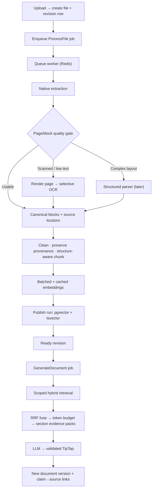

# RAG implementation plan: from current code to the target pipeline

**Project:** Case Study Generator · **Written:** 2 October 2026
**Status:** Proposed. **None of the phases below are implemented yet.** This document is an
engineering plan grounded in files that exist today, not a description of running behaviour.
**Companion to:** [`rag-document-processing-research.md`](./rag-document-processing-research.md)
(the *what and why*). This document is the *how and where*.

> **Evidence rule.** Every claim about the current codebase in this document was read from the
> repository on the date above and is cited as `path:line`. Where a claim depends on an external
> system that was not exercised (Supabase extension availability, OpenRouter embedding output
> format), it is marked **VERIFY** and must be confirmed before it is relied on. No benchmarks,
> latency numbers, or cost figures in this document were measured on our corpus.

---

## 1. Summary of decisions

The research document recommends a native-first, structure-aware, evidence-preserving pipeline
with selective OCR, canonical blocks, provenance, durable processing, and scoped hybrid retrieval.
This plan commits to that direction with four concrete architectural choices:

| Decision | Choice | Rationale |
| --- | --- | --- |
| Vector storage | **pgvector in the existing Supabase Postgres** | The README already claims pgvector (`README.md:17`); the DB is Postgres; no new datastore. Requires the `vector` extension. |
| Distance metric | **Cosine distance (`<=>`)** | `pplx-embed-v1-4b` produces **unnormalized** int8-quantized vectors. L2 (`<->`) and inner product (`<#>`) are incorrect for this model. |
| Background processing | **`@adonisjs/queue` + Redis** | Removes the transaction/I-O anti-pattern and makes retries durable. `@adonisjs/queue@0.6.2` peer-matches the installed `@adonisjs/core@^7.5.0` and `@adonisjs/lucid@^22.4.2`. |
| Structured parsing | **Stay in TypeScript for Phase 1–2**; evaluate a Python worker (Docling) only in Phase 3+ | The team is small; a second runtime is a maintenance cost. Native extraction plus selective OCR covers the initial format set. |

Embedding model stays `perplexity/pplx-embed-v1-4b` (`config/open_router.ts:6`), which is **2560
dimensions**, 32K context, and Matryoshka (MRL) capable. The generation model stays
`openai/gpt-6-luna` (`config/open_router.ts:5`) — **VERIFY** that this model id is served by
OpenRouter before relying on it; it was not exercised in this audit.

---

## 2. Current-state audit

### 2.1 What actually runs today

There is **no durable pipeline**. Everything happens synchronously inside one HTTP request:

```
POST /documents
  └─ documents_controller.store                 app/controllers/documents_controller.ts:33
       ├─ db.transaction()                       :36   ← opened before any I/O
       ├─ Promise.all(files → FileService.processFile)   :41
       │    └─ FileService.processFile           app/services/documents/files_service.ts:26
       │         ├─ drive.getStream + full buffer into RAM   :28-29, :60-68
       │         ├─ .pdf  → pdf-parse getText + getImage + Tesseract OCR every image  :70
       │         ├─ .docx → mammoth.extractRawText (structure discarded)              :109
       │         ├─ .png/.jpg → Tesseract OCR                                          :122
       │         └─ RecursiveCharacterTextSplitter(1000/200 chars) + embed each chunk  :140
       │              └─ OpenAIEmbeddings → OpenRouter /embeddings                     :9
       ├─ initDocumentContent                    app/services/documents/init_tiptap_doc.ts:22
       │    └─ OpenRouterService.generateDocumentInit
       │         ├─ createRelevantContext         app/services/open_router_service.ts:70
       │         │    └─ EmbeddFileService.similaritySearch   embedd_file_service.ts:24
       │         │         └─ in-process cosine over number[][] (top-20)   ← INVERTED
       │         └─ ChatPromptTemplate | withStructuredOutput(TipTap Zod)  :47
       ├─ create documents + document_versions + files + chunks rows   :47-66
       │    └─ embedding stored as comma-joined string   :62
       └─ trx.commit()                            :71
```

Relevant file inventory (AI/RAG surface):

| File | Role |
| --- | --- |
| `app/controllers/documents_controller.ts` | Orchestrates the entire pipeline inline |
| `app/controllers/uploads_controller.ts` | Puts bytes into S3, returns metadata, creates **no** DB row |
| `app/services/documents/files_service.ts` | Extraction, OCR, chunking, embedding |
| `app/services/documents/embedd_file_service.ts` | Embedding client + in-process cosine search |
| `app/services/documents/init_tiptap_doc.ts` | Glue: flattens chunks → LLM |
| `app/services/open_router_service.ts` | Retrieval, context assembly, generation, retry loop |
| `app/services/structured_model_output_service.ts` | TipTap Zod schema + prompt template |
| `app/services/exports/pdf_service.ts` | Playwright PDF export (unrelated to retrieval) |
| `config/open_router.ts` | Model + embedding model ids |
| `database/migrations/1790487764910_create_chunks_table.ts` | `chunks.embedding` is `text` |

> **Documentation drift.** `.agents/docs/codebase.md:3` says "AdonisJS 6". The installed core is
> `@adonisjs/core@^7.5.0` (`package.json`), i.e. AdonisJS 7. Correct this when the doc is next
> touched; it affects every CLI and provider reference in `adonis.md`.

### 2.2 Recommendation → implementation status

This extends the research document's final decision matrix (research §15) with what is actually
in the tree.

| Research item | Status in code | Evidence |
| --- | --- | --- |
| Native-first extraction | **Partial** | pdf-parse + mammoth exist, but DOCX uses `extractRawText` and PDF page boundaries are discarded (`files_service.ts:73,110`) |
| Canonical blocks + provenance | **Missing** | No block model; chunks are flat strings (`chunks` migration) |
| Structure-aware chunking | **Missing** | `RecursiveCharacterTextSplitter(1000, 200)` only (`files_service.ts:144`) |
| Table / numeric context preservation | **Missing** | No table extraction or serialization |
| Durable jobs, cache, pipeline versions | **Missing** | No queue, no hashing, no version columns; all inline |
| Selective OCR with quality gates | **Contradicted** | Every embedded PDF image ≥100px is OCR'd; confidence discarded (`files_service.ts:75-95,131`) |
| Deterministic chunk context | **Missing** | Prompt prefix is `[Source: <fileKey>, Chunk: N]`, and `fileKey` is `undefined` for text chunks (`open_router_service.ts:93`) |
| Scoped hybrid search | **Missing** | In-memory cosine only, no lexical branch, no authorization filter (`embedd_file_service.ts:24`) |
| Section-specific evidence packs | **Missing** | One retrieval query for the whole document (`open_router_service.ts:42-47`) |
| Parent expansion / reranking | **Missing** | — |
| pgvector | **Missing** | `chunks.embedding` is `text`; README claim at `README.md:17` is aspirational |
| LangGraph | **Unused** | Dependency present, zero imports |
| Correct dense ranking | **Broken** | Inverted sort, see **D1** |

### 2.3 What the research document already got right

- The system prompt frames retrieved text as **evidence, not instructions**
  (`structured_model_output_service.ts:62`), which mitigates prompt injection at the instruction
  level. Escaping/sanitization of extracted HTML is still missing.
- `withStructuredOutput` + a Zod schema (`open_router_service.ts:35`) constrains model output to
  a known node set, which mitigates output-side injection.
- Model output is validated before it reaches TipTap.

These should be preserved, not rebuilt.

---

## 3. Phase 0 — defects to fix first

Every item below is a defect in code that exists today. They are ordered by blast radius: **D1
silently degrades every document the product generates today.** Fix Phase 0 before starting the
architecture work, because several defects (D2, D3, D6) are load-bearing for Phase 1.

Each fix follows `working-rules.md`: a dedicated worktree (`git worktree add -b fix/<name> ../<name>`),
a test, then merge. Use `node ace` for any new framework-managed file (`adonis.md`).

### D1 — Retrieval returns the *least* relevant chunks (critical)

`app/services/documents/embedd_file_service.ts:24-36`

```ts
similarity: 1 - similarity.cosine(vectorQuery, vector),   // :30  → this is a DISTANCE
...
.sort((a, b) => b.similarity - a.similarity)              // :32  → descending
.slice(0, 20)                                             // :33
```

`ml-distance`'s `similarity.cosine` **already returns cosine similarity** (`p / sqrt(p2*q2)`,
confirmed in `node_modules/ml-distance/src/similarities/cosine.js`). Subtracting it from 1 turns it
into a distance, and the descending sort then ranks the **most dissimilar** chunks first. The
top-20 chunks injected into the prompt are therefore the 20 *worst* matches.

**Impact:** every generated document is grounded in the least relevant evidence available.
Retrieval quality, not the model, is the current bottleneck.

**Fix:** rank by `similarity.cosine(...)` directly, descending; add a minimum-score floor so
unrelated chunks are not injected as "evidence". When the pgvector migration lands (Phase 1),
replace the whole method with a SQL `ORDER BY embedding <=> $1`.

**Test:** seed three orthogonal unit vectors and one query aligned with the third; assert the
third is ranked first. This test does not exist today (`tests/unit/open_router_service.spec.ts`
stubs the whole chain; `tests/unit/services/files_service.spec.ts` stubs OCR).

### D2 — DB transaction held open across OCR and external API calls

`app/controllers/documents_controller.ts:36-71`. `db.transaction()` is opened at `:36`, then S3
downloads, Tesseract OCR, embedding calls, and the LLM call all run at `:41-44` **before** the
first row is written at `:47`. The research document explicitly warns against this
(`rag-document-processing-research.md:294`).

**Impact:** long-lived transactions hold pooler connections, risk pooler/client timeouts, and
make the pooler's transaction-mode behaviour fragile. A slow OCR job ties up a database
connection for the duration of the request.

**Fix:** extract the pipeline into a queued job (Phase 1). Until the queue lands, at minimum scope
the transaction to the row writes only (`:47-70`), and move extraction/generation before the
transaction.

### D3 — Orphaned S3 objects on rollback

`app/controllers/uploads_controller.ts:20` writes bytes to S3 and creates no DB row. If
`documents_controller.store` throws after upload, the `catch` at `:76-80` rolls back the DB but
leaves the objects in S3 forever.

**Impact:** unbounded storage growth and cost from failed generations.

**Fix:** make upload create a durable `files`/`file_revisions` row and a queued processing job.
On terminal failure, either delete the object or mark the revision failed so a lifecycle job can
reap it. Do not delete objects synchronously inside the request catch block.

### D4 — Unbounded concurrency

`app/controllers/documents_controller.ts:41` runs `Promise.all` over all uploaded files;
`app/services/documents/files_service.ts:157` runs `Promise.all` over every chunk of a file to
embed them.

**Impact:** a ten-file, thousand-chunk upload fires thousands of concurrent embedding requests.
A single `429` rejects the whole `Promise.all` and rolls back the request. `EmbeddFileService`
sets no `maxRetries` (`embedd_file_service.ts:9-15`), so there is no protection.

**Fix:** bounded concurrency (`p-limit` or queue worker concurrency), batched embedding calls
within provider token/request limits, and per-batch retry with backoff. `pplx-embed-v1` accepts
up to 512 inputs per request and 120,000 tokens combined — batch to that envelope.

### D5 — Retry loop has no backoff and no error classification

`app/services/open_router_service.ts:58-68`:

```ts
for (let i = 1; i <= this.MAX_RETRIES; i++) {   // MAX_RETRIES = 2 → only 2 attempts
  try { return await chain.invoke(input) }
  catch (error) { if (i < this.MAX_RETRIES) continue }   // instant retry, no delay
}
```

**Impact:** a rate-limit gets an immediate identical retry and fails again; deterministic errors
(Zod validation failures, `400`s, auth failures) are retried pointlessly; the first error is
swallowed with no log.

**Fix:** classify errors — retry `429`, `5xx`, and network timeouts only; exponential backoff with
jitter; log each failed attempt with the attempt number; cap total attempts honestly (the name
`MAX_RETRIES = 2` currently means two attempts, not one retry plus the original).

### D6 — Embeddings stored as comma-joined text; read-back helper is dead code

`database/migrations/1790487764910_create_chunks_table.ts:14` declares `table.text('embedding')`.
`app/controllers/documents_controller.ts:62` writes `chunk.embedding.toString()`, producing a
comma-joined string. At 2560 dimensions that is roughly **50 KB per chunk of pure serialization
overhead**, unindexable and unqueryable by the database.

`Chunk.getEmbedding()` (`app/models/chunk.ts:26-33`) parses it back but is **never called
anywhere**.

**Impact:** no database-side similarity search is possible; storage is inflated; the model of
record for an embedding is a string.

**Fix:** Phase 1 migration to a `vector(2560)` column plus a `chunk_embeddings` table carrying
model/version/dimension (see §5). Keep the old text column during backfill, then drop it.

### D7 — Source labels render as `undefined` in the prompt

`files_service.ts:74` calls `this.splitText(resultText.text)` **without** a `fileKey`, while
image chunks pass one (`:134`). `open_router_service.ts:93` renders
`[Source: ${document.metadata.filekey}, Chunk: ...]`.

**Impact:** every text chunk is labelled `[Source: undefined, Chunk: N]`, defeating provenance in
the generated prompt even before citations exist.

**Fix:** carry file identity explicitly through the pipeline. In Phase 1 this is replaced by block
refs and section paths, not a `fileKey` string.

### D8 — Environment contract drift

- `config/database.ts:50` reads `env.get('DB_URL')`, but `DB_URL` is **not declared** in
  `start/env.ts`, so it is unvalidated and untyped.
- `.env.example` is missing both `OPENROUTER_API_KEY` and `DB_URL`; bootstrapping from it fails
  `start/env.ts:48`.
- `.env` `DB_URL` host is `aws-0-ap-northeast-2.pooler.supabase.com`, while `DB_HOST` is
  `aws-0-ap-northeast-1.pooler.supabase.com` — **different regions**. `DB_URL` wins, so `DB_HOST`
  is dead but misleading.
- `config/logger.ts` reads `env.get('APP_NAME')`, also undeclared.
- `OPENROUTER_API_KEY` uses `Env.schema.string()` rather than `Env.schema.secret()`
  (`start/env.ts:48`).

**Fix:** declare `DB_URL`, `APP_NAME`, and any new Redis/pipeline vars in `start/env.ts`; use
`Env.schema.secret()` for API keys; reconcile the two Supabase regions to one project; update
`.env.example`.

### D9 — Tesseract language data resolved by working directory

`eng.traineddata` (~5.0 MB) is committed at the repo root and tracked in git. Neither
`createWorker('eng')` call (`files_service.ts:88,128`) sets `langPath` or `cachePath`. Tesseract.js
defaults its cache to the process CWD, so the root file works today only when the process starts
from the repo root.

**Impact:** running from any other CWD (container `WORKDIR`, systemd, a test runner) silently
re-downloads the pack from jsDelivr or fails offline.

**Fix:** remove `eng.traineddata` from git, add it to `.gitignore`, set explicit `langPath`/`cachePath`
via config, and download the pack as a setup step (`bin/install-deps.sh`).

### D10 — PDF image handling loses format and leaks resources

- `files_service.ts:164` hard-codes `image-file.png` as the extension for **every** extracted PDF
  image, regardless of its actual format.
- `saveToDrive` (`:162-171`) swallows all errors and returns `''`, so a failed image write
  produces a chunk with an empty `fileKey`.
- `PDFParse` (`:71`) is never destroyed/closed.

**Fix:** preserve the source image format, surface (do not swallow) storage failures, and release
the parser in a `finally` block.

### D11 — Embedding vector exposed to the client

`app/transformers/chunk_transformer.ts:6` includes `'embedding'` in the serialized payload. Chunks
are not preloaded on the document edit page today (`documents_controller.ts:86-93`), so it is not
currently leaked, but the transformer is a trap.

**Fix:** drop `embedding` from the transformer.

### D12 — Prompt requests nodes the schema forbids

`structured_model_output_service.ts:88` asks for numbered lists, but the Zod node enum
(`:23-31`) omits `orderedList` and `horizontalRule`, while the editor enables both. The model
literally cannot emit them.

**Fix:** add the missing node types to the schema (and tests, extending
`tests/unit/structured_model_output_service.spec.ts`).

### D13 — Document version insert is not awaited

`app/controllers/document_versions_controller.ts:27` calls
`document.related('documentVersions').create(payload)` without `await`, then saves the document
at `:29`.

**Fix:** `await` the insert (and compare hashes to skip no-op autosaves, per the editor's 800 ms
debounce in `inertia/components/documents/editor.tsx`).

---

## 4. Target architecture



### 4.1 Service responsibilities (mapped to real directories)

Per `adonis.md`, controllers stay thin, services hold logic, transformers format output.

| Responsibility | Where | Notes |
| --- | --- | --- |
| Job dispatch + status | `app/controllers/documents_controller.ts`, `app/controllers/uploads_controller.ts` | Controller only creates rows and dispatches; no extraction in-request |
| Durable workers | `app/jobs/*_job.ts` (new) | `@adonisjs/queue` jobs; keep each stage idempotent |
| Extraction | `app/services/documents/extractors/` (new) | One module per format behind a common interface |
| Canonical blocks | `app/services/documents/blocks/` (new) | Normalization + provenance |
| Chunking | `app/services/documents/chunking_service.ts` (new) | Structure-aware + token-bounded recursive fallback |
| Embedding | `app/services/documents/embedding_service.ts` (refactor of `embedd_file_service.ts`) | Batch, retry, cache by input hash |
| Retrieval | `app/services/documents/retrieval_service.ts` (new) | Dense + lexical + fusion + auth scope + budget |
| Generation | `app/services/open_router_service.ts` (refactor) | Consumes evidence packs instead of a flat chunk list |
| Persistence | Lucid models + migrations | See §5 |
| UI states | `inertia/components/documents/status.tsx`, `inertia/pages/documents/*` | Upload complete and index-ready must be separate states |

---

## 5. Data model

Create every schema file with `node ace` (`adonis.md`), then generate models with
`node ace make:model <Name>`. Logical schema follows research §10.

### 5.1 Migration commands

```bash
node ace make:migration create_file_revisions_table
node ace make:migration create_processing_runs_table
node ace make:migration create_document_blocks_table
node ace make:migration create_document_tables_table
node ace make:migration create_chunk_blocks_table
node ace make:migration create_chunk_embeddings_table
node ace make:migration add_vector_embedding_to_chunks
node ace make:migration add_full_text_search_to_chunks
node ace make:migration create_generated_claim_sources_table
```

### 5.2 Tables

| Table | Main columns | Purpose |
| --- | --- | --- |
| `file_revisions` | `file_id`, `source_hash`, `retrieved_at` (URLs), `mime`, `byte_size` | Stable source identity and citation target |
| `processing_runs` | `revision_id`, `pipeline_version`, `status`, `stage_timings` (jsonb), `warnings` (jsonb), `embedding_model`, `embedding_dimensions` | Separate attempts/configurations; enables safe reprocessing |
| `document_blocks` | `run_id`, `block_type`, `text`, `raw_reference`, `order_index`, `section_path` (jsonb), `source_locator` (jsonb), `extraction_method` | Canonical evidence representation |
| `document_tables` | `block_id`, `cells`/`headers`/`units`/`notes` (jsonb) | Preserve numerical relationships |
| `chunks` | existing + `run_id`, `kind`, `token_count`, `content_hash`, `parent_id` | Retrieval unit; **drop** `embedding text` after backfill |
| `chunk_blocks` | `chunk_id`, `block_id`, `row_start`, `row_end`, `char_start`, `char_end` | Many-to-many provenance |
| `chunk_embeddings` | `chunk_id`, `model`, `version`, `dimensions`, `embedding vector(2560)`, `input_hash` | Support re-embedding without recomputing text |
| `generated_claim_sources` | `document_version_id`, `node_id`, `block_id`, `chunk_id`, `revision_id` | Persist claim→evidence links for citation checking |

Keep generated-document versions separate from source-file processing versions
(`document_versions` already exists and must not be conflated with `processing_runs`).

### 5.3 pgvector specifics (critical correctness details)

```sql
-- Enable once, preferably over a DIRECT (non-pooled) connection. VERIFY on Supabase.
CREATE EXTENSION IF NOT EXISTS vector;

-- Embeddings are 2560-dim (pplx-embed-v1-4b). Pin this in config, do not hard-code in two places.
ALTER TABLE chunks ADD COLUMN embedding vector(2560);

-- HNSW index for cosine distance. pgvector >= 0.5.0 (Supabase ships newer).
CREATE INDEX chunks_embedding_hnsw
  ON chunks USING hnsw (embedding vector_cosine_ops);

-- Query: cosine DISTANCE (ascending = most similar first).
SELECT id, content, 1 - (embedding <=> $1) AS score
FROM chunks
WHERE embedding IS NOT NULL
ORDER BY embedding <=> $1
LIMIT $2;
```

**Distance operator:** use `<=>` (cosine). `pplx-embed-v1-4b` is **unnormalized**, so L2 (`<->`)
and inner product (`<#>`) produce incorrect rankings. This matches the bug in D1 but survives the
port to SQL only if the right operator is used.

**Dimension:** Perplexity's docs list `pplx-embed-v1-4b` at 2560 dimensions with MRL support
(128–2560). **VERIFY** what OpenRouter's OpenAI-compatible endpoint actually returns — Perplexity's
native API defaults to `base64_int8` encoding, while the current `OpenAIEmbeddings` client
(`embedd_file_service.ts:9-15`) expects a float array. Assert the returned length equals the
configured dimension at runtime and fail loudly on mismatch.

**Backfill:** the existing `chunks.embedding` text values are parseable floats
(`Chunk.getEmbedding()`), but were produced without a recorded model/version. Backfill by
re-embedding from `content` with a pinned model, not by trusting the old strings. Keep the text
column until the backfill verifies, then drop it.

**Pooler caveats (VERIFY):** `DB_URL` points at the Supabase **transaction pooler**
(`*.pooler.supabase.com`). Transaction-mode pooling does not support session-level state and
prepared statements may need `?pgbouncer=true`. Lucid works today without it; raw parameterized
SQL in retrieval should be tested against the pooler specifically. Run extension creation and
HNSW index builds on a direct connection to avoid statement timeouts.

### 5.4 Lexical branch

```sql
ALTER TABLE chunks
  ADD COLUMN content_tsv tsvector
  GENERATED ALWAYS AS (to_tsvector('english', coalesce(content, ''))) STORED;

CREATE INDEX chunks_content_tsv_gin ON chunks USING gin (content_tsv);
```

Label this "dense + PostgreSQL full-text search." PostgreSQL's native ranking is **not BM25**
(research §11, S18); do not describe it as BM25 unless an actual BM25 implementation replaces it.

---

## 6. Phased plan

### Phase 1 — Reliable evidence baseline

**Goal:** diagnosable, measurable, correct retrieval over native documents.

**Work**
1. Install and configure `@adonisjs/queue` + `@adonisjs/redis` (see §7).
2. `app/jobs/process_file_job.ts` — extract → blocks → chunk → embed → publish run, with stage
   outputs persisted and a lease/heartbeat. `app/jobs/generate_document_job.ts` — retrieve →
   evidence packs → generate → new version.
3. Refactor `documents_controller.store` to create rows, dispatch jobs, and redirect; no extraction
   or LLM in-request (fixes D2, D3, D4).
4. Canonical block extraction for PDF/DOCX/Markdown/TXT; preserve PDF page numbers and DOCX element
   refs. DOCX moves from `mammoth.extractRawText` to semantic conversion (`mammoth.convertToHtml`),
   then HTML → blocks.
5. Structure-aware chunking with a token-bounded `RecursiveCharacterTextSplitter` fallback
   (research §6 calibration: 350–700 embedding tokens, 0–80 overlap, count prefixes/headers).
6. pgvector migration + `chunk_embeddings`; batched, cached, retried embedding service keyed by
   input hash + model + version + dimensions (fixes D1 at the storage layer, D6).
7. Scoped retrieval service: dense + lexical with RRF, authorized-revision filter, token budget
   via `gpt-tokenizer`.
8. Status/warnings surfaced in UI (`status.tsx`, edit/create pages) as separate
   `uploaded` / `processing` / `ready` / `failed` states.

**Acceptance:** a document created from a native PDF has blocks with page locators; retrieval over
it returns relevant chunks for a section query with a source locator; a forced embedding failure
does not require OCR to re-run; server restart does not lose an in-flight job.

**Rollback:** keep the synchronous path behind a config flag until the queued path passes
evaluation (research §6 split retains the current LangChain path during transition).

### Phase 2 — Real-world document support

- Selective OCR: gate on text density, replacement characters, layout anomalies, and image
  coverage; OCR only failed/image-important regions; retain per-block confidence and flag uncertain
  numerics (fixes the "OCR everything" contradiction). Fixes D9, D10.
- Table-aware extraction + serialization: store canonical table JSON plus a row-group retrieval
  form with repeated headers; link groups to the full table.
- DOCX/PPTX as required; explicitly mark unsupported/partial inputs as such.
- Evaluate Docling vs Unstructured on our difficult samples; adopt a Python worker **only** if it
  measurably beats the TS path.

**Acceptance:** scanned PDF yields flagged, confidence-tagged text; a business table is retrievable
with headers and units intact.

### Phase 3 — Better evidence selection

- Deterministic context prefixes (source title + section path) baked into the embedding input —
  or evaluate Perplexity's `pplx-embed-context-v1-4b`, which is purpose-built for
  document-aware chunk embeddings.
- PostgreSQL lexical search integrated with the dense branch (already schema-ready from §5.4) and
  rank fusion.
- Section-specific evidence packs (background, challenge, intervention, outcomes, limitations)
  with cross-section dedup and preserved source diversity.
- Bounded parent expansion; add a reranker only if relevant evidence exists but ranks poorly.

**Acceptance:** retrieval recall improves on the evaluation set without exceeding the generation
token budget.

### Phase 4 — Targeted advanced methods (gated)

Each requires a recorded failure that the method addresses and a rollback path. In priority order:
VLM figure descriptions → LLM contextualization on ambiguous chunks → summary index → proposition
extraction → late chunking / RAPTOR / GraphRAG / ColPali. Adopt only against measured gaps
(research §7, §14).

---

## 7. Infrastructure: `@adonisjs/queue` + Redis

Peer compatibility was checked against the installed stack:

| Package | Version | Peer requirement | Project satisfies |
| --- | --- | --- | --- |
| `@adonisjs/queue` | `0.6.2` | `core ^7.0.0`, `lucid ^20\|\|^21\|\|^22`, `redis ^8\|\|^9\|\|^10` | `core ^7.5.0`, `lucid ^22.4.2` |
| `@adonisjs/redis` | `11.0.0` | `core ^7.0.0` | yes |

```bash
bun add @adonisjs/queue@^0.6.2 @adonisjs/redis@^11.0.0
node ace configure @adonisjs/queue    # CLI-first, per adonis.md
node ace configure @adonisjs/redis
```

The `configure` command registers the provider in `adonisrc.ts`, adds the command, and generates
`config/queue.ts` / `config/redis.ts`. Do not hand-write these.

**New env vars** (declare in `start/env.ts` with `Env.schema.secret()` for the password, and add to
`.env.example`):

```
QUEUE_CONNECTION=redis
REDIS_HOST=127.0.0.1
REDIS_PORT=6379
REDIS_PASSWORD=
```

**Worker process:** add a deployed process, e.g. `node ace queue:work --queues=documents`. Do not
run workers inside the web process if the app scales horizontally without shared state.

**Operational settings to pin:** queue concurrency (bounded, matching D4), per-job timeout,
attempts with backoff, and a retry policy that distinguishes transient from terminal errors
(matching D5). Redis is now a production dependency: decide its persistence and availability tier
before shipping.

---

## 8. Retrieval design detail

### 8.1 Authorization is part of the query

Documents are shareable (`document_shares`, `app/policies/document_policy.ts`). Retrieval must
enforce the **same** rule as `DocumentPolicy.edit` (owner OR any share) and `update` (owner OR
`role = 'edit'`) depending on the operation. Apply the constraint in SQL over
`files` → `document_files` → `documents` → `document_shares`, **then** validate results. Never let
the model decide permissions, and apply the filter to the lexical branch, parent expansion, figure
access, and citation previews alike (research §11).

### 8.2 Hybrid flow

```
query text ──┬─→ embed → dense search (chunks JOIN authorized files) ─┐
             └─→ websearch_to_tsquery → lexical search ────────────────┤
                                                                       ▼
                                              Reciprocal Rank Fusion → dedup
                                                                       ▼
                                     section-specific packs + token budget (gpt-tokenizer)
                                                                       ▼
                                             generate → validate → persist version + claims
```

Rank fusion combines lists without equating incompatible raw scores (research §11). Start with
small bounded candidate pools and evaluate before adding a reranker. Begin with exact pgvector
search for small scoped corpora; introduce HNSW when measurements justify it — HNSW with filters
can under-return, so verify the deployed pgvector version's iterative-scan behaviour.

### 8.3 Evidence framing

Preserve the existing "evidence, not instructions" framing
(`structured_model_output_service.ts:62`). Escape/sanitize extracted text before it enters the
prompt and before any HTML preview. Generated summaries may navigate, but citations must point to
original blocks. Validate citation existence, authorized revision, and numeric consistency
separately from well-formed JSON.

---

## 9. Evaluation plan

Build a legally usable 30–50 document set (native/multi-column/scan/mixed PDFs, table-heavy
reports, DOCX with images, Markdown/TXT, PPTX, URLs). Record human-reviewed questions with gold
source locations, including numerical comparisons, dates, and missing/contradictory evidence.

| Layer | Check |
| --- | --- |
| Extraction | OCR character/word error on sampled ground truth |
| Structure | Reading order, heading/list correctness |
| Tables | Correct cells, headers, units, notes |
| Retrieval | Recall@k, nDCG@k, evidence diversity |
| Generation | Supported claims / checked claims |
| Citations | Validity and actual support (scored separately) |
| Performance | p50/p95 ready time, peak memory, queue delay |
| Cost | Embedding tokens, LLM tokens, retries per file |
| Robustness | Restart, timeout, partial failure, duplicate job |
| Access control | Cross-user and unauthorized-parent retrieval |

Controlled comparisons (research §13), run with model, prompt, scope, and budget held constant:
**A** current path, **B** canonical blocks + structure-aware chunking, **C** B + selective OCR and
tables, **D** C + context prefixes and hybrid retrieval, **E** D + bounded parent expansion or
reranker, **F** best baseline + one enrichment at a time. Record failure examples, not only
averages.

---

## 10. Risks and mitigations

| Risk | Mitigation |
| --- | --- |
| pgvector unavailable/locked on Supabase, or pooler blocks DDL | **VERIFY** early on a direct connection; fallback is a separate vector store only if unavoidable |
| OpenRouter returns Perplexity's `base64_int8` instead of floats | Assert returned length/format at startup; decode if needed |
| Redis becomes a single point of failure | Choose an availability tier; jobs must be idempotent so a lost message is re-runnable |
| Embedding cost at `pplx-embed-v1-4b` ($0.03/1M tokens) scales with uploads | Cache by input hash; batch; consider MRL-reduced dimensions |
| OCR CPU on large scans | Selective OCR + bounded worker concurrency; keep OCR out of the web path |
| 2560-dim vectors inflate storage/index size | MRL reduction is available; measure before reducing |
| Scope creep into advanced methods | Phase 4 is gated on recorded failures with rollback paths |

---

## 11. Deliberately not doing yet, and open questions

- **LangGraph** is a dependency (`package.json`) with **zero imports**. Either adopt it for the
  multi-stage generation graph or remove it; leaving it is dead weight.
- **`approved` status** is declared (`status.tsx`, `validators/documents.ts`) but never set by any
  controller. Approval workflow is undefined.
- **PPTX** remains commented out (`files_service.ts:39-41,118-120`); `PptxParser` does not exist.
- **Ally/Google OAuth** is configured but has no routes (`start/routes.ts`).
- **`unified`, `remark-parse`, `remark-rehype`, `edge.js`** are declared but unused; decide whether
  the Markdown/HTML block pipeline will use them before keeping them.
- **`document_versions` content** is untyped `jsonb` with no dedup; autosave can create duplicate
  versions.

---

## 12. Verification checklist

Per `working-rules.md`, every phase is developed in its own worktree and merged only after
verification.

```bash
bun run lint
bun run typecheck        # tsc --noEmit + inertia/tsconfig.json
node ace test            # japa; unit suite currently covers services only
```

Manual checks for Phase 1: restart the server mid-job and confirm the job resumes or is retried;
force an embedding failure and confirm OCR is not re-run; retrieve across two shared documents and
confirm no cross-tenant leakage; confirm a scanned PDF is visibly marked partial, not "ready".

**Definition of done for any phase:** tests (including a regression test for the defect it fixes),
lint, typecheck, and a manual run of the application — not just a passing unit mock. The existing
`tests/unit/services/files_service.spec.ts` stubs OCR entirely and
`tests/unit/open_router_service.spec.ts` stubs the chain, so new coverage must exercise real
ranking and real extraction paths, not only mocks.
