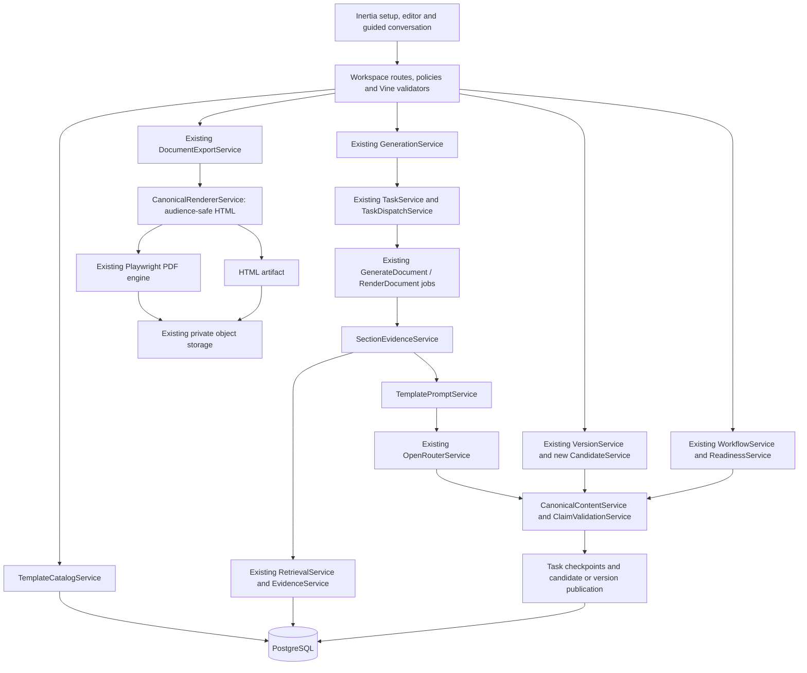

> Historical implementation, superseded by [Company document templates](document-outline-templates-plan.md). Retained as a record; its canonical workflow and commands are no longer active.

# Template-guided generation: target architecture

Date: 26 October 2026. Status: proposed; accompanies the [implementation plan](./template-generation-implementation-plan.md). All new names below are proposed. Existing classes are identified explicitly.

## 1. Boundaries and dependency direction

Keep the AdonisJS monolith. Routes select controllers and middleware; controllers load scope, authorize, validate, delegate and serialize. Services own orchestration, transactions and I/O. Shared schemas and adapters contain pure logic. Transformers expose explicit fields and do not query the database.



Ingestion still produces `file_revisions → processing_runs → document_blocks/chunks/chunk_blocks/chunk_embeddings`. Changing a writing template does not create another ingestion run or embedding space. New generated-content blocks belong inside immutable document snapshots. They are distinct from the extraction blocks already named `document_blocks`.

## 2. Code ownership and interfaces

| Location                                                          | Responsibility                                                                                                     |
| ----------------------------------------------------------------- | ------------------------------------------------------------------------------------------------------------------ |
| `shared/templates/contracts.ts`, `shared/templates/catalog.ts`    | Versioned Zod schemas, enums, built-in definitions and pure compatibility checks; safe imports from both runtimes. |
| `shared/templates/editor_adapter.ts`, `shared/templates/nodes.ts` | Canonical ↔ bounded editor JSON conversion and shared node definitions; no DB, Node-only modules or credentials.   |
| `config/templates.ts`                                             | Release flags, limits, repair policy, model-call budget, supported languages and renderer registry versions.       |
| `app/services/templates/catalog_service.ts`                       | Scope resolution, clone/draft/publish/archive, immutable hashes, system seed handling.                             |
| `app/services/templates/brand_service.ts`                         | Reviewed workspace brand versions; author/CTA/footer data is explicit configuration.                               |
| `app/services/documents/section_evidence_service.ts`              | Query planning, scoped retrieval, source snapshots, budget allocation, gaps and contradictions.                    |
| `app/services/documents/template_prompt_service.ts`               | Trusted prompt envelope, template definition and separated user/source segments.                                   |
| `app/services/documents/canonical_content_service.ts`             | Canonical parsing, bounds, structure, stable IDs, normalization and hashes.                                        |
| `app/services/documents/claim_validation_service.ts`              | Reference/number/availability checks and typed issue production; no assertion that automated checks prove truth.   |
| `app/services/documents/candidate_service.ts`                     | Section/template-change candidate storage, preview, acceptance and stale-base protection.                          |
| `app/services/exports/canonical_renderer_service.ts`              | Trusted HTML projection for internal/public audiences; no content rewriting.                                       |
| Existing generation/version/readiness/workflow/export services    | Integrate the above while preserving their existing task, scope and transaction boundaries.                        |
| Existing `OpenRouterService`                                      | Provider-specific schema mode, token usage, response parsing and bounded transport retries.                        |

Plain shared modules and React components have no Ace generator. Framework classes, migrations, validators, policies, controllers, transformers, commands, pages and tests are scaffolded with Ace. Full commands appear in the plan.

Core interfaces to settle in phase 1:

```ts
type GenerationIntent = {
  operation: 'full' | 'section' | 'derivative'
  documentId: string
  baseVersionId: string | null
  setupRevision: number
  selectionRevision: number
  templateVersionId: string
  language: string
  audience: 'internal' | 'public'
  imagePolicy: 'none' | 'source_only' | 'optional_source'
  brandVersionId: string | null
  mutationId: string
  sectionKey?: string
  parentVersionId?: string
}

type SourceManifest = {
  filePins: Array<{
    fileId: string
    revisionId: string
    runId: string
    pipelineVersion: string
    embeddingModel: string
    embeddingDimensions: number
    sourceHash: string
  }>
  documentPins: Array<{ documentId: string; versionId: string; contentHash: string }>
  assertions: Array<{ id: string; authorId: number; createdAt: string; contentHash: string }>
}

type ValidationIssue = {
  code: string
  severity: 'blocking' | 'warning'
  sectionKey?: string
  blockId?: string
  claimId?: string
  message: string
}
```

Use discriminated unions in the actual schema: `sectionKey` must be required only for section work and rejected for incompatible operations; parent pins are required for semantic derivatives. Clients submit selections and expected revisions. The server constructs the manifest, actor, permissions, template hash and generation identity; none is trusted from the client.

## 3. Canonical representation and editor behavior

The canonical root pins schema version, document type, template version/hash, language, project metadata, ordered sections, claims and media. Project metadata includes the title, one-sentence description and stage, independently of document workflow status. Brand and renderer configuration live in the immutable version envelope. All hash inputs use the existing stable `fingerprint()` algorithm with explicit schema/hash-algorithm versions.

Each section has `key`, stable `id`, status (`complete`, `needs_input`, `not_applicable` where permitted), ordered blocks and missing-information items. Each block has a stable server-issued UUID and a discriminated block type. Persisted claims have server-issued IDs; each claim binds an exact textual/metric value or metadata path and a hash. Client-created node IDs are temporary until accepted. A model uses only server-issued source handles; new structural IDs are allocated or remapped by the server before persistence.

| Block            | Canonical fields and editor representation                                                                                                                                                           |
| ---------------- | ---------------------------------------------------------------------------------------------------------------------------------------------------------------------------------------------------- |
| Paragraph        | Bounded rich text runs with allowlisted marks/links, claim anchors; paragraph inside a stable section node.                                                                                          |
| List             | Ordered/unordered items of the same bounded rich text; item identity preserved through edits.                                                                                                        |
| Capability group | Title, body, availability and claim IDs; heading/body editor node with a typed availability control.                                                                                                 |
| Metric table     | Typed rows: label, exact reported value string, optional parsed decimal, unit, scope, period, baseline, sample size, method, qualifier and evidence IDs. Typed row controls and semantic HTML table. |
| Comparison table | Typed rows with comparison basis, source date, scope and claims; unsupported superiority is an issue, never an inferred default.                                                                     |
| Image            | Authorized asset handle, caption, alt text, section slot and publication disposition; source metadata resolved server-side.                                                                          |
| Reference link   | Label, allowlisted destination and audience classification; never executable content.                                                                                                                |

Canonical rich text is a bounded semantic schema, not arbitrary TipTap JSON. Formatting-only changes preserve claim text hashes but still create a new content version. Factual edits invalidate the affected claim-review decisions. Splitting/merging paragraphs must deterministically remap anchors or mark the resulting claims unreviewed; copying a citation does not copy its review approval.

Use custom `templateSection`, `capabilityGroup`, `metricTable`, `comparisonTable` and claim-marker nodes built with installed TipTap core. Tables use typed row editors so numeric context cannot be lost through arbitrary cell operations. Share node/schema definitions between editor and adapters. These APIs are supported by [TipTap's custom-node mechanism](https://tiptap.dev/docs/editor/extensions/custom-extensions/create-new/node).

For new versions, canonical JSON is authoritative. `document_versions.content` is a deterministic compatibility projection generated in the same transaction; callers cannot independently write both representations. Legacy rows retain their original TipTap content and legacy normalizer. Every read, edit, history and export path branches on `content_schema_version`; a legacy normalizer must never strip attributes from a template version.

Draft saves may contain empty required sections or unresolved review issues, provided the storage schema and authorization remain valid. Malformed structure, unknown evidence IDs, unsafe links and invented assets fail the save. Generation uses stricter validity: hard failures trigger bounded repair and do not publish; permissible missing-data states create a reviewable draft with blockers. Approval requires all blocking issues to be resolved by verified correction or an explicitly permitted editorial disposition.

## 4. State and transactions

### Request

In a short transaction, lock workspace/membership in the established order, authorize the document, compare base/setup/source revisions, resolve a published accessible template, and pin source revisions and model/prompt/renderer configuration. Create the existing task plus dispatch intent atomically. Generation run ID equals task ID.

Hash the complete normalized caller intent, including operation, document/base IDs, explicit setup/template, language/audience/image policy, source-selection revision and parent/section identity. Repeat calls by the same actor with the same mutation ID and same intent reuse the task. Different intent under that ID returns 409. Reuse the repository uniqueness scope `(workspace_id, actor_id, kind, mutation_id)` rather than changing all historical task identities to workspace-only uniqueness.

A duplicate request returns the originally pinned task, even if a model config or published default changed later. New explicit requests receive new mutation IDs. Membership and resource access must still be valid before any duplicate response is disclosed.

### Worker

Retain existing task statuses: `queued`, `running`, `succeeded`, `failed`, `cancelled`, `conflict`. Add a separate stage (`preparing`, `retrieving`, `drafting`, `validating`, `publishing`, `ready`) for UI and metrics. Progress stages do not replace status or imply a precise percentage.

Checkpoint the source manifest/evidence pack, provider response, validated canonical candidate and diagnostics with hashes. Sensitive raw output is private, bounded and retention-limited. Reclaiming an expired lease can reuse a valid checkpoint only after current authorization and its input hash are rechecked. A provider timeout before a durable response may require another call; this is at-least-once provider execution with exactly-once database publication, not a promise of exactly-once provider billing.

Keep one semantic repair attempt per logical run, durable across job retries. Cap total provider attempts across initial generation, transport retry and repair in `config/templates.ts` (proposed six calls/run, three transport attempts per logical call, existing 90-second call timeout). Exhausted budget produces a terminal failure. Lease renewal remains active during calls. Instantiate the gateway from the pinned model/parameter snapshot; never silently read a changed default on retry. A now-disabled model fails explicitly. Credentials remain runtime configuration and never enter the snapshot. No transaction remains open during model, embedding or storage work.

### Publication and candidate acceptance

`TaskService.finish()` fences the lease and membership; publication then locks the document, compares base/input/setup/source revisions and checks the active task. It writes the immutable version, evidence/media projections, initial validation report and current pointer atomically. A partial unique generation-task reference prevents duplicate full/derivative versions.

For section regeneration, finish stores a detached candidate and diagnostics. It does not replace the editor contents. The UI presents a diff. Acceptance rechecks candidate ownership, membership, the expected base version and hashes, validates the assembled document, then creates one new version. Any intervening edit returns 409; no implicit rebase. Unchanged sections and their IDs remain byte-equivalent after canonical normalization. Rejecting a candidate retains the current draft.

Template switching is a deterministic mapping candidate: matching semantic keys map, incompatible sections/blocks appear in an explicit unmapped list, and the old version remains intact. Acceptance records acknowledged omissions. AI completion, if requested afterwards, is a normal generation operation against the newly accepted draft.

## 5. Evidence and review

Per-section retrieval calls the existing retriever with manifest pins, a section query and a budget. Add a metadata-only retrieval mode so signed image URLs are created only for the final authorized candidates, immediately before a provider call. With image policy `none`, do not sign or send image candidates; authorized extracted text can still contribute textual evidence. Reserve budgets across required sections; count shared evidence once in the model envelope. Record every section-to-evidence association even when an excerpt is globally deduplicated.

Extend evidence rows to expose revision/run/source-block identities, complete locators and hashes, rather than flattening to only a chunk/page reference. Distinguish copied source measurements, derived calculations with formula/input IDs, and user assertions with author/date. Preserve exact values and units; absent method/baseline/sample size remains null.

Authorization is independent of support. First verify that a reference belongs to the exact pinned manifest and authorized workspace; then verify exact values and context; finally require human support disposition for claims that cannot be established mechanically. Retain reviewer, claim hash, evidence-set hash, decision and reason. Review decisions are append-only and version-scoped. Missing-data fallbacks are explicit policy choices, not invented claims.

Automated issues integrate with `document_issues` using version, code, section/block/claim anchors and origin. Users cannot resolve a deterministic authorization/schema/number failure merely by toggling its issue state. Revalidation must clear it. Human support decisions can close review-required issues and record why; a generic warning acknowledgment cannot override a blocker.

Current access is rechecked for generation, retry, preview, approval, rendering and download. A source gaining a new revision is a staleness event; it does not silently replace the pin. Removing a source from current setup changes future generation but is distinct from revoking access to historical evidence. Deleted/quarantined sources or revoked membership block dependent use. Historical canonical access uses the version's explicit manifest, never “any source in this workspace.”

## 6. Approval, export and public output

For template documents, approval is an immutable decision over `(versionId, contentHash, templateVersion/hash, brandVersion/hash, rendererVersion, audience, imagePolicy, sourceManifestHash, validationReportId)`. New content gets new approval. Editing moves active pointers but does not erase historical approvals. Explicit revocation is a separate audit action. Legacy invalidation behavior stays on the legacy path.

Workspace owner or document owner may approve while they have active workspace membership. Ordinary members can edit and submit for review but cannot approve. Apply this rule in policy, coordinating service, readiness and exposed UI capabilities. Adding a workspace-owner policy method alone would leave the current service/readiness restrictions inconsistent.

Final template HTML/PDF exports require an exact approval, including in a one-member workspace. Draft preview remains available and clearly labeled. Historical approved versions can be selected explicitly; current access, revocation, source availability and approved render configuration are rechecked. The generic document metadata is not used to render an old snapshot.

`CanonicalRendererService` produces one audience-filtered HTML document for both HTML artifact and PDF. Public output omits internal IDs, source file URLs, private excerpts, editor warnings and private destinations. Public endnotes are emitted only for explicitly approved public references. Rendered text, numbers and qualifications come from the snapshot. Required media removal is a validation decision, not a silent renderer fallback.

Resolve approved asset bytes into data URLs or a self-contained permitted artifact; no signed/private storage URLs survive into public output. Retain PDF network blocking. Reject unknown URL schemes, user scripts/styles, and remote font/image fetching. Company CTA/footer/contact fields come from the reviewed brand snapshot. An unreviewed brand can support draft preview but blocks a final branded export.

Render and stage the object outside a DB transaction. In a short final transaction recheck access/approval/hash and publish the export record referencing the staged private object. Failed publication leaves an unreferenced object eligible for bounded cleanup. Download rechecks the export's recorded scope and sources. No CMS publication or public hosting is included.

## 7. P1 extension boundaries

Portfolio is a document type in the same pipeline, with ordered `portfolio_items` pointing to exact case-study versions. Each entry retains its own fact/evidence namespace and approved destination. Default inputs are approved parents; explicit internal drafts can use unapproved versions. Reject cross-workspace entries, duplicates and lineage cycles. Use bounded transitive authorization of parent evidence; public approval cannot hide unavailable underlying sources.

Short case studies, one-page summaries and presentations are new documents with a parent-version link, their own canonical schemas and approvals. Parent changes produce a staleness indicator without rewriting descendants. A semantic derivative never runs inside the formatting-only export operation.

The custom template editor modifies bounded data only. Workspace text is lower-trust than invariant system rules and cannot weaken source authorization, required factual review or resource fetching controls. Published versions remain immutable in both the application service and PostgreSQL update/delete guards.

## 8. Rollback and failure behavior

Disable new template creation/generation using capability flags, drain or safely fail queued template tasks, and retain the compatible readers/renderers and all published versions. Legacy documents continue to use the legacy path. Do not send a canonical document through the old prompt-only generator when the feature is disabled. Historical data, evidence and approvals remain available.

Additive migration rollback is safe only before template data is written. After use, operational rollback means feature disablement and a forward-compatible deployment; destructive down-migrations require separately reviewed data preservation. Older application binaries that cannot read canonical versions are not a safe rollback target.
