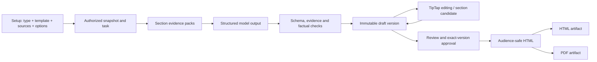

> Historical implementation, superseded by [Company document templates](document-outline-templates-plan.md). Retained as a record; its canonical workflow and commands are no longer active.

# Template-guided document generation — implementation plan

**Status:** User approved implementation. First-release code is implemented; see [verification report](template-generation-verification.md) for passed checks and open release gates. P1/P2 remain later scope.  
**Date:** 26 October 2026  
**Repository baseline:** `df9aa47`, `/Users/johnpaul/projects/capstone_demo`  
**Stack:** AdonisJS 7, Lucid/PostgreSQL, React/Inertia, TipTap, existing OpenRouter gateway, existing queue and private object storage.

This plan translates all 22 supplied backlog stories into repository-specific changes, routes, persistence, scaffolding commands and verification gates. Approval of this plan should settle the decisions in section 1 before implementation begins in a dedicated worktree.

Supporting documents: [research and current-state evidence](./template-generation-research.md), [architecture and transaction design](./template-generation-architecture.md).

Source documents: [output specification](/Users/johnpaul/Downloads/capstone-template-output-specification.md) and [backlog](/Users/johnpaul/Downloads/capstone-template-implementation-backlog.md). Their NestJS/Next.js references are unverified design assumptions; this plan follows the user's AdonisJS request and the inspected repository. Their company portfolio analysis informs editorial requirements, not verified project facts to inject into generated documents.

## 1. Decisions proposed for approval

| Decision                      | Proposed implementation                                                                                                                                                                                                                                                                   |
| ----------------------------- | ----------------------------------------------------------------------------------------------------------------------------------------------------------------------------------------------------------------------------------------------------------------------------------------- |
| Stack and scope               | Extend the existing application. Preserve configured ingestion, OCR, embeddings, model provider, storage and workspace architecture.                                                                                                                                                      |
| First release                 | `CS-STANDARD`, `CS-TECHNICAL`, `CS-VISION`; source imagery/no-image modes; section editing/regeneration; review; approved HTML/PDF. All P0 safeguards and evaluation are release gates.                                                                                                   |
| Later releases                | P1: portfolio collections, custom templates, short case studies, one-page summaries and presentations. P2: resumes and generated illustrations. P1 remains explicit product scope, not implied completion after PDF.                                                                      |
| Source of truth               | Versioned canonical semantic JSON. TipTap is an editing projection; HTML/PDF render the same immutable approved snapshot.                                                                                                                                                                 |
| Execution                     | A generation run is an existing `workspace_tasks` row. Extend current jobs, leases, dispatch intents and idempotency.                                                                                                                                                                     |
| Approval                      | For template documents, workspace owner **or** document owner with active membership may approve. Other members may edit/submit, but may not approve.                                                                                                                                     |
| Solo behavior                 | Final template exports require approval even with one member. Draft previews remain available. Existing legacy documents retain their established solo export behavior. This is a deliberate product change.                                                                              |
| Historical approval           | Keep approval of an old template snapshot identifiable after edits. New versions need approval; explicit revocation or lost access blocks old exports.                                                                                                                                    |
| Template administration       | Workspace owners manage/publish custom templates and brand versions. The repo has only owner/member roles; avoid inventing an editor/admin role in this feature. Members can select published templates.                                                                                  |
| Initial language              | Ship evaluated English definitions first. The schema carries a language code; other languages remain unavailable until retrieval, fonts, length rules and fixtures are verified.                                                                                                          |
| Missing measurements          | An explicit “not measured” statement is approvable where the template permits it. Missing required substantive information and unresolved contradictory claims block approval.                                                                                                            |
| Media                         | P0 accepts verified assets from selected source revisions. `none` suppresses media; `source_only` uses explicitly selected eligible assets; `optional_source` may suggest eligible source assets and omit optional empty slots. Required slots always obey their declared readiness rule. |
| Brand and public distribution | Use reviewed workspace brand configuration. Public audience controls artifact contents; it does not publish a website or push to a CMS. Unprovided contacts, bios, logos and CTAs remain absent.                                                                                          |
| Limits and repair             | One semantic repair attempt per logical run, separate from bounded transport retry; preserve valid saved content on failure. Initial bounded defaults are listed below and remain configurable.                                                                                           |

The source documents propose template names and lengths; they do not establish an official company template taxonomy. Accept these as application defaults subject to review.

### Initial catalog contract

| Template             | Ordered semantic sections                                                                                                              | Default length                       | Special behavior                                                                                         |
| -------------------- | -------------------------------------------------------------------------------------------------------------------------------------- | ------------------------------------ | -------------------------------------------------------------------------------------------------------- |
| `CS-STANDARD`        | `summary`, `context`, `solution`, optional `governance`, optional `deployment`, `outcomes`, conditional `limitations`, `conclusion`    | 700–1,100 words                      | Supported capability groups; truthful unmeasured-outcome fallback.                                       |
| `CS-TECHNICAL`       | `summary`, `context`, `technical_approach`, `implementation`, `evaluation`, `outcomes`, conditional `limitations`, `conclusion`        | 900–1,500 words                      | Metrics retain units, scope and methodology; limitations required when evaluation is incomplete.         |
| `CS-VISION`          | `summary`, `user_need`, `product_vision`, `capabilities`, `differentiators`, `availability_roadmap`, optional `outcomes`, `conclusion` | 600–1,000 words                      | Availability per capability; separates delivered, pilot and planned work; measured results are optional. |
| `CS-SHORT` — P1      | `problem`, `solution`, `outcome_status`, with common header                                                                            | 200–350 words                        | At most one image, optional full-case link; direct generation or reviewed derivative.                    |
| `PF-COLLECTION` — P1 | Introduction plus ordered typed project entries                                                                                        | 50–100 words/entry plus introduction | Each entry retains its source version, distinct facts and valid resource destination.                    |

Every case study snapshots title, one-sentence description, language and project stage (`concept`, `in_development`, `pilot`, `live`, `unknown`). Stage and capability availability are distinct from workflow status. Required identity/purpose must be available before generation; `unknown` stage is valid and visible. Optional metadata requires provenance. Word budgets exclude captions. P0 seeds make hero images optional so no-image mode remains a supported complete format. The full section-specific rules and budgets in specification section 5 are acceptance requirements for seed fixtures.

## 2. Current-state audit and adoption matrix

| Area and source                                                                                     | Current behavior                                                                               | Decision/status                                                                                   |
| --------------------------------------------------------------------------------------------------- | ---------------------------------------------------------------------------------------------- | ------------------------------------------------------------------------------------------------- |
| `package.json`; installed `@adonisjs/core` 7.5.2                                                    | AdonisJS 7, React/Inertia; old overview says Adonis 6.                                         | **Adopt** actual stack; **reject** framework migration.                                           |
| `app/services/documents/creation_service.ts:11`, `:19`                                              | Document and project creation immediately request generation.                                  | **Change** both paths to persist setup and require a visible selected format before generation.   |
| `app/services/documents/generation_service.ts:21`, `:32`, `:124`                                    | Source pins, hashes and atomic version publication; broad retrieval and generic TipTap output. | **Adopt** coordinator; **extend** request snapshots and generation pipeline.                      |
| `app/services/documents/retrieval_service.ts:11`                                                    | Scoped dense + PostgreSQL lexical retrieval and RRF.                                           | **Adopt** retrieval; add section planner and global evidence budgeting.                           |
| `app/services/documents/evidence_service.ts:27`, `:76`                                              | Scoped current/historical evidence via chunk and TipTap references.                            | **Extend** to canonical manifests, exact revision/block hashes and approved-parent lineage.       |
| `app/models/document_block.ts:8`, `app/models/chunk_block.ts:6`                                     | Ingested source blocks and chunk associations.                                                 | **Adopt** as evidence provenance; **reject** reuse as generated document sections.                |
| `app/services/workspaces/task_service.ts:75`, `:201`                                                | Durable execution with actor-scoped mutation IDs and fenced completion.                        | **Adopt**; add stages/checkpoints/usage, not a second queue/run state machine.                    |
| `app/services/documents/version_service.ts:14`                                                      | Optimistic append-only saves with mutation receipts.                                           | **Adopt**; add canonical version path and candidate acceptance.                                   |
| `app/services/documents/readiness_service.ts:28`, `:150`                                            | Global seven-field checklist, owner-only approval and solo bypass.                             | **Change** for template documents; preserve legacy branch.                                        |
| `app/services/documents/workflow_service.ts:18`, `:74`                                              | Prior approvals are invalidated; only document owner approves.                                 | **Change** to immutable snapshot approvals and shared ownership predicate for template documents. |
| `app/services/exports/document_export_service.ts:21`, `:179`                                        | PDF/current-version export and solo mode.                                                      | **Extend** with explicit approved version and render configuration.                               |
| `app/services/exports/pdf_service.ts:52`, `:136`                                                    | TipTap HTML → Playwright PDF with remote requests blocked.                                     | **Adopt** engine/resource isolation; add canonical semantic HTML and public filtering.            |
| `inertia/components/documents/form.tsx:18`, `editor.tsx:26`; `inertia/pages/documents/edit.tsx:126` | Guided brief, editor, polling and review controls.                                             | **Extend** existing surfaces; **defer** a new agent/chat framework.                               |
| Models/migrations/shared schemas inspected                                                          | No `case_study_templates` or versioned catalog found.                                          | **Add** one generalized catalog. Recheck before scaffolding on a newer baseline.                  |
| `postman/README.md:3`                                                                               | Endpoint matrices and functional tests are current API contract; provider simulation exists.   | **Adopt** and extend local artifacts; no workspace publication in planning.                       |

## 3. Integration defects and gaps to resolve first

“Defect” here means a mismatch with the proposed template contract, not a claim that all existing behavior violated earlier requirements.

| ID  | Location/symptom                                                                                       | Required fix and verification                                                                                                                                     |
| --- | ------------------------------------------------------------------------------------------------------ | ----------------------------------------------------------------------------------------------------------------------------------------------------------------- |
| D1  | Creation service auto-enqueues without a format.                                                       | Introduce draft setup; require resolved template for both case-study and project-start generation. Test both entry paths and reload.                              |
| D2  | Generic model schema lacks semantic sections, metrics and claims.                                      | Introduce canonical schemas and bidirectional editor adapters before enabling template generation. Reject unknown/duplicate/missing keys and incompatible blocks. |
| D3  | `generationInput`, `reviewInputHash` omit template/brand/audience/media/configuration.                 | Pin full normalized intent and snapshot hashes; replay with changed payload must 409.                                                                             |
| D4  | Readiness requires all seven information fields, including results.                                    | Template-specific prerequisites and permissible missing-data states; no-results Standard and Vision must remain viable.                                           |
| D5  | Policy, service, transformer and readiness disagree with requested workspace-owner approval.           | Update all four using a central permission predicate; test workspace owner, document owner, member and revoked membership.                                        |
| D6  | Generic invalidation and latest-only export make historical approval unusable.                         | Template snapshot history, explicit revocation and version-addressed exports; preserve old approved content through later edits.                                  |
| D7  | Legacy citation rendering includes internal IDs/URLs; public template exports need a clean projection. | Audience-safe canonical renderer; inspect HTML/PDF for IDs, private URLs, warnings and unsupported assets.                                                        |
| D8  | Generic historical evidence lookup and flattened retrieval rows lack full canonical provenance.        | Version-manifest resolution and full revision/run/block/locator/hash references; reject a valid chunk ID from the wrong manifest.                                 |
| D9  | Provider retries, task retries and future repair can multiply calls; stage checkpoints are absent.     | Persist budgets/checkpoints; test restart, exhausted repair, duplicate submission and provider timeout without duplicate publication.                             |
| D10 | Editor is disabled during current full-generation flow; section generation needs a candidate diff.     | Detached candidate plus explicit acceptance; preserve ongoing edits and return 409 on stale acceptance.                                                           |

Phase 0 locks down these behaviors in the design and establishes legacy regression evidence. Each implementation phase below resolves its listed gaps before its capability is enabled; there is no unrelated preliminary rewrite.

## 4. Target architecture



Controllers remain thin. Reuse `GenerationService`, `TaskService`, `TaskDispatchService`, `RetrievalService`, `EvidenceService`, `VersionService`, `WorkflowService`, `ReadinessService`, `DocumentExportService` and the OpenRouter/Playwright wrappers. New template, canonical-content, claim-validation, section-evidence, candidate and renderer services have bounded responsibilities described in the architecture document.

No provider call, embedding call or asset rendering runs inside a database transaction. Atomic boundaries are request/task creation, version publication, candidate acceptance, review/approval and export-record publication. Current membership epoch, expected base version, setup revision, source-selection revision and hashes fence every relevant write.

### Initial configurable limits

Use Zod for shared canonical/template schemas and Vine for HTTP envelopes. Define strict unknown-field handling and document-size/depth limits server-side. Proposed initial caps: 20 sections/template, 100 content blocks/document, 50 rows/table, 100 selected files (existing cap), 2 MB canonical JSON (matching the existing content ceiling), four provider image candidates, 10,000 unique evidence tokens/run (existing retriever default), and two concurrent section retrievals. Section budgets subdivide the global budget; required sections cannot be starved by earlier optional ones. Enforce a total model context budget after adding prompts/schema/output allowance.

Custom templates also bound instruction length (4,000 characters), section objective length (1,000 characters), nesting and per-block arrays. These are proposed starting values, validated against fixtures before release. Editorial word ranges produce warnings; structural limits, renderer capacity and unauthorized references are hard failures.

## 5. Data model and migrations

All new domain IDs are UUIDs; user/actor IDs use existing integer user keys. Timestamps use `timestamptz`; hashes use 64-character SHA-256 values plus a hash/schema version. Every tenant-owned relation carries `workspace_id`. Use Lucid-generated migrations, composite tenant FKs where applicable, and transaction-level scope checks for global system templates.

### 5.1 New P0 tables

| Table                            | Columns and important constraints                                                                                                                                                                                                                                                                                                                                                                                                                                                                                                                                                     |
| -------------------------------- | ------------------------------------------------------------------------------------------------------------------------------------------------------------------------------------------------------------------------------------------------------------------------------------------------------------------------------------------------------------------------------------------------------------------------------------------------------------------------------------------------------------------------------------------------------------------------------------- |
| `document_templates`             | `id`, nullable `workspace_id` (system scope), `key varchar(80)`, `document_type varchar(32)`, `name varchar(160)`, nullable `archived_at`, timestamps. Partial unique index on `key WHERE workspace_id IS NULL`; unique `(workspace_id,key) WHERE workspace_id IS NOT NULL`. System entries are read-only to workspace actors.                                                                                                                                                                                                                                                        |
| `document_template_versions`     | `id`, `template_id FK RESTRICT`, `version integer > 0`, `state draft/published`, `schema_version`, `definition jsonb`, `definition_hash`, `draft_revision integer`, nullable integer `created_by_id`, `published_by_id`, `published_at`, timestamps. Unique `(template_id,version)` and `(template_id,id)`. Published rows cannot be updated or deleted, including direct SQL. Archival belongs to the catalog; history remains readable.                                                                                                                                             |
| `workspace_brand_versions`       | `id`, `workspace_id`, `version`, `state draft/published`, bounded `definition jsonb`, `definition_hash`, author/publisher IDs, `published_at`, timestamps. Unique `(workspace_id,version)` and `(workspace_id,id)`; published configuration immutable. One brand series per workspace initially.                                                                                                                                                                                                                                                                                      |
| `document_evidence_references`   | `id`, `workspace_id`, `document_id`, `document_version_id`, `claim_id`, nullable `section_key`/`block_id`/metadata path, `source_kind file/document/assertion`, nullable file/revision/run/chunk/source-block IDs, nullable source-document-version ID, nullable assertion ID/author/date, `locator jsonb`, `source_hash`, `evidence_set_hash`, timestamp. Exactly one source kind; file ancestry must match, and all referenced entities must belong to the workspace. Unique per version/claim/reference identity; indexes on version, source revision and source document version. |
| `document_media_bindings`        | `id`, `workspace_id`, `document_id`, `document_version_id`, `section_key`, `block_id`, source revision/run/block IDs, optional source chunk ID, `asset_hash`, `caption`, `alt_text`, `disposition internal_only/public_approved`, nullable reviewer/date. Unique `(document_version_id,block_id)`. Reuses immutable source asset bytes/object references. No public URL is accepted as evidence.                                                                                                                                                                                      |
| `document_generation_candidates` | `id`, workspace/document IDs, nullable unique `generation_task_id`, `kind section/template_change`, `base_version_id`, `base_content_hash`, `input_hash`, nullable `section_key`, candidate canonical JSON, source manifest, `diagnostics jsonb`, `unmapped_content jsonb`, creator/time, `state pending/accepted/rejected`, nullable `accepted_version_id`/actor/time. Immutable candidate payload; lifecycle fields change under lock. A deterministic template-change candidate need not have a task.                                                                              |
| `document_validation_reports`    | `id`, workspace/document/version IDs, `phase`, `validator_version`, `input_hash`, `report_hash`, `issues jsonb`, `summary jsonb`, timestamp. Append-only. The input hash includes the snapshot and claim-review/evidence state; readiness must use a matching report, not simply the latest row.                                                                                                                                                                                                                                                                                      |
| `document_claim_reviews`         | `id`, workspace/document/version IDs, `claim_id`, `claim_hash`, `evidence_set_hash`, `decision supported/contradicted/unsupported/user_assertion_accepted`, reviewer ID, reason, `mutation_id`, `request_hash`, timestamp. Append-only review history; latest decision for the exact claim/evidence hash drives readiness. Unique `(workspace_id,document_version_id,reviewer_id,mutation_id)` makes a single-claim review retry idempotent; changed payload under the same identity is 409.                                                                                          |
| `document_exports`               | `id`, workspace/document/version IDs, unique `task_id`, `approval_id`, `snapshot_hash`, template/brand/renderer versions, `audience`, `format html/pdf`, `artifact_key`, `artifact_hash`, byte size, requester/time. Created on successful publication only; task status remains the execution authority. Index `(workspace_id,document_id,created_at)`. Final template export requires a valid approval.                                                                                                                                                                             |

Claims and semantic content live in canonical JSON; evidence/media tables are enforced relational projections created with the version, not an independently editable content store. At publication, validate that projections exactly match canonical references. Claim support decisions are separate records so immutable content need not be mutated during review. Automated hard failures cannot be bypassed by inserting a “supported” review.

For file references, use composite keys to enforce workspace and revision/run/block ancestry; add supporting unique indexes where the current schema lacks an exact target. Parent-document evidence must use a same-workspace version FK. Use `RESTRICT` for referenced source/version history to prevent silently deleting provenance. Source deletion must first report dependencies or explicitly mark the source unavailable; unavailable evidence blocks dependent operations. Document/workspace deletion retention remains an explicit migration review topic rather than accidental cascades through approval history.

### 5.2 Extend existing tables

| Table                | Additive changes                                                                                                                                                                                                                                                                                                                                                                                                                                                                                                       |
| -------------------- | ---------------------------------------------------------------------------------------------------------------------------------------------------------------------------------------------------------------------------------------------------------------------------------------------------------------------------------------------------------------------------------------------------------------------------------------------------------------------------------------------------------------------- |
| `documents`          | `content_mode legacy/template DEFAULT legacy`, `document_type DEFAULT case_study`, nullable `selected_template_version_id FK`, bounded `template_setup jsonb DEFAULT '{}'`, `setup_revision integer DEFAULT 0`. Setup stores language, audience, image policy, selected media and brand selection. Existing metadata/source revision counters remain independent. New flagged creation explicitly chooses template mode; incomplete setup is saveable.                                                                 |
| `document_versions`  | Nullable `template_version_id`, `canonical_content jsonb`, `content_schema_version`, `brand_version_id`, `parent_version_id`, `generation_task_id`, `content_hash`, `source_manifest jsonb`, `generation_snapshot jsonb`, `render_configuration jsonb`, `snapshot_hash`. Keep `content` as the server-derived TipTap projection. Existing `(workspace_id,document_id,id)` relation remains. Partial unique generation-task ID for published full/derivative results; candidate acceptance uses its own unique receipt. |
| `workspace_tasks`    | Nullable `stage`, `error_code`; bounded `checkpoint jsonb`, `telemetry jsonb`; `repair_count`, `provider_attempts` with nonnegative checks. Versioned payload includes operation, immutable caller intent, source pins, model/prompt/template/config hashes. Existing statuses, task kinds, leases, outbox and actor-scoped mutation uniqueness remain.                                                                                                                                                                |
| `document_issues`    | Nullable version/report IDs, `origin human/validation`, stable `code`, section/block/claim anchors, issue fingerprint. Partial uniqueness for a validation issue within its version. Human issues keep their existing document-wide scope; validation issues are filtered by target version.                                                                                                                                                                                                                           |
| `document_reviews`   | Nullable `snapshot_hash`, `render_configuration_hash`, `validation_report_id`, `source_manifest_hash`; preserve legacy fields.                                                                                                                                                                                                                                                                                                                                                                                         |
| `document_approvals` | Nullable snapshot/render hashes, validation report ID, `authority document_owner/workspace_owner`, explicit `revoked_at`, `revoked_by_id`, `revocation_reason`. Existing `invalidated_at` applies to legacy semantics; new template edits do not revoke old snapshot approval.                                                                                                                                                                                                                                         |

Template/brand fields are nullable for legacy rows. Add a check requiring a complete coherent canonical envelope when `content_schema_version` is present. Use PostgreSQL triggers to protect published template/brand definitions and canonical version payloads from update/delete through ordinary application writes. Catalog key, document type and scope are stable after creation. Canonical rows' content/configuration are immutable; review/checklist state resides outside them. The server chooses document mode from rollout policy; clients cannot downgrade a template document to legacy mode. Candidate acceptance reuses `version_acceptances` receipts with the candidate ID and acceptance payload in the request hash.

System templates have a nullable workspace, so a simple same-workspace FK cannot prove accessibility. Resolve catalog scope in the service inside the publication transaction, and use a DB trigger for catalog immutability/scope coherence. Test attempts to attach another workspace's template both through HTTP and direct DB writes.

### 5.3 P1 additions

Add `portfolio_items`: UUID ID, workspace ID, portfolio document/version IDs, `position integer >= 0`, source document/version IDs, `source_content_hash`, typed `entry_content jsonb`, `resource_url`, `audience`, optional category/stage/thumbnail reference. Unique `(portfolio_version_id,position)` and `(portfolio_version_id,source_document_version_id)`. Same-workspace FKs and source-version authorization are mandatory. Do not create a second portfolio document/version table.

Use the existing parent-version column for short/summary/presentation derivatives. Keep slide IDs/order/layouts in their own canonical discriminated schema. Resume records and generated-image provenance are P2 schema additions after their formats/providers are approved.

### 5.4 Migration sequence

1. Expand: create catalog/brand tables, extend documents/versions/tasks, then add dependent evidence/candidate/report/review/export tables and constraints.
2. Seed: insert system definitions by key and definition hash. Same key/hash is a no-op; changed published definition creates a new version. Never patch a published row.
3. Backfill: mark existing documents `legacy`; retain content, IDs and approval behavior. Do not assign an invented template or inferred claim provenance. Audit runtime schema for unexpected equivalents before applying migrations.
4. Switch: enable template reads/writes for one test workspace once all P0 prerequisites pass. New task payload version must coexist with queued legacy payloads during deployment.
5. Contract: no destructive cleanup in this backlog. A later reviewed migration may remove compatibility projections only after every consumer is migrated.

## 6. HTTP routes and contracts

All routes below live under **`/workspaces/:workspaceId`**, with the existing `auth` and `resolveWorkspace` middleware and session/CSRF protection. Every nested ID is scoped before use. Keep generated route names and frontend `urlFor`/Inertia route helpers; do not introduce unscoped `/templates/:id` or `/generation-runs/:id` endpoints from the generic backlog example.

### 6.1 P0 route matrix

| Method + suffix                                                        | Route name / controller action                                            | Contract                                                                                                                                                                                 |
| ---------------------------------------------------------------------- | ------------------------------------------------------------------------- | ---------------------------------------------------------------------------------------------------------------------------------------------------------------------------------------- |
| `GET /templates`                                                       | `templates.index` → `Templates.index`                                     | Filter compatible published templates by document type/language/renderer; excludes archived catalog entries from new selection; pagination, maximum 50/page.                             |
| `GET /templates/:templateId/versions/:versionId`                       | `templateVersions.show` → `TemplateVersions.show`                         | Published definition/heading preview; authorized historical published versions remain readable after archive.                                                                            |
| `POST /documents`                                                      | Existing `documents.store`                                                | Persist template setup and brief. Template mode creates a draft without implicit provider work. The explicit Generate action follows. Legacy behavior retains its branch during rollout. |
| `POST /projects`                                                       | Existing `projects.store`                                                 | In template-enabled flow, create project/draft and open setup; do not silently generate a default case study.                                                                            |
| `PUT /documents/:documentId/setup`                                     | `documentSetups.update` → `DocumentSetups.update`                         | Validate/persist exact selection with `setupRevision`; returns updated revision and readiness. Template changes on existing canonical content go through the candidate route.            |
| `PUT /documents/:documentId/sources`                                   | Existing `documentTasks.sources`                                          | Keep base/source-selection revision concurrency; source IDs are resolved server-side.                                                                                                    |
| `POST /documents/:documentId/generation`                               | Existing `documentTasks.generate`                                         | Exact template intent + expected revisions + mutation ID; 202 task receipt. Reuses the existing endpoint instead of adding a duplicate generation API.                                   |
| `GET /tasks/:taskId`                                                   | Existing `documentTasks.show`                                             | Safe task/status/stage, warnings, terminal version/candidate ID and retry action. No raw prompts, keys, internal object keys or provider responses.                                      |
| `POST /documents/:documentId/versions`                                 | Existing `documentVersions.store`                                         | Canonical editor save with `baseVersionId` and `mutationId`; server creates canonical snapshot/projection. Legacy body remains supported only for legacy documents.                      |
| `POST /documents/:documentId/sections/:sectionKey/regenerate`          | `documentSections.regenerate` → `DocumentSections.regenerate`             | 202 detached candidate task against exact base; optional bounded rewrite intent. Does not replace current content.                                                                       |
| `POST /documents/:documentId/template-change`                          | `documentTemplateChanges.store` → `DocumentTemplateChanges.store`         | Create mapping candidate with target published version, expected base/setup revisions and mutation ID; return 201 with unmapped content report.                                          |
| `GET /documents/:documentId/candidates/:candidateId`                   | `documentCandidates.show` → `DocumentCandidates.show`                     | Authorized before/after sections, omissions and validation diagnostics.                                                                                                                  |
| `POST /documents/:documentId/candidates/:candidateId/accept`           | `documentCandidates.accept` → `DocumentCandidates.accept`                 | Compare base/hash and record accepted omissions; create one new unapproved version; repeated identical mutation returns its receipt.                                                     |
| `POST /documents/:documentId/candidates/:candidateId/reject`           | `documentCandidates.reject` → `DocumentCandidates.reject`                 | Idempotent rejection; current content/approval unaffected.                                                                                                                               |
| `GET /documents/:documentId/versions/:versionId/validation`            | `documentValidations.show` → `DocumentValidations.show`                   | Current exact-snapshot report and unresolved review actions.                                                                                                                             |
| `POST /documents/:documentId/versions/:versionId/claim-reviews`        | `documentClaimReviews.store` → `DocumentClaimReviews.store`               | Owner reviewer records a claim/evidence-hash disposition and reason; returns new validation state.                                                                                       |
| `POST /documents/:documentId/reviews`                                  | Existing `documentReviews.store`                                          | Submit `baseVersionId` and exact render configuration for review; template-specific readiness.                                                                                           |
| `POST /documents/:documentId/approvals`                                | Existing `documentReviews.approve`                                        | Exact review/version/configuration, warning acknowledgments and mutation ID; owner policy enforced.                                                                                      |
| `POST /documents/:documentId/approvals/:approvalId/revoke`             | `documentApprovalRevocations.store` → `DocumentApprovalRevocations.store` | Explicit audited revocation by an authorized owner; blocks future dependent exports.                                                                                                     |
| `GET /documents/:documentId/versions/:versionId/preview/:format`       | `documentPreviews.show` → `DocumentPreviews.show`                         | Authenticated HTML/PDF draft preview, labeled unapproved when appropriate; current access checks. Format allowlist only.                                                                 |
| `POST /documents/:documentId/versions/:versionId/exports`              | `documentExports.store` → `DocumentExports.store`                         | 202 render task for `format`, `approvalId`, exact configuration hash and mutation ID. Explicit historical version allowed.                                                               |
| `GET /documents/:documentId/exports/:taskId/download`                  | Existing `exportPdfs.download`, delegate to generalized export service    | Serve HTML or PDF by recorded MIME/name; recheck snapshot approval/access. Preserve old route name for existing callers.                                                                 |
| Existing PDF preview/export paths                                      | Existing `ExportPdfs` actions                                             | Compatibility wrappers. Template requests use the new gate; they cannot use legacy solo export to bypass approval.                                                                       |
| `GET /documents/:documentId/versions/:versionId/evidence/:referenceId` | `documentEvidence.show` → `DocumentEvidence.show`                         | Resolve only a reference in that snapshot; return scoped passage/locator. Existing chunk and asset endpoints remain for legacy content.                                                  |

P0 brand configuration is imported and published through a reviewed, owner-attributed Ace command using `BrandService`; public branded release requires that configuration. A brand-management page is unnecessary for this milestone. The command must validate the actor's current ownership, support dry-run, refuse mutation of published versions and accept a local data file without executable instructions.

### 6.2 P1 routes

| Method + suffix                                                        | Purpose                                                                                                        |
| ---------------------------------------------------------------------- | -------------------------------------------------------------------------------------------------------------- |
| `GET /templates/manage` and `GET /templates/:templateId/edit`          | Inertia template management pages; owner capability. Declare the static `manage` path before parameter routes. |
| `POST /templates`                                                      | Clone a published seed or create a bounded workspace draft.                                                    |
| `POST /templates/:templateId/versions`                                 | Create a draft revision from a published version.                                                              |
| `PATCH /templates/:templateId/versions/:versionId`                     | Update draft only, with `draftRevision`; 409 on stale revision, 422 on invalid structure.                      |
| `POST /templates/:templateId/versions/:versionId/validate`             | Validate structural fixtures/example and return diagnostics; no implicit provider call.                        |
| `POST /templates/:templateId/versions/:versionId/publish`              | Publish validated immutable definition; idempotent mutation.                                                   |
| `POST /templates/:templateId/archive`                                  | Remove from new selection; historical reads/rendering remain.                                                  |
| `PUT /documents/:documentId/portfolio-selection`                       | Persist ordered authorized source-version IDs, destinations and audience with setup revision.                  |
| Existing generation route with `documentType=portfolio` in saved setup | Generate the distinct portfolio-entry schema through the same coordinator.                                     |
| `POST /documents/:documentId/derivatives`                              | Pin parent version and target type/template; create a separate draft/document and generation task.             |

### 6.3 Generation example and errors

The JSON flow sends `Accept: application/json` and a valid session/CSRF token. The existing source-selection endpoint owns file selection; generation compares its revision and pins exact current eligible revisions on the server.

```json
{
  "mutationId": "<client UUID>",
  "baseVersionId": "<saved version UUID or null>",
  "setupRevision": 2,
  "selectionRevision": 3,
  "templateVersionId": "<published UUID>",
  "language": "en",
  "audience": "internal",
  "imagePolicy": "optional_source",
  "brandVersionId": null
}
```

The IDs above are placeholders, not executable fixture values. Document type comes from validated saved setup and must match the template. The explicit request choices must match `setupRevision`; mismatch is 409. Success retains the existing receipt shape: `{ "data": { "id": "<task UUID>", "status": "queued", "stage": "preparing" } }`, with a scoped polling location. Terminal task result returns `versionId` or `candidateId`.

Preserve the current exception-handler envelope: `{ "error": { "code": "...", "message": "...", "retryable": false } }`, with field errors on 422. Add structured validation issue details through explicit exceptions/transformers, rather than parsing prose. Use 404 for inaccessible scope/resource, 403 for a known accessible resource with a forbidden action, 409 for stale base/setup, active incompatible work or reused mutation with different input, and 422 for incompatible template/language or invalid content/readiness. Preserve framework CSRF failures. Worker/provider failures appear as safe terminal task codes; they do not replace a previously saved version.

Stable domain codes include `SECTION_MISSING`, `SOURCE_UNAUTHORIZED`, `NUMERIC_MISMATCH`, `FACT_CONFLICT`, `CLAIM_NEEDS_REVIEW`, `LENGTH_WARNING`, `TEMPLATE_INCOMPATIBLE`, `RENDER_OVERFLOW`, `REPAIR_EXHAUSTED` and `INPUTS_CHANGED`. A retry of the same mutation reuses its run; a user-requested fresh run uses a new mutation ID and a newly authorized snapshot.

## 7. AdonisJS CLI and file plan

The following are **implementation commands to run after approval**, not commands executed while writing this plan. Their generator names/flags were checked against installed `node ace list --json` and per-command help. Generate once, then edit the generated files. Never use `--force` to replace existing services or models.

Create/reuse a dedicated managed worktree from the agreed baseline at implementation start. Shared planning documents live in `docs/`, the repository's current documentation location; `.agents/` is read-only in this session. No worktree, commit or migration is necessary to prepare this review package.

### 7.1 P0 models, migrations and seed

```bash
node ace make:model DocumentTemplate --migration
node ace make:model DocumentTemplateVersion --migration
node ace make:model WorkspaceBrandVersion --migration
node ace make:migration add_template_setup_to_documents --alter
node ace make:migration add_canonical_snapshots_to_document_versions --alter
node ace make:migration add_template_execution_to_workspace_tasks --alter
node ace make:model DocumentEvidenceReference --migration
node ace make:model DocumentMediaBinding --migration
node ace make:model DocumentGenerationCandidate --migration
node ace make:model DocumentValidationReport --migration
node ace make:model DocumentClaimReview --migration
node ace make:migration add_version_validation_to_document_issues --alter
node ace make:migration add_snapshot_identity_to_document_reviews --alter
node ace make:migration add_snapshot_revocation_to_document_approvals --alter
node ace make:model DocumentExport --migration
node ace make:migration enforce_template_snapshot_integrity
node ace make:seeder DocumentTemplate
node ace make:command audit_template_migration
node ace make:command publish_workspace_brand
```

Edit migrations in dependency order before running: version extensions reference the existing task table; candidate/report/approval relations follow their prerequisite tables; the final integrity migration adds guards/composite indexes after all columns exist. Generated alter-table guesses must be changed to the exact existing table names in section 5. Register proposed command names `templates:audit` and `templates:publish-brand` in their generated classes; these are new commands to implement, not currently installed commands.

### 7.2 P0 services and HTTP scaffolds

```bash
node ace make:service templates/catalog
node ace make:service templates/brand
node ace make:service documents/section_evidence
node ace make:service documents/template_prompt
node ace make:service documents/canonical_content
node ace make:service documents/claim_validation
node ace make:service documents/candidate
node ace make:service exports/canonical_renderer
node ace make:controller templates index
node ace make:controller template_versions show
node ace make:controller document_setups update
node ace make:controller document_sections regenerate
node ace make:controller document_template_changes store
node ace make:controller document_candidates show accept reject
node ace make:controller document_validations show
node ace make:controller document_claim_reviews store
node ace make:controller document_approval_revocations store
node ace make:controller document_previews show
node ace make:controller document_exports store
node ace make:controller document_evidence show --singular
node ace make:policy document_template view create update publish archive --model=DocumentTemplate
node ace make:policy workspace_brand view publish --model=WorkspaceBrandVersion
node ace make:validator document_template --resource
node ace make:validator document_setup
node ace make:validator document_candidate
node ace make:validator document_claim_review
node ace make:validator document_export
node ace make:transformer document_template
node ace make:transformer document_template_version
node ace make:transformer document_candidate
node ace make:transformer document_validation_report
node ace make:transformer document_export
```

The service generator adds `_service.ts`; for example `templates/catalog` creates `app/services/templates/catalog_service.ts`. Edit existing document/task/version/review/image/export validators, policies, controllers, transformers and jobs in place. No new queue package or replacement job scaffold is required. Add `approve`, `revokeApproval`, `reviewClaim` and explicit export checks to the existing document policy/service path.

Create pure shared modules, catalog definitions, config and React feature components directly; there is no relevant Ace generator for these files. P0 extends existing pages rather than creating a parallel application. Components: `template_selector.tsx`, `template_preview.tsx`, `template_setup.tsx`, `section_actions.tsx`, `candidate_diff.tsx`, `validation_panel.tsx`, typed metric/comparison editors, and `export_snapshot_dialog.tsx` under `inertia/components/documents/` or a shared `templates/` directory. Extend generated data consumers only after backend transformer changes.

### 7.3 Test scaffolds and P1 additions

```bash
node ace make:test templates/contracts --suite=unit
node ace make:test templates/editor_adapter --suite=unit
node ace make:test templates/validation --suite=unit
node ace make:test templates/rendering --suite=unit
node ace make:test template_catalog --suite=functional
node ace make:test template_generation --suite=functional
node ace make:test template_editing --suite=functional
node ace make:test template_workflows --suite=functional
node ace make:test template_media_exports --suite=functional
node ace make:test template_rollout --suite=functional
node ace make:test template_workflow --suite=browser

# P1 only, after its phase is approved for implementation
node ace make:model PortfolioItem --migration
node ace make:service documents/portfolio
node ace make:service documents/derivative
node ace make:controller document_portfolio_selections update
node ace make:controller document_derivatives store
node ace make:validator portfolio_selection
node ace make:validator document_derivative
node ace make:page templates/manage --react
node ace make:page templates/edit --react
node ace make:test portfolio_generation --suite=functional
node ace make:test workspace_templates --suite=functional
node ace make:test document_derivatives --suite=functional
```

Add P1 actions to existing template controllers instead of rerunning their generators. Generate any later summary/presentation renderer services and tests when those contracts are agreed. New Adonis packages, if later justified, use `node ace add`; P0 needs no package addition. Do not add an unreviewed presentation dependency before the delivery format is selected.

After scaffolding/migration in the implementation worktree:

```bash
# TEST_DB_URL must explicitly name the isolated test database.
NODE_ENV=test node ace migration:run
NODE_ENV=test node ace db:seed --files=database/seeders/document_template_seeder.ts
NODE_ENV=test node ace schema:generate
node ace codegen
node ace list:routes --jsonl
npm run typecheck
```

Confirm the actual generated seeder path before the seed command. Do not run `migration:fresh`, destructive rollback, or all unrelated seeders against development/shared data. `schema:generate` updates Lucid schema classes; `schema:dump` has a different purpose and is not a substitute.

## 8. Dependency-ordered delivery phases

Each phase leaves legacy behavior usable and keeps incomplete template capabilities behind flags. “Ready” means its concrete acceptance gate passed; it does not mean all later formats are complete.

### Phase 0 — Baseline, contract decisions and regression protection

**Stories:** TPL-001 research; TPL-017 fixture planning; TPL-018 change record. **Gaps:** D1–D10 documented.

Rebase the plan against the implementation baseline, verify no new template catalog appeared, create the isolated worktree, record legacy API/solo-export behavior and capture migration fixtures with approved/unapproved documents, images, issues and source history. Define the seven initial block fixtures and exact template section keys. Add a requirements-to-test ledger preserving TMP/TPL identifiers. Start fictional fixtures reflecting the eight supplied editorial patterns: operational modules, governance, technical evaluation, voice workflow, multiple offerings, retrieval/problem-solution, product vision and comparison/roadmap.

**Gate:** existing targeted creation, version-conflict, review, retrieval, task and export tests pass on the disposable database, or pre-existing failures are recorded with owners before proceeding. Validate explicit `TEST_DB_URL` isolation; do not infer isolation from `NODE_ENV` alone. Contract/approval choices in section 1 are agreed before schema work.

### Phase 1 — Shared contracts, catalog, storage and authorization

**Stories:** TPL-001–004. **Gaps:** D2, D3, D5 groundwork, D8.

Implement shared bounded schemas, additive migrations, immutable seed definitions, catalog and brand services, tenant FKs and policies. Extend version/task envelopes with discriminators and safe legacy decoding. Build a dry-run migration audit reporting counts, unknown formats, references and seed hashes. Store facts supplied by a user as assertions with attribution; do not call them verified source facts.

**Gate:** `templates/contracts` unit tests and `template_catalog` functional tests pass; seed rerun is a no-op; changed definitions create a new version; direct SQL update/delete of a published definition fails; two-workspace references fail; archived definitions remain readable in history; representative legacy documents remain byte-preserved and readable. No template generation enabled yet.

### Phase 2 — Setup and visible format selection

**Stories:** TPL-005 and setup portion of TPL-018. **Gaps:** D1, D3, D4.

Extend `DocumentForm`, project creation, document metadata/inspector and source picker with type/template/heading preview, language, audience, image policy and saved setup. Use one typed setup state for manual controls and the guided conversational composer. Present unsupported document types as unavailable; never silently turn a resume request into a case study. The existing composer is guided input, so a new autonomous chat engine is not a prerequisite. If format recommendation is added, it only proposes a visible selection; the server still resolves the exact published version.

Create draft independently, then explicitly request generation. Both document and project-start paths must follow this sequence. Preserve entered content, unsaved changes, source-upload state and selected project context on 422/409 failures. Display missing identity/required media before generation.

**Gate:** keyboard-only choose Standard/Technical/Vision, toggle no images, save/reload setup, create from project context and inspect identical normalized generation intents from the manual/composer paths. Stale setup revision fails without losing local edits. Feature flag off retains legacy creation.

### Phase 3 — Evidence planning, structured generation and durable execution

**Stories:** TPL-006–009. **Gaps:** D2, D3, D8, D9.

Add section queries above existing retrieval, deduplication, total/section budgets, exact source locators/hashes and asset candidates. Separate trusted rules, template definition, user intent, source excerpts and fictional style examples. Extend the existing gateway to return canonical JSON with usage and actual model identity. Provider-native schema constraints use supported capability; fallback is parsed JSON with the same server validation and bounded repair, never raw prose acceptance.

Add task stages/checkpoints, run-wide repair/transport budgets and typed safe errors. Recheck membership and sources on execution/retry. Publish only schema-valid content with authorized references. Permitted missing-information states are saved as blocked drafts; fabricated numeric/citation/asset output fails or repairs. A restarted worker can reuse a durable valid checkpoint, and stale input cannot overwrite newer content.

**Gate:** `template_generation` and validation unit tests cover all three templates, architecture evidence missed by the general query, deduplication, absent measurements, conflicting dates/values, prompt injection, wrong source IDs, wrong units, unauthorized sources, no-image mode, timeout, restart, lease loss, mutation replay and concurrent edits. Compare stored source/model/prompt/template hashes with the request. No duplicate version is published and retry budgets survive restart.

### Phase 4 — Canonical editing, factual review and section candidates

**Stories:** TPL-010; review parts of TPL-008/013. **Gaps:** D2, D4, D8, D10.

Implement all seven block adapters and stable section/claim identity, typed metric/comparison controls, manual-save normalization and validation reports. Extend history/read paths so legacy normalization cannot strip canonical data. Factual edits require fresh claim review; formatting-only edits preserve evidence associations but still create an unapproved version.

Add section regeneration → candidate/diff → accept/reject, and deterministic template-change preview with omitted/unmapped content. Incomplete valid drafts can autosave. Invalid payloads cannot bypass canonical validation via the old version endpoint. Keep unrelated section bytes/IDs unchanged after normalization. The editor may remain usable while a section candidate runs; acceptance conflicts rather than overwriting newer edits.

**Gate:** `templates/editor_adapter`, `template_editing` and `template_workflows` tests cover every block round trip, formatting, metric precision/qualifiers, paragraph split/merge/paste, unknown nodes/IDs, section accept/reject, duplicate acceptance, stale base, missing required sections, and template switching with explicit omissions. Browser verifies focus/undo and no loss of unsaved text.

### Phase 5 — Source media, snapshot approval and HTML/PDF output

**Stories:** TPL-011–013. **Gaps:** D5, D6, D7.

Use selected source revision assets with preview/caption/alt text and public disposition. P0 template image insertion selects from the source library; an upload must enter/select that library first. Existing standalone `document_images` remain available to legacy documents and are not automatically promoted to source evidence. No-image mode removes media/captions without empty slots or broken figure references. Video uses a reviewed resource link or an available source poster.

Implement the central owner approval predicate in policy, service, readiness and transformer capabilities. Make template review independent of the legacy seven-field/solo shortcuts. Store exact snapshot/configuration approval and explicit revocation. Add safe historical version selection and a warning when a newer draft exists.

Render canonical HTML with semantic tables/headings and the same approved values used in PDF. Use private staging plus atomic export-record publication and current-access checks on download. HTML download is self-contained or bundles only approved assets; PDF blocks network requests. Store renderer/brand/template versions and output checksum. Changes to brand, renderer, audience or image policy create a new version envelope and require fresh review/approval; the export dialog cannot override the approved configuration. Archived definitions do not break historical rendering.

**Gate:** `template_media_exports`, `template_workflows` and rendering tests pass. Owner matrix, solo approval requirement, edit-after-approval, explicit revocation, old-version export, source access loss during render/download, changed brand, missing/incorrect image and cross-workspace assets are verified. Inspect representative HTML and every PDF page for tables, repeated headers, long titles, figures, no-image layout, numerical parity, readable pagination and absence of private metadata. Retain existing legacy `solo_pdf_export` regression coverage.

### Phase 6 — Quality evaluation, documentation and P0 pilot

**Stories:** TPL-017–018. **Prerequisite:** phases 1–5 complete.

Compare generic baseline and template generation on the same authorized fixture set, model, source revisions and comparable evidence/output budgets. Separate deterministic checks, human S/C/U support labels and user assertions. Report section coverage, JSON validity, broken citations, unsupported/contradicted claims, required-fact coverage, manual corrections, failures/retries, input/output tokens, queue-inclusive p50/p95 and stage timings. Record sample counts and configurations; small samples do not establish a production p95 or accuracy guarantee.

Update FR/HLD/LLD, endpoint contracts, local Postman simulation and an operational guide. Enable only a test workspace, demonstrate Standard/Technical/Vision, missing-results and no-image cases through approval and both exports. Rehearse flag rollback with historical canonical/legacy records still readable. Collect mentor feedback on concrete artifacts.

**Gate:** `template_rollout` and the full relevant regression suite pass; must-pass fixtures have valid structure/authorized references and approved samples contain no unresolved critical numeric/availability errors. Quality report identifies failures/corrections and the decision to release. The under-one-minute generation goal remains unproven until measured on a defined workload. Expand rollout only after review of the report and sample outputs.

### Phase 7 — Portfolio, custom templates and short case studies

**Stories:** TPL-014–016. **Priority:** P1.

Enable `PF-COLLECTION` from one or more authorized saved case studies, defaulting to approved versions. Persist explicit order and per-project problem/solution/destination; reject duplicate or cross-workspace selections. Internal draft use of unapproved parents is explicit. Public destinations must be approved public links, never authenticated app URLs. Source changes mark the collection stale; they do not rewrite entries. The collection has its own owner/review/approval and checks underlying evidence access.

Add the owner-only structured template editor: clone, reorder sections, bounded objectives/length/media rules, fixture preview, publish and archive. Core safety/evidence rules cannot be weakened by custom instructions. Publish creates a new immutable version.

Enable `CS-SHORT` from selected sources or a pinned parent. Preserve qualifiers and exact units; a missing outcome becomes current state. Derivatives are separate documents and require separate approval.

**Gate:** `portfolio_generation`, `workspace_templates` and `document_derivatives` tests pass. Demonstrate three similar-name projects, reorder, invalid/private destination, revoked parent/source, stale parent, immutable custom version, cross-workspace template, and concise output preserving a caveat. Extend the P0 quality evaluation to both new formats.

### Phase 8 — One-page summary and partner presentation

**Stories:** TPL-019–020. **Priority:** P1; output format review precedes renderer implementation.

Agree summary page size and minimum text size, presentation delivery format, aspect ratio and slide structure. Proposed summary default is A4 with at least 11-point body text; confirm before treating this as a hard limit. Proposed presentation is six slides: title, problem, solution, capabilities/architecture, evidence/current state, next steps. PPTX versus slide PDF remains a product decision; inspect compatible maintained libraries only after that decision.

Implement separate summary/slide canonical contracts, parent lineage and review. Measure actual page/slide overflow. Return `RENDER_OVERFLOW` and a revision action rather than deleting caveats or shrinking text below the agreed minimum. AI shortening creates another unapproved version. Validate all claims and source assets against the parent and underlying evidence.

**Gate:** `document_derivatives` plus format-specific renderer tests pass; inspect every page/slide of short/long-title, long-name, metric and image fixtures. Mentor approves the agreed deliverable formats. These outputs remain outstanding until this gate passes.

### Phase 9 — Optional extensions

**Stories:** TPL-021–022. **Priority:** P2, separate scope approval.

Resume work starts with reviewed general/Korea-specific references and typed identity, employment, education, project and skill records; never repurpose case-study sections or assume a photograph is mandatory. Generated illustration work starts with provider/cost decisions and explicit opt-in. Preserve origin/prompt/model provenance and label illustrations; generated imagery must never become screenshot or factual evidence. Both extensions reuse version, access, review and export safeguards and require their own quality fixtures.

**Gate:** agreed formats/provider, revised estimates, privacy/visibility controls, missing/conflicting fact tests, provider failure fallback and explicit review of examples. These extensions do not block P0/P1.

## 9. Backlog and requirement traceability

| Story                     | Requirements    | Phase               | Primary verification                                |
| ------------------------- | --------------- | ------------------- | --------------------------------------------------- |
| TPL-001 Contracts         | TMP-01,02,04    | 0–1                 | Contract fixtures, actual stack mapping             |
| TPL-002 Persistence       | TMP-02,09       | 1                   | Migration/immutability/legacy fixtures              |
| TPL-003 Seeds             | TMP-01,02,05    | 1                   | Three seed fixtures and idempotent rerun            |
| TPL-004 Permissions       | TMP-03,09,11    | 1,5                 | Two-workspace and ownership matrix                  |
| TPL-005 Selection         | TMP-01,07       | 2                   | Manual/composer request parity                      |
| TPL-006 Evidence planning | TMP-03,05       | 3                   | Per-section relevance, pins and budgets             |
| TPL-007 Generation        | TMP-02,04,05    | 3                   | Structured provider response and injection fixtures |
| TPL-008 Validation        | TMP-04,05,09    | 3–4                 | Metrics, conflicts, claims and repair               |
| TPL-009 Durability        | TMP-04,12       | 3                   | Restart/timeout/duplicate/concurrency tests         |
| TPL-010 Editing           | TMP-06,09       | 4                   | Round trip, candidate acceptance and switching      |
| TPL-011 Media             | TMP-07          | 5                   | Authorized assets and no-image output               |
| TPL-012 Rendering         | TMP-08,09       | 5                   | HTML/PDF parity and visual inspection               |
| TPL-013 Approval          | TMP-09          | 4–5                 | Exact-snapshot approval/revocation/export           |
| TPL-014 Portfolio         | TMP-10,09       | 7                   | Entries, order, destinations, parent permissions    |
| TPL-015 Custom templates  | TMP-02,11       | 7                   | Owner publication, bounds and history               |
| TPL-016 Short case        | TMP-13          | 7                   | Compression/qualifier/lineage fixtures              |
| TPL-017 Evaluation        | TMP-12          | 0–6, extended in P1 | Reproducible quality/performance report             |
| TPL-018 Rollout/docs      | TMP-01–09,12    | 6                   | Pilot demo and rollback rehearsal                   |
| TPL-019 One-page summary  | TMP-13          | 8                   | Real page overflow and visual gate                  |
| TPL-020 Presentation      | TMP-13          | 8                   | Agreed format and every-slide inspection            |
| TPL-021 Resumes           | TMP-14          | 9                   | Reviewed formats and missing/conflicting records    |
| TPL-022 Illustrations     | Optional TMP-07 | 9                   | Provenance and no illustration-as-evidence          |

The supplied relative estimates total 61 P0 points, 21 P1 points and 8 provisional P2 points. They are planning inputs, not elapsed-time promises; re-estimate after phase 1 validates adapter/migration complexity. Suggested skill areas are backend/contracts, AI/evidence, frontend/editor and QA/output evaluation. No individuals are assigned and no external tickets are created by this plan.

## 10. Risks, compatibility and rollout

| Risk                                                            | Mitigation and release gate                                                                          |
| --------------------------------------------------------------- | ---------------------------------------------------------------------------------------------------- |
| Canonical/editor drift                                          | One schema, deterministic adapters, every-block round trips, server-only projection writes.          |
| Legacy path accidentally strips template fields                 | Explicit mode/schema discriminator across history, save, readiness and export; separate fixtures.    |
| Approval bypass through old PDF/solo route                      | Every export entry point resolves document mode and delegates to the same snapshot gate.             |
| Historical approvals depend on latest metadata/source selection | Snapshot all render metadata/manifests; distinguish new source revision from access revocation.      |
| Citation exists but does not support claim                      | Human claim/evidence-hash review, deterministic numeric checks and unresolved support blockers.      |
| Retry multiplication or duplicate publication                   | Durable counters/checkpoints, run-wide budget, lease fencing, unique task-to-version constraint.     |
| Slow section retrieval                                          | Bounded concurrency, global token budget and shared evidence deduplication; stage latency measured.  |
| Leaking source URLs/IDs into public HTML/PDF                    | Public-safe projection and inspected output fixtures; no remote asset fetch.                         |
| Unknown brand/format requirements                               | Draft preview can proceed; public brand release and P1 renderer acceptance wait for concrete inputs. |
| Template/brand changes rewrite history                          | Published DB immutability, explicit version pins, archive instead of delete.                         |
| Scope expansion                                                 | P0/P1/P2 capability flags and explicit milestones; reduce breadth before evidence/access safeguards. |

Deployment order: additive schema → compatible application/worker readers → idempotent seed → test-workspace capability enablement → evaluated rollout. Task payload decoding must handle queued legacy tasks or explicitly drain them before switch. Preserve old renderer implementations while approved historical versions reference them.

Operational rollback disables new template generation and custom publication, pauses/drains affected tasks, and keeps canonical read/edit/preview/history available. It must not fall back to generic generation for a template document. Keep data, template versions, manifests and audit records. Down-migrations after canonical writes are destructive and outside normal rollback. Plan a forward fix rather than deploy an old binary that cannot read the data.

## 11. Review decisions and open questions

The recommendations in section 1 allow the work to be estimated and reviewed now. Record changes to them in this document before implementation.

1. Confirm the three P0 formats and their proposed word budgets; accept template-specific missing-outcome behavior.
2. Confirm workspace-owner/document-owner approval, owner-only template administration and required approval for final template exports in solo workspaces.
3. Supply/review company brand content, permitted public destinations and media publication disposition before the P0 public-output demo. Neutral internal previews can be used during development.
4. Confirm English-first availability. Additional languages need their own retrieval/font/quality acceptance, especially because the current lexical query uses English text search.
5. Confirm the summary page format/minimum typography and presentation format/aspect ratio before phase 8. Portfolio and short outputs remain P1 even if summary/presentation priorities change.
6. Confirm historical source retention/deletion behavior with product owners before applying restrictive provenance FKs. Revocation must block dependent use; deleting evidence must not silently create an apparently valid approved export.

These questions are recorded for review of the concrete plan. They do not authorize implementation or deployment.

## 12. Verification commands and manual acceptance

### Planning verification performed

Read both supplied documents; inspected models, migrations, services, controllers, policies, validators, transformers, editor/create flows, tests and local Postman artifacts. Checked installed package versions and Ace command/flag help. Checked official AdonisJS and TipTap references linked in the research document. Planning changes consist only of Markdown documentation. Application tests, provider calls, migrations, seeds and runtime export generation have not been run for this plan.

### Implementation verification to run

Use the existing test harness and an explicitly isolated PostgreSQL database named `capstone_tenancy_test` where required by the functional helpers. `TEST_DB_URL` must differ from `DB_URL`; tests truncate fixtures. Add a preflight check before any migration/test commands. Never print credentials in test evidence.

```bash
# After new tests exist; choose the phase's relevant files first.
node ace test unit --files=tests/unit/templates/contracts.spec.ts
node ace test functional --files=tests/functional/template_catalog.spec.ts
node ace test functional --files=tests/functional/template_generation.spec.ts
node ace test functional --files=tests/functional/template_editing.spec.ts
node ace test functional --files=tests/functional/template_workflows.spec.ts
node ace test functional --files=tests/functional/template_media_exports.spec.ts
node ace test functional --files=tests/functional/template_rollout.spec.ts

# Release verification after relevant phase checks pass.
node ace codegen
npm run typecheck
npm run lint
npm test
npm run build
git diff --check
```

The browser suite is already registered in `adonisrc.ts`; run the new scenario with `node ace test browser --files=tests/browser/template_workflow.spec.ts`. Browser acceptance covers keyboard selection, focus return, save/reload, no-image mode, evidence inspection, metric edits, candidate diff acceptance/conflict, template switching, review/approval, old-version choice, light/dark and narrow viewport layouts. Use current design tokens/primitives and reduced-motion preferences. Keep progress announcements accessible and avoid precise model-completion percentages.

Extend `postman/contracts/` with a local template-workflow OpenAPI contract derived from section 6, validators, serializers and HTTP tests; add examples for 202, 403/404, 409 and 422. Add runnable local requests only where they exercise auth, task polling, candidate acceptance and export behavior beyond the existing harness. Keep the spec authoritative and preserve assertions if generating a collection. Extend the existing provider mock with valid canonical output, malformed output, numeric conflicts, repair success/failure and timeout cases.

```bash
postman simulate start postman/simulations/workspace-generation.sim.yaml
```

Then run the repository's opt-in provider transport test with the documented local mock URL and dummy key, and the new template transport assertions. Current `postman/README.md` records a previous dataset-access failure; resolve actual tool availability at implementation time and report a skipped transport check honestly. Do not replace the mock with billable live calls to make a test pass. Live model-quality evaluation is separately configured and recorded in phase 6.

Manual release demonstration: create a Standard draft from authorized sources → inspect missing measurements → review claims → approve exact snapshot → export HTML/PDF; repeat Technical and Vision examples → generate a section candidate while another edit occurs and observe 409 → approve then edit and explicitly export the earlier approved snapshot → revoke source access and confirm dependent export denial → disable new generation and verify both canonical and legacy history remain readable.

**Approval boundary:** the user requested this Markdown plan for review before implementation. The completed plan is the review artifact; application changes begin only after the user approves the intended scope and decisions.
