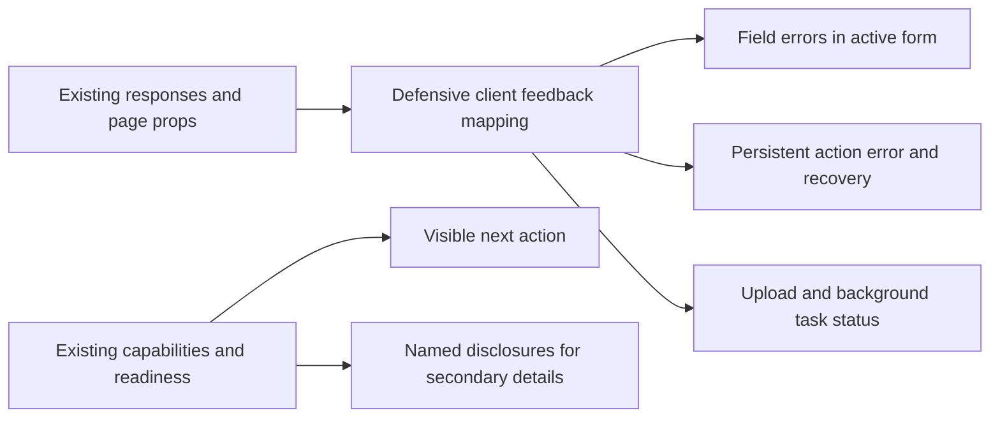

# UI simplicity and feedback implementation plan

Date: 2026-10-24
Status: approved and implemented on `fix/ui-simple`; static, unit and functional checks pass. Browser verification remains blocked by the session environment.
Inputs: [research](./ui-simplicity-research.md), [architecture](./ui-simplicity-architecture.md).

## 1. Decisions

- Preserve the current brand, route names, payloads, authorization, evidence checks, versioning, and approval rules.
- Keep the writing surface, save state, and the next permitted workflow action visible.
- Put secondary controls behind named menus or disclosures; never hide blocking failures or required acknowledgments.
- Give every failed operation one concise, persistent recovery surface.
- Use existing Radix/shadcn components and semantic tokens. Add no dependency.
- Scope implementation to frontend presentation and client response handling. No database, controller, service, or API contract changes.

## 2. Current-state audit

See the source-referenced Before/After table in the research document.

| Recommendation | Decision | Reason |
| --- | --- | --- |
| Field errors and operation-specific recovery | Adopted | Directly addresses confusing feedback |
| Compact editor toolbar and contextual next action | Adopted | Reduces choice overload |
| Named disclosures for optional information | Adopted | Keeps functionality discoverable |
| Remove all explanations and warnings | Rejected | Would hide consequences and blockers |
| New onboarding wizard or visual identity | Deferred | Larger change than the problem requires |
| Backend error contract redesign | Deferred | Existing status/error/validation data should be sufficient for this pass |

## 3. Defects to fix first

- **D1 — Fragile error parsing.** `inertia/lib/api.ts:31`: error arrays are assumed iterable and missing success JSON becomes a synthetic 401. Validate shapes; classify by actual response/network state; support explicit empty success where appropriate without returning fabricated typed data.
- **D2 — Duplicate and misplaced errors.** `inertia/pages/documents/edit.tsx:98`, `inertia/components/documents/inspector.tsx:26`: errors appear twice and dialogs do not receive field details. Return a typed client result and render it in the originating form/action.
- **D3 — Temporary upload feedback.** `inertia/components/files/form.tsx:83`: preserve failed files with per-file errors and recovery controls; safely interpret the existing upload response.
- **D4 — Unfiltered asynchronous failure text.** `inertia/pages/files/edit.tsx:118`, `inertia/pages/documents/edit.tsx:410`: present safe, task-specific messages and only appropriate recovery actions.
- **D5 — Error-page dead ends.** `inertia/pages/errors/server_error.tsx:1`, `not_found.tsx:1`: supply a clear destination and concise explanation.

## 4. Target architecture



See the architecture document for component responsibilities and state lifetime.

## 5. Data model and contracts

No tables, columns, indexes, constraints, migrations, or generated API entities change.

Client-only feedback contains a safe message, optional field messages, and a recovery category: retry, sign-in, permission, conflict, validation, or unavailable. It does not contain raw server exceptions for display. Preserve `ApiError.status` and validation details; inspect existing consumers before altering its client interface.

The current action callback can evolve from `Promise<boolean>` to an explicit client result. Update all its callers together. Do not change HTTP payloads, `mutationId`, `baseVersionId`, or revision handling.

## 6. Phases

### Phase 0 — Feedback correctness (D1–D5)

Files: `inertia/lib/api.ts`, a small reusable feedback mapper/component if duplication warrants it, document edit/editor/inspector, upload form, file edit, and error pages.

- Map known response status and existing error codes to short safe messages. Preserve specific known business failures rather than treating every conflict as a stale version.
- Keep typed API success expectations explicit. Distinguish non-JSON/malformed results from authentication failures.
- Attach validation messages to fields with `aria-invalid` and `aria-describedby`; place form-wide failures inside open dialogs. Focus the first invalid field on submit, without stealing focus on background polls.
- Keep input after failed saves. Offer Retry only when appropriate. Conflict recovery retains the local backup and explicit latest-version action.
- Keep upload errors per file. Uploading several files must not erase failures when another succeeds. Recheck file size/type and disable duplicate submissions.
- Use one error surface per failed action. Background polling errors remain quiet but visible with a status-refresh recovery that does not repeat a mutation.
- Give missing/server error pages a safe Home link; show Retry only where retry is meaningful. Do not blindly reload a failed mutation or unsaved editor.

Acceptance: meaningful tests cover malformed errors, validation, 401/403/409/422/429/5xx, network failure, and unexpected success bodies. Manual flows prove inputs survive failure; an open metadata/issue dialog shows its own errors; failed uploads remain retryable; background failures announce once.

### Phase 1 — Writing and review hierarchy

Files: document edit, inspector, editor, version history, metadata form.

Proposed desktop composition:

```text
Back   Case-study title     Saved     [Next action] [More]

Formatting toolbar                    [Save when needed]
Document canvas                       Status + first blocker
                                      Sources (count)
                                      Issues (open count)
                                      Details
```

On mobile, the canvas remains primary and the same inspector opens through a labelled Details button. Keep one mounted form/state owner when layouts change.

- Primary action follows existing readiness/capabilities: Generate draft for an empty draft, Submit for review for a saved eligible draft, Approve for an eligible approver, Download PDF for an approved version. When blocked, show the next action with a short reason and a way to resolve it; never fabricate readiness.
- More contains History, Preview PDF, Generate again, Edit information, and confirmed Delete when permitted. Do not bury Save or local-draft recovery.
- Sources shows its count and state; reveal source selection on request. Keep failures and review-relevant limitations in the visible summary.
- Issues shows open/blocking counts; expand when the user follows a blocker. Details contains properties and approval history; omit raw owner IDs.
- Remove scoring implementation prose from the main flow. Readiness remains a checklist, never an evidence-quality score.
- Move optional deadline and project assignment under More options in the metadata dialog. Required story inputs stay visible. Auto-expand sections with validation errors.
- Keep confirmation of regenerated content and approval consequences. Use the existing accessible dialog primitives instead of introducing more native confirmation prompts.

Acceptance: every existing action remains reachable with keyboard and correct capability restrictions; blockers remain visible when disclosures are closed; dirty content, source selection, and issue drafts survive polling, resize, and panel toggling; active approval warnings cannot be bypassed.

### Phase 2 — Consistent copy and secondary forms

Files: document create/form, file create/form/user form, project dialog, workspace home/index/members, auth pages, collection intros, active access/error pages, shared button.

- Use short action labels: Create draft, Add files, Save, Try again, History, Details. Keep necessary context in labels where several actions would otherwise be ambiguous.
- Keep file type/size limits visible before upload. Shorten upload receipt explanation to a clear Remove from list label and a concise clarification where needed.
- Reduce repeated page descriptions and instructional paragraphs. Keep meaningful empty states with a direct next action.
- Keep optional project grouping on demand in creation. Show an existing choice as a compact summary, and retain current automatic generation behaviour with accurate action copy.
- Keep invite email and action visible; disclose administrative detail without hiding pending/failed invitation status or delivery retry.
- Standardize validation associations and loading labels across auth, project, file rename, workspace name, and invitation forms.
- Replace shared button `transition-all` with explicit properties; retain existing subtle press feedback without layering extra transforms. No new navigation or keyboard-triggered animation; reduced motion removes movement.

Acceptance: actions describe their actual effect; error and pending states remain visible; keyboard access and focus restoration work; small screens do not overflow; both themes retain readable text and focus indicators.

## 7. Risks and mitigation

- **Lost drafts:** disclosures must preserve state; tests/manual checks include collapse/reopen and desktop/mobile switching.
- **Hidden blockers:** summaries contain actionable blockers; invalid fields automatically reveal their section.
- **Unsafe retries:** preserve existing mutation identity; status refresh does not repeat generation, approval, or export.
- **Sensitive diagnostics:** display only approved user-facing messages and safe context; do not expose raw response bodies even behind Details.
- **Overly broad cleanup:** touch only flows in this plan, leaving worker lifecycle documents and backend behaviour intact.

## 8. Open questions and implementation prerequisite

The user approved implementation and requested branch `fix/ui-simple`. The isolated worktree is `/private/tmp/capstone-ui-simple`; the original `main` checkout remains unchanged by application edits. Keep this worktree available for review.

Implementation refinements: native Details disclosures retain mounted drafts; the mobile inspector is an inline panel with one state owner. Pending/failed invitations remain visible with delivery retry. Pure response parsing lives in `shared/ui_feedback.ts` for testability. Vite explicitly permits the resolved shared `node_modules` directory while retaining strict filesystem checks, so linked dependency fonts work in the worktree.

## 9. Verification

See [verification record](./ui-simplicity-verification.md) for commands, outcomes, and unverified browser scenarios. The recorded source audit above describes the pre-change baseline; line numbers refer to that baseline.

Required project commands after implementation:

```sh
node ace codegen
npm run typecheck
npm run lint
npm test
npm run build
git diff --check
```

Use the configured Japa unit/browser suites for feedback logic and important state-preservation cases. Avoid tests that merely match rendered copy or mirror JSX. Record baseline failures separately; do not silently fix unrelated generated files.

Manual walkthrough with `./bin/run-dev.sh`: create a draft; reject an invalid brief; attach valid/invalid files; fail and retry one upload; edit metadata/issues with invalid input; save offline and reconnect; resolve a concurrent edit without losing the local draft; refresh failed task status; complete review/approval/export; open history and details; recover from missing/access/server pages. Verify 390 px and desktop widths, light/dark, keyboard Tab/Enter/Escape, focus restoration, reduced motion, and screen-reader announcements. Confirm console/network behaviour before claiming live completion.

## Approved refinement: icons and shorter copy

The user reviewed the implementation and requested fewer words, easier scanning, and Lucide icons before text. Continue in the same worktree under the existing authorization. Keep primary workflow labels, field labels, statuses, blockers, and destructive consequences readable; make familiar secondary utilities icon buttons with accessible names and focus/hover tooltips. Remove repeated introductions and redundant completed-checklist sentences. Lead disclosures and menu actions with relevant Lucide icons. No contract, state-lifetime, typography, or dependency changes are needed.

Acceptance: typecheck, lint, build, and the existing unit/functional suites pass; icon buttons retain native button semantics, visible focus, keyboard labels, and at least 32 px utility targets. Browser verification remains subject to the existing session restrictions.

## Approved refinement: solo export and required team checklist

The user explicitly requested heading-only checklist rows, optional review requirements for a workspace with one member, direct solo PDF export, and an always-visible checklist for workspaces with more than one member. This changes the earlier approved-only export contract.

Research: membership is active when `workspace_memberships.revoked_at IS NULL`; accepting invitations and revoking memberships serialize on the workspace row. Readiness lives in `ReadinessService`, final export is guarded at request/render/publication/download, and the mobile inspector currently hides the checklist. Pending invitations do not grant membership.

Implementation:

1. Expose server-derived `reviewRequired` (active count differs from exactly one) and `canExport`. Solo submission/export requires a meaningful saved version and no active generation; information/source/editorial checklist gates remain mandatory for teams. Existing approval records keep their meaning.
2. Extend the existing PDF request with optional `baseVersionId` and optional `approvalId`, preserving `mutationId`. Teams require the current approval as before. Solo requests use the exact saved version without creating a review or approval. No schema migration or new route.
3. Mark solo render snapshots explicitly and bind them to version, writing inputs, and source pins. Revalidate active membership and that snapshot before rendering, before publishing, and when downloading. If a second member joins, the solo path stops with 409. Serialize publication/download/request against membership changes using workspace-first locks.
4. Keep the checklist rows as subheadings with status icons and accessible status names; remove percentage, progress, and explanatory text. Solo users can expand the optional checklist. Team users always see it, including on mobile. Refresh workflow props while visible so membership changes update the presentation; the server remains authoritative between refreshes.
5. Test incomplete solo export, exact-version protection, team enforcement, pending/revoked member counting, membership changes during render/download, and existing approved-export invalidation. Use local Japa HTTP/service tests and controlled PDF/storage adapters, without live providers.

Acceptance: codegen, typecheck, lint, unit/functional suites, build, and diff checks. Browser walkthrough remains limited by the previously recorded environment restrictions. Backend files remain layered; no controller business rules or client-only bypass.
