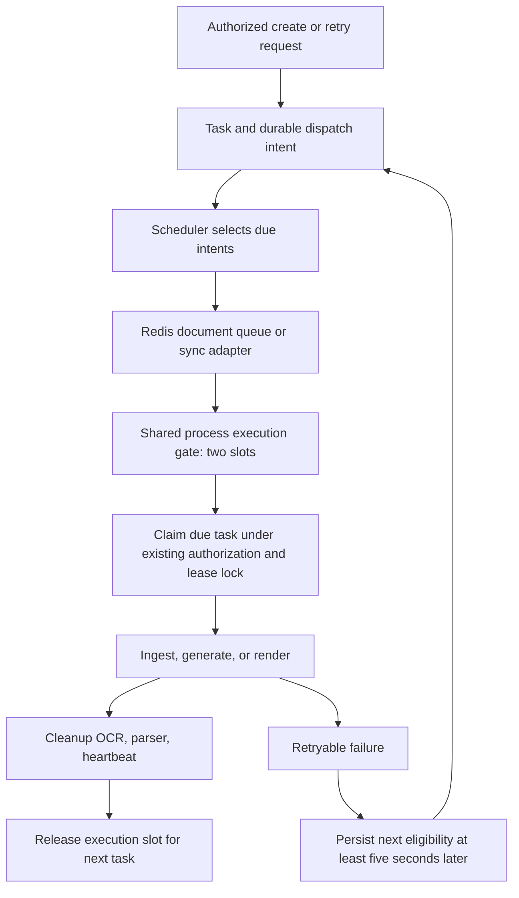

# Worker lifecycle architecture

Status: proposed, pending agreement on the implementation plan.

The queue owns reusable job capacity and polling. The execution service owns process-local
admission across both adapters, including work still settling after a queue timeout. It does
not own task persistence or authorization. Job handlers acquire admission before a task lease
and release it after all owned cleanup. Waiting for capacity must not consume an attempt or
create an OCR thread.

`TaskService` owns durable execution eligibility and existing lease fencing. `TaskDispatchService`
owns delivery eligibility. Both compare timestamps with a consistent database clock; eligibility
is checked again inside the claim transaction. Source-ready wakeups and reconciliation preserve
future retry timestamps. Duplicate messages are harmless and cannot make delayed tasks disappear.

`FileService` owns at most one OCR worker per active extraction and destroys it when extraction
finishes or fails. An OCR lifecycle adapter must expose actual thread-exit completion and contain
initialization failures. Public Tesseract termination alone does not prove thread exit in v7.0.0.
If no supported ownership boundary exists, revise this architecture before introducing child-process
containment; a timeout around `createWorker` alone is insufficient.

Configuration owns the task concurrency default (two) and retry minimum (5,000 ms). Generation
and embedding keep their bounded transient-retry loops with the shared minimum; request handlers
persist schedules and return without waiting through the cooldown.

Shutdown stops new admission, drains active jobs, clears heartbeats, terminates owned OCR threads,
and closes queue connections. Forced process death relies on existing durable task leases and
reconciliation; it does not authorize an old lease to publish results.

Rollback requires draining consumers before reverting cooldown-aware code, because older consumers
would ignore the new timestamps. Keep additive columns until delayed tasks are drained. The deployment
contract is one document consumer with two slots; additional processes multiply capacity.
