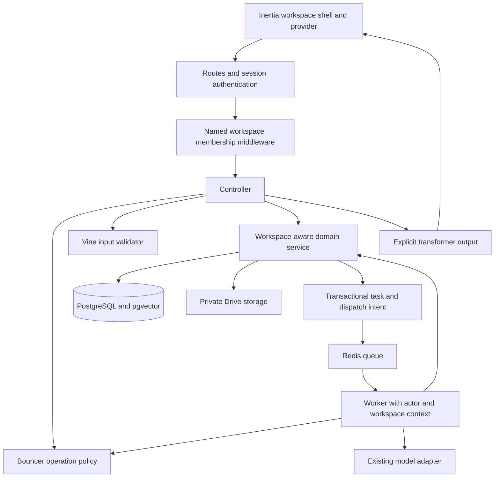

# Workspace tenancy architecture

Date: 15 October 2026

Status: Proposed implementation specification; documentation approved for preparation, application coding awaiting review.

Read with [the backend implementation plan](workspace-tenancy-implementation-plan.md) and [the HumbleBeeAI redesign plan](humblebee-ui-redesign-plan.md).

## 1. Evidence, authority, and scope

| Label           | Meaning                                                                                             |
| --------------- | --------------------------------------------------------------------------------------------------- |
| Requirement     | Behavior stated in the active functional requirements (FR), rather than inferred from a screenshot. |
| User decision   | A choice confirmed in this chat; it overrides a conflicting proposed HLD behavior.                  |
| Proposal        | A concrete implementation default chosen for this handoff, subject to review.                       |
| Current finding | Observed repository behavior; not proof of deployed database or remote storage state.               |

### Sources

- [CodeCanvas: Functional Requirements 2.1](https://docs.google.com/document/d/1hcQO6PWB23ojrTVPm2IJ-SfIzZFZ9rt4aBjLS7iRki4/edit?tab=t.ag964wom2yfk), revised 15 October 2026. FR-TEN-01–03 are the active workspace requirements.
- [CodeCanvas: High Level Design 1.1](https://docs.google.com/document/d/1hcQO6PWB23ojrTVPm2IJ-SfIzZFZ9rt4aBjLS7iRki4/edit?tab=t.ro5zwguqlz7d), revision entry dated 15 October 2026. Use sections 3.2.4–3.2.5, 3.4, 3.5, 3.8, 3.11, and 3.14–3.15.
- [Supplied design research](/Users/johnpaul/Downloads/humblebee-design-kit/humblebee-ui-design-research.md), dated 10 October 2026, plus its CSS/JSON tokens and reference images.
- [Detailed editor reference](</Users/johnpaul/Desktop/Screenshot 2026-10-15 at 11.31.59 PM.png>) and [structural wireframe](</Users/johnpaul/Desktop/Screenshot 2026-10-13 at 2.47.32 PM.png>).
- Repository migrations, routes, models, services, policies, queue jobs, transformers, and Inertia entries inspected for this proposal.

The latest FR takes precedence over stale HLD scope text that still describes workspaces, TXT/Markdown, or PPTX input as conditional. The HLD itself identifies membership roles, projects, and invitation acceptance details as proposals. Earlier FR revisions and the older draft LLD are historical context, not competing authority.

**User decisions:** members collaborate on all workspace documents; the files library is shared; existing data is preserved and reviewed; invitations include email delivery; the root uses server redirects plus a React provider; deadlines, issues, explainable progress, and review safeguards are included.

This change does not require billing, tenant subdomains, a new frontend framework, live collaborative cursors/CRDTs, a generic admin dashboard, workspace deletion, or ownership transfer. Unimplemented output formats, OAuth/provisioning flows, and other FR gaps must be listed as separate work rather than advertised as working features. Existing signup must gain workspace provisioning; any future account-creation path must reuse it.

## 2. Problem and current behavior

The application has accounts, user-owned documents and files, document VIEW/EDIT shares, accepted content versions, RAG processing records, Redis jobs, and PDF generation. It has no workspace or project model.

| Current finding                                                                                                                                  | Consequence                                                                                   |
| ------------------------------------------------------------------------------------------------------------------------------------------------ | --------------------------------------------------------------------------------------------- |
| `start/routes.ts:14` renders the marketing/home page at `/`.                                                                                     | No server destination resolver or tenant URL exists.                                          |
| `app/controllers/documents_controller.ts:13` lists the signed-in user's relation; other actions load by resource ID and then check policies.     | Current owner/share rules need workspace membership in addition to resource checks.           |
| `app/services/documents/retrieval_service.ts:33` accepts file IDs and an owner ID.                                                               | Shared workspace sources require a document-bound, server-authorized retrieval scope.         |
| `config/drive.ts:4` constructs a public CDN URL and line 26 sets public visibility.                                                              | Tenant authorization cannot protect bytes already exposed through public URLs.                |
| `app/jobs/generate_document.ts:11` carries only a document ID; processing jobs carry run/file IDs.                                               | Jobs lack initiating-actor and workspace context and need revocation and stale-result checks. |
| `app/controllers/documents_controller.ts:75` accepts status directly. PDF export authorizes reading but does not establish an approved snapshot. | Review/approval must become explicit operations with atomic audit records.                    |
| Version saves calculate the next version without a locked base-version comparison.                                                               | Multi-member editing would permit lost updates or version races.                              |
| Existing document fields omit the full FR-ING-01 input, deadline, issues, and review records.                                                    | The screenshot requires real backend additions, not decorative controls.                      |

Schema truth comes from migrations. A generated schema file is not evidence that remote migrations have run. No live database, bucket policy, SMTP delivery, or browser behavior was verified while preparing this document.

## 3. Options and selected architecture

| Option                                 | Benefit                                                                   | Cost / reason                                                                                                                                                |
| -------------------------------------- | ------------------------------------------------------------------------- | ------------------------------------------------------------------------------------------------------------------------------------------------------------ |
| Database per workspace                 | Strong operational separation.                                            | Provisioning, migrations, pooling, and cross-workspace account management are excessive for this application's initial workload. Rejected for this delivery. |
| PostgreSQL schema per workspace        | Separate namespaces within one server.                                    | Dynamic schemas, search paths, migration fan-out, and worker routing add complexity without a stated deployment need. Rejected.                              |
| Shared schema, explicit workspace keys | Fits Lucid, existing PostgreSQL/pgvector, and one application deployment. | Requires comprehensive query scoping and negative tests. Selected.                                                                                           |
| Shared schema plus PostgreSQL RLS      | Additional defense against omitted tenant predicates.                     | Needs verified database roles and transaction-local context for every web/worker query. Deferred; this proposal does not claim RLS protection.               |

No tenancy library is needed. Retain the existing layered architecture:



Controllers adapt HTTP, authorize, validate, delegate, and respond. Services own transactions and business behavior; they never accept `HttpContext`. Policies share the same membership/access service as workers. Transformers select safe preloaded fields and never query. Extend the existing API serializer for JSON; keep Inertia props as the page contract.

## 4. Workspace access contract

### 4.1 Membership and ownership

All checks below require an active membership in the resource's workspace. Knowing an ID, receiving an old share, or owning a row is insufficient after membership is revoked.

| Operation                                                              | Active member                         | Resource owner                  | Workspace owner                 |
| ---------------------------------------------------------------------- | ------------------------------------- | ------------------------------- | ------------------------------- |
| Read/create/edit projects and case studies                             | Yes                                   | Same membership requirement     | Same content permissions        |
| Save content, select/detach sources, request generation, submit review | Yes                                   | Yes                             | Yes                             |
| Approve or delete a case study                                         | No, unless its owner                  | Yes                             | Only if also its document owner |
| List/download/attach workspace library files                           | Yes                                   | Yes                             | Yes                             |
| Rename/delete library file                                             | No, unless uploader                   | Uploader only                   | Only if uploader                |
| Create/update/resolve document issues                                  | Yes                                   | Yes                             | Yes                             |
| Rename workspace, invite/revoke members, revoke/resend invitations     | No                                    | Not implied                     | Yes                             |
| Read membership roster                                                 | Yes                                   | Yes                             | Yes                             |
| Access another workspace                                               | Only with that workspace's membership | Ownership alone is insufficient | No global bypass                |

Roles `owner` and `member` control workspace management only; they are not global administrator/general-user account classes. A user may own multiple workspaces. Only one is marked as that user's initial workspace.

**Proposal:** workspace-owner membership cannot be revoked or left in v1. Revoking an ordinary member preserves their authored documents/files and historical attribution. Remaining members may edit the documents, but owner-only approval/deletion and file rename/deletion remain unavailable until that owner rejoins. Display this limitation explicitly; never silently transfer ownership to the workspace owner. Ownership transfer and account deletion need separate contracts.

### 4.2 Request context

```ts
type WorkspaceAccessContext = Readonly<{
  actorId: number
  workspaceId: string
  membershipId: string
  membershipEpoch: number
}>
```

This is constructed by the server after session authentication and active-membership lookup. The browser may select a workspace URL but cannot supply trusted actor IDs, role flags, or capability booleans. A process-global tenant variable or a model hook that silently reads the current session is prohibited.

For a protected nested resource: authenticate → resolve workspace membership → load through that workspace relation → verify route parent/resource consistency → authorize operation → validate input → act. Recheck membership and relevant resource state inside protected write transactions. Return concealed 404 for missing/nonmember workspace resources, and 403 for a forbidden owner-only operation inside an accessible workspace.

Use scoped Lucid relations for ordinary queries. Existing vector SQL remains in its retrieval service with bound parameters and explicit workspace/document/source predicates.

### 4.3 Root, switching, and URL compatibility

| Request                                       | Behavior                                                                                                                                                                      |
| --------------------------------------------- | ----------------------------------------------------------------------------------------------------------------------------------------------------------------------------- |
| Guest `GET /`                                 | Redirect to login.                                                                                                                                                            |
| Authenticated `GET /`                         | Resolve a still-authorized remembered workspace; otherwise initial workspace, then another active membership. If no valid membership remains, show an explicit recovery page. |
| New account                                   | Atomically create user, initial workspace, owner membership; log in only after commit.                                                                                        |
| Existing account missing an initial workspace | Use the idempotent provisioning repair after authorized rollout; revoked memberships must not be recreated by ordinary navigation.                                            |
| Workspace selector                            | Navigate to that workspace's home; remember selection server-side only after authorization.                                                                                   |
| Canonical document/file URL                   | Check the workspace in the URL against the resource, irrespective of the remembered selection.                                                                                |
| Legacy resource GET                           | Authenticate, resolve resource workspace, verify membership/operation, redirect temporarily to canonical URL.                                                                 |
| Legacy resource mutation after cutover        | Return 410 with safe upgrade guidance; no redirected or unscoped write.                                                                                                       |
| Revoked workspace in another tab              | Deny subsequent requests, stop polling, clear tenant UI, and offer authorized workspace navigation.                                                                           |

Preserve intended authorized destinations after login, including invitation routes. Accept only internal allowlisted route destinations. Root navigation performs no domain provisioning on behalf of an arbitrary URL and never renders a homepage.

The React `WorkspaceProvider` supplies current server props, summaries, and capabilities; it does not authorize or initiate redirect loops. Keep app-wide theme, motion, tooltip, and Tuyau providers outside tenant-reset boundaries. Key document drafts, polling, and editor state by workspace plus resource. Check unsaved work before a workspace visit; discard stale tenant caches on a successful switch. A cancelled switch retains the current editor.

## 5. Data ownership and integrity

### 5.1 New logical records

Use UUIDs for new domain records; keep existing numeric user IDs. Store event timestamps in UTC with timezone; deadlines are nullable ISO calendar dates, not midnight timestamps.

| Record                     | Minimum fields and constraints                                                                                                                                                                                                                                           |
| -------------------------- | ------------------------------------------------------------------------------------------------------------------------------------------------------------------------------------------------------------------------------------------------------------------------ |
| `workspaces`               | `id, name, owner_user_id, initial_for_user_id?, created_at, updated_at`; unique non-null `initial_for_user_id`.                                                                                                                                                          |
| `workspace_memberships`    | `id, workspace_id, user_id, role(owner/member), revoked_at?, joined_at, authorization_epoch`; unique workspace/user pair. Reactivation uses the same membership identity and increments its epoch.                                                                       |
| `workspace_invitations`    | Workspace, normalized recipient email, inviter, hashed token, expiry, accepted/revoked timestamps and accepted user, delivery state. At most one pending unrevoked invitation per workspace/email.                                                                       |
| `projects`                 | Workspace, name, optional description, creator, timestamps. Documents may have null project.                                                                                                                                                                             |
| `document_issues`          | Workspace, document, title, optional description, blocking flag, open/resolved state, creator, updater, resolver and resolution time.                                                                                                                                    |
| `document_reviews`         | Workspace, document, exact version, submitter, submitted time, invalidated time; one active review per document.                                                                                                                                                         |
| `document_approvals`       | Workspace, document, review, exact version, owner approver, approval time, acknowledged warning IDs; immutable historical record.                                                                                                                                        |
| `document_workflow_events` | Workspace, document, actor, event, prior/resulting state, version, reason, timestamp. Append-only; insertion failure rolls back the transition.                                                                                                                          |
| `workspace_tasks`          | Workspace, initiating actor/membership and authorization epoch, operation, target, base version if relevant, immutable input snapshot/fingerprint and selected-source pins, status, attempt/lease token, result reference, safe error, timestamps, idempotency identity. |
| `task_dispatches`          | Task reference, queue name, encrypted dispatch data only where necessary, delivery/retry timestamps. Committed with task creation and retried independently of HTTP success.                                                                                             |

Task target consistency is checked by the domain service and database constraints for typed resource references; do not use an unchecked free-form target ID. Invitation email delivery stores the raw bearer token only in encrypted delivery material until successful dispatch, never in logs or ordinary task output. The invitation table stores the comparison hash.

### 5.2 Existing records to extend

- Documents: workspace, optional project, typed FR-ING-01 project information, optional deadline, current version reference, review/approval references, and optimistic concurrency metadata.
- Files, revisions, runs, versions, evidence blocks, chunks, chunk mappings, embeddings, attachments: workspace reference and composite parent constraints.
- Attachments: retain existing `files_id` naming for compatibility; add explicit generation selection and unique workspace/document/file tuple.
- Users: optional last-workspace preference; authentication remains global. A preference is never an access grant.
- Existing shares: retain historical rows during migration, but remove their authorization role at cutover. They do not become workspace memberships automatically.

Composite FK examples:

- `documents(workspace_id, project_id)` → `projects(workspace_id, id)`.
- `document_files(workspace_id, document_id)` → documents, and `(workspace_id, files_id)` → files.
- `file_revisions(workspace_id, file_id)` → files; `processing_runs(workspace_id, file_revision_id)` → revisions.
- `chunks(workspace_id, file_revision_id, run_id)` → a unique processing-run key that includes revision identity; also enforce the chunk's legacy `file_id` against its revision.
- Evidence blocks carry the workspace and processing run. Chunk mappings include that run so both their chunk and block FKs require the same run/workspace.
- Embeddings reference chunks through workspace and chunk identity.
- Versions, reviews, issues, approvals, and workflow events reference the same workspace/document. An approval's review and version must belong to that document.

Add the referenced composite unique keys before FKs. Keep IDs globally unique. Index workspace plus commonly filtered fields, including updated time, document status/project, file creation time, issue state, membership user, and task status. Uniqueness must also prevent duplicate version numbers and duplicate accepted task results. Do not change vector dimensions or ranking as part of tenancy.

Legacy evidence with missing revision/run identity is reported and excluded from new retrieval until repaired or reprocessed. Do not fabricate provenance to satisfy a NOT NULL constraint.

## 6. Invitation and account flow

**Requirement:** FR-TEN-03 supports an email recipient without an existing account and displays the user's name when a member exists.

**Proposal:** owner sends invitation → transaction stores invitation/task/dispatch intent → SMTP job delivers link → recipient signs in/registers → server validates token, expiry, matching normalized account email, and email ownership → transaction accepts invitation and creates/reactivates membership → navigate to workspace.

Use 256-bit random tokens, SHA-256 comparison hashes, seven-day expiry, and a single-use acceptance transaction. Possession of the invitation delivered to the account's matching email provides the verification event for this flow; record the verified email and verification time. A bare email string entered at signup or tokenless invitation lookup is not verification. If independent account-email verification is later required, reuse the same recorded identity contract.

Do not auto-join existing users merely because their email matches. Existing-account email comparisons are case-normalized without provider-specific dot/plus rewriting. Audit existing case-insensitive email collisions before relying on uniqueness.

GET displays a confirmation; POST performs acceptance with session/CSRF protection. Expired, revoked, or mismatched links cannot join. Replaying an already accepted invitation by the same user returns the existing membership; another user is denied. Resend rotates the token, resets expiry, and invalidates earlier links. Delivery failure leaves a pending invitation with retry feedback. Owners can revoke pending invitations.

Membership display names use existing full name/email fallback; there is no separate username column today. Pending invitations display email without disclosing whether an arbitrary address has an account.

## 7. Files, retrieval, and workers

### 7.1 Private bytes

Remove the public CDN configuration and public `getUrl` output. Upload objects under generated workspace/file/revision prefixes for new writes. Existing registered keys need not change if the bucket and access policy become private; preserve hashes and locators.

Application asset URLs resolve file/revision/block identity, authorize current membership, and stream permitted content. Ordinary page props expose safe route identities, not object keys or permanent storage URLs. Update existing TipTap image/citation serialization and PDF asset resolution accordingly.

Provider image delivery uses authorized bytes when the adapter supports them, or short-lived provider-scoped signed URLs. These must not become stored document content. Access is rechecked before disclosure; an already disclosed URL/byte stream cannot be recalled. Private bucket controls and removal of old public access must be verified remotely before cutover, not inferred from the local `visibility` flag.

Sanitize source/output content and restrict asset schemes. SVG and external URLs require existing safe processing or a separately documented support gap; turning sources private does not make arbitrary markup safe.

### 7.2 Retrieval scope

The retrieval entry point accepts actor/workspace/document, section query, and server-resolved selected source pins. File IDs submitted by the browser are validated against current document attachments and active workspace before retrieval.

Every dense, lexical, supplemental-image, and final expansion branch shares the same eligible source relation: workspace → document-selected attachment → file → immutable revision → eligible ready run → chunk. Model/pipeline/dimension checks remain. An empty eligible selection returns no library-wide fallback. Same-workspace files not selected for this case study remain excluded.

Retain existing immutable provenance when a file is detached. Detachment affects subsequent generation, not the identity of past citations. Source deletion reports unavailable evidence; it never substitutes a newer source silently.

### 7.3 Durable execution and races

Redis transports task IDs. PostgreSQL stores immutable actor/workspace/target/source context and accepted outcomes. Tasks and dispatch intents commit together; redispatching an undelivered task is safe. Retain the installed queue adapter rather than replacing it with another queue system.

Claims issue a fresh fencing token; initial lease 120 seconds, renewal every 30 seconds, three attempts by default. Reclaimed work replaces the token. Revalidate access and the initiating membership epoch before private reads, provider disclosure, and accepted writes. Worker output publication checks live token, active membership/epoch, target workspace, base version, input fingerprint, source selection/pins, and resource existence in one short transaction. The input fingerprint covers generation-relevant fields, so deadline-only changes need not invalidate generation. A stale worker cannot publish through heartbeat timestamps alone. Provider calls happen outside database locks.

Revocation and accepted publication serialize on the membership row; document/source changes use consistent resource locks. A publication that commits before revocation is valid; one after revocation is denied. Attachment changes, deletion, and content saves fence older results. Do not silently retry a stale generation onto the newest version.

Revocation increments the membership authorization epoch and fences/cancels outstanding tasks in the same transaction. Rejoining cannot revive earlier work; a new authorized request is required. Source-ingestion completion may wake existing dependent generation tasks, but must retain each generation request's own initiating context and pins. Never create generation work under the uploader's or document owner's identity merely because ingestion completed.

Background errors, status reads, retries, cleanup jobs, and logs are tenant-aware. No credentials, source excerpts, inaccessible IDs, or raw provider errors enter general diagnostics.

## 8. Content, review, and progress contracts

FR-ING-01 project information comprises overview, problem statement, work completed, technical approach, tools/models/technologies, challenges, and results. Store it as a typed JSON object with one shared server/client contract; retain legacy description separately during transition. Existing descriptions are not assumed to satisfy all fields.

Persist business states as `draft, edited, in_review, approved`; ingestion/generation states remain separate. A successful initial generation creates Draft; accepted manual/AI changes create a new version and Edited. Review submission records the current version and In Review. Only the active document owner approves that unchanged reviewed version. Any accepted content, input, or generation-source change invalidates active review/approval and returns a reviewed/approved document to Edited; deadline edits do not.

Concurrent saves submit `baseVersionId`. Lock the document, compare base, append one version, and update current pointer atomically; stale requests return 409 with safe current-version identity. The UI preserves local content for comparison. AI proposals are never accepted by polling or ordinary autosave.

**Proposal:** review requires a saved nonempty valid document, complete project information, prepared selected sources or explicit input-only mode, no active conflicting generation, and no open blocking issue. Owner approval requires the exact active review, those same current conditions, and acknowledgment of outstanding evidence warnings. User-authored claims remain exempt from automated evidence scoring but covered by owner sign-off. An unresolved blocking issue prevents approval and final export; adding one invalidates active review/approval. Nonblocking issues remain visible.

| Readiness stage     | Complete when                                                                                                                                 | Weight |
| ------------------- | --------------------------------------------------------------------------------------------------------------------------------------------- | ------ |
| Project information | Every required FR-ING-01 field is nonempty after validation.                                                                                  | 25%    |
| Source preparation  | At least one selected source has an eligible ready pin and all selected sources are ready, or explicit input-only mode has no selected files. | 25%    |
| Editorial readiness | Current saved version is schema-valid/nonempty, no open blocking issue, no active conflicting generation, and an active review references it. | 25%    |
| Approval            | The active owner approval references that unchanged current review/version and remains valid.                                                 | 25%    |

Compute these on the server, return completed flags/reasons plus their sum, and label it “Workflow readiness.” A new generation or edit can reduce readiness. It is neither generation progress nor evidence confidence. The screenshot's 68% is illustrative, not a required literal value.

Final PDF export checks approval at request, render start, publication, and download. The task pins an approved version plus source/asset/brand configuration; if approval is invalidated during rendering, discard final publication. Previews are visibly unapproved, separately authorized responses and never reusable final-export URLs.

## 9. Migration, failure paths, and deferred decisions

Preserve all existing user/resource IDs and attribution. First audit, then add nullable columns/new tables, backfill deterministic owner workspaces, resolve cross-user shares/attachments using an explicitly reviewed mapping, enforce constraints, and cut over web plus workers together.

Automatically joining every historic collaborator would grant access to all workspace content under the selected permission model. Therefore unresolved cross-user shares block cutover. Retain old rows as history; do not silently delete access records, duplicate documents/files, move source ownership, or bulk-invite users.

Legacy `pending` maps to Draft while processing state remains separate; `editing` maps to Edited. Legacy Approved records lacking trustworthy owner/version/audit evidence are labeled approval-unverified and blocked from final export until explicit review. Preserve their original state in migration history; do not invent approval actors/times.

Drain old queue payloads before cutover, then switch task dispatch and workers. After new collaborative data or approvals are written, the old user-only application is not a safe rollback target. Prefer feature disable/forward repair; a full restore must coordinate database and private objects.

Operational inputs still required before their rollout phase: actual legacy conflict mappings, SMTP sender/credentials, verified private bucket policy, backup/restore destination and retention, production client artwork, and deployment worker limits. These do not prevent preparing the implementation documents and do not authorize external writes.

## 10. Acceptance evidence

The implementation must demonstrate two workspaces with deliberately overlapping filenames/titles and distinct memberships, including one user in both. Test direct reads/writes, nested-parent mismatches, counts/search, private bytes, citations, all retrieval branches, queue retries, and revoked membership.

Test duplicate provisioning/acceptance, invitation email failure/replay, owner-only operations, shared-library attachment, document deletion retaining files, explicit detach excluding future retrieval, concurrent saves, stale worker publication, stale review, and edited approval rejection. Assert that invalid composite relationships fail at the database boundary.

Record actual case counts and failures; do not describe the proposed guarantees as verified production behavior. The implementation plan supplies phase-level commands and the redesign plan supplies responsive, keyboard, theme, and interaction acceptance.
