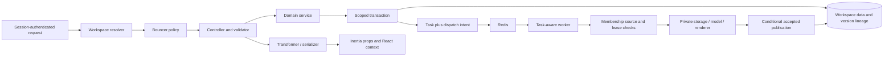

# Workspace tenancy implementation plan

Date: 15 October 2026

Status: Review document. Commands below describe future implementation; generators, package installation, migrations, and remote changes have not been executed.

The [architecture document](workspace-tenancy-architecture.md) is authoritative for permission, invitation, source, lifecycle, and readiness behavior. The [UI plan](humblebee-ui-redesign-plan.md) consumes the contracts here. Research and structural architecture are combined in the first document to retain the three deliverables requested by the user.

## 1. Decisions

1. Shared PostgreSQL schema, explicit workspace references, composite constraints, and Bouncer authorization; no new tenancy package or claimed RLS protection.
2. All active members collaborate on workspace documents and browse the shared library. Document approval/deletion and file rename/deletion remain owner-only.
3. One idempotently provisioned initial workspace per account; workspace owners manage membership.
4. Preserve existing data. A reviewed mapping is mandatory for legacy cross-user shares or inconsistent attachments before cutover.
5. Server root resolver and canonical workspace URLs; React context presents server state.
6. Private source access, document-selected retrieval, actor-bound durable tasks, and fenced publication are release requirements.
7. Include deadlines, FR-ING-01 input, issues, workflow readiness, version conflicts, review, approval audits, and approved-only final PDF export.
8. SMTP invitations use Adonis Mail; keep Bun as the dependency lockfile owner and Node 24+ for Ace.
9. Default to seven-day invitations, 120-second task leases renewed every 30 seconds, and three worker attempts. Put tunables in generated/configured application configuration, not duplicated constants.
10. Implement only after document review in a dedicated worktree, one verified phase at a time.

## 2. Current-state audit

### 2.1 Compatibility and evidence

Installed versions inspected during planning: Node 24.19.0, Bun 1.4.0, Adonis Core 7.5.2, Lucid 22.4.2, Inertia adapter 5.0.1, queue 0.6.2, React 19.3.0, Framer Motion 14.0.0, Tailwind 4.3.3, and shadcn CLI 4.21.0. Package ranges are not exact installed versions; recheck the worktree before installation.

Adonis Mail 10.4.0 registry metadata declares Node >=24 and Core 7 compatibility. Its optional transport peers are transport-dependent; SMTP does not require adding SES/MJML merely because their peer entries appear. Installation must run the package configure hook. See [official Mail documentation](https://docs.adonisjs.com/guides/digging-deeper/mail).

The checkout has no discovered maintained OpenAPI/Postman contract. Reuse named routes, transformers, validators, and the serializer as the baseline; the endpoint tables below define the intended changes. Creating/publishing a Postman workspace is not needed to write these documents.

Current typechecking and `git diff --check` passed during planning. No database migration status, remote bucket configuration, SMTP send, browser behavior, or full test suite was verified.

| Area                     | Current location                                               | Change                                                                       |
| ------------------------ | -------------------------------------------------------------- | ---------------------------------------------------------------------------- |
| Root and routes          | `start/routes.ts:14`                                           | Replace home rendering with resolver and workspace-prefixed route groups.    |
| Signup                   | `app/controllers/new_account_controller.ts:10`                 | Transactional account/initial-workspace provisioning before login.           |
| Authentication redirects | `app/controllers/session_controller.ts`, guest/auth middleware | Preserve authorized intended destination; default through resolver.          |
| Documents                | `app/controllers/documents_controller.ts:13`, policies         | Workspace relation loads and member collaboration.                           |
| Shares                   | `app/controllers/document_shares_controller.ts`                | Audit/archive legacy grants; replace sharing UI with workspace membership.   |
| Files/upload             | files/uploads controllers, `app/services/upload_service.ts`    | Workspace root, private objects, safe responses, shared library.             |
| Retrieval                | `app/services/documents/retrieval_service.ts:33`               | One authorized document/source scope in every SQL branch.                    |
| Queue                    | process-file/generate-document jobs                            | Persisted task context, outbox dispatch, access rechecks, fencing.           |
| Versions                 | `app/controllers/document_versions_controller.ts:13`           | Locked base-version comparison and atomic accepted writes.                   |
| Export                   | `app/controllers/export_pdfs_controller.ts:7`                  | Distinct preview/final task, approved snapshot, revalidation.                |
| Storage                  | `config/drive.ts:4`                                            | Remove public CDN and public visibility; verify actual private policy.       |
| Output                   | `providers/api_provider.ts`, transformers                      | Preserve JSON serializer; add typed safe Inertia data.                       |
| Schema                   | `database/migrations`                                          | Authoritative source; regenerate classes against the migrated test database. |

### 2.2 Recommendation status

| Recommendation                                            | Status                    | Reason                                                                |
| --------------------------------------------------------- | ------------------------- | --------------------------------------------------------------------- |
| HLD membership before resource permission                 | Adopted                   | Required isolation boundary.                                          |
| HLD explicit VIEW/EDIT grants for each document           | Rejected for new access   | User selected all-member collaboration. Historical rows are retained. |
| Separate account/workspace/resource authority             | Adopted                   | Workspace management does not grant owner-only content authority.     |
| Per-tenant databases, schema switching, tenancy framework | Rejected                  | Unnecessary operational complexity for this delivery.                 |
| PostgreSQL RLS                                            | Deferred                  | Requires separately verified roles and pooled transaction context.    |
| Durable PostgreSQL task identity with Redis transport     | Adopted                   | Preserves installed queue and supports recovery/fencing.              |
| Replacing Redis with the older draft LLD polling design   | Rejected                  | Active HLD and installed implementation use Redis.                    |
| Existing-data reset                                       | Rejected                  | User selected preservation and conflict review.                       |
| Deadlines, issues, progress, review safeguards            | Adopted                   | Explicit user additions to the redesign.                              |
| PPTX/HTML/summary/CMS expansion                           | Deferred from this change | Record FR gaps; do not expose unsupported actions. Release baseline since 12 Nov 2026: PDF-only final export, see [release scope](release-scope.md) (D-PDF-EXPORT). |

## 3. Defects to fix first

“Defect” includes missing invariants that become release-blocking for the approved change. It does not assert that every prototype gap is currently exploitable remotely.

| ID  | Location / symptom                                                         | Required fix                                                                                                         |
| --- | -------------------------------------------------------------------------- | -------------------------------------------------------------------------------------------------------------------- |
| D1  | Root renders home; navigation has no tenant destination.                   | Root resolver, intended-route rules, canonical workspace URLs.                                                       |
| D2  | User ownership and shares are the only content boundaries.                 | Active membership plus workspace-scoped loads on every path.                                                         |
| D3  | Public Drive configuration and object URLs/keys in transformers/content.   | Private bucket, protected asset routes, source-reference migration, sanitized output.                                |
| D4  | Owner-only SQL retrieval has no document/workspace context.                | One eligible-source scope in dense, lexical, image, and expansion branches.                                          |
| D5  | Queue payloads contain IDs only; timestamps do not fence stale work.       | Actor/workspace task records, recoverable dispatch, live lease token and current-context publication checks.         |
| D6  | Version numbering and current content are not atomically compared.         | Base-version checks, document lock, unique numbering, idempotent acceptance.                                         |
| D7  | Caller-supplied status and ungated latest-version PDF export.              | Event-driven lifecycle, exact-version review/approval, audit, final-export rechecks.                                 |
| D8  | Signup has no workspace transaction or retry identity.                     | One initial workspace and owner membership, including future account paths.                                          |
| D9  | No full input/deadline/issues/readiness contracts.                         | Add typed fields, policies, server calculations, and safe transformers.                                              |
| D10 | Legacy data and shares have no tenant mapping; Git reports ambiguous HEAD. | Read-only conflict audit and explicit mapping; use verified full Git refs without deleting refs to silence warnings. |

Phase 0 captures these findings and fixtures. Their fixes are assigned below; no public tenant release is allowed while D2–D8 remain unresolved.

## 4. Target architecture and interfaces



### 4.1 HTTP conventions

All paths below except root, login/signup, and invitation landing use `W = /workspaces/:workspaceId`. “Member” means active membership checked on the server. “Owner” always identifies workspace, document, or file ownership explicitly.

- Browser GETs render Inertia; successful form writes use a 303 redirect to an authorized named route.
- Async operations requested as JSON return 202 with `data.task` using `ctx.serialize`; JSON CRUD returns serialized 200/201 data.
- JSON failures use `error: { code, message, retryable, correlationId, details? }`. Inertia validation preserves input and field errors; conflict UI receives the safe conflict payload.
- Guest page requests redirect to login; JSON requests return 401. Nonmember or mismatched nested resources return concealed 404. Accessible owner-only denials return 403. Validation is 422, oversize 413, stale/invalid transition 409, expired/revoked invitation 410 after safe token resolution.
- All writes use existing session/CSRF protection. UUIDs, dates, content schemas, pagination and sort allowlists are validated. Do not accept actor/workspace ownership from form bodies.
- Lists use `page=1, perPage=20` with maximum 100; `q` max 200 characters, explicit sort allowlists, and tenant-scoped counts. Apply filters before pagination. No global directory/email search.

### 4.2 Endpoint matrix

| Method and path                                             | Input / output                                                             | Authorization and significant behavior                                                               |
| ----------------------------------------------------------- | -------------------------------------------------------------------------- | ---------------------------------------------------------------------------------------------------- |
| GET `/`                                                     | Redirect destination                                                       | Session resolver; no home page.                                                                      |
| GET `/workspaces`                                           | Workspace summaries / recovery                                             | Own active memberships only.                                                                         |
| POST `/workspaces`                                          | name → workspace                                                           | Authenticated; creator becomes owner.                                                                |
| GET `W`                                                     | Home, projects, recent documents                                           | Member; counts and recent records scoped.                                                            |
| PATCH `W`                                                   | name                                                                       | Workspace owner. No workspace deletion endpoint in v1.                                               |
| POST `W/selection`                                          | No tenant body needed                                                      | Member; persist preference, then redirect home.                                                      |
| GET `W/members`                                             | Member names and pending invitations                                       | Member; management capabilities only for owner.                                                      |
| DELETE `W/members/:membershipId`                            | Revoke membership                                                          | Workspace owner; cannot revoke workspace owner. Lock membership to serialize revocation.             |
| POST `W/invitations`                                        | email → invitation/task                                                    | Workspace owner; normalize, deduplicate, queue SMTP; do not disclose global account existence.       |
| POST `W/invitations/:id/resend`                             | Rotated invitation/task                                                    | Workspace owner; invalidate old token and reset expiry.                                              |
| DELETE `W/invitations/:id`                                  | Revocation                                                                 | Workspace owner; no membership deletion through invitation revocation.                               |
| GET `/invitations/:token`                                   | Safe invitation landing                                                    | No acceptance on GET; minimal information, no embedded token in analytics/logs.                      |
| POST `/invitations/:token/accept`                           | Membership / redirect                                                      | Matching authenticated account plus token possession; atomic and replay-safe.                        |
| GET/POST `W/projects`                                       | Paginated list / name, description                                         | Member.                                                                                              |
| GET/PATCH `W/projects/:projectId`                           | Project and documents / metadata                                           | Member. Deletion deferred; ungrouping documents remains possible.                                    |
| GET `W/documents`                                           | q, project, status → list                                                  | Member; owner is displayed, not used as an implicit list filter.                                     |
| GET `W/documents/create`                                    | Input form                                                                 | Member.                                                                                              |
| POST `W/documents`                                          | title, project?, projectInformation, dueDate?, sourceMode, selectedFileIds | Member; owner = actor; create Draft and optional explicit generation request.                        |
| GET `W/documents/:documentId/edit`                          | Document, current version, inspector data                                  | Member; scoped parent, versions, files, issues and capabilities.                                     |
| PATCH `W/documents/:documentId`                             | Metadata/input, metadataRevision                                           | Member; reject stale metadata. No free-form status assignment.                                       |
| DELETE `W/documents/:documentId`                            | Owner delete                                                               | Document owner; fence tasks, remove attachments, retain library files.                               |
| POST `W/documents/:documentId/versions`                     | baseVersionId, mutationId, validated content                               | Member; one atomic accepted version or 409.                                                          |
| PUT `W/documents/:documentId/sources`                       | baseVersionId, selectionRevision, file IDs, sourceMode                     | Member; replaces attachment/selection state atomically, invalidates review and stale tasks.          |
| POST `W/documents/:documentId/generation`                   | baseVersionId, mutationId                                                  | Member; replay accepted mutation IDs; reject failed latest sources with 409 before task creation; freeze eligible input/source context and return task. Pending sources defer execution. Do not autosave an AI edit proposal. |
| GET `W/files`                                               | q, status → list                                                           | Member; all workspace files, no cross-workspace source inference.                                    |
| GET `W/files/create`                                        | Upload page                                                                | Member.                                                                                              |
| POST `W/files/uploads`                                      | Multipart original file → file/task                                        | Member; private registration, validation, ingestion task. Retire redundant old registration submit.  |
| GET `W/files/:fileId/edit`                                  | Safe metadata and linked documents                                         | Member; rename/delete capabilities reflect uploader.                                                 |
| PATCH/DELETE `W/files/:fileId`                              | filename / explicit delete                                                 | File owner; deletion explains affected same-workspace dependencies and records unavailable evidence. |
| GET `W/files/:fileId/download`                              | Original authorized stream                                                 | Member; recheck on request, safe filename/headers, no public redirect.                               |
| GET `W/files/:fileId/revisions/:revisionId/assets/:assetId` | Derived image/asset stream                                                 | Member; validate every parent relation and allowlisted registered asset.                             |
| GET `W/documents/:documentId/evidence/:chunkId`             | Permitted locator/excerpt                                                  | Member; chunk must be cited/authorized for this document, not merely in the workspace.               |
| GET `W/documents/:documentId/issues`                        | Scoped issue list                                                          | Member.                                                                                              |
| POST/PATCH `W/documents/:documentId/issues[/:issueId]`      | title, description?, blocking, state                                       | Member; creator/updater/resolver set by server. No physical delete in v1.                            |
| POST `W/documents/:documentId/reviews`                      | baseVersionId, mutationId                                                  | Member; readiness predicates; record review/version.                                                 |
| POST `W/documents/:documentId/approvals`                    | reviewId, baseVersionId, warning acknowledgments, mutationId               | Document owner; exact review/current version and audit in one transaction.                           |
| GET `W/documents/:documentId/preview/pdf`                   | Labeled preview                                                            | Member; current saved version, no final artifact identity.                                           |
| POST `W/documents/:documentId/exports/pdf`                  | approvalId, mutationId → task                                              | Member; currently valid owner-approved snapshot only.                                                |
| GET `W/documents/:documentId/exports/:taskId/download`      | Final PDF stream                                                           | Member; task/document/approval still valid or 409.                                                   |
| GET `W/tasks/:taskId`                                       | Safe progress/result link                                                  | Member plus target permission; exclude payloads, prompts and keys.                                   |
| Legacy GET resource paths                                   | Temporary authorized redirect                                              | Resolve actual workspace and validate membership before destination.                                 |
| Legacy POST/PUT/PATCH/DELETE resource paths                 | 410                                                                        | Never apply an old unscoped write after cutover.                                                     |

Use named routes corresponding to these resources; preserve existing route-name families where feasible and add workspace parameters to generated callers. Place static list/create routes before dynamic ID routes. Document share pages redirect to the workspace documents list after cutover; share mutations are retired.

### 4.3 Internal contracts and shared data

```ts
type SourceMode = 'files' | 'input_only'
type WorkflowState = 'draft' | 'edited' | 'in_review' | 'approved'
type ProjectInformation = {
  overview: string
  problemStatement: string
  workCompleted: string
  technicalApproach: string
  tools: string
  challenges: string
  results: string
}
type ReadinessStage = {
  key: 'project_information' | 'source_preparation' | 'editorial_readiness' | 'approval'
  complete: boolean
  reasons: string[]
}
type SourcePin = {
  fileId: string
  revisionId: string
  runId: string
  embeddingModel: string
  pipelineVersion: string
}
```

Services take `WorkspaceAccessContext` from the architecture, not browser capabilities. Export/generation input pins include source selection revision, base/current version, generation-input snapshot/fingerprint, initiating membership authorization epoch, configuration identity and task identity. Compare relevant input fields independently of deadline-only metadata changes. Use generated transformer types for the frontend.

Shared props expose nullable `workspace`, active `workspaces` summaries, nullable membership, and explicit capabilities. Context is optional on auth, invitation, recovery, and error pages. Document props add project, owner, deadline, metadata revision, current version, selected sources/source mode, issues, active review/approval, approval-unverified marker, readiness stages/percentage, and action capabilities.

Do not return object keys, public storage URLs, hashes of secret credentials, raw task payloads, or unneeded email-directory data. Invitation props never expose comparison hashes. API serializer wrapping applies to JSON, not an extra nested envelope around every Inertia page prop.

## 5. Data model and migration rules

Implement the logical tables and composite graph in architecture section 5. Use the following additional type/validation defaults:

| Field family         | Definition                                                                                                                                                                                                                |
| -------------------- | ------------------------------------------------------------------------------------------------------------------------------------------------------------------------------------------------------------------------- |
| Names and titles     | Workspace/project 1–120 chars; document and issue title 1–255; trim before checking.                                                                                                                                      |
| Descriptions         | Optional project/issue descriptions, max 10,000 chars.                                                                                                                                                                    |
| Project information  | Required keys; drafts may contain empty strings, max 20,000 chars per field; review requires all trimmed values nonempty.                                                                                                 |
| Deadline             | Nullable SQL `date`; API `YYYY-MM-DD`; past dates permitted and shown as overdue only while not approved.                                                                                                                 |
| Membership           | UUID, workspace UUID, integer user FK, owner/member check, UTC joined/revoked times, nonnegative authorization epoch; unique workspace/user. Revocation/reactivation advance the epoch so historical tasks cannot revive. |
| Invitation           | Recipient up to 254 chars, hash 64 hex chars, UTC expiry; accepted/revoked terminal timestamps; delivery pending/sent/failed.                                                                                             |
| Issues               | open/resolved check, boolean blocking default false; resolver/time both present for resolved and null when reopened.                                                                                                      |
| Metadata concurrency | Nonnegative integer incremented by metadata/input/deadline writes; stale expected value returns 409.                                                                                                                      |
| Content concurrency  | UUID current/base version; unique document/version number; accepted mutation UUID unique per actor/document/operation, with request hash.                                                                                 |
| Task state           | queued/running/succeeded/failed/cancelled/conflict; persisted attempts, lease UUID and expiry; operation enum and validated typed target references.                                                                      |
| JSONB                | Typed project information, immutable pins/config references, acknowledgment IDs and safe result metadata; never an unrestricted client persistence bag.                                                                   |

Repeated mutation ID with the same request returns the original result; a different request using that ID returns 409. Keep a durable acceptance identity independently of queue retention. Task rows provide this for async work; workflow events and version acceptance records retain it for synchronous mutations.

Migration order:

1. Create workspace/membership/invitation/project tables with FKs to existing users.
2. Add nullable workspace/metadata/current-version columns to existing domain tables.
3. Add issue/review/approval/workflow/task/dispatch tables and indexes. Cyclic document/current-version references are added after both tables exist, with appropriate deferred validation.
4. Backfill and resolve audit conflicts. Record original statuses and mappings without rewriting content.
5. Add composite unique targets, then composite FKs, then NOT NULL on operational workspace references. Validate constraints after conflict repair. Do not tighten legacy provenance columns until repaired/excluded as described in the architecture.
6. Retain deprecated shares, URL fields, and old status metadata for the compatibility interval. No DROP belongs in the first cutover.

Write each migration through Ace. No source edit to generated schema classes as a substitute for DDL.

## 6. Phases and commands

All shell blocks in this section are **instructions for the future coding worktree**, not a record of executed changes. Run help against the installed version before using a command. Do not use `--force` on an existing framework file.

### Phase 0 — Baseline, isolation, and fixtures

Addresses D1–D10 by recording a reproducible baseline before changes.

```bash
git status --short
git worktree list
git show-ref --verify refs/heads/main
git worktree add -b codex/workspace-tenancy /private/tmp/capstone_demo_workspace_tenancy refs/heads/main
cd /private/tmp/capstone_demo_workspace_tenancy
bun install --frozen-lockfile
node ace list --json
node ace list:routes --jsonl
npm run typecheck
npm run lint
node ace test unit
```

Prefer the app's managed create-worktree tool when implementing through Codex; use its returned directory rather than creating a duplicate. Verify the intended starting ref at that time. Reuse a suitable existing isolated checkout. Documentation itself remains in the user-requested `docs/` location.

Use a dedicated test PostgreSQL database with pgvector, private test storage, test Redis, and fake mail/model adapters. Do not copy production credentials into fixtures or run test cleanup against a production DB_URL.

**Acceptance:** baseline checks and known failures recorded; fixtures include Alice in A, Bob in B, Carol in both, distinct document/file owners, a legacy cross-user share, and an inconsistent attachment. No feature exposure changes yet.

### Phase 1 — Additive schema and initial provisioning

Addresses D8 and establishes the keys needed for D2/D9. Keep tenant routes behind a disabled rollout switch until the migration/isolation gates pass.

```bash
node ace make:model Workspace --migration --factory
node ace make:model WorkspaceMembership --migration --factory
node ace make:model WorkspaceInvitation --migration --factory
node ace make:model Project --migration --factory
node ace make:migration add_workspace_references --alter
node ace make:migration add_document_workspace_metadata --alter
node ace make:service workspaces/workspace
node ace make:service workspaces/membership
node ace make:command audit_workspace_migration
node ace make:command backfill_workspace_tenancy
node ace make:command verify_workspace_tenancy
node ace make:test workspace_provisioning --suite=functional
node ace make:test workspace_migration --suite=functional
```

Reuse User, Document, File, and existing models; do not regenerate them. Add relations and atomic provisioning to signup. Use the database initial-owner unique key for retries. Existing-account repair must not reactivate revoked memberships.

**Acceptance:** concurrent provisioning yields one initial workspace and one owner membership; failed membership creation leaves no partial new account; existing signup still functions with rollout disabled.

### Phase 2 — Audit and preserve existing data

Addresses D10. Implement the generated Ace command classes with the following **new proposed interfaces**, which do not exist until this phase:

```bash
node ace workspaces:audit --output=tmp/workspace-audit.json
node ace workspaces:backfill --dry-run --mapping=tmp/workspace-mapping.json
node ace workspaces:backfill --apply --mapping=tmp/workspace-mapping.json
node ace workspaces:verify
```

`workspaces:audit` is read-only and exits nonzero for unresolved critical conflicts. Its report contains IDs/counts and reasons, not document text or storage credentials. Report cross-user shares, mismatched attachments, duplicate version/attachment identities, orphaned provenance, case-normalized email collisions, unverifiable approvals, and queue payloads lacking context.

Mapping JSON is versioned and binds to an audit fingerprint. It maps user/resource IDs to approved workspace IDs and explicitly records each legacy grant's resolution. A collaborator may join only after the owner has reviewed the effect of workspace-wide access. Creating an invitation is not completed membership and cannot satisfy an unresolved access-preservation gate.

Backfill defaults to dry run, is resumable/idempotent, uses bounded transactions, checks the audit fingerprint, and changes no source bytes or immutable content. Apply refuses unknown IDs, silent cross-workspace links, and unreviewed share resolutions. Verify compares before/after IDs, counts, ownership, attachment endpoints, source hashes, versions and migrated state history.

**Acceptance:** two backfill runs produce the same mapping with no duplicates; unresolved share/attachment conflicts block apply/cutover; no production data reset, automatic bulk membership, or invented approval evidence.

### Phase 3 — HTTP tenancy and root resolution

Addresses D1/D2. Finish the additive UI compatibility contract before exposing tenant routing.

```bash
node ace make:middleware resolve_workspace --stack=named
node ace make:controller --singular entry handle
node ace make:controller workspaces --resource
node ace make:controller workspace_members index destroy
node ace make:controller projects --resource
node ace make:policy workspace view update invite removeMember
node ace make:policy project view create update
node ace make:validator workspaces --resource
node ace make:validator projects --resource
node ace make:transformer workspace
node ace make:transformer workspace_membership
node ace make:transformer project
node ace make:test workspace_isolation --suite=functional
node ace make:test workspace_navigation --suite=functional
```

Register the resolver as named middleware after authentication on workspace groups, not as a global router middleware that would break login/error pages. Extend existing document/file/version policies and controllers. Remove legacy shares as an access fallback only during coordinated cutover. Scope preloads, pagination, counts and safe errors.

**Acceptance:** guest root/login, initial/last-workspace fallback, revoked preference, direct deep links, two tabs in different workspaces, nested ID mismatch, shared-member edits and owner-only actions pass; nonmember responses disclose no content.

### Phase 4 — Private assets, retrieval, and durable tasks

Addresses D3–D5.

```bash
node ace make:model WorkspaceTask --migration --factory
node ace make:model TaskDispatch --migration --factory
node ace make:controller file_downloads handle
node ace make:controller source_assets handle
node ace make:controller evidence handle
node ace make:controller workspace_tasks show
node ace make:service workspaces/access
node ace make:service workspaces/task
node ace make:service workspaces/task_dispatch
node ace make:service documents/source_access
node ace make:policy workspace_task view retry
node ace make:transformer workspace_task
node ace make:command dispatch_workspace_tasks
node ace make:command reconcile_workspace_tasks
node ace make:test workspace_storage --suite=functional
node ace make:test workspace_retrieval --suite=functional
node ace make:test workspace_workers --suite=functional
```

Update existing process-file and generation jobs rather than generating replacements with duplicate responsibilities. Add task ID handling to each and schema-validate old/new payload versions during transition. Define proposed `workspaces:dispatch-tasks` and `workspaces:reconcile-tasks` commands to drain outbox intents and reclaim expired work; run bounded passes through the deployment scheduler/process supervisor. They must operate without a browser session and never infer actor from the current resource owner.

Recheck access and membership epoch before private reads, provider disclosure and accepted writes. Membership revocation fences outstanding tasks atomically; reactivation does not resume them. Ingestion completion wakes persisted dependent generation requests using their original actor/input/source context, never a new request attributed to the uploader or document owner.

Change database/asset references and serializer output before disabling old public paths. Inventory old object URLs in source locators and TipTap documents; resolve registered references by stable asset identity without rewriting factual text or inventing missing images. Preserve immutable version content by using a server-side legacy-asset resolver, not bulk content replacements. Preview/export and model image adapters use the same authorization rules.

Remote bucket policy verification is an explicit deployment step requiring the deployment owner's authorized credentials. Test an old public URL and a direct unsigned object request; both must be denied after the change. Merely changing the local Drive flag is insufficient.

**Acceptance:** all retrieval branches exclude B and unselected A files; guessed asset/revision IDs fail; anonymous storage fails; revoked/expired-lease workers cannot read again or publish; enqueue crash recovery and duplicate dispatch create one accepted result.

### Phase 5 — Invitations, project information, deadlines, and issues

Addresses D9 and completes D8 for invited users.

```bash
node ace add @adonisjs/mail --package-manager bun --transports=smtp
node ace make:mail --help
node ace make:mail workspace_invitation
node ace make:job send_workspace_invitation
node ace make:controller workspace_invitations index store resend destroy
node ace make:controller invitation_acceptances show store
node ace make:service workspaces/invitation
node ace make:policy workspace_invitation view create resend revoke accept
node ace make:validator workspace_invitations
node ace make:transformer workspace_invitation
node ace make:model DocumentIssue --migration --factory
node ace make:controller document_issues index store update
node ace make:service documents/issue
node ace make:service documents/readiness
node ace make:policy document_issue view create update
node ace make:validator document_issues
node ace make:transformer document_issue
node ace make:transformer document_readiness
node ace make:test workspace_invitations --suite=functional
node ace make:test document_metadata --suite=functional
node ace make:test document_readiness --suite=unit
```

`make:mail` is supplied by Mail after installation, not by the current baseline. Inspect its help and generated paths before continuing. Choose SMTP transport and configure sender/environment variables through the package hook; do not add a hardcoded provider service or publish credentials.

Persist invitation email ownership verification as specified in the architecture, expose inline mismatch/expiry/delivery feedback, and reuse idempotent initial provisioning for new invite recipients. Adapt the generated invitation transformer to safe field selection.

Validate/save the typed input/deadline with metadata concurrency. Issues are member-managed, retain authorship, and resolve/reopen rather than disappear. New blocking issues invalidate review/approval; ordinary deadline changes do not. Unit-test readiness from input facts; database-dependent membership behavior belongs in functional tests.

**Acceptance:** unknown-email invite → signup → matching-token acceptance succeeds; mismatch/expiry/revocation/replay and SMTP failure behave as specified; deadline date does not shift timezone; readiness transitions are deterministic.

### Phase 6 — Version conflicts, review, approval, and PDF

Addresses D6/D7.

```bash
node ace make:model DocumentReview --migration --factory
node ace make:model DocumentApproval --migration --factory
node ace make:model DocumentWorkflowEvent --migration --factory
node ace make:controller document_reviews store
node ace make:controller document_approvals store
node ace make:controller document_previews pdf
node ace make:controller document_exports store download
node ace make:service documents/version
node ace make:service documents/review
node ace make:service documents/approval
node ace make:service documents/workflow
node ace make:service exports/document_export
node ace make:job render_document_pdf
node ace make:policy document_review create
node ace make:policy document_approval create
node ace make:policy document_export preview create download
node ace make:validator document_reviews
node ace make:validator document_approvals
node ace make:validator document_exports
node ace make:transformer document_review
node ace make:transformer document_approval
node ace make:test document_version_conflicts --suite=functional
node ace make:test document_review --suite=functional
node ace make:test document_exports --suite=functional
```

Reuse the existing PDF renderer behind the new snapshot/export service. Existing document-version and document validators need explicit schema/base-version contracts, not regenerated files. Add required acceptance/idempotency columns with generated alter migrations where needed; never overwrite existing models/controllers with generator force.

Under a consistent lock order, confirm active membership, lock the document, compare base/current identity, apply changes and workflow invalidation, append audit, and commit. All transactional queries use the transaction client. For source mutations lock and validate relevant attachments before final acceptance. Approval checks current review, actor ownership, blocking issues, prepared inputs and acknowledged warnings.

For a no-op content save, return the existing version without invalidating approval. AI-assisted candidates require explicit confirmation; do not add a functioning natural-language editing control until its candidate endpoint exists. Initial generation may publish only to its still-valid base, with its initiating actor attributed correctly.

**Acceptance:** competing saves produce one accepted result and one 409; mutation replay creates no second version; owner-only exact-version approval is atomic with its event; an edit or blocking issue invalidates export; revocation/edit during render prevents publication/download.

### Phase 7 — UI integration, cutover, and verification

Consumes the UI plan and fixes D1–D10 before tenant release.

1. Deliver the new provider/layout/screens against the typed contracts in a nonpublic rollout environment.
2. Re-run audit/backfill verification on the intended target with the reviewed mapping and protected backup.
3. Enter a brief maintenance window; stop old writes, drain old processing/generation payloads, capture final counts.
4. Apply remaining workspace constraints; run verification; deploy matched web/worker/asset policy versions.
5. Start dispatcher/reconciler and workers; enable canonical routes/new UI together.
6. Smoke-test login, creation, collaboration, invitation delivery, private download, review, and approved PDF with test accounts.
7. Retain historical shares/statuses and legacy GET resolver for one release. Remove obsolete columns/paths only in a separately reviewed contract migration.

**Acceptance:** documented negative authorization cases all deny; no migration count/hash loss; old mutations are 410; real private bucket and SMTP delivery checks pass; UI acceptance passes at prescribed viewports. Every phase ends with a focused commit and verified results before the next phase starts.

## 7. Risks and mitigations

| Risk                                                                    | Mitigation / release gate                                                                                    |
| ----------------------------------------------------------------------- | ------------------------------------------------------------------------------------------------------------ |
| A former document share expands to all workspace content.               | Owner-reviewed conflict mapping; no automatic membership.                                                    |
| Public object URL survives local config change.                         | Actual bucket policy and old-URL tests before tenant release.                                                |
| A raw SQL/image query forgets a tenant predicate.                       | Shared eligible-source relation plus seeded branch-specific negative tests.                                  |
| Worker accepts after revocation or lease expiry.                        | Membership serialization, fencing token, conditional publication, restart tests.                             |
| Old frontend sends writes without workspace/base identity.              | Matched web deployment and explicit 410 legacy mutation responses.                                           |
| Schema generator removes hand-declared duplicates or exposes drift.     | Migrations first; inspect generated diff and adjust models deliberately. No hand edits to generated classes. |
| Missing historical evidence blocks constraints.                         | Report/exclude/reprocess; do not fake run/revision IDs.                                                      |
| Removing an uploader strands owner-only actions.                        | Preserve attribution and show former-owner limitation; no silent transfer.                                   |
| New saves overwrite another member's content.                           | Compare base version under lock; retain conflict draft client-side.                                          |
| Dependency installer overwrites primitives or creates another lockfile. | Bun lock ownership; inspected shadcn diff; no blanket overwrite.                                             |

Rollback before tenant writes can disable rollout while retaining additive tables. After collaborative writes/approvals, old user-only code is unsafe. Disable affected operations and forward-fix, or restore a tested coordinated DB/object backup; never run a blanket rollback/drop as an emergency default.

## 8. Open operational inputs

Before production cutover, obtain: approved legacy mapping, SMTP sender/credentials, actual private bucket controls, backup retention/restore procedure, worker concurrency/connection budget, and original client logo assets. The optional one-page summary format is inconsistent between FR-EXP-04 and its resolved open item; it remains outside this change. The HLD's broader provisioning/OAuth and missing input-format adapters remain explicitly tracked gaps.

These are phase gates, not reasons to implement unrelated features or block the documentation handoff. No secret values belong in this document or committed mapping examples.

## 9. Verification

### Commands after each implementation slice

```bash
node ace migration:status
node ace migration:run
node ace schema:generate
node ace codegen
node ace list:routes --jsonl
npm run typecheck
npm run lint
node ace test unit
node ace test functional
node ace test browser
npm run build
git diff --check
```

Run migrations only against the explicitly chosen development/test target until deployment approval. `schema:generate` creates Lucid schema classes; `schema:dump` writes a SQL snapshot and must not be described as class generation. Never use `migration:fresh` or `schema:dump --prune` for preserved data.

Install/configure `@japa/api-client` only if the functional HTTP harness needs it; the current test bootstrap has browser/auth/session plugins but no API-client plugin. Use the official Ace add/configure workflow for Adonis packages; ordinary test-library additions use Bun and the existing Japa compatibility versions. Run `npm test` for the full final suite after focused checks pass.

Run the application and workers in separate terminals:

```bash
npm run dev
```

```bash
node ace queue:work --queue=documents,mail
```

Wire invitation delivery to `mail` and retain documents processing/render tasks on `documents`. The deployment must also run the bounded outbox dispatcher/reconciler defined in phase 4; starting the queue worker alone cannot recover a missing enqueue.

### Required scenarios

| Group            | Assertions                                                                                                                                                   |
| ---------------- | ------------------------------------------------------------------------------------------------------------------------------------------------------------ |
| Membership       | A/B isolation; Carol can use either URL concurrently; nonmember owner still denied; revoked membership blocks next request and publication.                  |
| Parent integrity | A URL with a B document/file/revision/issue/task fails; composite FK insertion rejects cross-tenant and mismatched-run links.                                |
| Provisioning     | Concurrent/retried signup/provisioning produces one initial workspace; rollback is atomic; repair does not undo revocation.                                  |
| Invitations      | Unknown account, matching email, mismatch, expired/revoked token, resend rotation, duplicate acceptance and mail failure.                                    |
| Sources          | Shared library works; unselected same-workspace source excluded; each retrieval branch excludes B; detach stops future retrieval and preserves old locators. |
| Bytes            | Old public URLs denied; application streams authorized; model URLs expire; no object keys/public URLs enter page props or final content.                     |
| Preservation     | Audit conflicts block cutover; backfill replay stable; IDs, ownership, source hashes, attachments and version counts preserved.                              |
| Editing          | Concurrent content/metadata conflicts preserve draft; same mutation replay no-op; source changes fence old generation.                                       |
| Review           | Member submits, owner approves exact version, nonowner denied; audit failure rolls back; edit/blocking issue invalidates; legacy approval requires review.   |
| Export           | Unapproved final rejected; preview clearly labeled; edit/revocation during render or before download rejects publication/access.                             |
| Readiness        | All 16 combinations of the four boolean stages sum correctly; real predicates tested; explicit input-only mode and failed selected source handled.           |
| Recovery         | Restart after domain commit/before enqueue, duplicate delivery, lease expiry, worker late response, and publication retry; one accepted result.              |
| UI               | New contracts render without cross-workspace state; browser checks specified in the companion UI plan.                                                       |

Use fake model/mail adapters for deterministic tests and a real Redis/database/private test-storage integration for transport/isolation scenarios. Report local/mocked evidence separately from remote bucket, actual SMTP, and manual browser evidence. Passing static checks alone is not visual or deployment verification.


### Membership-aware export contract amendment (2026-10-24)

The user approved direct export for exactly one active workspace member and mandatory checklist visibility/review for teams. This supersedes the approved-only export requirement above for solo workspaces. The PDF POST now accepts optional `approvalId` and optional `baseVersionId` with required `mutationId`; authorization selects the appropriate mode server-side. See [solo/team export contract](./solo-export-contract.md) for request, render, publication and download guarantees. Existing team approval requirements, workspace access and private artifact handling remain enforced.
