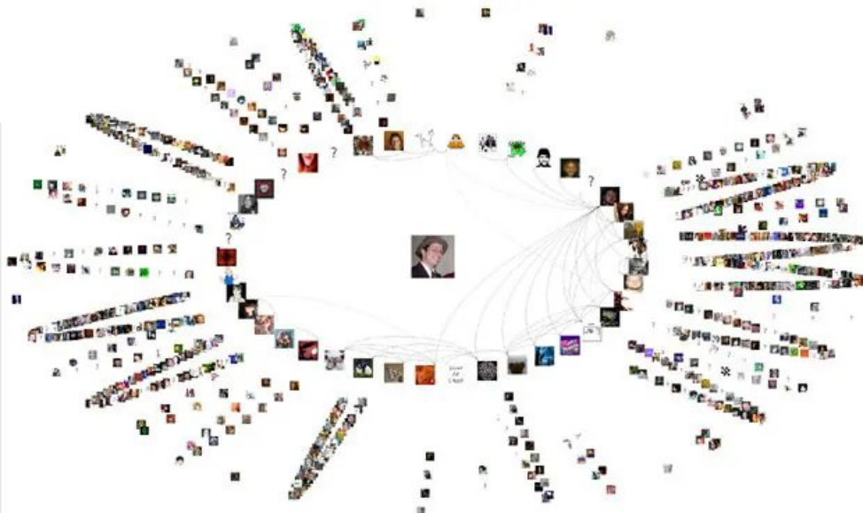

# Johnson & Johnson Predictive Customer Targeting With 96.8% Accuracy

HumbleBeeAI developed a predictive customer-targeting solution for Johnson & Johnson that the case study reports achieved 96.8% accuracy in predicting purchase probability. [PDF p. 1](http://localhost:3344/workspaces/ab6b13a5-514c-4849-96d2-cd4008c5c310/documents/31b8addc-2098-4ed6-8670-410ec572c4ca/evidence/a68143ba-8a4e-4fd6-8815-bf63b1a9cf63/asset)

## Executive Summary

Johnson & Johnson needed to identify which customers were most likely to purchase products across a varied global portfolio. HumbleBeeAI describes a predictive modeling solution combining machine learning and explainable AI; its case study reports 96.8% accuracy in predicting purchase probability. The source describes real-time prediction through a Flask API, but does not specify deployment scope, validation methodology, or when the reported accuracy was measured. [PDF p. 1](http://localhost:3344/workspaces/ab6b13a5-514c-4849-96d2-cd4008c5c310/documents/31b8addc-2098-4ed6-8670-410ec572c4ca/evidence/a68143ba-8a4e-4fd6-8815-bf63b1a9cf63/asset) [PDF p. 1](http://localhost:3344/workspaces/ab6b13a5-514c-4849-96d2-cd4008c5c310/documents/31b8addc-2098-4ed6-8670-410ec572c4ca/evidence/7d32b0a8-b612-4e46-a155-b7747b4f2a1b/asset) [PDF p. 1](http://localhost:3344/workspaces/ab6b13a5-514c-4849-96d2-cd4008c5c310/documents/31b8addc-2098-4ed6-8670-410ec572c4ca/evidence/7d32b0a8-b612-4e46-a155-b7747b4f2a1b/asset)

The supplied PDF identifies an “Open original HumbleBeeAI page” source link, but it does not include the page URL. The link therefore cannot be reproduced here. [PDF p. 1](http://localhost:3344/workspaces/ab6b13a5-514c-4849-96d2-cd4008c5c310/documents/31b8addc-2098-4ed6-8670-410ec572c4ca/evidence/7d32b0a8-b612-4e46-a155-b7747b4f2a1b/asset)

## Context and Challenge

Johnson & Johnson operates across pharmaceuticals, medical devices, and consumer products, with customer portfolios spanning categories and demographics. Its marketing team needed a more precise way to determine which customers were likely to buy specific products—and why. [PDF p. 2](http://localhost:3344/workspaces/ab6b13a5-514c-4849-96d2-cd4008c5c310/documents/31b8addc-2098-4ed6-8670-410ec572c4ca/evidence/ec357a6e-3da7-4b6f-8438-dc6e76a2ba95/asset)

The case study describes a workflow constrained by inconsistent data and limited explanatory power: teams struggled to identify high-probability buyers, encountered differences across regions and product lines, and could not readily interpret predictions. It also reports that processing large datasets quickly enough for real-time campaign decisions was a scalability challenge. [PDF p. 2](http://localhost:3344/workspaces/ab6b13a5-514c-4849-96d2-cd4008c5c310/documents/31b8addc-2098-4ed6-8670-410ec572c4ca/evidence/36dfa1c1-7496-4d43-a0b2-5dfd5d3b377b/asset)

## Solution and Capabilities

HumbleBeeAI’s described framework combined predictive modeling, data preparation, customer-focused feature engineering, model explanations, and an API for returning predictions. The case study presents these as capabilities of the solution; it does not detail the production rollout or the datasets used. [PDF p. 1](http://localhost:3344/workspaces/ab6b13a5-514c-4849-96d2-cd4008c5c310/documents/31b8addc-2098-4ed6-8670-410ec572c4ca/evidence/7d32b0a8-b612-4e46-a155-b7747b4f2a1b/asset) [PDF p. 1](http://localhost:3344/workspaces/ab6b13a5-514c-4849-96d2-cd4008c5c310/documents/31b8addc-2098-4ed6-8670-410ec572c4ca/evidence/7d32b0a8-b612-4e46-a155-b7747b4f2a1b/asset)

### Predictive modeling and data preparation

- The model used XGBoost, fine-tuned through systematic grid search, to predict purchase probability. [PDF p. 1](http://localhost:3344/workspaces/ab6b13a5-514c-4849-96d2-cd4008c5c310/documents/31b8addc-2098-4ed6-8670-410ec572c4ca/evidence/7d32b0a8-b612-4e46-a155-b7747b4f2a1b/asset)
- The described preprocessing used imputation strategies for missing values and MinMax scaling to standardize diverse datasets. [PDF p. 1](http://localhost:3344/workspaces/ab6b13a5-514c-4849-96d2-cd4008c5c310/documents/31b8addc-2098-4ed6-8670-410ec572c4ca/evidence/7d32b0a8-b612-4e46-a155-b7747b4f2a1b/asset)
- Custom features represented demographics, location, transaction history, and usage patterns, giving the model inputs intended to capture customer behavior. [PDF p. 1](http://localhost:3344/workspaces/ab6b13a5-514c-4849-96d2-cd4008c5c310/documents/31b8addc-2098-4ed6-8670-410ec572c4ca/evidence/7d32b0a8-b612-4e46-a155-b7747b4f2a1b/asset)

### Explainable predictions and API delivery

- SHAP analysis was used to show which features contributed to predictions, helping marketing teams understand why customers were assigned higher purchase probabilities. [PDF p. 1](http://localhost:3344/workspaces/ab6b13a5-514c-4849-96d2-cd4008c5c310/documents/31b8addc-2098-4ed6-8670-410ec572c4ca/evidence/7d32b0a8-b612-4e46-a155-b7747b4f2a1b/asset)
- A Flask API is described as providing predictions and interpretability metrics in real time, with the stated purpose of supporting rapid marketing decisions. The source does not clarify the deployment environment or availability. [PDF p. 1](http://localhost:3344/workspaces/ab6b13a5-514c-4849-96d2-cd4008c5c310/documents/31b8addc-2098-4ed6-8670-410ec572c4ca/evidence/7d32b0a8-b612-4e46-a155-b7747b4f2a1b/asset)

## Results and Business Impact

The case study reports the following outcomes. It does not provide evaluation details for the accuracy figure or numerical measurements for the campaign and business outcomes. [PDF p. 2](http://localhost:3344/workspaces/ab6b13a5-514c-4849-96d2-cd4008c5c310/documents/31b8addc-2098-4ed6-8670-410ec572c4ca/evidence/69c0a1ab-1e07-42f9-83df-2d0f468421de/asset)

- 96.8 percent prediction accuracy in predicting purchase probability. [PDF p. 1](http://localhost:3344/workspaces/ab6b13a5-514c-4849-96d2-cd4008c5c310/documents/31b8addc-2098-4ed6-8670-410ec572c4ca/evidence/a68143ba-8a4e-4fd6-8815-bf63b1a9cf63/asset) [PDF p. 2](http://localhost:3344/workspaces/ab6b13a5-514c-4849-96d2-cd4008c5c310/documents/31b8addc-2098-4ed6-8670-410ec572c4ca/evidence/69c0a1ab-1e07-42f9-83df-2d0f468421de/asset)
- SHAP analysis surfaced reported drivers of customer behavior, including regional preferences and product usage patterns. [PDF p. 2](http://localhost:3344/workspaces/ab6b13a5-514c-4849-96d2-cd4008c5c310/documents/31b8addc-2098-4ed6-8670-410ec572c4ca/evidence/69c0a1ab-1e07-42f9-83df-2d0f468421de/asset)
- The case study attributes higher conversion rates and stronger revenue growth across multiple product categories to improved campaign outcomes, but gives no quantified values or measurement period. [PDF p. 2](http://localhost:3344/workspaces/ab6b13a5-514c-4849-96d2-cd4008c5c310/documents/31b8addc-2098-4ed6-8670-410ec572c4ca/evidence/69c0a1ab-1e07-42f9-83df-2d0f468421de/asset)
- It also reports faster campaign planning and greater alignment with real-time market opportunities, without providing timing or operational metrics. [PDF p. 2](http://localhost:3344/workspaces/ab6b13a5-514c-4849-96d2-cd4008c5c310/documents/31b8addc-2098-4ed6-8670-410ec572c4ca/evidence/69c0a1ab-1e07-42f9-83df-2d0f468421de/asset)

## Limitations and Next Steps

The supplied case-study material does not specify the accuracy calculation or test conditions, data volumes, deployment scope, adoption levels, or measured before-and-after business results. It therefore supports reporting the stated prediction accuracy and qualitative outcomes, but not independently validating them or quantifying campaign or revenue impact. [PDF p. 2](http://localhost:3344/workspaces/ab6b13a5-514c-4849-96d2-cd4008c5c310/documents/31b8addc-2098-4ed6-8670-410ec572c4ca/evidence/69c0a1ab-1e07-42f9-83df-2d0f468421de/asset) [PDF p. 1](http://localhost:3344/workspaces/ab6b13a5-514c-4849-96d2-cd4008c5c310/documents/31b8addc-2098-4ed6-8670-410ec572c4ca/evidence/a68143ba-8a4e-4fd6-8815-bf63b1a9cf63/asset)

The source describes the Flask API as delivering real-time predictions and explanations, but does not establish its production availability or identify any planned next steps. No future work is presented as committed. [PDF p. 1](http://localhost:3344/workspaces/ab6b13a5-514c-4849-96d2-cd4008c5c310/documents/31b8addc-2098-4ed6-8670-410ec572c4ca/evidence/7d32b0a8-b612-4e46-a155-b7747b4f2a1b/asset)

## Conclusion

The case study describes a predictive targeting framework designed to make customer purchase predictions more accurate and understandable for Johnson & Johnson’s marketing teams. It reports 96.8 percent prediction accuracy and qualitative campaign benefits, while leaving the measurement methodology and quantified business impact unspecified. [PDF p. 1](http://localhost:3344/workspaces/ab6b13a5-514c-4849-96d2-cd4008c5c310/documents/31b8addc-2098-4ed6-8670-410ec572c4ca/evidence/a68143ba-8a4e-4fd6-8815-bf63b1a9cf63/asset) [PDF p. 2](http://localhost:3344/workspaces/ab6b13a5-514c-4849-96d2-cd4008c5c310/documents/31b8addc-2098-4ed6-8670-410ec572c4ca/evidence/69c0a1ab-1e07-42f9-83df-2d0f468421de/asset)

