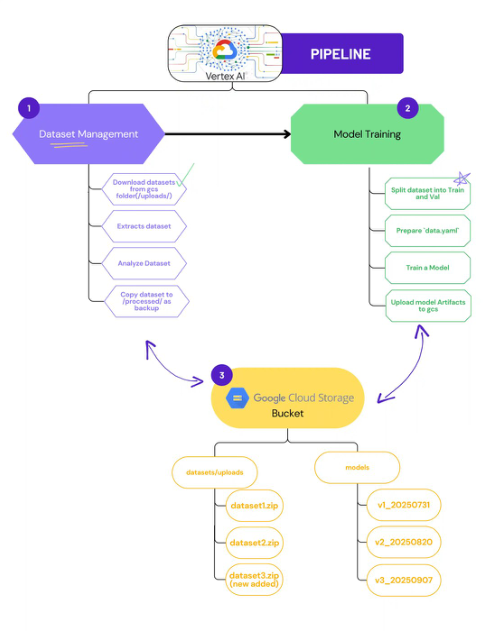

# Automated Training Pipeline for Retail Product Detection

HumbleBeeAI delivered a Google Cloud Vertex AI-based training pipeline that helped a retail technology client reduce custom product-detection model development time from two months to two weeks.  [PDF p. 1](http://localhost:3344/workspaces/ab6b13a5-514c-4849-96d2-cd4008c5c310/documents/57cefac9-51b9-4034-8805-aff98dc6681e/evidence/4c5ea7eb-5b69-4dc9-b953-10dc1dd77802/asset)

## Executive Summary

A retail technology company specializing in brand compliance and merchandising needed to create and deploy custom product-detection models for customers with distinct product catalogs. Its manual, specialist-dependent process slowed delivery and limited the teams’ ability to respond quickly. HumbleBeeAI implemented an automated training pipeline designed to let non-technical client success teams initiate model training and manage deployments. The case study reports reduced development time and lower training-management overhead; it does not provide a measurement period for these results.  [PDF p. 2](http://localhost:3344/workspaces/ab6b13a5-514c-4849-96d2-cd4008c5c310/documents/57cefac9-51b9-4034-8805-aff98dc6681e/evidence/69bd3625-336e-47da-be75-6388333349f8/asset) [PDF p. 2](http://localhost:3344/workspaces/ab6b13a5-514c-4849-96d2-cd4008c5c310/documents/57cefac9-51b9-4034-8805-aff98dc6681e/evidence/e1b8cf64-5e33-4857-870f-3d3dd7b9e010/asset) [PDF p. 3](http://localhost:3344/workspaces/ab6b13a5-514c-4849-96d2-cd4008c5c310/documents/57cefac9-51b9-4034-8805-aff98dc6681e/evidence/b5e32b3c-b3b8-41ae-831e-c5f127360062/asset)

## Context and Challenge

The client served more than 50 customer product catalogs. Each required custom detection models to monitor in-store product placement and support brand integrity. Previously, developing one model took one to two months of specialized ML engineering work, leaving client success teams dependent on a small group of experts and adding delays and communication overhead.  [PDF p. 2](http://localhost:3344/workspaces/ab6b13a5-514c-4849-96d2-cd4008c5c310/documents/57cefac9-51b9-4034-8805-aff98dc6681e/evidence/69bd3625-336e-47da-be75-6388333349f8/asset) [PDF p. 2](http://localhost:3344/workspaces/ab6b13a5-514c-4849-96d2-cd4008c5c310/documents/57cefac9-51b9-4034-8805-aff98dc6681e/evidence/d167cc2f-0174-43e0-a703-ec0f828fba78/asset)

The case study also describes challenges in handling varied dataset formats and quality standards, including preprocessing, validation and preparation across concurrent projects. It says the largest enterprise client managed over 200 distinct product brands and needed ongoing model updates, version management and deployment across geographic markets.  [PDF p. 2](http://localhost:3344/workspaces/ab6b13a5-514c-4849-96d2-cd4008c5c310/documents/57cefac9-51b9-4034-8805-aff98dc6681e/evidence/d167cc2f-0174-43e0-a703-ec0f828fba78/asset)

## Solution and Capabilities

HumbleBeeAI implemented a web-based training system on Google Cloud Vertex AI, connecting guided workflows for model creation with automated training orchestration and centralized dataset and model management.  [PDF p. 2](http://localhost:3344/workspaces/ab6b13a5-514c-4849-96d2-cd4008c5c310/documents/57cefac9-51b9-4034-8805-aff98dc6681e/evidence/e1b8cf64-5e33-4857-870f-3d3dd7b9e010/asset)

### Guided workflows for non-technical teams

Client success managers could start custom training, configure parameters and manage deployments without writing code. The interface also exposed training progress, giving non-technical users a way to work more independently while making the process visible.  [PDF p. 2](http://localhost:3344/workspaces/ab6b13a5-514c-4849-96d2-cd4008c5c310/documents/57cefac9-51b9-4034-8805-aff98dc6681e/evidence/e1b8cf64-5e33-4857-870f-3d3dd7b9e010/asset)

### Automated training lifecycle

Managed Vertex AI orchestration automated dataset preparation, hyperparameter tuning, model versioning and quality assurance. The case study describes these steps as reducing manual work and promoting consistent outputs.  [PDF p. 2](http://localhost:3344/workspaces/ab6b13a5-514c-4849-96d2-cd4008c5c310/documents/57cefac9-51b9-4034-8805-aff98dc6681e/evidence/e1b8cf64-5e33-4857-870f-3d3dd7b9e010/asset)

### Centralized data and model management

Integration with Google Cloud Storage (GCS) brought datasets and model artifacts into a centralized workflow. Dataset versioning and a model registry supported iteration and collaboration across distributed teams; the solution description also identifies one-click deployment options.  [PDF p. 2](http://localhost:3344/workspaces/ab6b13a5-514c-4849-96d2-cd4008c5c310/documents/57cefac9-51b9-4034-8805-aff98dc6681e/evidence/e1b8cf64-5e33-4857-870f-3d3dd7b9e010/asset)

### Cloud-scale orchestration

The solution was designed for enterprise-scale operations. The case study says it managed hundreds of simultaneous training jobs and large datasets, while describing performance and cost efficiency as design goals; no specific performance or cost figures are supplied.  [PDF p. 2](http://localhost:3344/workspaces/ab6b13a5-514c-4849-96d2-cd4008c5c310/documents/57cefac9-51b9-4034-8805-aff98dc6681e/evidence/e1b8cf64-5e33-4857-870f-3d3dd7b9e010/asset)

## Results and Business Impact

The case study reports the following operational results:  [PDF p. 3](http://localhost:3344/workspaces/ab6b13a5-514c-4849-96d2-cd4008c5c310/documents/57cefac9-51b9-4034-8805-aff98dc6681e/evidence/b5e32b3c-b3b8-41ae-831e-c5f127360062/asset)

- Model development time fell from 2 months to 2 weeks, reported as a 75% reduction. This enabled faster responses to customer requests and faster solution deployment, according to the case study. [PDF p. 3](http://localhost:3344/workspaces/ab6b13a5-514c-4849-96d2-cd4008c5c310/documents/57cefac9-51b9-4034-8805-aff98dc6681e/evidence/b5e32b3c-b3b8-41ae-831e-c5f127360062/asset)
- Training-management overhead decreased by 90% for training and deployment workflows for the largest client, described in the results as having over 20 brands. The system managed over 20 models with automated updates. [PDF p. 3](http://localhost:3344/workspaces/ab6b13a5-514c-4849-96d2-cd4008c5c310/documents/57cefac9-51b9-4034-8805-aff98dc6681e/evidence/b5e32b3c-b3b8-41ae-831e-c5f127360062/asset)
- Client success teams could manage model creation independently, reducing the ML engineering bottleneck, as reported by the case study. [PDF p. 3](http://localhost:3344/workspaces/ab6b13a5-514c-4849-96d2-cd4008c5c310/documents/57cefac9-51b9-4034-8805-aff98dc6681e/evidence/b5e32b3c-b3b8-41ae-831e-c5f127360062/asset)
- The case study also reports increased client satisfaction and retention associated with quicker custom model delivery and improved detection accuracy, but provides no numerical satisfaction, retention or accuracy measurements. [PDF p. 3](http://localhost:3344/workspaces/ab6b13a5-514c-4849-96d2-cd4008c5c310/documents/57cefac9-51b9-4034-8805-aff98dc6681e/evidence/b5e32b3c-b3b8-41ae-831e-c5f127360062/asset)

The results section describes the largest client as having over 20 brands, while the challenge section describes an enterprise client with over 200 distinct product brands. The source does not explain whether those figures refer to different scopes or reconcile them.  [PDF p. 3](http://localhost:3344/workspaces/ab6b13a5-514c-4849-96d2-cd4008c5c310/documents/57cefac9-51b9-4034-8805-aff98dc6681e/evidence/b5e32b3c-b3b8-41ae-831e-c5f127360062/asset) [PDF p. 2](http://localhost:3344/workspaces/ab6b13a5-514c-4849-96d2-cd4008c5c310/documents/57cefac9-51b9-4034-8805-aff98dc6681e/evidence/d167cc2f-0174-43e0-a703-ec0f828fba78/asset)

## Limitations and Next Steps

The supplied case study describes the pipeline as implemented and reports outcomes, but does not provide a deployment date, measurement period, methodology, or independent validation. It does not quantify improved detection accuracy, client satisfaction, retention, cost efficiency, or performance; no such figures are supplied here. [PDF p. 2](http://localhost:3344/workspaces/ab6b13a5-514c-4849-96d2-cd4008c5c310/documents/57cefac9-51b9-4034-8805-aff98dc6681e/evidence/e1b8cf64-5e33-4857-870f-3d3dd7b9e010/asset) [PDF p. 3](http://localhost:3344/workspaces/ab6b13a5-514c-4849-96d2-cd4008c5c310/documents/57cefac9-51b9-4034-8805-aff98dc6681e/evidence/b5e32b3c-b3b8-41ae-831e-c5f127360062/asset)

The source contains a reference labeled “Open original HumbleBeeAI page,” but the original page URL was not included in the supplied material. The link therefore cannot be reproduced here. [PDF p. 1](http://localhost:3344/workspaces/ab6b13a5-514c-4849-96d2-cd4008c5c310/documents/57cefac9-51b9-4034-8805-aff98dc6681e/evidence/9ad75d73-3039-4324-9921-9ee32b6f7259/asset)

## Conclusion

The delivered pipeline addressed a specific operational bottleneck: developing custom retail product-detection models depended on specialist effort and long cycles. By combining guided access for non-technical teams with automated training and centralized data and model management, it supported faster model development and the reported reduction in training-management overhead. [PDF p. 2](http://localhost:3344/workspaces/ab6b13a5-514c-4849-96d2-cd4008c5c310/documents/57cefac9-51b9-4034-8805-aff98dc6681e/evidence/d167cc2f-0174-43e0-a703-ec0f828fba78/asset) [PDF p. 2](http://localhost:3344/workspaces/ab6b13a5-514c-4849-96d2-cd4008c5c310/documents/57cefac9-51b9-4034-8805-aff98dc6681e/evidence/e1b8cf64-5e33-4857-870f-3d3dd7b9e010/asset) [PDF p. 3](http://localhost:3344/workspaces/ab6b13a5-514c-4849-96d2-cd4008c5c310/documents/57cefac9-51b9-4034-8805-aff98dc6681e/evidence/b5e32b3c-b3b8-41ae-831e-c5f127360062/asset)

