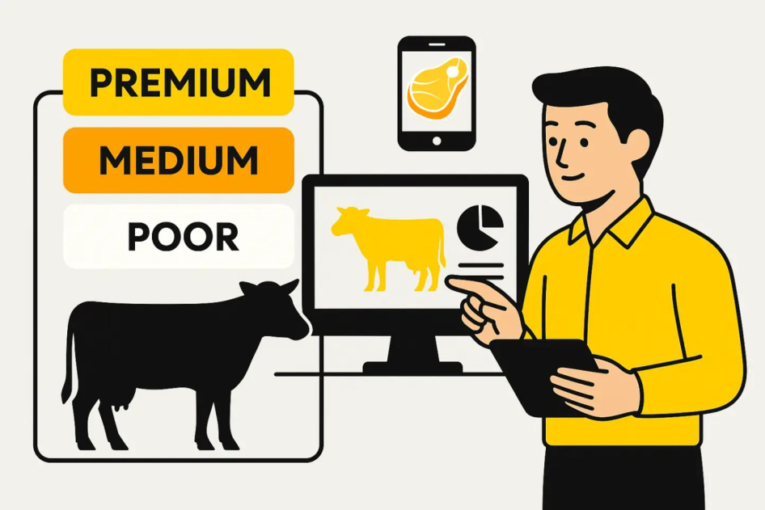

# Predicting Beef Carcass Quality Before Slaughter with On-Device Computer Vision

Predicting Beef Carcass Quality Before Slaughter with On-Device Computer Vision

## Executive Summary

HumbleBeeAI’s Beef Carcass Grading project is a mobile computer-vision solution for cattle producers and feedlot managers who need an estimate of likely carcass quality while timing and lot decisions can still be made. It classifies live-cattle images into premium, medium or poor quality bands, with confidence-scored predictions designed to work on mobile devices without network access. The supplied case study describes the solution and reports performance; it does not specify a client, deployment status, or independently measured business outcomes.  [PDF p. 1](http://localhost:3344/workspaces/ab6b13a5-514c-4849-96d2-cd4008c5c310/documents/3ccf1cc1-742a-40e6-9409-ff1fc385d33b/evidence/3a640fc8-ebc4-4c5b-8fa3-f63556ea9767/asset)The public project description is available on the [HumbleBeeAI case-study page](https://humblebee.ai/case-studies/beef-carcass-detection).

## Context and Challenge

In the described workflow, cattle quality is assessed through grading after slaughter. By that point, producers and feedlot managers have limited ability to use the information to adjust slaughter timing or sort lots. The case study also identifies variation in visual assessment across personnel and field conditions, friction from separate detection and classification tools, and a need for offline, low-latency operation in ranch and feedlot settings.The source further notes data challenges including limited labeled images, class imbalance, and variation in breed, camera angle and lighting.

## Solution and Capabilities

The proposed workflow brings image-based detection and quality-band classification together so field teams can capture an image and receive an estimate before slaughter. The case study describes the following capabilities:

- Unified detection and grading: one deep-learning model detects the animal and assigns one of three bands—premium, medium or poor—rather than passing results between separate models. The source says this design is intended to avoid cascading errors and simplify deployment and maintenance. [PDF p. 2](http://localhost:3344/workspaces/ab6b13a5-514c-4849-96d2-cd4008c5c310/documents/3ccf1cc1-742a-40e6-9409-ff1fc385d33b/evidence/90b45c2f-2fcc-4e1b-b0cb-fad6023febc5/asset) [PDF p. 2](http://localhost:3344/workspaces/ab6b13a5-514c-4849-96d2-cd4008c5c310/documents/3ccf1cc1-742a-40e6-9409-ff1fc385d33b/evidence/08aedc14-dc31-4489-9fca-5fa3457043a6/asset)
- Domain-oriented training: the model was fine-tuned on a custom-labeled dataset reflecting farm conditions, including breed diversity, camera angles and variable lighting; class weighting and targeted image augmentations address class imbalance and robustness. [PDF p. 2](http://localhost:3344/workspaces/ab6b13a5-514c-4849-96d2-cd4008c5c310/documents/3ccf1cc1-742a-40e6-9409-ff1fc385d33b/evidence/88c4077f-63fe-45f8-9369-918da12dc876/asset)
- Decision-support outputs: predictions include confidence scores for the three quality bands, and visual overlays help users check detections in the field. These outputs are intended to inform risk-aware timing and lot-selection decisions, not replace the eventual post-slaughter grade. [PDF p. 2](http://localhost:3344/workspaces/ab6b13a5-514c-4849-96d2-cd4008c5c310/documents/3ccf1cc1-742a-40e6-9409-ff1fc385d33b/evidence/305c02ad-cc6a-4f0f-a2a5-decf0b955e44/asset)
- Mobile, offline inference: the case study describes a mobile-phone deployment designed to return predictions at the point of image capture without network access or specialized equipment. [PDF p. 2](http://localhost:3344/workspaces/ab6b13a5-514c-4849-96d2-cd4008c5c310/documents/3ccf1cc1-742a-40e6-9409-ff1fc385d33b/evidence/61d4ec55-7327-42d6-bdf9-43952c462012/asset)

## Results and Business Impact

The supplied case study reports a “95% precision accuracy” figure and describes real-time, on-device inference. The source does not define the evaluation dataset, measurement protocol, class-level results or scope for this figure, so it should be read as a reported model-performance claim, not as a verified operational result. [PDF p. 2](http://localhost:3344/workspaces/ab6b13a5-514c-4849-96d2-cd4008c5c310/documents/3ccf1cc1-742a-40e6-9409-ff1fc385d33b/evidence/777bb413-4ba8-48a6-887c-ae836b8a64d2/asset) [PDF p. 2](http://localhost:3344/workspaces/ab6b13a5-514c-4849-96d2-cd4008c5c310/documents/3ccf1cc1-742a-40e6-9409-ff1fc385d33b/evidence/61d4ec55-7327-42d6-bdf9-43952c462012/asset)

- Reported technical finding: 95% “precision accuracy,” as phrased in the case study. Supporting benchmark details are not provided in the supplied material. [PDF p. 2](http://localhost:3344/workspaces/ab6b13a5-514c-4849-96d2-cd4008c5c310/documents/3ccf1cc1-742a-40e6-9409-ff1fc385d33b/evidence/777bb413-4ba8-48a6-887c-ae836b8a64d2/asset)
- Reported operating capability: confidence-scored predictions are described as running in real time on mobile devices and offline. No latency, battery, or device-specific measurements are supplied. [PDF p. 2](http://localhost:3344/workspaces/ab6b13a5-514c-4849-96d2-cd4008c5c310/documents/3ccf1cc1-742a-40e6-9409-ff1fc385d33b/evidence/61d4ec55-7327-42d6-bdf9-43952c462012/asset) [PDF p. 1](http://localhost:3344/workspaces/ab6b13a5-514c-4849-96d2-cd4008c5c310/documents/3ccf1cc1-742a-40e6-9409-ff1fc385d33b/evidence/3a640fc8-ebc4-4c5b-8fa3-f63556ea9767/asset)
- Business impact: earlier estimates may support timing and lot-composition decisions, but realized financial impact, decision changes, grading consistency in field use, and operational efficiency have not been measured or provided in the available sources. [PDF p. 2](http://localhost:3344/workspaces/ab6b13a5-514c-4849-96d2-cd4008c5c310/documents/3ccf1cc1-742a-40e6-9409-ff1fc385d33b/evidence/777bb413-4ba8-48a6-887c-ae836b8a64d2/asset)

The supplied material is a HumbleBeeAI case study, not a research publication: it provides no named authors or publication status for a paper, and no independent research benchmark is identified. Accordingly, the reported figure is presented here as a case-study model claim rather than evidence of client business impact. [PDF p. 1](http://localhost:3344/workspaces/ab6b13a5-514c-4849-96d2-cd4008c5c310/documents/3ccf1cc1-742a-40e6-9409-ff1fc385d33b/evidence/2e212063-17ef-430e-980a-bf8509d23928/asset)

## Limitations and Next Steps

The available sources do not identify a named customer, confirm a production rollout, or describe a pilot, so the deployment status beyond the case study’s solution description is unknown. They also do not provide the validation protocol behind the reported precision figure, testing across independent herds or devices, or measured business outcomes.

No specific next-phase work is documented in the supplied materials. Further evaluation of model performance across field conditions and tracking of decision and business outcomes would be useful to establish operational impact, but these are suggested evaluation needs, not reported project commitments.

## Conclusion

The project addresses the timing gap in conventional beef grading by bringing an image-based estimate of premium, medium or poor quality to mobile use before slaughter. The case study describes a unified model with confidence-scored, offline predictions and reports 95% “precision accuracy”; customer deployment and business impact remain unverified in the supplied evidence.  [PDF p. 1](http://localhost:3344/workspaces/ab6b13a5-514c-4849-96d2-cd4008c5c310/documents/3ccf1cc1-742a-40e6-9409-ff1fc385d33b/evidence/3a640fc8-ebc4-4c5b-8fa3-f63556ea9767/asset) [PDF p. 2](http://localhost:3344/workspaces/ab6b13a5-514c-4849-96d2-cd4008c5c310/documents/3ccf1cc1-742a-40e6-9409-ff1fc385d33b/evidence/777bb413-4ba8-48a6-887c-ae836b8a64d2/asset)

