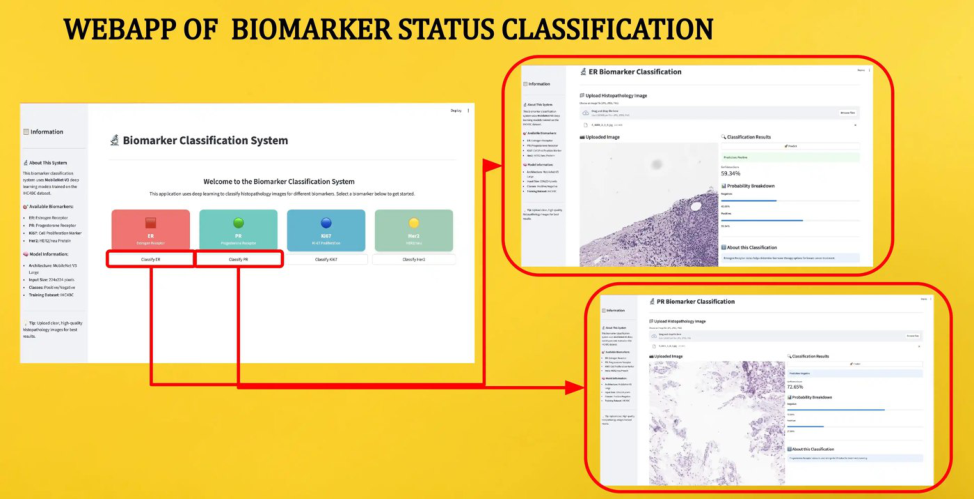

# AI Breast Cancer Biomarker Classification from H&E Histology Images

An AI-enabled web triage tool predicts breast cancer biomarkers from routine H&E histology images to help pathology laboratories prioritize cases for further testing. [PDF p. 1](http://localhost:3344/workspaces/ab6b13a5-514c-4849-96d2-cd4008c5c310/documents/97c50cf2-c4e9-4d63-80bc-5f3ed57c01f6/evidence/5e637708-d89f-4830-a0e4-69a9437a07ad/asset) [PDF p. 2](http://localhost:3344/workspaces/ab6b13a5-514c-4849-96d2-cd4008c5c310/documents/97c50cf2-c4e9-4d63-80bc-5f3ed57c01f6/evidence/08c58391-a495-4209-928e-8174e32d3468/asset)

## Executive Summary

Pathology laboratories use biomarker results to inform breast cancer diagnosis and treatment planning, but conventional immunohistochemistry (IHC) testing can be costly, time-consuming and labor-intensive. This project applies AI to routine H&E images to predict ER, PR, Ki-67 and HER2, with the aim of supporting faster triage and reducing reliance on routine IHC panels. The case study describes a web application as ready for clinical validation; it does not establish routine clinical deployment or provide numerical diagnostic-performance results. [PDF p. 2](http://localhost:3344/workspaces/ab6b13a5-514c-4849-96d2-cd4008c5c310/documents/97c50cf2-c4e9-4d63-80bc-5f3ed57c01f6/evidence/517384ad-a5d7-4fd1-bdea-19496c92b907/asset) [PDF p. 1](http://localhost:3344/workspaces/ab6b13a5-514c-4849-96d2-cd4008c5c310/documents/97c50cf2-c4e9-4d63-80bc-5f3ed57c01f6/evidence/5e637708-d89f-4830-a0e4-69a9437a07ad/asset) [PDF p. 1](http://localhost:3344/workspaces/ab6b13a5-514c-4849-96d2-cd4008c5c310/documents/97c50cf2-c4e9-4d63-80bc-5f3ed57c01f6/evidence/2cd6a8b5-1800-49f9-a9c3-0527c63e4d03/asset)

The supplied material is a HumbleBeeAI case study rather than a research-paper citation. It does not identify research authors or publication status. [View the complete case study](https://humblebee.ai/case-studies/breast-cancer).

## Context and Challenge

For pathology teams, conventional biomarker assessment relies on IHC panels for ER, PR, Ki-67 and HER2. The case study identifies cost and processing time, the labor and expertise required for manual evaluation, and high case volumes as pressures on laboratory workflows. It also notes that variation in assessment quality can complicate consistency and quality assurance. [PDF p. 2](http://localhost:3344/workspaces/ab6b13a5-514c-4849-96d2-cd4008c5c310/documents/97c50cf2-c4e9-4d63-80bc-5f3ed57c01f6/evidence/517384ad-a5d7-4fd1-bdea-19496c92b907/asset) [PDF p. 2](http://localhost:3344/workspaces/ab6b13a5-514c-4849-96d2-cd4008c5c310/documents/97c50cf2-c4e9-4d63-80bc-5f3ed57c01f6/evidence/9dd75fc2-6f3e-4bfc-9759-90d65868d470/asset)

These constraints make it difficult to scale testing and can contribute to delays in processing and reporting. The documented project goal is to use AI predictions as a triage aid—not to claim that H&E predictions replace confirmatory testing or pathologist judgment. [PDF p. 2](http://localhost:3344/workspaces/ab6b13a5-514c-4849-96d2-cd4008c5c310/documents/97c50cf2-c4e9-4d63-80bc-5f3ed57c01f6/evidence/9dd75fc2-6f3e-4bfc-9759-90d65868d470/asset) [PDF p. 1](http://localhost:3344/workspaces/ab6b13a5-514c-4849-96d2-cd4008c5c310/documents/97c50cf2-c4e9-4d63-80bc-5f3ed57c01f6/evidence/5e637708-d89f-4830-a0e4-69a9437a07ad/asset)

## Solution and Capabilities

The project describes an AI pipeline and web application intended to help pathologists screen and prioritize breast cancer cases using routine H&E histology images. [PDF p. 2](http://localhost:3344/workspaces/ab6b13a5-514c-4849-96d2-cd4008c5c310/documents/97c50cf2-c4e9-4d63-80bc-5f3ed57c01f6/evidence/2bfc3061-1ddf-466a-bdbb-ecba90749eb2/asset) [PDF p. 1](http://localhost:3344/workspaces/ab6b13a5-514c-4849-96d2-cd4008c5c310/documents/97c50cf2-c4e9-4d63-80bc-5f3ed57c01f6/evidence/5e637708-d89f-4830-a0e4-69a9437a07ad/asset)

### Biomarker prediction from H&E

- Deep-learning models trained on the IHC4BC dataset are described as predicting ER, PR, Ki-67 and HER2 expression from routine H&E images. [PDF p. 2](http://localhost:3344/workspaces/ab6b13a5-514c-4849-96d2-cd4008c5c310/documents/97c50cf2-c4e9-4d63-80bc-5f3ed57c01f6/evidence/08c58391-a495-4209-928e-8174e32d3468/asset)
- The intended role is triage: predictions can help prioritize cases for confirmatory testing, rather than establish that confirmatory testing is no longer required. [PDF p. 1](http://localhost:3344/workspaces/ab6b13a5-514c-4849-96d2-cd4008c5c310/documents/97c50cf2-c4e9-4d63-80bc-5f3ed57c01f6/evidence/2cd6a8b5-1800-49f9-a9c3-0527c63e4d03/asset) [PDF p. 1](http://localhost:3344/workspaces/ab6b13a5-514c-4849-96d2-cd4008c5c310/documents/97c50cf2-c4e9-4d63-80bc-5f3ed57c01f6/evidence/5e637708-d89f-4830-a0e4-69a9437a07ad/asset)

### Web-based review workflow

- The case study describes a web app that allows pathologists to upload slides, run batch inferences and view positive and negative examples. [PDF p. 2](http://localhost:3344/workspaces/ab6b13a5-514c-4849-96d2-cd4008c5c310/documents/97c50cf2-c4e9-4d63-80bc-5f3ed57c01f6/evidence/bed20b65-6294-4738-b677-717f26cda181/asset)
- It also describes exportable results intended to support downstream reporting and potential integration with laboratory information systems (LIS) or laboratory management systems (LIMS). The source does not establish that such integrations are deployed. [PDF p. 2](http://localhost:3344/workspaces/ab6b13a5-514c-4849-96d2-cd4008c5c310/documents/97c50cf2-c4e9-4d63-80bc-5f3ed57c01f6/evidence/bed20b65-6294-4738-b677-717f26cda181/asset)

## Results and Business Impact

The available material describes intended workflow benefits, but it does not provide measured client business outcomes, such as changes in turnaround time, IHC utilization, costs, workload or patient outcomes. Those impacts should therefore be treated as goals, not demonstrated results.

- The case study presents prioritization for confirmatory testing and reduced reliance on routine IHC panels as the intended workflow value; no measured reduction or savings figure is supplied. [PDF p. 1](http://localhost:3344/workspaces/ab6b13a5-514c-4849-96d2-cd4008c5c310/documents/97c50cf2-c4e9-4d63-80bc-5f3ed57c01f6/evidence/2cd6a8b5-1800-49f9-a9c3-0527c63e4d03/asset) [PDF p. 3](http://localhost:3344/workspaces/ab6b13a5-514c-4849-96d2-cd4008c5c310/documents/97c50cf2-c4e9-4d63-80bc-5f3ed57c01f6/evidence/f9261b33-4fd6-4244-840c-121eda786bf1/asset)
- The case study refers to strong validation results, but reports no numerical diagnostic-performance measurements in the supplied material. This is not evidence of a measured business impact. [PDF p. 1](http://localhost:3344/workspaces/ab6b13a5-514c-4849-96d2-cd4008c5c310/documents/97c50cf2-c4e9-4d63-80bc-5f3ed57c01f6/evidence/2cd6a8b5-1800-49f9-a9c3-0527c63e4d03/asset) [PDF p. 1](http://localhost:3344/workspaces/ab6b13a5-514c-4849-96d2-cd4008c5c310/documents/97c50cf2-c4e9-4d63-80bc-5f3ed57c01f6/evidence/5e637708-d89f-4830-a0e4-69a9437a07ad/asset)

Accordingly, the supported result is a described AI triage workflow and web application positioned for clinical validation—not a quantified improvement in laboratory or patient outcomes. [PDF p. 1](http://localhost:3344/workspaces/ab6b13a5-514c-4849-96d2-cd4008c5c310/documents/97c50cf2-c4e9-4d63-80bc-5f3ed57c01f6/evidence/5e637708-d89f-4830-a0e4-69a9437a07ad/asset)

## Limitations and Next Steps

The case study describes the web app as ready for clinical validation. The supplied information does not document completed clinical validation, routine production use, regulatory status, or integration into a laboratory’s existing systems. It also provides no cohort details or numerical diagnostic-performance results. [PDF p. 1](http://localhost:3344/workspaces/ab6b13a5-514c-4849-96d2-cd4008c5c310/documents/97c50cf2-c4e9-4d63-80bc-5f3ed57c01f6/evidence/5e637708-d89f-4830-a0e4-69a9437a07ad/asset)

Clinical validation and workflow integration are described as next steps or readiness goals, not confirmed completed activities. The supplied source does not specify a validation plan, timeline or deployment commitments. [PDF p. 1](http://localhost:3344/workspaces/ab6b13a5-514c-4849-96d2-cd4008c5c310/documents/97c50cf2-c4e9-4d63-80bc-5f3ed57c01f6/evidence/2cd6a8b5-1800-49f9-a9c3-0527c63e4d03/asset) [PDF p. 3](http://localhost:3344/workspaces/ab6b13a5-514c-4849-96d2-cd4008c5c310/documents/97c50cf2-c4e9-4d63-80bc-5f3ed57c01f6/evidence/0e793803-95c2-4c05-92df-3440de476119/asset)

## Conclusion

This project applies H&E-based AI predictions and a web triage workflow to a practical challenge for pathology laboratories: the cost and effort of conventional biomarker testing. The described capability provides a basis for evaluating case prioritization, but clinical validation and measurable laboratory impact remain to be established. [PDF p. 2](http://localhost:3344/workspaces/ab6b13a5-514c-4849-96d2-cd4008c5c310/documents/97c50cf2-c4e9-4d63-80bc-5f3ed57c01f6/evidence/517384ad-a5d7-4fd1-bdea-19496c92b907/asset) [PDF p. 1](http://localhost:3344/workspaces/ab6b13a5-514c-4849-96d2-cd4008c5c310/documents/97c50cf2-c4e9-4d63-80bc-5f3ed57c01f6/evidence/5e637708-d89f-4830-a0e4-69a9437a07ad/asset)

