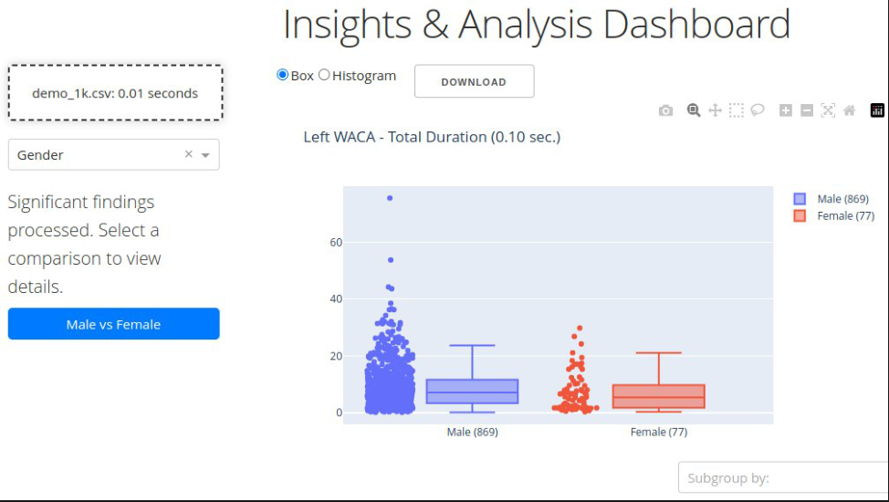
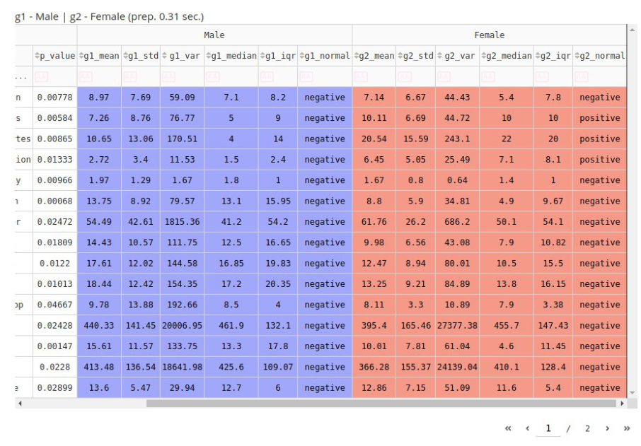

# Johnson & Johnson’s Cartonet Analysis Dashboard

Johnson & Johnson’s Cartonet Analysis Dashboard automated marketing data analysis and visualization to help its team move from manual reporting toward faster, insight-led decisions. [PDF p. 1](http://localhost:3344/workspaces/ab6b13a5-514c-4849-96d2-cd4008c5c310/documents/0eccff37-c19a-4333-b04f-779ad164e7c3/evidence/f7221384-1d26-4ea6-9e23-be14728e0694/asset)

## Executive Summary

HumbleBeeAI’s case study describes a custom AI-powered Cartonet Analysis Dashboard built for Johnson & Johnson’s marketing team, which used complex product-performance data to guide marketing strategy. The dashboard was designed to reduce the time spent preparing and reviewing datasets by automating analysis and presenting findings in interactive views. The case study describes the dashboard as built, but does not establish whether it is currently in production or broadly available. [PDF p. 2](http://localhost:3344/workspaces/ab6b13a5-514c-4849-96d2-cd4008c5c310/documents/0eccff37-c19a-4333-b04f-779ad164e7c3/evidence/0feeeb25-ddec-4e98-a31c-b6f8adc0e8b9/asset) [PDF p. 2](http://localhost:3344/workspaces/ab6b13a5-514c-4849-96d2-cd4008c5c310/documents/0eccff37-c19a-4333-b04f-779ad164e7c3/evidence/d27802e0-2569-4d40-ba11-9682067bec81/asset)

## Context and Challenge

The marketing team needed to interpret product performance, including diagnostic catheter data, while responding to changing market conditions. Before the dashboard, analysts spent hours preparing and reviewing large datasets; information was spread across multiple tools, and analysis could delay campaign or strategy decisions. The case study also identifies the risk of errors in manual analysis and the time this workflow left unavailable for strategic work. [PDF p. 2](http://localhost:3344/workspaces/ab6b13a5-514c-4849-96d2-cd4008c5c310/documents/0eccff37-c19a-4333-b04f-779ad164e7c3/evidence/0feeeb25-ddec-4e98-a31c-b6f8adc0e8b9/asset) [PDF p. 2](http://localhost:3344/workspaces/ab6b13a5-514c-4849-96d2-cd4008c5c310/documents/0eccff37-c19a-4333-b04f-779ad164e7c3/evidence/89bc59b2-04d6-45e0-bcc4-3930febbc006/asset)

## Solution and Capabilities

HumbleBeeAI’s described solution brings automated statistical analysis and comparative dashboard views together so marketers can explore performance without first doing the same data preparation and review manually. [PDF p. 2](http://localhost:3344/workspaces/ab6b13a5-514c-4849-96d2-cd4008c5c310/documents/0eccff37-c19a-4333-b04f-779ad164e7c3/evidence/d27802e0-2569-4d40-ba11-9682067bec81/asset) [PDF p. 3](http://localhost:3344/workspaces/ab6b13a5-514c-4849-96d2-cd4008c5c310/documents/0eccff37-c19a-4333-b04f-779ad164e7c3/evidence/146832a2-43d6-4507-af67-e5ca847b3429/asset)

### Automated analysis

- The dashboard ingests raw datasets and applies statistical models automatically, surfacing findings such as which products or physician groups are performing better. This is intended to shift analysts’ effort away from manual data review and calculation. [PDF p. 2](http://localhost:3344/workspaces/ab6b13a5-514c-4849-96d2-cd4008c5c310/documents/0eccff37-c19a-4333-b04f-779ad164e7c3/evidence/d27802e0-2569-4d40-ba11-9682067bec81/asset)

### Interactive comparisons and visualizations

- Box plots and summary tables let users filter by product or physician, compare performance, and explore patterns on demand. The case study presents these as interactive alternatives to static reports. [PDF p. 2](http://localhost:3344/workspaces/ab6b13a5-514c-4849-96d2-cd4008c5c310/documents/0eccff37-c19a-4333-b04f-779ad164e7c3/evidence/d27802e0-2569-4d40-ba11-9682067bec81/asset)

### Centralized analytics

- The described interface brings datasets into one place for side-by-side comparison, intended to reduce the need to switch between platforms and provide a shared view of performance. [PDF p. 3](http://localhost:3344/workspaces/ab6b13a5-514c-4849-96d2-cd4008c5c310/documents/0eccff37-c19a-4333-b04f-779ad164e7c3/evidence/146832a2-43d6-4507-af67-e5ca847b3429/asset)

## Results and Business Impact

HumbleBeeAI’s case study reports an 80 percent reduction in manual effort and describes faster campaign adjustments and improved team alignment as outcomes. These are source-reported results; the supplied material does not include a measurement method, baseline, evaluation period, or independent validation, so the impact cannot be assessed beyond the case study’s account. [PDF p. 1](http://localhost:3344/workspaces/ab6b13a5-514c-4849-96d2-cd4008c5c310/documents/0eccff37-c19a-4333-b04f-779ad164e7c3/evidence/e9fee05c-0c79-4e00-a9a8-c6318b92849b/asset) [PDF p. 4](http://localhost:3344/workspaces/ab6b13a5-514c-4849-96d2-cd4008c5c310/documents/0eccff37-c19a-4333-b04f-779ad164e7c3/evidence/f25cce72-0b0f-4847-a001-4d08de412b17/asset)

- Manual effort: 80 percent reduction, as reported in the case study. [PDF p. 1](http://localhost:3344/workspaces/ab6b13a5-514c-4849-96d2-cd4008c5c310/documents/0eccff37-c19a-4333-b04f-779ad164e7c3/evidence/e9fee05c-0c79-4e00-a9a8-c6318b92849b/asset) [PDF p. 4](http://localhost:3344/workspaces/ab6b13a5-514c-4849-96d2-cd4008c5c310/documents/0eccff37-c19a-4333-b04f-779ad164e7c3/evidence/f25cce72-0b0f-4847-a001-4d08de412b17/asset)
- Decision-making: the case study says real-time insights enabled marketers to adjust campaigns and reallocate resources more quickly; it does not quantify the change in decision speed or business outcomes. [PDF p. 4](http://localhost:3344/workspaces/ab6b13a5-514c-4849-96d2-cd4008c5c310/documents/0eccff37-c19a-4333-b04f-779ad164e7c3/evidence/f25cce72-0b0f-4847-a001-4d08de412b17/asset)
- Collaboration: the case study reports that shared interactive dashboards supported alignment and data-driven discussion, without providing a measured collaboration metric. [PDF p. 4](http://localhost:3344/workspaces/ab6b13a5-514c-4849-96d2-cd4008c5c310/documents/0eccff37-c19a-4333-b04f-779ad164e7c3/evidence/f25cce72-0b0f-4847-a001-4d08de412b17/asset)

## Limitations and Next Steps

The supplied case study does not specify the dashboard’s deployment status, supported data integrations, security or governance controls, or the methods used to validate its reported impact. Its screenshots include demo data, so they should be read as interface evidence rather than proof of production operation or measured business performance. [PDF p. 3](http://localhost:3344/workspaces/ab6b13a5-514c-4849-96d2-cd4008c5c310/documents/0eccff37-c19a-4333-b04f-779ad164e7c3/evidence/7d502bbd-e121-4563-820e-d326d9d1caef/asset) [PDF p. 3](http://localhost:3344/workspaces/ab6b13a5-514c-4849-96d2-cd4008c5c310/documents/0eccff37-c19a-4333-b04f-779ad164e7c3/evidence/1f163c3e-9327-4339-ab43-06dd94e17e0b/asset)

No planned next steps are provided in the source. The PDF references an “Open original HumbleBeeAI page” link, but the supplied material does not include its destination URL; an original source link therefore cannot be reproduced here. [PDF p. 1](http://localhost:3344/workspaces/ab6b13a5-514c-4849-96d2-cd4008c5c310/documents/0eccff37-c19a-4333-b04f-779ad164e7c3/evidence/f7221384-1d26-4ea6-9e23-be14728e0694/asset)

## Conclusion

The Cartonet Analysis Dashboard is presented as a way to replace labor-intensive, fragmented marketing analysis with automated processing, comparative views, and shared insights. The case study reports lower manual effort and describes support for faster, more collaborative decisions; further operational status and independently measured impact were not provided. [PDF p. 2](http://localhost:3344/workspaces/ab6b13a5-514c-4849-96d2-cd4008c5c310/documents/0eccff37-c19a-4333-b04f-779ad164e7c3/evidence/89bc59b2-04d6-45e0-bcc4-3930febbc006/asset) [PDF p. 4](http://localhost:3344/workspaces/ab6b13a5-514c-4849-96d2-cd4008c5c310/documents/0eccff37-c19a-4333-b04f-779ad164e7c3/evidence/f25cce72-0b0f-4847-a001-4d08de412b17/asset)

