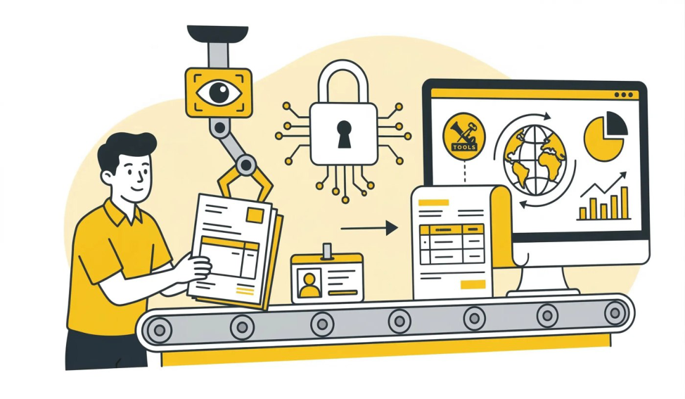

# Automating Customs Documentation with Local AI and Computer Vision

Automating customs documentation with locally hosted AI and computer vision.

## Executive Summary

HumbleBeeAI developed an MVP for a logistics and customs brokerage firm to digitize invoices, packing lists and identity documents and support customs declaration preparation. It combines computer vision with locally hosted OCR and large language model services, keeping sensitive document data within the client’s internal infrastructure. The project is described as a functional MVP; automated document classification and end-to-end declaration generation are roadmap items, not delivered capabilities. [PDF p. 2](http://localhost:3344/workspaces/ab6b13a5-514c-4849-96d2-cd4008c5c310/documents/08499636-03de-4b76-a7ee-82d5f663a0e6/evidence/1439ede9-a42f-4845-9294-9347e2c77ea6/asset) [PDF p. 2](http://localhost:3344/workspaces/ab6b13a5-514c-4849-96d2-cd4008c5c310/documents/08499636-03de-4b76-a7ee-82d5f663a0e6/evidence/9c4b5d96-6bea-4cfc-ab7e-58a92723bd65/asset) [PDF p. 2](http://localhost:3344/workspaces/ab6b13a5-514c-4849-96d2-cd4008c5c310/documents/08499636-03de-4b76-a7ee-82d5f663a0e6/evidence/0a59fa4f-80cd-45e0-8744-5f55f752b50a/asset)

## Context and Challenge

Customs staff previously transcribed information from physical or scanned invoices, packing lists and government-issued IDs into declaration templates. The manual process demanded focused attention for each document and became harder to scale as shipment volumes grew. At the same time, the documents could contain sensitive personal information, including PIN codes and identity numbers, making external cloud processing unacceptable to the client. [PDF p. 2](http://localhost:3344/workspaces/ab6b13a5-514c-4849-96d2-cd4008c5c310/documents/08499636-03de-4b76-a7ee-82d5f663a0e6/evidence/27b95ed5-7f64-49ea-b79d-b8568a63fd2a/asset) [PDF p. 2](http://localhost:3344/workspaces/ab6b13a5-514c-4849-96d2-cd4008c5c310/documents/08499636-03de-4b76-a7ee-82d5f663a0e6/evidence/1439ede9-a42f-4845-9294-9347e2c77ea6/asset)

Document layouts also varied by supplier and country of origin. Basic OCR alone could not reliably interpret document structure or extract semantically meaningful fields, so the solution needed to handle layout variation while operating inside the organization’s infrastructure. [PDF p. 2](http://localhost:3344/workspaces/ab6b13a5-514c-4849-96d2-cd4008c5c310/documents/08499636-03de-4b76-a7ee-82d5f663a0e6/evidence/27b95ed5-7f64-49ea-b79d-b8568a63fd2a/asset)

## Solution and Capabilities

The MVP pairs local processing with a reviewable extraction workflow. Its design addresses both the variety of customs paperwork and the need to keep identity data under the client’s control. [PDF p. 2](http://localhost:3344/workspaces/ab6b13a5-514c-4849-96d2-cd4008c5c310/documents/08499636-03de-4b76-a7ee-82d5f663a0e6/evidence/9c4b5d96-6bea-4cfc-ab7e-58a92723bd65/asset)

### Local AI deployment

OCR engines and LLM services run on the client’s internal servers rather than using cloud APIs. The stated purpose is to ensure that document data—including names, PIN codes and identity numbers—does not leave the organization’s perimeter.

### Computer vision and assisted extraction

The system analyzes uploaded images and PDFs, detecting features such as customs stamps, table structures and field boundaries to prepare documents for structured extraction. In the MVP, users choose the document type—invoice, packing list or ID—rather than relying on automated classification. [PDF p. 2](http://localhost:3344/workspaces/ab6b13a5-514c-4849-96d2-cd4008c5c310/documents/08499636-03de-4b76-a7ee-82d5f663a0e6/evidence/0a59fa4f-80cd-45e0-8744-5f55f752b50a/asset)

### Templates and user review

Extracted data is populated into standardized outputs such as Excel spreadsheets or PDF forms. Users can review and edit the populated information in a dedicated workspace before final submission. [PDF p. 2](http://localhost:3344/workspaces/ab6b13a5-514c-4849-96d2-cd4008c5c310/documents/08499636-03de-4b76-a7ee-82d5f663a0e6/evidence/0a59fa4f-80cd-45e0-8744-5f55f752b50a/asset)

### Security and access control

The source describes end-to-end encryption for data stored in the database and an admin panel with individual user credentials, supporting controlled access and auditability. [PDF p. 2](http://localhost:3344/workspaces/ab6b13a5-514c-4849-96d2-cd4008c5c310/documents/08499636-03de-4b76-a7ee-82d5f663a0e6/evidence/0a59fa4f-80cd-45e0-8744-5f55f752b50a/asset)

### Resource-conscious deployment

Lightweight models were selected for efficient operation on on-premise hardware. The source says this avoided the need for expensive GPU infrastructure or cloud compute and made deployment viable on the client’s existing server environment. [PDF p. 3](http://localhost:3344/workspaces/ab6b13a5-514c-4849-96d2-cd4008c5c310/documents/08499636-03de-4b76-a7ee-82d5f663a0e6/evidence/616300e2-48b6-4633-8f33-8458d5cd9766/asset)

## Results and Business Impact

The case study reports estimated operational improvements, not a separately documented measurement methodology or verified post-deployment study. Reported figures are: [PDF p. 3](http://localhost:3344/workspaces/ab6b13a5-514c-4849-96d2-cd4008c5c310/documents/08499636-03de-4b76-a7ee-82d5f663a0e6/evidence/70818b9e-bfa4-4144-a8e2-9fbe598da6c7/asset) [PDF p. 1](http://localhost:3344/workspaces/ab6b13a5-514c-4849-96d2-cd4008c5c310/documents/08499636-03de-4b76-a7ee-82d5f663a0e6/evidence/c678fda0-bf18-4ed6-beb6-b4c1bc3e2d9b/asset)

- Processing time: estimated reduction of up to 90% compared with the time declarants previously spent processing documents; the source says the pipeline handles work in seconds.
- Human error: reported 97% reduction through moving from manual transcription to AI-assisted extraction.
- Security approach: OCR and LLM services are hosted locally, with end-to-end database encryption described for stored data.
- Scale target: the MVP architecture is described as designed to support an initial user base of up to 1,000 declarants; this is a stated capacity target, not a measured business outcome.

The source provides no baseline dataset, test protocol or independently verified results for the reported time and error reductions, so their measurement status beyond the case-study estimates is not specified. [PDF p. 3](http://localhost:3344/workspaces/ab6b13a5-514c-4849-96d2-cd4008c5c310/documents/08499636-03de-4b76-a7ee-82d5f663a0e6/evidence/70818b9e-bfa4-4144-a8e2-9fbe598da6c7/asset) [PDF p. 1](http://localhost:3344/workspaces/ab6b13a5-514c-4849-96d2-cd4008c5c310/documents/08499636-03de-4b76-a7ee-82d5f663a0e6/evidence/ba9f4d0e-9a2c-4049-a8ec-ec0caca7c393/asset)

## Limitations and Next Steps

The delivered MVP retains a human step: users manually select document type, then review and edit extracted data before submission. The source does not establish that fully automated declarations or automatic classification are available in production. [PDF p. 2](http://localhost:3344/workspaces/ab6b13a5-514c-4849-96d2-cd4008c5c310/documents/08499636-03de-4b76-a7ee-82d5f663a0e6/evidence/0a59fa4f-80cd-45e0-8744-5f55f752b50a/asset) [PDF p. 3](http://localhost:3344/workspaces/ab6b13a5-514c-4849-96d2-cd4008c5c310/documents/08499636-03de-4b76-a7ee-82d5f663a0e6/evidence/965c83e9-d01e-47c6-a4c4-61fa3f9c485f/asset)

Planned Phase 2 work includes automated document classification, deeper ERP integrations and end-to-end customs declaration generation without manual review steps. These are roadmap items; the source does not report their completion or provide a schedule. [PDF p. 3](http://localhost:3344/workspaces/ab6b13a5-514c-4849-96d2-cd4008c5c310/documents/08499636-03de-4b76-a7ee-82d5f663a0e6/evidence/70818b9e-bfa4-4144-a8e2-9fbe598da6c7/asset) [PDF p. 2](http://localhost:3344/workspaces/ab6b13a5-514c-4849-96d2-cd4008c5c310/documents/08499636-03de-4b76-a7ee-82d5f663a0e6/evidence/0a59fa4f-80cd-45e0-8744-5f55f752b50a/asset)

The case study does not provide the client’s name, deployment dates, actual user count, or independently measured business outcomes. [PDF p. 2](http://localhost:3344/workspaces/ab6b13a5-514c-4849-96d2-cd4008c5c310/documents/08499636-03de-4b76-a7ee-82d5f663a0e6/evidence/1439ede9-a42f-4845-9294-9347e2c77ea6/asset) [PDF p. 3](http://localhost:3344/workspaces/ab6b13a5-514c-4849-96d2-cd4008c5c310/documents/08499636-03de-4b76-a7ee-82d5f663a0e6/evidence/70818b9e-bfa4-4144-a8e2-9fbe598da6c7/asset)

## Conclusion

This project establishes a locally hosted, AI-assisted workflow for extracting customs-document data while keeping sensitive records within the client’s infrastructure. The MVP reduces manual transcription through structured extraction, standardized outputs and user review; the case study reports estimated processing-time and error reductions, while broader automation remains planned. [PDF p. 2](http://localhost:3344/workspaces/ab6b13a5-514c-4849-96d2-cd4008c5c310/documents/08499636-03de-4b76-a7ee-82d5f663a0e6/evidence/9c4b5d96-6bea-4cfc-ab7e-58a92723bd65/asset) [PDF p. 3](http://localhost:3344/workspaces/ab6b13a5-514c-4849-96d2-cd4008c5c310/documents/08499636-03de-4b76-a7ee-82d5f663a0e6/evidence/70818b9e-bfa4-4144-a8e2-9fbe598da6c7/asset) [PDF p. 3](http://localhost:3344/workspaces/ab6b13a5-514c-4849-96d2-cd4008c5c310/documents/08499636-03de-4b76-a7ee-82d5f663a0e6/evidence/965c83e9-d01e-47c6-a4c4-61fa3f9c485f/asset)

Original source: HumbleBeeAI case study, “Automating Customs Documentation with Local AI and Computer Vision” (PDF provided; the original page URL is not included in the supplied source material).

The PDF includes an “Open original HumbleBeeAI page” reference, but its destination URL was not provided, so a direct source link cannot be reproduced here. [PDF p. 1](http://localhost:3344/workspaces/ab6b13a5-514c-4849-96d2-cd4008c5c310/documents/08499636-03de-4b76-a7ee-82d5f663a0e6/evidence/c678fda0-bf18-4ed6-beb6-b4c1bc3e2d9b/asset)

