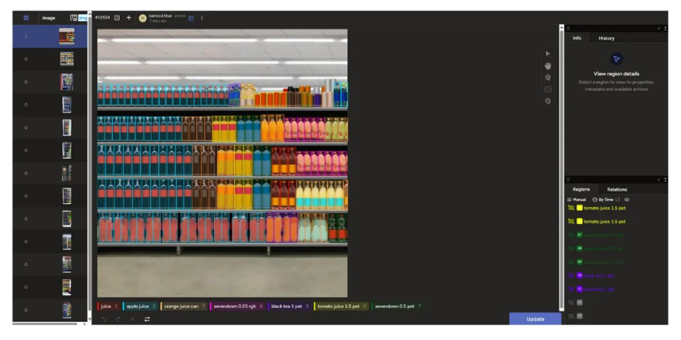
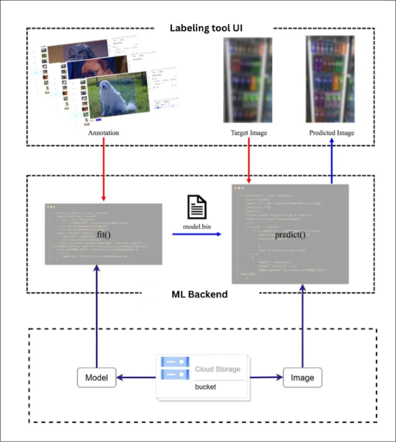

# Enterprise Data Labeling Platform Deployment and Customization

Enterprise Data Labeling Platform Deployment & Customization for a Computer Vision service provider [PDF p. 1](http://localhost:3344/workspaces/ab6b13a5-514c-4849-96d2-cd4008c5c310/documents/17f57d5a-143c-4189-a85c-a9ee82b6af2b/evidence/dbe9ed7c-06d9-4c00-bd5c-3d516850ece4/asset)

## Executive Summary

HumbleBeeAI implemented a customized data-labeling platform for a Computer Vision service provider serving more than 15 enterprise clients. The provider needed to offer client-specific annotation environments without compromising data isolation, security, or the ability to scale. The delivered platform combined a customized labeling tool, an ML backend, and Google Cloud Platform integrations. The case study reports deployment of 15+ isolated environments; the project is described as implemented, while further analytics and MLOps integrations are exploratory. [PDF p. 1](http://localhost:3344/workspaces/ab6b13a5-514c-4849-96d2-cd4008c5c310/documents/17f57d5a-143c-4189-a85c-a9ee82b6af2b/evidence/dbe9ed7c-06d9-4c00-bd5c-3d516850ece4/asset) [PDF p. 4](http://localhost:3344/workspaces/ab6b13a5-514c-4849-96d2-cd4008c5c310/documents/17f57d5a-143c-4189-a85c-a9ee82b6af2b/evidence/cae528ec-cafb-48e5-bffc-7b1365691804/asset)

## Context and Challenge

The provider had to support large annotation projects for multiple companies, each with different security requirements and annotation needs. Its previous infrastructure made client-by-client data isolation and backup/disaster recovery difficult, while increasing deployment demands strained scalability and model processing. The case study also identifies inefficient model integration across seven annotation types and a complex experience for distributed annotation teams as factors slowing project workflows. [PDF p. 2](http://localhost:3344/workspaces/ab6b13a5-514c-4849-96d2-cd4008c5c310/documents/17f57d5a-143c-4189-a85c-a9ee82b6af2b/evidence/827205d2-d6d8-4929-97f4-40b44da4a73a/asset) [PDF p. 3](http://localhost:3344/workspaces/ab6b13a5-514c-4849-96d2-cd4008c5c310/documents/17f57d5a-143c-4189-a85c-a9ee82b6af2b/evidence/1e1f0149-3340-4e91-91da-3454957d032c/asset) [PDF p. 2](http://localhost:3344/workspaces/ab6b13a5-514c-4849-96d2-cd4008c5c310/documents/17f57d5a-143c-4189-a85c-a9ee82b6af2b/evidence/fffe0ad6-b491-4c81-8d60-7282ea1273e6/asset)

- Security and data handling: the provider needed strict customer data separation, controlled access, and dependable backups for large-scale projects. [PDF p. 2](http://localhost:3344/workspaces/ab6b13a5-514c-4849-96d2-cd4008c5c310/documents/17f57d5a-143c-4189-a85c-a9ee82b6af2b/evidence/827205d2-d6d8-4929-97f4-40b44da4a73a/asset)
- Scalability: each new enterprise customer could require an isolated deployment, and concurrent model processing created GPU-memory utilization and auto-labeling reliability concerns. [PDF p. 2](http://localhost:3344/workspaces/ab6b13a5-514c-4849-96d2-cd4008c5c310/documents/17f57d5a-143c-4189-a85c-a9ee82b6af2b/evidence/827205d2-d6d8-4929-97f4-40b44da4a73a/asset)
- Annotation workflow: requirements included object detection, segmentation, video tracking, and keypoint analysis, among other annotation types. [PDF p. 2](http://localhost:3344/workspaces/ab6b13a5-514c-4849-96d2-cd4008c5c310/documents/17f57d5a-143c-4189-a85c-a9ee82b6af2b/evidence/827205d2-d6d8-4929-97f4-40b44da4a73a/asset)

## Solution and Capabilities

HumbleBeeAI delivered a customized labeling platform with an ML backend and Google Cloud Platform integration. The implementation centered on controlled data access, repeatable isolated deployments, and AI-assisted labeling. [PDF p. 2](http://localhost:3344/workspaces/ab6b13a5-514c-4849-96d2-cd4008c5c310/documents/17f57d5a-143c-4189-a85c-a9ee82b6af2b/evidence/0ccca8c9-6e06-40d9-9d92-a5325f12baa8/asset)

### Security and data isolation

- Disabled local file imports so project data used Google Cloud Storage (GCS) as a single source of truth. [PDF p. 2](http://localhost:3344/workspaces/ab6b13a5-514c-4849-96d2-cd4008c5c310/documents/17f57d5a-143c-4189-a85c-a9ee82b6af2b/evidence/0ccca8c9-6e06-40d9-9d92-a5325f12baa8/asset)
- Added invite-only user registration and automated, configurable database backups to GCS for disaster recovery and server migration. [PDF p. 2](http://localhost:3344/workspaces/ab6b13a5-514c-4849-96d2-cd4008c5c310/documents/17f57d5a-143c-4189-a85c-a9ee82b6af2b/evidence/0ccca8c9-6e06-40d9-9d92-a5325f12baa8/asset)

### Cloud-native, multi-company deployments

The deployment system supports multiple isolated labeling instances, with company-specific configurations, dedicated GCS buckets and corresponding CORS policies, and automated port allocation. These controls were designed to keep each customer environment segregated. [PDF p. 3](http://localhost:3344/workspaces/ab6b13a5-514c-4849-96d2-cd4008c5c310/documents/17f57d5a-143c-4189-a85c-a9ee82b6af2b/evidence/1e1f0149-3340-4e91-91da-3454957d032c/asset)

### ML-assisted annotation

The integrated ML backend supports all seven required annotation types. It includes model caching, automatic model detection based on labeling configuration, and dynamic model loading from GCS to provide AI-assisted labeling and reduce manual model management. [PDF p. 3](http://localhost:3344/workspaces/ab6b13a5-514c-4849-96d2-cd4008c5c310/documents/17f57d5a-143c-4189-a85c-a9ee82b6af2b/evidence/b68ab74a-d4c3-406c-9034-27ff103efe55/asset)

The source describes the platform and its capabilities; it does not specify a separate pilot status or identify functionality as a demo. [PDF p. 2](http://localhost:3344/workspaces/ab6b13a5-514c-4849-96d2-cd4008c5c310/documents/17f57d5a-143c-4189-a85c-a9ee82b6af2b/evidence/0ccca8c9-6e06-40d9-9d92-a5325f12baa8/asset) [PDF p. 3](http://localhost:3344/workspaces/ab6b13a5-514c-4849-96d2-cd4008c5c310/documents/17f57d5a-143c-4189-a85c-a9ee82b6af2b/evidence/b68ab74a-d4c3-406c-9034-27ff103efe55/asset)

## Results and Business Impact

The case study reports results across efficiency, deployment scale, data protection, model operations, and labeling accuracy. These are the source-reported outcomes; the supplied material does not provide measurement methods or a measurement period. [PDF p. 4](http://localhost:3344/workspaces/ab6b13a5-514c-4849-96d2-cd4008c5c310/documents/17f57d5a-143c-4189-a85c-a9ee82b6af2b/evidence/8b8b39d1-1e6f-4139-9a9a-4b2b2c1f0032/asset)

- 75% reduction in annotation time, attributed to the auto-labeling feature. [PDF p. 4](http://localhost:3344/workspaces/ab6b13a5-514c-4849-96d2-cd4008c5c310/documents/17f57d5a-143c-4189-a85c-a9ee82b6af2b/evidence/8b8b39d1-1e6f-4139-9a9a-4b2b2c1f0032/asset)
- 15+ isolated annotation environments successfully deployed for enterprise customers. [PDF p. 4](http://localhost:3344/workspaces/ab6b13a5-514c-4849-96d2-cd4008c5c310/documents/17f57d5a-143c-4189-a85c-a9ee82b6af2b/evidence/8b8b39d1-1e6f-4139-9a9a-4b2b2c1f0032/asset)
- 99.9% data protection reliability reported for the automated backup system with configurable frequencies and GCS integration; the source also says server migration times fell from days to hours. [PDF p. 4](http://localhost:3344/workspaces/ab6b13a5-514c-4849-96d2-cd4008c5c310/documents/17f57d5a-143c-4189-a85c-a9ee82b6af2b/evidence/8b8b39d1-1e6f-4139-9a9a-4b2b2c1f0032/asset)
- 90%+ labeling accuracy reported, associated with specialized model types and validation workflows. [PDF p. 4](http://localhost:3344/workspaces/ab6b13a5-514c-4849-96d2-cd4008c5c310/documents/17f57d5a-143c-4189-a85c-a9ee82b6af2b/evidence/8b8b39d1-1e6f-4139-9a9a-4b2b2c1f0032/asset)
- Manual model management was eliminated through automated model caching and the ML backend, according to the case study. [PDF p. 4](http://localhost:3344/workspaces/ab6b13a5-514c-4849-96d2-cd4008c5c310/documents/17f57d5a-143c-4189-a85c-a9ee82b6af2b/evidence/8b8b39d1-1e6f-4139-9a9a-4b2b2c1f0032/asset)

## Limitations and Next Steps

The supplied case study does not provide a measurement methodology or period for the reported outcomes, nor does it detail ongoing operating results. It states that advanced analytics dashboards and deeper integration with other MLOps tools are being explored; these are potential enhancements, not described as delivered functionality. [PDF p. 4](http://localhost:3344/workspaces/ab6b13a5-514c-4849-96d2-cd4008c5c310/documents/17f57d5a-143c-4189-a85c-a9ee82b6af2b/evidence/8b8b39d1-1e6f-4139-9a9a-4b2b2c1f0032/asset) [PDF p. 4](http://localhost:3344/workspaces/ab6b13a5-514c-4849-96d2-cd4008c5c310/documents/17f57d5a-143c-4189-a85c-a9ee82b6af2b/evidence/cae528ec-cafb-48e5-bffc-7b1365691804/asset)

The PDF includes the label “Open original HumbleBeeAI page,” but the supplied source material does not contain the destination URL, so a working original-page link cannot be reproduced here. [PDF p. 1](http://localhost:3344/workspaces/ab6b13a5-514c-4849-96d2-cd4008c5c310/documents/17f57d5a-143c-4189-a85c-a9ee82b6af2b/evidence/4a6967db-be9c-40d0-b0d6-92190bb06bcf/asset)

## Conclusion

The delivered platform addressed the provider’s need to deploy isolated, secure annotation environments for a growing enterprise customer base while improving annotation workflows through an integrated ML backend. The case study reports 15+ deployments and reductions in annotation time, with additional analytics and MLOps integrations still under exploration. [PDF p. 1](http://localhost:3344/workspaces/ab6b13a5-514c-4849-96d2-cd4008c5c310/documents/17f57d5a-143c-4189-a85c-a9ee82b6af2b/evidence/dbe9ed7c-06d9-4c00-bd5c-3d516850ece4/asset) [PDF p. 4](http://localhost:3344/workspaces/ab6b13a5-514c-4849-96d2-cd4008c5c310/documents/17f57d5a-143c-4189-a85c-a9ee82b6af2b/evidence/8b8b39d1-1e6f-4139-9a9a-4b2b2c1f0032/asset) [PDF p. 4](http://localhost:3344/workspaces/ab6b13a5-514c-4849-96d2-cd4008c5c310/documents/17f57d5a-143c-4189-a85c-a9ee82b6af2b/evidence/cae528ec-cafb-48e5-bffc-7b1365691804/asset)

