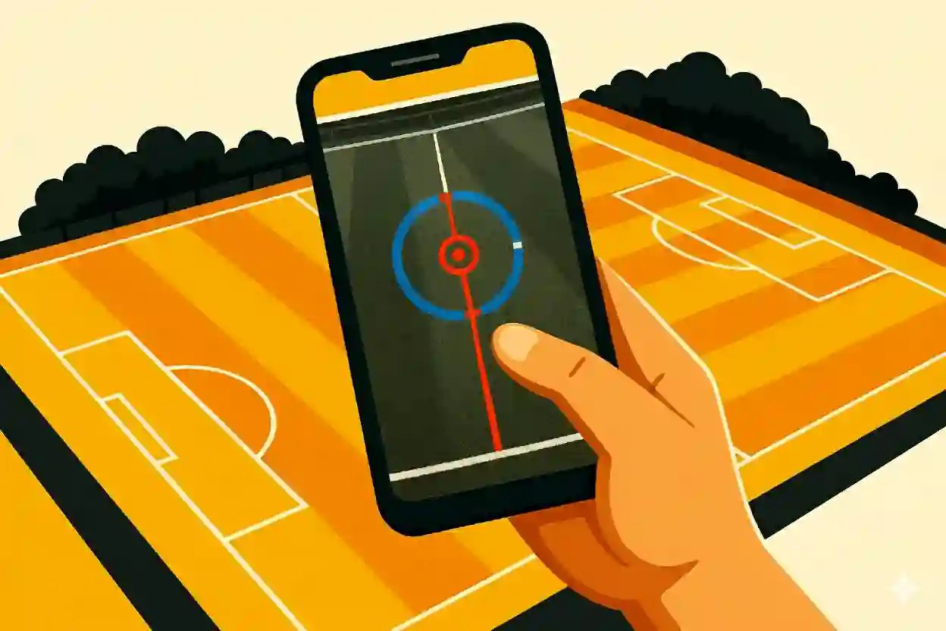

# Real-Time Sports Field Center Detection for Augmented RealityReal-Time Sports Field Center Detection for Augmented Reality

## Executive Summary

HumbleBeeAI partnered with an augmented-reality company to address the difficulty of locating and aligning sports-field centers using mobile devices. The project developed a mobile application using deep learning models optimized for real-time performance, with the aim of supporting more precise alignment for sports AR experiences. The source describes an implemented app, but does not specify whether it is generally available or in production deployment. [PDF p. 1](http://localhost:3344/workspaces/ab6b13a5-514c-4849-96d2-cd4008c5c310/documents/59cecf0a-c37a-4b1e-93e5-9447dbdf1c72/evidence/bea4afff-bd56-4e26-95d5-6057b5e68e8e/asset)

## Context and Challenge

Field center alignment can support sports broadcasting, coaching and augmented reality. The client's previous options relied on manual measurements or expensive equipment, methods described as time-consuming and potentially prone to error. The team also needed to address variability in lighting, weather and field conditions while providing fast feedback for AR use. [PDF p. 2](http://localhost:3344/workspaces/ab6b13a5-514c-4849-96d2-cd4008c5c310/documents/59cecf0a-c37a-4b1e-93e5-9447dbdf1c72/evidence/64c38a76-a7a2-46ba-8dac-6fe60ad0880c/asset) [PDF p. 2](http://localhost:3344/workspaces/ab6b13a5-514c-4849-96d2-cd4008c5c310/documents/59cecf0a-c37a-4b1e-93e5-9447dbdf1c72/evidence/5264f78a-70d1-497a-abf2-7a080e00f17d/asset)

## Solution and Capabilities

The solution uses a phone camera to identify the field center and alignment points. Its capabilities described in the case study include: [PDF p. 2](http://localhost:3344/workspaces/ab6b13a5-514c-4849-96d2-cd4008c5c310/documents/59cecf0a-c37a-4b1e-93e5-9447dbdf1c72/evidence/3ddd653f-c2cf-4fcb-b625-38dff4e90e6d/asset)

- Real-time visual detection: lightweight segmentation models and keypoint estimation identify the field center and key alignment points within seconds. [PDF p. 2](http://localhost:3344/workspaces/ab6b13a5-514c-4849-96d2-cd4008c5c310/documents/59cecf0a-c37a-4b1e-93e5-9447dbdf1c72/evidence/3ddd653f-c2cf-4fcb-b625-38dff4e90e6d/asset)
- Mobile-focused operation: deep learning models are optimized for mobile devices, and the source describes operation on iOS and Android without an internet connection. [PDF p. 2](http://localhost:3344/workspaces/ab6b13a5-514c-4849-96d2-cd4008c5c310/documents/59cecf0a-c37a-4b1e-93e5-9447dbdf1c72/evidence/3ddd653f-c2cf-4fcb-b625-38dff4e90e6d/asset)
- Configuration and integration support: customizable thresholds, exportable logs and integration with existing mobile applications are listed as features. [PDF p. 2](http://localhost:3344/workspaces/ab6b13a5-514c-4849-96d2-cd4008c5c310/documents/59cecf0a-c37a-4b1e-93e5-9447dbdf1c72/evidence/3ddd653f-c2cf-4fcb-b625-38dff4e90e6d/asset)

The source presents the image as an illustration of phone-based field-center alignment; it is not identified as a measured test result or an application screenshot. [PDF p. 1](http://localhost:3344/workspaces/ab6b13a5-514c-4849-96d2-cd4008c5c310/documents/59cecf0a-c37a-4b1e-93e5-9447dbdf1c72/evidence/4d6c395e-e35f-4dd0-929f-2a6749c7de71/asset)

## Results and Business Impact

The case study reports qualitative outcomes, including real-time identification of field centers and alignment points, reliable detection across various lighting and environmental conditions, reduced reliance on expensive equipment and manual labor, and improved AR alignment and user experience. [PDF p. 2](http://localhost:3344/workspaces/ab6b13a5-514c-4849-96d2-cd4008c5c310/documents/59cecf0a-c37a-4b1e-93e5-9447dbdf1c72/evidence/e34c8731-4fa8-45fa-acb0-d810774ce343/asset)

- Reported: instant identification of field centers and alignment points, and reliable detection across varied lighting and environmental conditions. [PDF p. 2](http://localhost:3344/workspaces/ab6b13a5-514c-4849-96d2-cd4008c5c310/documents/59cecf0a-c37a-4b1e-93e5-9447dbdf1c72/evidence/e34c8731-4fa8-45fa-acb0-d810774ce343/asset)
- Reported: reduced reliance on expensive equipment and manual labor, and less time spent on alignment tasks. [PDF p. 2](http://localhost:3344/workspaces/ab6b13a5-514c-4849-96d2-cd4008c5c310/documents/59cecf0a-c37a-4b1e-93e5-9447dbdf1c72/evidence/e34c8731-4fa8-45fa-acb0-d810774ce343/asset)
- Reported: improved field alignment for AR applications and enhanced experiences for fans and other users in sports settings. [PDF p. 2](http://localhost:3344/workspaces/ab6b13a5-514c-4849-96d2-cd4008c5c310/documents/59cecf0a-c37a-4b1e-93e5-9447dbdf1c72/evidence/e34c8731-4fa8-45fa-acb0-d810774ce343/asset)

These are qualitative statements in the supplied case study. It provides no numerical accuracy, latency, time-saved, cost-saved or user-engagement measurements, nor details of a measurement method or evaluation scope. [PDF p. 2](http://localhost:3344/workspaces/ab6b13a5-514c-4849-96d2-cd4008c5c310/documents/59cecf0a-c37a-4b1e-93e5-9447dbdf1c72/evidence/e34c8731-4fa8-45fa-acb0-d810774ce343/asset)

## Limitations and Next Steps

The source describes the application and its capabilities as developed, but does not provide deployment details, independent validation data, supported device specifications, or quantified performance results. It does not identify future work or a roadmap, so planned next steps cannot be stated from the available material. [PDF p. 1](http://localhost:3344/workspaces/ab6b13a5-514c-4849-96d2-cd4008c5c310/documents/59cecf0a-c37a-4b1e-93e5-9447dbdf1c72/evidence/bea4afff-bd56-4e26-95d5-6057b5e68e8e/asset) [PDF p. 2](http://localhost:3344/workspaces/ab6b13a5-514c-4849-96d2-cd4008c5c310/documents/59cecf0a-c37a-4b1e-93e5-9447dbdf1c72/evidence/3ddd653f-c2cf-4fcb-b625-38dff4e90e6d/asset) [PDF p. 2](http://localhost:3344/workspaces/ab6b13a5-514c-4849-96d2-cd4008c5c310/documents/59cecf0a-c37a-4b1e-93e5-9447dbdf1c72/evidence/e34c8731-4fa8-45fa-acb0-d810774ce343/asset)

The source PDF includes the label “Open original HumbleBeeAI page,” but the underlying URL was not supplied here; no link can be reproduced without inventing it. [PDF p. 1](http://localhost:3344/workspaces/ab6b13a5-514c-4849-96d2-cd4008c5c310/documents/59cecf0a-c37a-4b1e-93e5-9447dbdf1c72/evidence/7475ce96-a4b0-4c9a-ad5a-dd09e9c57f36/asset)

## Conclusion

The project addresses a practical obstacle for mobile sports AR: finding field centers and alignment points quickly without depending on manual alignment or expensive equipment. The documented solution combines mobile-optimized deep learning with phone-camera detection, while reported business and user benefits remain qualitative rather than numerically measured. [PDF p. 1](http://localhost:3344/workspaces/ab6b13a5-514c-4849-96d2-cd4008c5c310/documents/59cecf0a-c37a-4b1e-93e5-9447dbdf1c72/evidence/bea4afff-bd56-4e26-95d5-6057b5e68e8e/asset) [PDF p. 2](http://localhost:3344/workspaces/ab6b13a5-514c-4849-96d2-cd4008c5c310/documents/59cecf0a-c37a-4b1e-93e5-9447dbdf1c72/evidence/5264f78a-70d1-497a-abf2-7a080e00f17d/asset) [PDF p. 2](http://localhost:3344/workspaces/ab6b13a5-514c-4849-96d2-cd4008c5c310/documents/59cecf0a-c37a-4b1e-93e5-9447dbdf1c72/evidence/e34c8731-4fa8-45fa-acb0-d810774ce343/asset)

