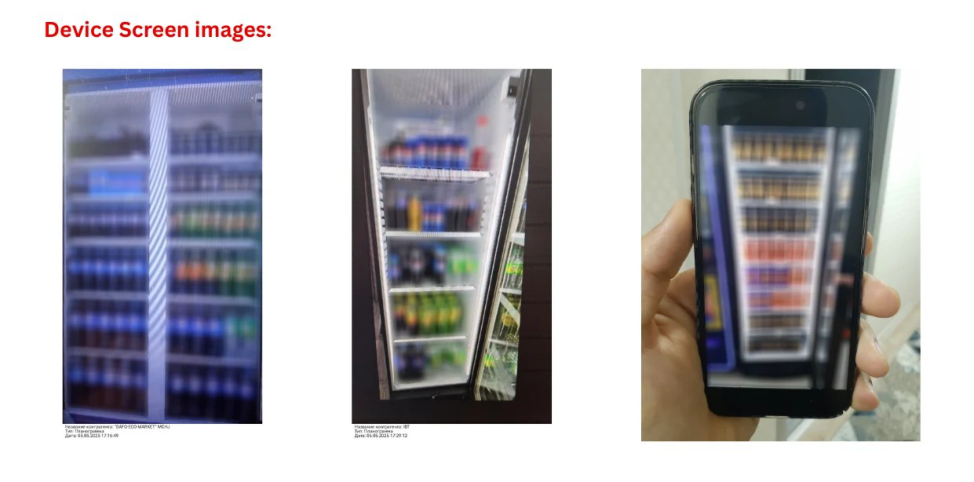
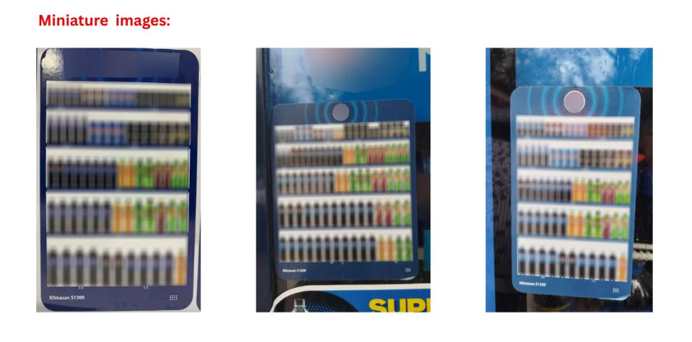

# AI Fraud Detection for Retail Compliance

HumbleBeeAI integrated AI-based retail fraud detection into a distribution platform to help clients validate field reports and monitor planogram compliance across thousands of locations. [PDF p. 1](http://localhost:3344/workspaces/ab6b13a5-514c-4849-96d2-cd4008c5c310/documents/9301d410-ac80-4094-a5d7-5f11c20d02fe/evidence/479be1cc-1c01-43c3-9a25-a4da911df6e8/asset) [PDF p. 1](http://localhost:3344/workspaces/ab6b13a5-514c-4849-96d2-cd4008c5c310/documents/9301d410-ac80-4094-a5d7-5f11c20d02fe/evidence/acb2e5ca-cf7f-4f05-879e-56f18bd6a531/asset)

## Executive Summary

A retail technology company serving more than 600 customers partnered with HumbleBeeAI to address fraudulent field reporting in retail audits. Its distribution SaaS platform serves distributors and manufacturers across FMCG, beverage, pharmaceutical and automotive industries. The implemented AI-powered fraud detection system is described as enabling those clients to identify fraudulent submissions, support planogram adherence across thousands of locations, and improve audit reliability.  [PDF p. 1](http://localhost:3344/workspaces/ab6b13a5-514c-4849-96d2-cd4008c5c310/documents/9301d410-ac80-4094-a5d7-5f11c20d02fe/evidence/781ffd75-4b6e-41d1-bc10-df125bbf6480/asset) [PDF p. 2](http://localhost:3344/workspaces/ab6b13a5-514c-4849-96d2-cd4008c5c310/documents/9301d410-ac80-4094-a5d7-5f11c20d02fe/evidence/822425a5-8565-4599-a9ca-9f70c101ff79/asset)

The case study reports initial detection accuracy and audit-reliability gains; it does not provide a measurement methodology, baseline, or broader quantified business-impact data.  [PDF p. 4](http://localhost:3344/workspaces/ab6b13a5-514c-4849-96d2-cd4008c5c310/documents/9301d410-ac80-4094-a5d7-5f11c20d02fe/evidence/dcd67a51-cc4b-403e-a08f-26053e82c5ed/asset)

## Context and Challenge

Retail compliance depended on field agents manually auditing product displays and reporting in-store conditions. At thousands of outlets, the manual process was costly, difficult to scale, vulnerable to inaccurate or fraudulent submissions, and did not guarantee reliable results.  [PDF p. 2](http://localhost:3344/workspaces/ab6b13a5-514c-4849-96d2-cd4008c5c310/documents/9301d410-ac80-4094-a5d7-5f11c20d02fe/evidence/822425a5-8565-4599-a9ca-9f70c101ff79/asset) [PDF p. 2](http://localhost:3344/workspaces/ab6b13a5-514c-4849-96d2-cd4008c5c310/documents/9301d410-ac80-4094-a5d7-5f11c20d02fe/evidence/1de9ea14-99c9-4c41-986d-e14270819d32/asset)

Reported examples of invalid submissions included photographs of device screens, miniature reference displays and closed coolers. Inconsistent audit data also limited the company’s ability to derive actionable insights for merchandising and retail-partnership decisions.  [PDF p. 2](http://localhost:3344/workspaces/ab6b13a5-514c-4849-96d2-cd4008c5c310/documents/9301d410-ac80-4094-a5d7-5f11c20d02fe/evidence/1de9ea14-99c9-4c41-986d-e14270819d32/asset)

## Solution and Capabilities

HumbleBeeAI implemented a computer-vision and AI solution intended to automate detection of fraudulent field submissions. The case study describes three detection mechanisms: [PDF p. 2](http://localhost:3344/workspaces/ab6b13a5-514c-4849-96d2-cd4008c5c310/documents/9301d410-ac80-4094-a5d7-5f11c20d02fe/evidence/b8333528-b67e-436a-b904-3e081491de0a/asset)

### Multi-layer fraud checks

- Device-screen detection: a classification model identifies images captured from a phone or tablet screen. [PDF p. 2](http://localhost:3344/workspaces/ab6b13a5-514c-4849-96d2-cd4008c5c310/documents/9301d410-ac80-4094-a5d7-5f11c20d02fe/evidence/b8333528-b67e-436a-b904-3e081491de0a/asset)
- Miniature-image analysis: an OCR-based algorithm analyzes text on product labels to identify miniature or printed reference images. [PDF p. 3](http://localhost:3344/workspaces/ab6b13a5-514c-4849-96d2-cd4008c5c310/documents/9301d410-ac80-4094-a5d7-5f11c20d02fe/evidence/3ac9be85-e210-46cb-b7f0-c13d753c84fd/asset)
- Closed-door verification: a model detects whether cooler doors are closed, which the audit guidelines prohibit.

The solution was integrated into the retail technology company’s distribution platform. The source describes it as transforming fraud checking from a manual task into an automated operation, but does not specify further details about deployment architecture or review workflows. [PDF p. 2](http://localhost:3344/workspaces/ab6b13a5-514c-4849-96d2-cd4008c5c310/documents/9301d410-ac80-4094-a5d7-5f11c20d02fe/evidence/b8333528-b67e-436a-b904-3e081491de0a/asset) [PDF p. 4](http://localhost:3344/workspaces/ab6b13a5-514c-4849-96d2-cd4008c5c310/documents/9301d410-ac80-4094-a5d7-5f11c20d02fe/evidence/a788050b-8905-478b-9db6-72192e559f29/asset)

## Results and Business Impact

The case study reports the following results: [PDF p. 4](http://localhost:3344/workspaces/ab6b13a5-514c-4849-96d2-cd4008c5c310/documents/9301d410-ac80-4094-a5d7-5f11c20d02fe/evidence/dcd67a51-cc4b-403e-a08f-26053e82c5ed/asset)

- Fraudulent submissions were detected with over 90% accuracy within the first week. [PDF p. 4](http://localhost:3344/workspaces/ab6b13a5-514c-4849-96d2-cd4008c5c310/documents/9301d410-ac80-4094-a5d7-5f11c20d02fe/evidence/dcd67a51-cc4b-403e-a08f-26053e82c5ed/asset)
- Overall audit reliability increased by more than 90%, as reported in the case study. [PDF p. 4](http://localhost:3344/workspaces/ab6b13a5-514c-4849-96d2-cd4008c5c310/documents/9301d410-ac80-4094-a5d7-5f11c20d02fe/evidence/dcd67a51-cc4b-403e-a08f-26053e82c5ed/asset)
- The platform processed image inputs from thousands of locations, automating a task the source describes as unfeasible to evaluate manually. [PDF p. 4](http://localhost:3344/workspaces/ab6b13a5-514c-4849-96d2-cd4008c5c310/documents/9301d410-ac80-4094-a5d7-5f11c20d02fe/evidence/dcd67a51-cc4b-403e-a08f-26053e82c5ed/asset)

The source says validated data enabled data-driven decisions and contributed to optimized merchandising strategies, stronger retail partnerships and maximized return on investment. It provides no quantified measure for those business outcomes and does not describe how the accuracy or audit-reliability figures were calculated. [PDF p. 4](http://localhost:3344/workspaces/ab6b13a5-514c-4849-96d2-cd4008c5c310/documents/9301d410-ac80-4094-a5d7-5f11c20d02fe/evidence/dcd67a51-cc4b-403e-a08f-26053e82c5ed/asset)

Original source: HumbleBeeAI, “A Global Beverage Leader Prevents Retail Fraud with AI” (case study PDF). The provided source text includes an “Open original HumbleBeeAI page” label but does not provide a URL, so no link can be reproduced here. [PDF p. 1](http://localhost:3344/workspaces/ab6b13a5-514c-4849-96d2-cd4008c5c310/documents/9301d410-ac80-4094-a5d7-5f11c20d02fe/evidence/479be1cc-1c01-43c3-9a25-a4da911df6e8/asset)

## Limitations and Next Steps

The supplied case study presents the solution as implemented and describes integration into the distribution platform. It does not state whether all capabilities are available to every platform customer, identify a pilot or rollout scope, or provide ongoing monitoring and error-rate details. The reported result figures should therefore be read as claims in the case study, with no methodology or baseline included in the supplied material. [PDF p. 4](http://localhost:3344/workspaces/ab6b13a5-514c-4849-96d2-cd4008c5c310/documents/9301d410-ac80-4094-a5d7-5f11c20d02fe/evidence/a788050b-8905-478b-9db6-72192e559f29/asset) [PDF p. 4](http://localhost:3344/workspaces/ab6b13a5-514c-4849-96d2-cd4008c5c310/documents/9301d410-ac80-4094-a5d7-5f11c20d02fe/evidence/dcd67a51-cc4b-403e-a08f-26053e82c5ed/asset)

No planned next steps are specified in the source.

## Conclusion

The project addresses a concrete operational gap: manually reviewing field reports across thousands of retail locations was difficult to scale and vulnerable to fraud. The implemented computer-vision and AI checks automate identification of several reported submission types, while the case study reports over 90% fraud-detection accuracy within the first week and an increase in audit reliability of more than 90%.  [PDF p. 2](http://localhost:3344/workspaces/ab6b13a5-514c-4849-96d2-cd4008c5c310/documents/9301d410-ac80-4094-a5d7-5f11c20d02fe/evidence/1de9ea14-99c9-4c41-986d-e14270819d32/asset) [PDF p. 2](http://localhost:3344/workspaces/ab6b13a5-514c-4849-96d2-cd4008c5c310/documents/9301d410-ac80-4094-a5d7-5f11c20d02fe/evidence/b8333528-b67e-436a-b904-3e081491de0a/asset) [PDF p. 4](http://localhost:3344/workspaces/ab6b13a5-514c-4849-96d2-cd4008c5c310/documents/9301d410-ac80-4094-a5d7-5f11c20d02fe/evidence/dcd67a51-cc4b-403e-a08f-26053e82c5ed/asset)

