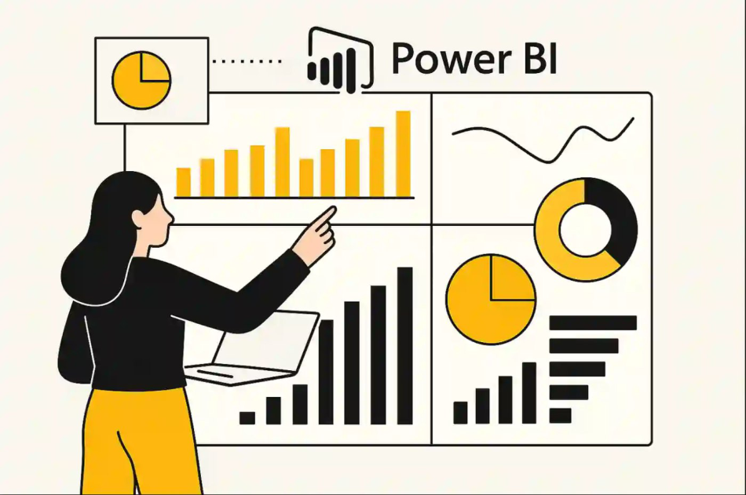

# Johnson & Johnson Event Impact Analytics in Power BI

HumbleBeeAI built a Power BI analytics platform to help Johnson & Johnson evaluate how educational and promotional events relate to medical procedure volumes. [PDF p. 1](http://localhost:3344/workspaces/ab6b13a5-514c-4849-96d2-cd4008c5c310/documents/eb4805d8-ac27-420c-a4c5-d08fe48e42d5/evidence/08738728-0692-4692-9c93-c63adb938233/asset)

## Executive Summary

Johnson & Johnson partnered with HumbleBeeAI to answer whether its events increase medical procedure volumes. Fragmented event, account and procedure records made it difficult to assess event effectiveness, compare regional performance or confidently evaluate return on investment. HumbleBeeAI delivered a unified analytics solution in Microsoft Power BI, designed to support event-impact analysis and interactive exploration. [PDF p. 1](http://localhost:3344/workspaces/ab6b13a5-514c-4849-96d2-cd4008c5c310/documents/eb4805d8-ac27-420c-a4c5-d08fe48e42d5/evidence/e29717b2-8eac-4ac1-bbbd-dd990ebda74e/asset) [PDF p. 3](http://localhost:3344/workspaces/ab6b13a5-514c-4849-96d2-cd4008c5c310/documents/eb4805d8-ac27-420c-a4c5-d08fe48e42d5/evidence/5ac8ab56-6a4a-41ce-b023-aa141162e522/asset)

## Context and Challenge

J&J invests in educational and promotional events for medical professionals, with the aim of strengthening relationships and encouraging adoption of its products. However, event activity was separated from procedure data, so teams lacked a reliable way to connect events with changes in procedure volume. [PDF p. 2](http://localhost:3344/workspaces/ab6b13a5-514c-4849-96d2-cd4008c5c310/documents/eb4805d8-ac27-420c-a4c5-d08fe48e42d5/evidence/d4c65d25-7792-4f76-949d-40bcec746219/asset) [PDF p. 2](http://localhost:3344/workspaces/ab6b13a5-514c-4849-96d2-cd4008c5c310/documents/eb4805d8-ac27-420c-a4c5-d08fe48e42d5/evidence/00a8abb0-d589-4675-be0f-54a904e80e02/asset)

The prior workflow and data presented several constraints:

- There were no benchmarks for comparing accounts that hosted events with accounts that did not.
- Missing account codes and formatting inconsistencies required hours of manual cleanup.
- Regional comparisons were limited, reducing visibility into where utilization was strongest or weakest.
- The future solution needed to handle thousands of records and remain accessible to non-technical users.

 [PDF p. 2](http://localhost:3344/workspaces/ab6b13a5-514c-4849-96d2-cd4008c5c310/documents/eb4805d8-ac27-420c-a4c5-d08fe48e42d5/evidence/00a8abb0-d589-4675-be0f-54a904e80e02/asset)

## Solution and Capabilities

HumbleBeeAI built an analytics system around Microsoft Power BI, combining data preparation, event-impact analysis and interactive dashboards. [PDF p. 2](http://localhost:3344/workspaces/ab6b13a5-514c-4849-96d2-cd4008c5c310/documents/eb4805d8-ac27-420c-a4c5-d08fe48e42d5/evidence/24ecdd69-6e54-4962-809e-56b669c938e7/asset)

### Data integration and preprocessing

Power Query was used to clean and merge account records, event logs and procedure data. The work included filling missing codes, resolving duplicates and correcting inconsistencies to create a single dataset for analysis. [PDF p. 2](http://localhost:3344/workspaces/ab6b13a5-514c-4849-96d2-cd4008c5c310/documents/eb4805d8-ac27-420c-a4c5-d08fe48e42d5/evidence/0792e0c6-e0b2-4f71-8a9c-2fb01a2736b6/asset)

### Event-impact analysis

The analysis compared procedure volumes before and after events at account level, established benchmarks by contrasting event-hosting accounts with non-event accounts, and mapped utilization geographically to help identify where events appeared to be working or not. [PDF p. 2](http://localhost:3344/workspaces/ab6b13a5-514c-4849-96d2-cd4008c5c310/documents/eb4805d8-ac27-420c-a4c5-d08fe48e42d5/evidence/426fc694-5cea-4412-b122-61ff93d0753d/asset)

### Interactive dashboards

Stakeholders could filter dashboard views by account, event type, procedure or timeframe and drill into the data without requiring technical support, supporting quicker exploration and strategy adjustments. [PDF p. 2](http://localhost:3344/workspaces/ab6b13a5-514c-4849-96d2-cd4008c5c310/documents/eb4805d8-ac27-420c-a4c5-d08fe48e42d5/evidence/a505591f-83d7-46fa-941b-a50a04a6ab10/asset)

## Results and Business Impact

The case study reports improved visibility into event ROI and procedure-volume patterns, and describes the resulting benchmarks as showing that accounts hosting events consistently outperformed those that did not. It also reports that leaders could use the analysis to inform resource allocation and refine underperforming strategies. [PDF p. 3](http://localhost:3344/workspaces/ab6b13a5-514c-4849-96d2-cd4008c5c310/documents/eb4805d8-ac27-420c-a4c5-d08fe48e42d5/evidence/2a9cf378-a1b5-4eec-90ee-a7067f4c0af9/asset)

- Manual cleaning work was reported as eliminated, freeing teams to focus on strategy; the source gives no quantified time savings.
- Structured mapping and consistent calculations were reported to improve data accuracy and reliability; no numerical accuracy measure is provided.
- Interactive dashboards were described as helping stakeholders explore data and discover insights.

 [PDF p. 3](http://localhost:3344/workspaces/ab6b13a5-514c-4849-96d2-cd4008c5c310/documents/eb4805d8-ac27-420c-a4c5-d08fe48e42d5/evidence/2a9cf378-a1b5-4eec-90ee-a7067f4c0af9/asset)

The source does not provide numerical event-lift, ROI, time-saved or accuracy measurements. The reported observations should therefore be understood as case-study findings, not as quantified causal or financial impact. [PDF p. 3](http://localhost:3344/workspaces/ab6b13a5-514c-4849-96d2-cd4008c5c310/documents/eb4805d8-ac27-420c-a4c5-d08fe48e42d5/evidence/2a9cf378-a1b5-4eec-90ee-a7067f4c0af9/asset)

## Limitations and Next Steps

The source describes the Power BI solution and dashboards as delivered. It does not provide implementation dates, measured financial outcomes, details of ongoing production operations, or a defined next-step roadmap. No additional planned functionality is specified. [PDF p. 2](http://localhost:3344/workspaces/ab6b13a5-514c-4849-96d2-cd4008c5c310/documents/eb4805d8-ac27-420c-a4c5-d08fe48e42d5/evidence/a505591f-83d7-46fa-941b-a50a04a6ab10/asset) [PDF p. 3](http://localhost:3344/workspaces/ab6b13a5-514c-4849-96d2-cd4008c5c310/documents/eb4805d8-ac27-420c-a4c5-d08fe48e42d5/evidence/2a9cf378-a1b5-4eec-90ee-a7067f4c0af9/asset)

## Conclusion

By bringing account, event and procedure data into a shared Power BI analytics experience, HumbleBeeAI gave J&J teams a structured way to examine event-related procedure trends, compare accounts and explore regional patterns. The source reports useful benchmarks and improved analytical visibility, but does not quantify business impact. [PDF p. 2](http://localhost:3344/workspaces/ab6b13a5-514c-4849-96d2-cd4008c5c310/documents/eb4805d8-ac27-420c-a4c5-d08fe48e42d5/evidence/24ecdd69-6e54-4962-809e-56b669c938e7/asset) [PDF p. 3](http://localhost:3344/workspaces/ab6b13a5-514c-4849-96d2-cd4008c5c310/documents/eb4805d8-ac27-420c-a4c5-d08fe48e42d5/evidence/2a9cf378-a1b5-4eec-90ee-a7067f4c0af9/asset)

Original source: HumbleBeeAI case study PDF, “How Johnson & Johnson Turned a Mountain of Event Data into a Clear Story of ROI?” (source link referenced in the PDF as “Open original HumbleBeeAI page”; no URL is provided in the supplied material). [PDF p. 1](http://localhost:3344/workspaces/ab6b13a5-514c-4849-96d2-cd4008c5c310/documents/eb4805d8-ac27-420c-a4c5-d08fe48e42d5/evidence/08738728-0692-4692-9c93-c63adb938233/asset)

