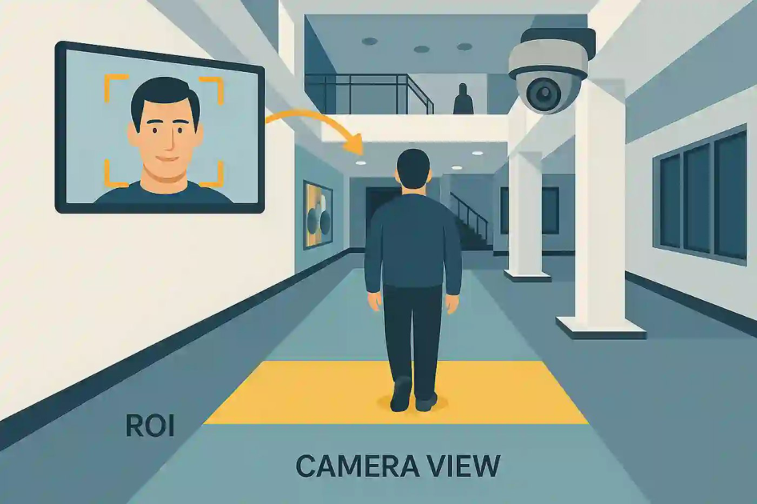

# Improving Facial Recognition Accuracy with AI-Powered Data Refinement

HumbleBeeAI refined a workforce attendance facial-recognition system with image filtering, face tracking and alignment, and entry-threshold logic. [PDF p. 1](http://localhost:3344/workspaces/ab6b13a5-514c-4849-96d2-cd4008c5c310/documents/260f80d8-d7e8-4164-a1de-160882a5658f/evidence/f6fa6965-8842-4808-833c-f932c4296550/asset)

## Executive Summary

An organization using facial recognition for employee attendance was dealing with poor-quality image data, inconsistent identity matching and vulnerabilities in how attendance was recorded. HumbleBee AI describes implementing a solution that filters unusable images, tracks people across frames and aligns faces before recognition. The case study presents the system as implemented, but does not provide a measured accuracy rate or quantified business outcome. [PDF p. 2](http://localhost:3344/workspaces/ab6b13a5-514c-4849-96d2-cd4008c5c310/documents/260f80d8-d7e8-4164-a1de-160882a5658f/evidence/76b8a4a1-ba48-4443-953b-1392543692e8/asset) [PDF p. 2](http://localhost:3344/workspaces/ab6b13a5-514c-4849-96d2-cd4008c5c310/documents/260f80d8-d7e8-4164-a1de-160882a5658f/evidence/81a4b35d-d62b-4b14-941c-e18ebeb14db5/asset) [PDF p. 3](http://localhost:3344/workspaces/ab6b13a5-514c-4849-96d2-cd4008c5c310/documents/260f80d8-d7e8-4164-a1de-160882a5658f/evidence/2d419c5f-ba1b-44ae-a72a-e2ca314f773b/asset)

## Context and Challenge

The client's attendance and security workflows depended on a camera-based recognition system, but the system generated an estimated 5,000 unusable images per day because of poor angles, low resolution and facial occlusion. Those images made records harder to manage, while the system also struggled to distinguish unusable captures from people intentionally obscuring their faces. [PDF p. 2](http://localhost:3344/workspaces/ab6b13a5-514c-4849-96d2-cd4008c5c310/documents/260f80d8-d7e8-4164-a1de-160882a5658f/evidence/5d7320a4-969f-424f-8933-eefb43fd9286/asset)

- Frame-by-frame recognition sometimes assigned one person multiple identities when their face position varied, resulting in unreliable attendance logs.
- Attendance could be triggered by briefly appearing on camera without entering, and repeated appearances could generate redundant records.
- Rotated or mis-cropped faces and high camera placement produced partial or poorly aligned views that did not match the frontal images used for precomputed facial embeddings.

 [PDF p. 2](http://localhost:3344/workspaces/ab6b13a5-514c-4849-96d2-cd4008c5c310/documents/260f80d8-d7e8-4164-a1de-160882a5658f/evidence/5d7320a4-969f-424f-8933-eefb43fd9286/asset)

## Solution and Capabilities

HumbleBee AI reports implementing a multi-part system update addressing data quality, recognition logic and security. The available case study describes the capabilities below; it does not include a detailed deployment architecture or product screenshots. [PDF p. 2](http://localhost:3344/workspaces/ab6b13a5-514c-4849-96d2-cd4008c5c310/documents/260f80d8-d7e8-4164-a1de-160882a5658f/evidence/81a4b35d-d62b-4b14-941c-e18ebeb14db5/asset)

### Filter and categorize image captures

The filtering mechanism assesses facial landmarks and image viability, discarding unusable frames using predefined criteria that include a minimum face size of 640 pixels and frontal positioning. The stated purpose is to reduce noise in the database while retaining security-relevant information; the case study also says the system flags and alerts management when a tracked person’s face cannot be detected, such as when it is obscured by a mask. [PDF p. 2](http://localhost:3344/workspaces/ab6b13a5-514c-4849-96d2-cd4008c5c310/documents/260f80d8-d7e8-4164-a1de-160882a5658f/evidence/81a4b35d-d62b-4b14-941c-e18ebeb14db5/asset) [PDF p. 3](http://localhost:3344/workspaces/ab6b13a5-514c-4849-96d2-cd4008c5c310/documents/260f80d8-d7e8-4164-a1de-160882a5658f/evidence/2d419c5f-ba1b-44ae-a72a-e2ca314f773b/asset)

### Track people across frames

Rather than decide identity from each frame independently, the system follows an individual across multiple frames and compares the captured images with the database after the track is complete. It assigns the identity with the highest cumulative similarity score, aiming to prevent small changes in face position from creating separate identities. [PDF p. 2](http://localhost:3344/workspaces/ab6b13a5-514c-4849-96d2-cd4008c5c310/documents/260f80d8-d7e8-4164-a1de-160882a5658f/evidence/81a4b35d-d62b-4b14-941c-e18ebeb14db5/asset)

### Gate attendance records and reduce duplicates

A virtual line records attendance only when an individual crosses the designated threshold, so simply appearing briefly on camera does not trigger an entry. The system also updates a person’s status only when it changes, intended to eliminate redundant records. [PDF p. 3](http://localhost:3344/workspaces/ab6b13a5-514c-4849-96d2-cd4008c5c310/documents/260f80d8-d7e8-4164-a1de-160882a5658f/evidence/40c03ad3-b63d-41c6-849a-f8542fe130fa/asset)

### Align faces before recognition

Using facial landmarks, the system rotates, crops and rescales captured faces to a standard position before generating embeddings. HumbleBee AI also advised repositioning cameras to eye level to improve the capture of clear, frontal facial images; the source describes this as advice, not as a confirmed completed camera change. [PDF p. 3](http://localhost:3344/workspaces/ab6b13a5-514c-4849-96d2-cd4008c5c310/documents/260f80d8-d7e8-4164-a1de-160882a5658f/evidence/40c03ad3-b63d-41c6-849a-f8542fe130fa/asset)

## Results and Business Impact

The case study reports qualitative improvements in data cleanliness, recognition consistency, attendance-record reliability and security. It does not provide before-and-after accuracy figures, quantified time or cost savings, or a defined measurement period, so the reported benefits cannot be expressed as measured business impact. [PDF p. 3](http://localhost:3344/workspaces/ab6b13a5-514c-4849-96d2-cd4008c5c310/documents/260f80d8-d7e8-4164-a1de-160882a5658f/evidence/2d419c5f-ba1b-44ae-a72a-e2ca314f773b/asset)

- Data quality: filtering was reported to reduce unusable-image noise while retaining security information from unauthorized access attempts.
- Identity matching: tracking was reported to reduce misrecognition and link each tracked individual to a single, highly probable identity.
- Attendance integrity: the virtual line was reported to prevent fraudulent attendance logging, and status-change logic to remove redundant entries.
- Recognition quality: automated alignment and camera repositioning were associated in the case study with improved embeddings and detection and recognition accuracy, including for partially obscured faces.

 [PDF p. 3](http://localhost:3344/workspaces/ab6b13a5-514c-4849-96d2-cd4008c5c310/documents/260f80d8-d7e8-4164-a1de-160882a5658f/evidence/2d419c5f-ba1b-44ae-a72a-e2ca314f773b/asset)

## Limitations and Next Steps

The source describes the solution as implemented, but provides no technical evaluation results, quantified accuracy baseline, or operational measurement details. It also does not establish that camera repositioning was completed; it says HumbleBee AI advised the client to move cameras to eye level. Further plans or next steps are not specified. [PDF p. 3](http://localhost:3344/workspaces/ab6b13a5-514c-4849-96d2-cd4008c5c310/documents/260f80d8-d7e8-4164-a1de-160882a5658f/evidence/40c03ad3-b63d-41c6-849a-f8542fe130fa/asset) [PDF p. 2](http://localhost:3344/workspaces/ab6b13a5-514c-4849-96d2-cd4008c5c310/documents/260f80d8-d7e8-4164-a1de-160882a5658f/evidence/81a4b35d-d62b-4b14-941c-e18ebeb14db5/asset)

The brief requests an original source link, but the supplied source material contains only the label “Open original HumbleBeeAI page” and no URL. A link cannot be reproduced without inventing one. [PDF p. 1](http://localhost:3344/workspaces/ab6b13a5-514c-4849-96d2-cd4008c5c310/documents/260f80d8-d7e8-4164-a1de-160882a5658f/evidence/204b17ec-22ec-417c-9ec9-9f79507c8d14/asset)

## Conclusion

This project addressed the client's stated attendance-recognition problems with image filtering, cross-frame tracking, threshold-based attendance logic and facial alignment. HumbleBee AI reports qualitative gains in data integrity, recognition and security, while the supplied case study does not quantify those gains or provide a source URL. [PDF p. 2](http://localhost:3344/workspaces/ab6b13a5-514c-4849-96d2-cd4008c5c310/documents/260f80d8-d7e8-4164-a1de-160882a5658f/evidence/81a4b35d-d62b-4b14-941c-e18ebeb14db5/asset) [PDF p. 3](http://localhost:3344/workspaces/ab6b13a5-514c-4849-96d2-cd4008c5c310/documents/260f80d8-d7e8-4164-a1de-160882a5658f/evidence/2d419c5f-ba1b-44ae-a72a-e2ca314f773b/asset) [PDF p. 1](http://localhost:3344/workspaces/ab6b13a5-514c-4849-96d2-cd4008c5c310/documents/260f80d8-d7e8-4164-a1de-160882a5658f/evidence/204b17ec-22ec-417c-9ec9-9f79507c8d14/asset)

