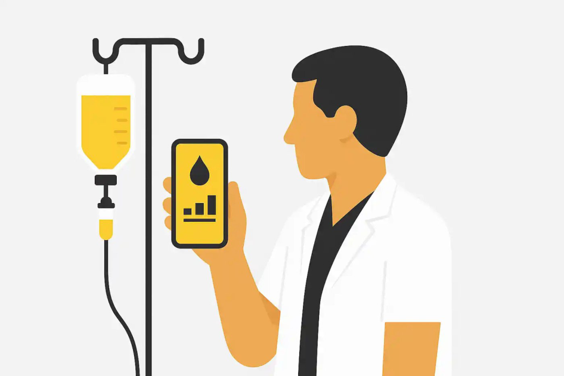

# IV Drip Flow Rate Estimator: Real-Time, On-Device AI

An on-device mobile app estimates IV drip flow rates from a phone camera in real time, helping clinical staff replace manual drop counting with a faster, consistent reading.  [PDF p. 1](http://localhost:3344/workspaces/ab6b13a5-514c-4849-96d2-cd4008c5c310/documents/5077dd91-04f8-4943-9e17-c32791ccd2b7/evidence/dbb05e8a-05c0-4610-be0e-08c5d9f82060/asset) [PDF p. 2](http://localhost:3344/workspaces/ab6b13a5-514c-4849-96d2-cd4008c5c310/documents/5077dd91-04f8-4943-9e17-c32791ccd2b7/evidence/0acd7000-b813-4bd8-bb94-c4d6b0c7406d/asset)

## Executive Summary

HumbleBeeAI collaborated with a medical technology solutions provider to develop an AI-powered mobile application for healthcare professionals monitoring IV infusions. The project addressed a routine but attention-intensive task: estimating flow by manually counting drops. The case study reports that the app returns an estimate within 15 seconds, achieves over 95% accuracy, and operates on mobile devices without internet dependence. The source describes the application as developed, but does not specify its deployment status or establish that it is generally available in clinical production. [PDF p. 1](http://localhost:3344/workspaces/ab6b13a5-514c-4849-96d2-cd4008c5c310/documents/5077dd91-04f8-4943-9e17-c32791ccd2b7/evidence/dbb05e8a-05c0-4610-be0e-08c5d9f82060/asset)

The intended users are healthcare professionals in hospitals, clinics and remote healthcare facilities; the source does not identify the provider by name. [PDF p. 2](http://localhost:3344/workspaces/ab6b13a5-514c-4849-96d2-cd4008c5c310/documents/5077dd91-04f8-4943-9e17-c32791ccd2b7/evidence/0acd7000-b813-4bd8-bb94-c4d6b0c7406d/asset)

## Context and Challenge

Accurate IV flow monitoring matters because patients need to receive the intended fluid or medication dosage. In the described workflow, nurses counted drops manually, requiring sustained attention and leaving readings vulnerable to distraction, fatigue, differences in observer skill and visibility conditions. [PDF p. 2](http://localhost:3344/workspaces/ab6b13a5-514c-4849-96d2-cd4008c5c310/documents/5077dd91-04f8-4943-9e17-c32791ccd2b7/evidence/d86d933f-8e32-4db7-a5cf-1efe2190f86e/asset) [PDF p. 2](http://localhost:3344/workspaces/ab6b13a5-514c-4849-96d2-cd4008c5c310/documents/5077dd91-04f8-4943-9e17-c32791ccd2b7/evidence/d2fa9320-9cbb-483b-9aa1-2fddf09f48ff/asset)

- Manual observation could take up to 3 minutes per observation, according to the case study. [PDF p. 2](http://localhost:3344/workspaces/ab6b13a5-514c-4849-96d2-cd4008c5c310/documents/5077dd91-04f8-4943-9e17-c32791ccd2b7/evidence/d2fa9320-9cbb-483b-9aa1-2fddf09f48ff/asset)
- The source identifies delayed detection of air bubbles, occlusions or incorrect drip speeds as a concern, noting these issues may go unnoticed for several minutes. [PDF p. 2](http://localhost:3344/workspaces/ab6b13a5-514c-4849-96d2-cd4008c5c310/documents/5077dd91-04f8-4943-9e17-c32791ccd2b7/evidence/d2fa9320-9cbb-483b-9aa1-2fddf09f48ff/asset)
- The client sought a camera-based mobile method for fast, precise, real-time measurement while maintaining patient privacy and reliability across healthcare environments. [PDF p. 2](http://localhost:3344/workspaces/ab6b13a5-514c-4849-96d2-cd4008c5c310/documents/5077dd91-04f8-4943-9e17-c32791ccd2b7/evidence/d86d933f-8e32-4db7-a5cf-1efe2190f86e/asset)

## Solution and Capabilities

The delivered solution described in the case study is a mobile app that uses the device camera to estimate IV drip flow automatically. A healthcare professional points a phone camera at the IV setup; the system displays an estimated flow rate within seconds. The source says the app is designed for iOS and Android, but does not provide device compatibility details or clinical validation protocols. [PDF p. 1](http://localhost:3344/workspaces/ab6b13a5-514c-4849-96d2-cd4008c5c310/documents/5077dd91-04f8-4943-9e17-c32791ccd2b7/evidence/dbb05e8a-05c0-4610-be0e-08c5d9f82060/asset)

### Camera-based flow estimation

- Estimates the drip flow rate from the phone camera view, replacing manual drop counting in the described workflow.
- Presents an estimated reading within seconds; the case study reports a result within 15 seconds. [PDF p. 1](http://localhost:3344/workspaces/ab6b13a5-514c-4849-96d2-cd4008c5c310/documents/5077dd91-04f8-4943-9e17-c32791ccd2b7/evidence/dbb05e8a-05c0-4610-be0e-08c5d9f82060/asset)

### On-device operation

The app is described as running securely on mobile devices without requiring internet access. This supports use in low-connectivity settings, including remote facilities; the source does not describe the specific privacy or security controls. [PDF p. 1](http://localhost:3344/workspaces/ab6b13a5-514c-4849-96d2-cd4008c5c310/documents/5077dd91-04f8-4943-9e17-c32791ccd2b7/evidence/dbb05e8a-05c0-4610-be0e-08c5d9f82060/asset)

### Designed for clinical settings

The solution is described as supporting on-site staff across hospitals, clinics and remote healthcare facilities, and as designed to operate on iOS and Android.

## Results and Business Impact

The case study reports the following technical and workflow observations. These are source-reported claims; independent testing methods, sample sizes and measurement conditions are not provided. [PDF p. 1](http://localhost:3344/workspaces/ab6b13a5-514c-4849-96d2-cd4008c5c310/documents/5077dd91-04f8-4943-9e17-c32791ccd2b7/evidence/dbb05e8a-05c0-4610-be0e-08c5d9f82060/asset) [PDF p. 2](http://localhost:3344/workspaces/ab6b13a5-514c-4849-96d2-cd4008c5c310/documents/5077dd91-04f8-4943-9e17-c32791ccd2b7/evidence/17a3f42d-77fb-421a-9b75-9adc649f5487/asset)

- Performance: results within 15 seconds and over 95% accuracy, as reported in the executive summary. [PDF p. 1](http://localhost:3344/workspaces/ab6b13a5-514c-4849-96d2-cd4008c5c310/documents/5077dd91-04f8-4943-9e17-c32791ccd2b7/evidence/dbb05e8a-05c0-4610-be0e-08c5d9f82060/asset)
- Comparison with manual counting: the results section describes AI estimation as over 10x faster; it does not state the test protocol or comparison conditions. [PDF p. 2](http://localhost:3344/workspaces/ab6b13a5-514c-4849-96d2-cd4008c5c310/documents/5077dd91-04f8-4943-9e17-c32791ccd2b7/evidence/17a3f42d-77fb-421a-9b75-9adc649f5487/asset)
- Workflow and clinical value: the source attributes reduced manual effort, more consistent readings and earlier recognition of flow irregularities to the transition from manual counting. These business and patient-safety impacts are described qualitatively, without quantified outcome data. [PDF p. 2](http://localhost:3344/workspaces/ab6b13a5-514c-4849-96d2-cd4008c5c310/documents/5077dd91-04f8-4943-9e17-c32791ccd2b7/evidence/17a3f42d-77fb-421a-9b75-9adc649f5487/asset)

The PDF identifies an original HumbleBeeAI project page, but its URL is not included in the supplied source material. An original source link therefore cannot be reproduced here. [PDF p. 1](http://localhost:3344/workspaces/ab6b13a5-514c-4849-96d2-cd4008c5c310/documents/5077dd91-04f8-4943-9e17-c32791ccd2b7/evidence/900220d5-8f12-4a0c-9d35-e446ffc8a884/asset) [PDF p. 1](http://localhost:3344/workspaces/ab6b13a5-514c-4849-96d2-cd4008c5c310/documents/5077dd91-04f8-4943-9e17-c32791ccd2b7/evidence/8cbac0a6-6928-4624-a2cc-74f248ff124c/asset)

## Limitations and Next Steps

The supplied case study does not specify whether the application has been deployed in routine clinical production, nor does it provide validation methods, testing population, device-level constraints or quantified real-world outcomes. Accordingly, the reported accuracy and speed are presented as case-study figures, not as independently verified clinical guarantees. [PDF p. 1](http://localhost:3344/workspaces/ab6b13a5-514c-4849-96d2-cd4008c5c310/documents/5077dd91-04f8-4943-9e17-c32791ccd2b7/evidence/dbb05e8a-05c0-4610-be0e-08c5d9f82060/asset) [PDF p. 2](http://localhost:3344/workspaces/ab6b13a5-514c-4849-96d2-cd4008c5c310/documents/5077dd91-04f8-4943-9e17-c32791ccd2b7/evidence/17a3f42d-77fb-421a-9b75-9adc649f5487/asset)

No planned next steps are provided in the source. Further clinical validation, deployment details and measurement of operational outcomes are not described and should not be treated as completed work.

## Conclusion

The IV Drip Flow Rate Estimator replaces a repetitive manual counting task with a camera-based mobile estimate intended for clinical staff, including those working in low-connectivity settings. The source reports rapid readings and over 95% accuracy, while broader patient-safety and efficiency benefits remain qualitative and unquantified in the material provided. [PDF p. 1](http://localhost:3344/workspaces/ab6b13a5-514c-4849-96d2-cd4008c5c310/documents/5077dd91-04f8-4943-9e17-c32791ccd2b7/evidence/dbb05e8a-05c0-4610-be0e-08c5d9f82060/asset) [PDF p. 2](http://localhost:3344/workspaces/ab6b13a5-514c-4849-96d2-cd4008c5c310/documents/5077dd91-04f8-4943-9e17-c32791ccd2b7/evidence/17a3f42d-77fb-421a-9b75-9adc649f5487/asset)

