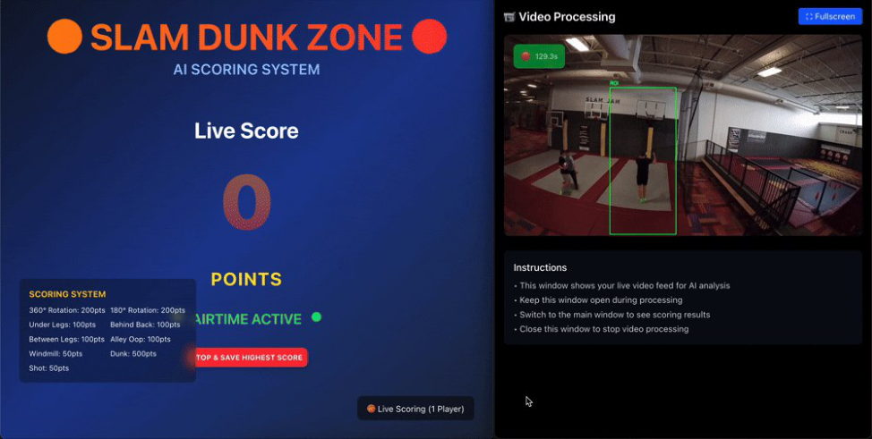

# LiveScore AI Real-Time Basketball Scoring Platform

LiveScore AI brings real-time, automated scoring and event controls to basketball trick-shot and dunk competitions. [PDF p. 1](http://localhost:3344/workspaces/ab6b13a5-514c-4849-96d2-cd4008c5c310/documents/d56b0818-e252-4909-a105-01c511b2f5df/evidence/628716cd-fad6-4cd3-88e3-bcd0a5411c12/asset)

## Executive Summary

HumbleBeeAI’s LiveScore AI is a scoring and event-management platform for tournament operators, event producers, venues, players, and spectators at basketball trick-shot and dunk events. It combines player-movement tracking and trick recognition with automated scoring, animated score displays, live leaderboards, and administrative controls, aiming to reduce manual scoring friction while making results visible as the event unfolds. [PDF p. 1](http://localhost:3344/workspaces/ab6b13a5-514c-4849-96d2-cd4008c5c310/documents/d56b0818-e252-4909-a105-01c511b2f5df/evidence/356651fb-27ec-4901-a225-0a52e8f9cc9b/asset) [PDF p. 1](http://localhost:3344/workspaces/ab6b13a5-514c-4849-96d2-cd4008c5c310/documents/d56b0818-e252-4909-a105-01c511b2f5df/evidence/628716cd-fad6-4cd3-88e3-bcd0a5411c12/asset)

The case study describes real-time scoring and edge-based video processing, but does not provide a quantified latency figure, measured business outcomes, or a clear statement of the platform’s current deployment status. [PDF p. 3](http://localhost:3344/workspaces/ab6b13a5-514c-4849-96d2-cd4008c5c310/documents/d56b0818-e252-4909-a105-01c511b2f5df/evidence/59f8cb82-95fa-4a10-a7cf-e0ebb6b7d208/asset)

## Context and Challenge

The case study identifies a set of issues with traditional event scoring: manual methods can delay feedback and introduce human error; spectators and players may be disconnected from scoring; and organizers must manage score updates, leaderboards, and adjustments without disrupting play. It also describes scalability as a constraint when events expand to multiple concurrent games that need responsive scoring. [PDF p. 2](http://localhost:3344/workspaces/ab6b13a5-514c-4849-96d2-cd4008c5c310/documents/d56b0818-e252-4909-a105-01c511b2f5df/evidence/afd00c3c-b4d9-44e2-b072-cd31a92027cc/asset)

These challenges affect both the competition floor and event operations. Players and audiences need timely, understandable results, while organizers need a way to control scoring and event updates during live play. [PDF p. 2](http://localhost:3344/workspaces/ab6b13a5-514c-4849-96d2-cd4008c5c310/documents/d56b0818-e252-4909-a105-01c511b2f5df/evidence/f9ceda9d-018c-467b-9af4-4265ee68c935/asset)

## Solution and Capabilities

LiveScore AI brings scoring, video processing, spectator-facing displays, and organizer controls into a real-time event workflow. The capabilities described in the case study include: [PDF p. 2](http://localhost:3344/workspaces/ab6b13a5-514c-4849-96d2-cd4008c5c310/documents/d56b0818-e252-4909-a105-01c511b2f5df/evidence/28782cda-2fd4-47a0-b9f6-aff81d3d2066/asset)

### Automated scoring and live event updates

The platform processes scoring data as play unfolds and updates player-facing displays and spectator screens. Its scoring engine is described as recognizing player movements, tricks, and dunk events to generate scores, reducing reliance on manual scoring and supporting consistent adjudication. [PDF p. 2](http://localhost:3344/workspaces/ab6b13a5-514c-4849-96d2-cd4008c5c310/documents/d56b0818-e252-4909-a105-01c511b2f5df/evidence/f4d5a343-7228-4f85-8923-32ff11972f13/asset) [PDF p. 2](http://localhost:3344/workspaces/ab6b13a5-514c-4849-96d2-cd4008c5c310/documents/d56b0818-e252-4909-a105-01c511b2f5df/evidence/6a1ec4ec-b0f7-4f0d-8df4-979d508a308e/asset)

### Spectator displays and persistent leaderboards

Animated screens present trick queues and motion choreography to help audiences follow the competition. Leaderboards update during events and can be used for analysis and reporting, including player rankings and export of results. [PDF p. 2](http://localhost:3344/workspaces/ab6b13a5-514c-4849-96d2-cd4008c5c310/documents/d56b0818-e252-4909-a105-01c511b2f5df/evidence/e9dac307-6de1-4ce5-924b-154a37f0dbc6/asset) [PDF p. 3](http://localhost:3344/workspaces/ab6b13a5-514c-4849-96d2-cd4008c5c310/documents/d56b0818-e252-4909-a105-01c511b2f5df/evidence/beb22282-086f-492f-9593-eb587379b3a1/asset)

### On-site video processing

LiveScore AI is described as using NVIDIA Jetson Orin Nano edge devices to process video on-site. It supports RTSP streams from networked CCTV cameras as well as cameras connected directly to the device. Processing at the venue avoids sending raw footage to remote servers; the processed stream is relayed back to clients so spectators and administrators can view camera feeds alongside scoring data. The case study says this approach is intended to reduce bandwidth requirements and support responsiveness in venues with limited connectivity. [PDF p. 3](http://localhost:3344/workspaces/ab6b13a5-514c-4849-96d2-cd4008c5c310/documents/d56b0818-e252-4909-a105-01c511b2f5df/evidence/59f8cb82-95fa-4a10-a7cf-e0ebb6b7d208/asset)

### Organizer controls

An administrative interface supports score edits, leaderboard adjustments, and real-time event control. The case study also describes secure authentication and role-based access, allowing authorized administrators to make changes without interrupting gameplay. [PDF p. 3](http://localhost:3344/workspaces/ab6b13a5-514c-4849-96d2-cd4008c5c310/documents/d56b0818-e252-4909-a105-01c511b2f5df/evidence/be76072d-022b-42a7-bc8f-6f72f83cf936/asset)

- Real-time score and display updates during play.
- Automated recognition and scoring of movements, tricks, and dunk events.
- Animated spectator UI and persistent, exportable leaderboards.
- On-site video processing with RTSP or directly connected camera inputs, plus administrative event controls.

## Results and Business Impact

The case study reports qualitative benefits, including increased audience participation and player excitement, less manual intervention for organizers, and more consistent scoring intended to reduce human error and disputes. It also describes support for large-scale events and multiple concurrent games with minimal latency. These are reported outcomes and capabilities, not quantified performance results. [PDF p. 3](http://localhost:3344/workspaces/ab6b13a5-514c-4849-96d2-cd4008c5c310/documents/d56b0818-e252-4909-a105-01c511b2f5df/evidence/c21f987a-fe8f-473c-b879-b47b0314e5f8/asset)

- Engagement: dynamic, real-time scores and animations are reported to boost participation and excitement.
- Operations: automated scoring and leaderboard updates are reported to reduce manual intervention.
- Scoring: automated scoring is described as supporting consistent, fair, and transparent adjudication.
- Venue processing: on-site NVIDIA Jetson Orin Nano processing is reported to reduce cloud dependency and bandwidth costs while providing real-time camera feeds.

No numerical measurements, evaluation methodology, or independently measured business-impact figures are provided in the supplied case-study material. [PDF p. 3](http://localhost:3344/workspaces/ab6b13a5-514c-4849-96d2-cd4008c5c310/documents/d56b0818-e252-4909-a105-01c511b2f5df/evidence/c21f987a-fe8f-473c-b879-b47b0314e5f8/asset)

## Limitations and Next Steps

The source describes the platform’s scoring, video, leaderboard, and administrative capabilities, but does not specify a release timeline, rollout scope, or whether every described capability is currently available in production. It also gives no measured latency, accuracy, bandwidth savings, or user-engagement figures. [PDF p. 1](http://localhost:3344/workspaces/ab6b13a5-514c-4849-96d2-cd4008c5c310/documents/d56b0818-e252-4909-a105-01c511b2f5df/evidence/628716cd-fad6-4cd3-88e3-bcd0a5411c12/asset) [PDF p. 3](http://localhost:3344/workspaces/ab6b13a5-514c-4849-96d2-cd4008c5c310/documents/d56b0818-e252-4909-a105-01c511b2f5df/evidence/59f8cb82-95fa-4a10-a7cf-e0ebb6b7d208/asset) [PDF p. 3](http://localhost:3344/workspaces/ab6b13a5-514c-4849-96d2-cd4008c5c310/documents/d56b0818-e252-4909-a105-01c511b2f5df/evidence/c21f987a-fe8f-473c-b879-b47b0314e5f8/asset)

No planned next steps are stated in the supplied material. The source text references an “Open original HumbleBeeAI page” link, but the link’s URL was not included in the supplied source, so it cannot be reproduced here. [PDF p. 1](http://localhost:3344/workspaces/ab6b13a5-514c-4849-96d2-cd4008c5c310/documents/d56b0818-e252-4909-a105-01c511b2f5df/evidence/628716cd-fad6-4cd3-88e3-bcd0a5411c12/asset)

## Conclusion

LiveScore AI addresses the operational and audience challenges of trick-shot and dunk competitions by bringing automated scoring, live visual feedback, video processing, leaderboards, and organizer controls into one platform. The case study supports its intended value for event delivery, while numerical results and the platform’s current deployment scope remain unspecified. [PDF p. 1](http://localhost:3344/workspaces/ab6b13a5-514c-4849-96d2-cd4008c5c310/documents/d56b0818-e252-4909-a105-01c511b2f5df/evidence/356651fb-27ec-4901-a225-0a52e8f9cc9b/asset) [PDF p. 3](http://localhost:3344/workspaces/ab6b13a5-514c-4849-96d2-cd4008c5c310/documents/d56b0818-e252-4909-a105-01c511b2f5df/evidence/c21f987a-fe8f-473c-b879-b47b0314e5f8/asset)

