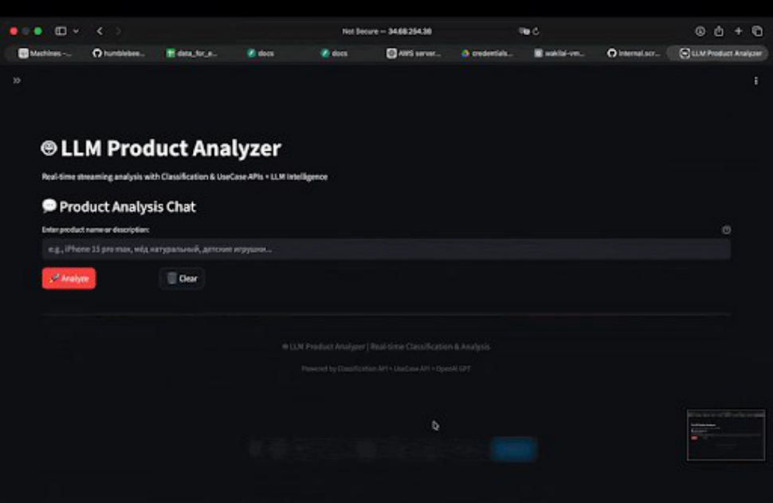

# LLM Results Analyzer for Unified HS Code Classification

LLM Results Analyzer brings regulatory HS code knowledge and real-world trade precedent together in one unified classification workflow. [PDF p. 1](http://localhost:3344/workspaces/ab6b13a5-514c-4849-96d2-cd4008c5c310/documents/d317c1ce-95c6-4e5a-b38d-403e4826878a/evidence/fdd28aa0-8e9a-49d4-9f8a-d6a0741bd2b1/asset)

## Executive Summary

HumbleBeeAI developed the LLM Results Analyzer to help users making Harmonized System (HS) code classification decisions combine two complementary sources: theoretical code definitions and compliance knowledge from Custom Clarification, and practical classification evidence from Custom Optimization. Before this integration, users had to work across the two systems and reconcile their outputs themselves. The analyzer is described as a delivered orchestration framework that sends a classification request to both systems and uses a specialized analyzer LLM to synthesize their results; no quantitative performance or business-impact measurements are provided in the source. [PDF p. 3](http://localhost:3344/workspaces/ab6b13a5-514c-4849-96d2-cd4008c5c310/documents/d317c1ce-95c6-4e5a-b38d-403e4826878a/evidence/c6d67ee5-2362-4733-95d0-108cd48f4fcd/asset)

## Context and Challenge

The two underlying classification projects addressed different evidence needs. Custom Clarification provided theoretical HS code definitions, official regulations and legal frameworks; Custom Optimization drew on 65.5 million real-world product descriptions reflecting trade practices and classification precedents. Those systems could each be used independently, but there was no efficient built-in way for users to combine their recommendations. [PDF p. 2](http://localhost:3344/workspaces/ab6b13a5-514c-4849-96d2-cd4008c5c310/documents/d317c1ce-95c6-4e5a-b38d-403e4826878a/evidence/7fd5799e-5cf1-42ac-aa56-e709ab819f44/asset)

Users previously submitted the same product query to each system, waited for separate responses, then manually compared and reconciled potentially inconsistent results. The case study identifies this manual process as time-consuming and prone to human error and inconsistency; differences between recommendations could also leave users uncertain about which to prioritize. [PDF p. 2](http://localhost:3344/workspaces/ab6b13a5-514c-4849-96d2-cd4008c5c310/documents/d317c1ce-95c6-4e5a-b38d-403e4826878a/evidence/3a94c147-ade5-46f4-883b-3f518cc0c22d/asset)

Original source: the PDF refers to an “Open original HumbleBeeAI page” link, but does not provide its destination URL in the supplied material. A direct link therefore cannot be reproduced here. [PDF p. 1](http://localhost:3344/workspaces/ab6b13a5-514c-4849-96d2-cd4008c5c310/documents/d317c1ce-95c6-4e5a-b38d-403e4826878a/evidence/fdd28aa0-8e9a-49d4-9f8a-d6a0741bd2b1/asset)

## Solution and Capabilities

The analyzer acts as an orchestration layer around the two existing classification systems. A unified endpoint dispatches identical requests to both underlying endpoints simultaneously; after both return, a specialized analyzer LLM processes their outputs using prompt engineering for HS code classification. The framework retains the original system outputs alongside its synthesized analysis.

### Parallel requests through one endpoint

- The unified endpoint sends the same classification query to Custom Clarification and Custom Optimization at the same time, avoiding the sequential wait of separately running each system.
- The two responses bring theoretical regulatory and compliance considerations together with practical trade descriptions and precedent. [PDF p. 2](http://localhost:3344/workspaces/ab6b13a5-514c-4849-96d2-cd4008c5c310/documents/d317c1ce-95c6-4e5a-b38d-403e4826878a/evidence/7fd5799e-5cf1-42ac-aa56-e709ab819f44/asset)

### Synthesis with retained source outputs

- A specialized analyzer LLM identifies areas where the underlying recommendations agree or differ, and provides a reasoned recommendation that considers both perspectives.
- Keeping both original outputs alongside the synthesis preserves visibility into the underlying evidence rather than replacing it with a single unexplained answer.

The supplied screenshot illustrates a product-analysis interface. The source does not establish that this screenshot depicts the exact unified endpoint or confirm the production availability of every visible interface element. [PDF p. 3](http://localhost:3344/workspaces/ab6b13a5-514c-4849-96d2-cd4008c5c310/documents/d317c1ce-95c6-4e5a-b38d-403e4826878a/evidence/ed26290d-04e0-4440-a4e2-43dbaa0e2949/asset)

## Results and Business Impact

The case study reports qualitative workflow and decision-support benefits, but supplies no before-and-after timings, accuracy figures, adoption counts or other quantified outcome measures. The reported results should therefore be read as source-described observations rather than independently measured business impact.

- Workflow: the unified endpoint is reported to eliminate the complexity and time overhead associated with manually using two separate systems.
- Response time: parallel processing is reported to make total response time only marginally longer than the slower of the two underlying systems. No response-time values are supplied.
- Conflict handling: the analyzer is reported to identify and explain discrepancies between theoretical and practical approaches, offering users guidance on resolving classification conflicts.
- Classification confidence and adoption: the case study reports improved confidence through justifications based on compliance requirements and trade precedent, and a substantial increase in adoption after simplifying the workflow. It provides no numerical confidence or adoption measurements.

The source includes this illustration of users reviewing a combined classification result; it is illustrative and does not itself provide performance evidence. [PDF p. 4](http://localhost:3344/workspaces/ab6b13a5-514c-4849-96d2-cd4008c5c310/documents/d317c1ce-95c6-4e5a-b38d-403e4826878a/evidence/4bb4b84f-865c-4978-bfc5-34f6cee1bbe9/asset)

## Limitations and Next Steps

The supplied case study does not document known technical limitations, a roadmap, or planned next steps. It describes the orchestration framework and its unified endpoint as developed, but does not specify deployment scope, production status, ongoing validation, or service availability. Those details remain unprovided, and the reported qualitative benefits are not accompanied by quantitative measurements.

## Conclusion

The LLM Results Analyzer addresses the practical gap between two separate sources of HS code classification knowledge by coordinating their requests and presenting a reasoned synthesis alongside the original outputs. The case study describes a simpler combined workflow and qualitative decision-support benefits, while leaving quantified impact and production scope unspecified.

