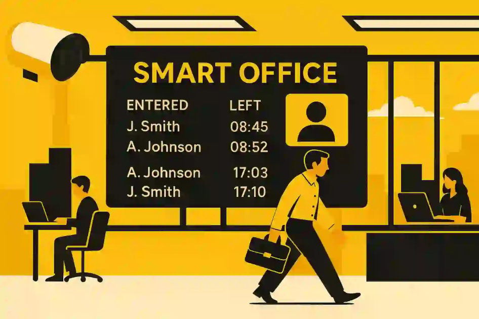

# LumioHub AI: Reducing Computational Costs and RAM Overload with ROI Processing

HumbleBeeAI optimized LumioHub AI’s video recognition workflow with region-of-interest processing and a 30-second track-timing mechanism to reduce unnecessary computation and control memory use. [PDF p. 1](http://localhost:3344/workspaces/ab6b13a5-514c-4849-96d2-cd4008c5c310/documents/23f5a23d-84a1-4ae4-acfd-1957268d08da/evidence/d2a0ebc6-84c6-4e33-97e6-4dfb597ffe17/asset)

## Executive Summary

LumioHub AI provides a computer-vision and real-time analytics platform for modern enterprises, supporting workplace workflows such as attendance automation and on-premise security. As deployments expanded, whole-frame analysis and long-lived video tracks placed pressure on processing resources and RAM. HumbleBeeAI implemented region-of-interest (ROI) processing and a track-duration protocol to address these bottlenecks. The public case study reports lower computational demand, stable memory use and more responsive processing, but provides no quantified savings or measured business outcomes. [PDF p. 2](http://localhost:3344/workspaces/ab6b13a5-514c-4849-96d2-cd4008c5c310/documents/23f5a23d-84a1-4ae4-acfd-1957268d08da/evidence/d04eac3b-313d-464d-8844-c921d2651fe3/asset) [PDF p. 2](http://localhost:3344/workspaces/ab6b13a5-514c-4849-96d2-cd4008c5c310/documents/23f5a23d-84a1-4ae4-acfd-1957268d08da/evidence/c8819c88-b345-4eff-8ea7-4e44006f8623/asset) [PDF p. 3](http://localhost:3344/workspaces/ab6b13a5-514c-4849-96d2-cd4008c5c310/documents/23f5a23d-84a1-4ae4-acfd-1957268d08da/evidence/509118b1-24e0-40ea-8264-ad07784eee95/asset)

## Context and Challenge

The platform’s computer-vision models processed full video frames even when faces appeared in only small portions of the image. That meant computation was spent analyzing pixels outside the relevant regions, increasing processing load as the client expanded its deployment. [PDF p. 2](http://localhost:3344/workspaces/ab6b13a5-514c-4849-96d2-cd4008c5c310/documents/23f5a23d-84a1-4ae4-acfd-1957268d08da/evidence/c8819c88-b345-4eff-8ea7-4e44006f8623/asset)

Memory pressure came from the previous tracking workflow: the system retained every frame associated with an active track until the person left the camera’s view. When someone remained visible for an extended period—sometimes over an hour—the accumulated frames created a memory bottleneck and risked system instability, constraining use in high-traffic settings. [PDF p. 2](http://localhost:3344/workspaces/ab6b13a5-514c-4849-96d2-cd4008c5c310/documents/23f5a23d-84a1-4ae4-acfd-1957268d08da/evidence/c8819c88-b345-4eff-8ea7-4e44006f8623/asset)

These constraints affected a platform designed to process high volumes of video data for enterprise users. The case study identifies processing efficiency, memory stability and scalability as the concerns; it does not provide deployment volumes or quantified baseline measurements. [PDF p. 2](http://localhost:3344/workspaces/ab6b13a5-514c-4849-96d2-cd4008c5c310/documents/23f5a23d-84a1-4ae4-acfd-1957268d08da/evidence/d04eac3b-313d-464d-8844-c921d2651fe3/asset) [PDF p. 2](http://localhost:3344/workspaces/ab6b13a5-514c-4849-96d2-cd4008c5c310/documents/23f5a23d-84a1-4ae4-acfd-1957268d08da/evidence/c8819c88-b345-4eff-8ea7-4e44006f8623/asset)

## Solution and Capabilities

HumbleBeeAI implemented a two-part optimization aimed at reducing the data analyzed and limiting the amount of track history retained. The source describes these as custom solutions implemented for the LumioHub AI platform. [PDF p. 2](http://localhost:3344/workspaces/ab6b13a5-514c-4849-96d2-cd4008c5c310/documents/23f5a23d-84a1-4ae4-acfd-1957268d08da/evidence/680522ad-ce8e-414e-a6c3-aa59d9ad09ab/asset)

### Region-of-interest processing

Instead of analyzing each entire frame, the ROI framework isolates relevant areas where faces are detected and processes those pixels. The purpose is to avoid spending computation on unrelated parts of the frame. [PDF p. 2](http://localhost:3344/workspaces/ab6b13a5-514c-4849-96d2-cd4008c5c310/documents/23f5a23d-84a1-4ae4-acfd-1957268d08da/evidence/680522ad-ce8e-414e-a6c3-aa59d9ad09ab/asset)

### 30-second track-duration management

A timer was configured for each active track. If a track remained active beyond 30 seconds, the system marked it as removed and assigned a new track ID if the person remained in view. This caps the frames retained for a single track, addressing the accumulation that caused RAM pressure. [PDF p. 2](http://localhost:3344/workspaces/ab6b13a5-514c-4849-96d2-cd4008c5c310/documents/23f5a23d-84a1-4ae4-acfd-1957268d08da/evidence/680522ad-ce8e-414e-a6c3-aa59d9ad09ab/asset)

- Process relevant face regions rather than entire video frames, reducing the amount of image data sent through analysis.
- Apply a 30-second limit to active tracks, with a new track ID assigned when a person remains visible after the limit.

The source is a HumbleBeeAI case study rather than a research paper; author names and a formal publication status are not provided. See the [complete public case study](https://humblebee.ai/case-studies/optimizing-recognition-processing).

## Results and Business Impact

The public case study reports qualitative improvements following implementation, including reduced computation, controlled memory use and more responsive real-time processing. It does not publish numerical savings, benchmark methodology, or measured business outcomes, so these reported observations should not be read as quantified ROI. [PDF p. 3](http://localhost:3344/workspaces/ab6b13a5-514c-4849-96d2-cd4008c5c310/documents/23f5a23d-84a1-4ae4-acfd-1957268d08da/evidence/509118b1-24e0-40ea-8264-ad07784eee95/asset)

- Computational demand: the case study says ROI processing minimized the data requiring analysis and enabled faster, more efficient processing; it provides no cost amount or percentage reduction.
- Memory and responsiveness: the case study reports stable memory consumption and lower-latency insight delivery after track-timing was introduced, without reporting RAM figures or latency measurements.
- Capacity and business impact: the source says the platform can handle a higher volume of video streams without overburdening compute resources, but supplies no stream counts or independently measured business-impact results.

## Limitations and Next Steps

The available case-study material does not include before-and-after measurements, a benchmark protocol, cost figures, resource utilization data, latency values or quantified stream capacity. It therefore supports a description of the implemented approach and reported qualitative observations, not a numerical estimate of savings or a verified business return. [PDF p. 3](http://localhost:3344/workspaces/ab6b13a5-514c-4849-96d2-cd4008c5c310/documents/23f5a23d-84a1-4ae4-acfd-1957268d08da/evidence/509118b1-24e0-40ea-8264-ad07784eee95/asset)

The case study says HumbleBeeAI continues to work with the client to explore further optimizations and integrate new AI capabilities. Those activities are described as ongoing exploration; no specific next feature or delivery date is provided, so they should not be treated as completed functionality. [PDF p. 3](http://localhost:3344/workspaces/ab6b13a5-514c-4849-96d2-cd4008c5c310/documents/23f5a23d-84a1-4ae4-acfd-1957268d08da/evidence/2e784e4a-07df-43fc-a2e5-a8e20de1600a/asset)

For research attribution, the source is presented as a HumbleBeeAI case study, but it does not name individual authors or specify formal publication or peer-review status. [PDF p. 1](http://localhost:3344/workspaces/ab6b13a5-514c-4849-96d2-cd4008c5c310/documents/23f5a23d-84a1-4ae4-acfd-1957268d08da/evidence/9bdc3cae-63c2-4d48-8238-1ba124d53352/asset)

Read the [complete public case study](https://humblebee.ai/case-studies/optimizing-recognition-processing) for the source account of the work.

## Conclusion

For LumioHub AI, HumbleBeeAI addressed two related video-processing bottlenecks with targeted changes: analyze relevant face regions instead of full frames, and bound track duration at 30 seconds to limit retained frames. The case study reports improved compute efficiency, stable memory and greater responsiveness, while leaving the scale of any cost savings and business impact unquantified. [PDF p. 2](http://localhost:3344/workspaces/ab6b13a5-514c-4849-96d2-cd4008c5c310/documents/23f5a23d-84a1-4ae4-acfd-1957268d08da/evidence/680522ad-ce8e-414e-a6c3-aa59d9ad09ab/asset) [PDF p. 3](http://localhost:3344/workspaces/ab6b13a5-514c-4849-96d2-cd4008c5c310/documents/23f5a23d-84a1-4ae4-acfd-1957268d08da/evidence/509118b1-24e0-40ea-8264-ad07784eee95/asset)

