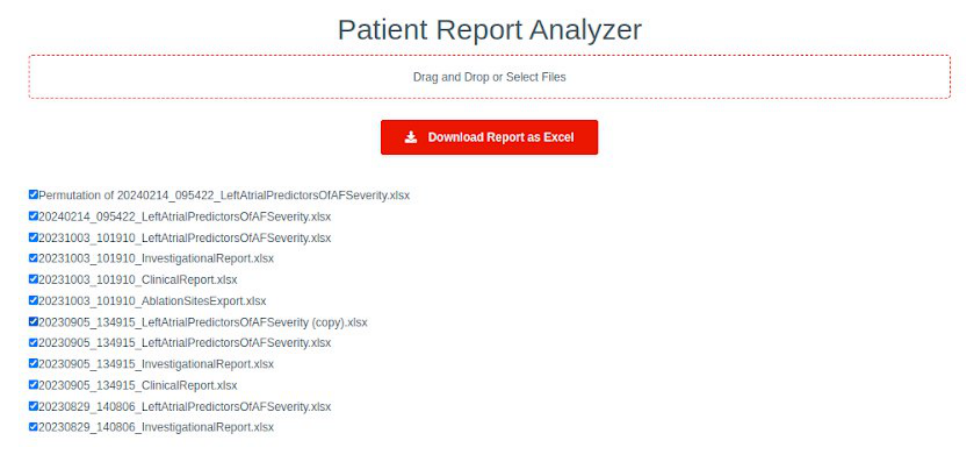
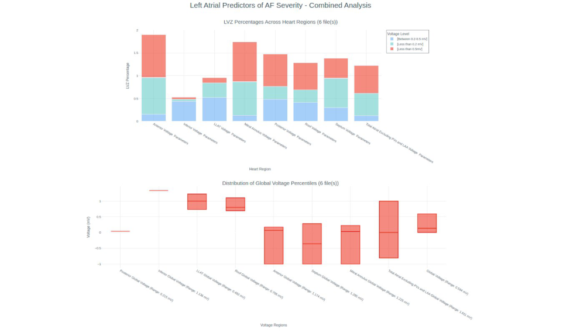

# Johnson & Johnson Patient Report Analyzer

HumbleBeeAI developed a Patient Report Analyzer for Johnson & Johnson to automate the preparation and visualization of varied patient-data Excel files. [PDF p. 1](http://localhost:3344/workspaces/ab6b13a5-514c-4849-96d2-cd4008c5c310/documents/467a4530-a428-4941-aa44-77cd6d9459ce/evidence/a0f26bc1-5b1b-4bcd-857a-13dbc2efc0e1/asset) [PDF p. 2](http://localhost:3344/workspaces/ab6b13a5-514c-4849-96d2-cd4008c5c310/documents/467a4530-a428-4941-aa44-77cd6d9459ce/evidence/0b330d22-3eac-44f6-8bfc-74e99ec7953c/asset)

## Executive Summary

Johnson & Johnson’s analytics teams needed to make sense of patient datasets arriving in different formats, sizes and structures. The case study describes the Patient Report Analyzer as automating data parsing, cleaning and visualization for Excel files with varying structures. It reports an 80% decrease in preprocessing time; the material describes the solution as developed, but does not specify deployment or production status. [PDF p. 2](http://localhost:3344/workspaces/ab6b13a5-514c-4849-96d2-cd4008c5c310/documents/467a4530-a428-4941-aa44-77cd6d9459ce/evidence/46c1674f-a56e-4f2d-a87a-81767bca42d3/asset) [PDF p. 1](http://localhost:3344/workspaces/ab6b13a5-514c-4849-96d2-cd4008c5c310/documents/467a4530-a428-4941-aa44-77cd6d9459ce/evidence/a0f26bc1-5b1b-4bcd-857a-13dbc2efc0e1/asset) [PDF p. 1](http://localhost:3344/workspaces/ab6b13a5-514c-4849-96d2-cd4008c5c310/documents/467a4530-a428-4941-aa44-77cd6d9459ce/evidence/78bb7334-7237-4866-8a7c-2168cf401e13/asset) [PDF p. 2](http://localhost:3344/workspaces/ab6b13a5-514c-4849-96d2-cd4008c5c310/documents/467a4530-a428-4941-aa44-77cd6d9459ce/evidence/0b330d22-3eac-44f6-8bfc-74e99ec7953c/asset)

The original case-study PDF identifies the source page as “Open original HumbleBeeAI page,” but the supplied material does not include a URL, so a direct link cannot be reproduced here. [PDF p. 1](http://localhost:3344/workspaces/ab6b13a5-514c-4849-96d2-cd4008c5c310/documents/467a4530-a428-4941-aa44-77cd6d9459ce/evidence/a0f26bc1-5b1b-4bcd-857a-13dbc2efc0e1/asset)

## Context and Challenge

Before the analyzer, each workbook could present a different parsing challenge: columns shifted, sheet structures changed and file formats varied. Teams spent time manually cleaning and reshaping data, while large, complex Excel files created processing delays. The case study says this repetitive work left room for errors and made it difficult to support multiple formats reliably. [PDF p. 2](http://localhost:3344/workspaces/ab6b13a5-514c-4849-96d2-cd4008c5c310/documents/467a4530-a428-4941-aa44-77cd6d9459ce/evidence/40297078-7351-40d8-95a2-8719d559e0c7/asset)

The affected users were analytics teams and healthcare professionals waiting for usable analyses. The documented constraints included inconsistent workbook structures, large datasets and the effort required to turn files into information suitable for analysis; the source does not quantify the number of users or the volume of files. [PDF p. 2](http://localhost:3344/workspaces/ab6b13a5-514c-4849-96d2-cd4008c5c310/documents/467a4530-a428-4941-aa44-77cd6d9459ce/evidence/40297078-7351-40d8-95a2-8719d559e0c7/asset) [PDF p. 2](http://localhost:3344/workspaces/ab6b13a5-514c-4849-96d2-cd4008c5c310/documents/467a4530-a428-4941-aa44-77cd6d9459ce/evidence/46c1674f-a56e-4f2d-a87a-81767bca42d3/asset)

## Solution and Capabilities

HumbleBeeAI developed the Patient Report Analyzer to reduce manual preparation and make analysis outputs easier to access. The case study reports the following capabilities: [PDF p. 2](http://localhost:3344/workspaces/ab6b13a5-514c-4849-96d2-cd4008c5c310/documents/467a4530-a428-4941-aa44-77cd6d9459ce/evidence/0b330d22-3eac-44f6-8bfc-74e99ec7953c/asset)

- Adaptive parsing: adjusts to changes such as renamed columns and restructured worksheets, addressing the variation in incoming Excel files. [PDF p. 2](http://localhost:3344/workspaces/ab6b13a5-514c-4849-96d2-cd4008c5c310/documents/467a4530-a428-4941-aa44-77cd6d9459ce/evidence/0b330d22-3eac-44f6-8bfc-74e99ec7953c/asset)
- Automated data cleaning: handles inconsistencies to reduce the need for human cleanup before analysis. [PDF p. 2](http://localhost:3344/workspaces/ab6b13a5-514c-4849-96d2-cd4008c5c310/documents/467a4530-a428-4941-aa44-77cd6d9459ce/evidence/0b330d22-3eac-44f6-8bfc-74e99ec7953c/asset)
- Batch processing and caching: used to speed up processing, including for files described as over 1GB. [PDF p. 2](http://localhost:3344/workspaces/ab6b13a5-514c-4849-96d2-cd4008c5c310/documents/467a4530-a428-4941-aa44-77cd6d9459ce/evidence/0b330d22-3eac-44f6-8bfc-74e99ec7953c/asset)
- Analysis views and exports: presents charts and tables and supports downloadable Excel summaries, so teams can review and take data out of the interface. [PDF p. 2](http://localhost:3344/workspaces/ab6b13a5-514c-4849-96d2-cd4008c5c310/documents/467a4530-a428-4941-aa44-77cd6d9459ce/evidence/0b330d22-3eac-44f6-8bfc-74e99ec7953c/asset)

The supplied interface image shows file selection and an Excel-report download control. [PDF p. 2](http://localhost:3344/workspaces/ab6b13a5-514c-4849-96d2-cd4008c5c310/documents/467a4530-a428-4941-aa44-77cd6d9459ce/evidence/a215caaa-d63e-4789-878f-1db5a8997560/asset)

The case study names Python, JavaScript, Pandas, Plotly and Flask as the implementation technologies. [PDF p. 2](http://localhost:3344/workspaces/ab6b13a5-514c-4849-96d2-cd4008c5c310/documents/467a4530-a428-4941-aa44-77cd6d9459ce/evidence/0b330d22-3eac-44f6-8bfc-74e99ec7953c/asset)

A supplied example of the analysis interface shows a combined analysis with charts across six files; it illustrates a reported visualization capability and does not establish a particular clinical outcome. [PDF p. 3](http://localhost:3344/workspaces/ab6b13a5-514c-4849-96d2-cd4008c5c310/documents/467a4530-a428-4941-aa44-77cd6d9459ce/evidence/8f21d28b-6ad8-44cb-a8d8-b3d6339e1266/asset)

## Results and Business Impact

The case study reports improvements in preparation and processing speed. These are reported project results; the supplied material does not provide a measurement method, baseline definition or independent validation. [PDF p. 3](http://localhost:3344/workspaces/ab6b13a5-514c-4849-96d2-cd4008c5c310/documents/467a4530-a428-4941-aa44-77cd6d9459ce/evidence/26dc5cc2-487f-4d1d-a20b-276a424f1b1b/asset) [PDF p. 1](http://localhost:3344/workspaces/ab6b13a5-514c-4849-96d2-cd4008c5c310/documents/467a4530-a428-4941-aa44-77cd6d9459ce/evidence/78bb7334-7237-4866-8a7c-2168cf401e13/asset)

- Preprocessing time: decreased by 80%, according to the Executive Summary. [PDF p. 1](http://localhost:3344/workspaces/ab6b13a5-514c-4849-96d2-cd4008c5c310/documents/467a4530-a428-4941-aa44-77cd6d9459ce/evidence/78bb7334-7237-4866-8a7c-2168cf401e13/asset)
- Manual work: decreased by 80%, according to the Results section. [PDF p. 3](http://localhost:3344/workspaces/ab6b13a5-514c-4849-96d2-cd4008c5c310/documents/467a4530-a428-4941-aa44-77cd6d9459ce/evidence/26dc5cc2-487f-4d1d-a20b-276a424f1b1b/asset)
- Processing time: became 50% faster; the case study also says reports that once took hours appeared in minutes. [PDF p. 3](http://localhost:3344/workspaces/ab6b13a5-514c-4849-96d2-cd4008c5c310/documents/467a4530-a428-4941-aa44-77cd6d9459ce/evidence/26dc5cc2-487f-4d1d-a20b-276a424f1b1b/asset) [PDF p. 1](http://localhost:3344/workspaces/ab6b13a5-514c-4849-96d2-cd4008c5c310/documents/467a4530-a428-4941-aa44-77cd6d9459ce/evidence/78bb7334-7237-4866-8a7c-2168cf401e13/asset)
- Large files: the Solution section says batch processing and caching supported fast runs for files over 1GB; it gives no more specific performance figure for those files. [PDF p. 2](http://localhost:3344/workspaces/ab6b13a5-514c-4849-96d2-cd4008c5c310/documents/467a4530-a428-4941-aa44-77cd6d9459ce/evidence/0b330d22-3eac-44f6-8bfc-74e99ec7953c/asset)

The source attributes additional value to consistent data and more analyst focus on insights, but it does not report a measured effect on patient outcomes or quantify a business impact beyond the stated time and manual-work changes. [PDF p. 3](http://localhost:3344/workspaces/ab6b13a5-514c-4849-96d2-cd4008c5c310/documents/467a4530-a428-4941-aa44-77cd6d9459ce/evidence/26dc5cc2-487f-4d1d-a20b-276a424f1b1b/asset)

## Limitations and Next Steps

The supplied case study describes the analyzer and its capabilities as developed, but does not state whether it was deployed in production, whether the screenshots represent a live production system, or what functionality is currently available to users. No future work or roadmap is provided. [PDF p. 2](http://localhost:3344/workspaces/ab6b13a5-514c-4849-96d2-cd4008c5c310/documents/467a4530-a428-4941-aa44-77cd6d9459ce/evidence/0b330d22-3eac-44f6-8bfc-74e99ec7953c/asset) [PDF p. 2](http://localhost:3344/workspaces/ab6b13a5-514c-4849-96d2-cd4008c5c310/documents/467a4530-a428-4941-aa44-77cd6d9459ce/evidence/a215caaa-d63e-4789-878f-1db5a8997560/asset) [PDF p. 3](http://localhost:3344/workspaces/ab6b13a5-514c-4849-96d2-cd4008c5c310/documents/467a4530-a428-4941-aa44-77cd6d9459ce/evidence/8f21d28b-6ad8-44cb-a8d8-b3d6339e1266/asset)

The reported measurements are not accompanied by test conditions, sample sizes, calculation details or independent validation in the supplied material. It also does not provide quantified accuracy or reliability measures; therefore, claims about those dimensions cannot be assessed from this source. [PDF p. 3](http://localhost:3344/workspaces/ab6b13a5-514c-4849-96d2-cd4008c5c310/documents/467a4530-a428-4941-aa44-77cd6d9459ce/evidence/26dc5cc2-487f-4d1d-a20b-276a424f1b1b/asset) [PDF p. 2](http://localhost:3344/workspaces/ab6b13a5-514c-4849-96d2-cd4008c5c310/documents/467a4530-a428-4941-aa44-77cd6d9459ce/evidence/0b330d22-3eac-44f6-8bfc-74e99ec7953c/asset)

## Conclusion

The supported project value is a developed analyzer intended to reduce the manual effort involved in preparing varied patient-data workbooks and to return charts, tables and Excel summaries. The case study reports an 80% decrease in preprocessing time and 50% faster processing, while leaving deployment status and measurement methodology unspecified. [PDF p. 1](http://localhost:3344/workspaces/ab6b13a5-514c-4849-96d2-cd4008c5c310/documents/467a4530-a428-4941-aa44-77cd6d9459ce/evidence/a0f26bc1-5b1b-4bcd-857a-13dbc2efc0e1/asset) [PDF p. 2](http://localhost:3344/workspaces/ab6b13a5-514c-4849-96d2-cd4008c5c310/documents/467a4530-a428-4941-aa44-77cd6d9459ce/evidence/0b330d22-3eac-44f6-8bfc-74e99ec7953c/asset) [PDF p. 3](http://localhost:3344/workspaces/ab6b13a5-514c-4849-96d2-cd4008c5c310/documents/467a4530-a428-4941-aa44-77cd6d9459ce/evidence/26dc5cc2-487f-4d1d-a20b-276a424f1b1b/asset) [PDF p. 1](http://localhost:3344/workspaces/ab6b13a5-514c-4849-96d2-cd4008c5c310/documents/467a4530-a428-4941-aa44-77cd6d9459ce/evidence/78bb7334-7237-4866-8a7c-2168cf401e13/asset)

Original source: HumbleBeeAI case study, “How Johnson & Johnson reduced patient data analytics time by 80%?” A direct original-page URL was not included in the supplied source material. [PDF p. 1](http://localhost:3344/workspaces/ab6b13a5-514c-4849-96d2-cd4008c5c310/documents/467a4530-a428-4941-aa44-77cd6d9459ce/evidence/a0f26bc1-5b1b-4bcd-857a-13dbc2efc0e1/asset)

