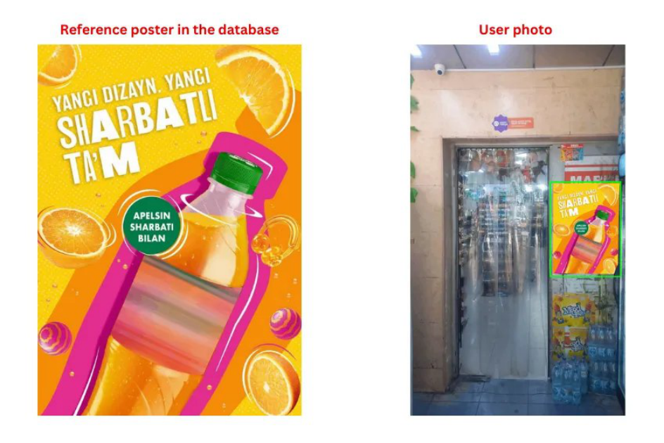

# Flexible Campaigns with Poster Recognition AI: Retail Technology Case Study

Poster Recognition AI gives an unnamed retail technology and distribution provider a way to adapt poster campaigns through reference-database updates instead of repeated model retraining.  [PDF p. 1](http://localhost:3344/workspaces/ab6b13a5-514c-4849-96d2-cd4008c5c310/documents/a44defcb-e44c-42a3-b775-6a9315f1e4d1/evidence/360e1314-6e01-4b1b-953b-0973cefb2fbf/asset)

## Executive Summary

HumbleBeeAI integrated poster recognition into a distribution platform serving retail and FMCG clients. Previously, each new poster campaign could require a full model retraining cycle reported as three months, making fast campaign changes difficult. The case study says the delivered system allows new posters to be recognized after reference-database updates and reports 94% recognition accuracy, 90% less verification time, and 85% lower deployment costs. The provider is not named in the supplied case study. [PDF p. 2](http://localhost:3344/workspaces/ab6b13a5-514c-4849-96d2-cd4008c5c310/documents/a44defcb-e44c-42a3-b775-6a9315f1e4d1/evidence/c26e47ef-e63d-4775-ac67-972d09131d51/asset) [PDF p. 2](http://localhost:3344/workspaces/ab6b13a5-514c-4849-96d2-cd4008c5c310/documents/a44defcb-e44c-42a3-b775-6a9315f1e4d1/evidence/94798007-045b-457b-bf31-d3a5b264738c/asset) [PDF p. 3](http://localhost:3344/workspaces/ab6b13a5-514c-4849-96d2-cd4008c5c310/documents/a44defcb-e44c-42a3-b775-6a9315f1e4d1/evidence/4564e019-1259-4f50-b9d2-ee42f7cd3816/asset)

These figures are implementation claims reported in a company case study, not findings from an identified academic research publication or a disclosed independent benchmark. The public case study is available at [https://humblebee.ai/case-studies/poster-recognition](https://humblebee.ai/case-studies/poster-recognition). [PDF p. 1](http://localhost:3344/workspaces/ab6b13a5-514c-4849-96d2-cd4008c5c310/documents/a44defcb-e44c-42a3-b775-6a9315f1e4d1/evidence/360e1314-6e01-4b1b-953b-0973cefb2fbf/asset)

## Context and Challenge

The provider's customers run seasonal promotions, product launches and brand campaigns across varied retail settings. According to the case study, the previous system recognized only pre-programmed poster designs; a new campaign could trigger a complete model retraining cycle lasting three months. That constrained campaign timing and added deployment costs. [PDF p. 2](http://localhost:3344/workspaces/ab6b13a5-514c-4849-96d2-cd4008c5c310/documents/a44defcb-e44c-42a3-b775-6a9315f1e4d1/evidence/c26e47ef-e63d-4775-ac67-972d09131d51/asset) [PDF p. 2](http://localhost:3344/workspaces/ab6b13a5-514c-4849-96d2-cd4008c5c310/documents/a44defcb-e44c-42a3-b775-6a9315f1e4d1/evidence/94798007-045b-457b-bf31-d3a5b264738c/asset)

The challenge also involved monitoring promotional execution across a reported network of 500+ retail locations. The case study describes manual verification as time-intensive and prone to human error, while variations in poster format, lighting, viewing angle, size and installation added recognition complexity. [PDF p. 2](http://localhost:3344/workspaces/ab6b13a5-514c-4849-96d2-cd4008c5c310/documents/a44defcb-e44c-42a3-b775-6a9315f1e4d1/evidence/94798007-045b-457b-bf31-d3a5b264738c/asset) [PDF p. 1](http://localhost:3344/workspaces/ab6b13a5-514c-4849-96d2-cd4008c5c310/documents/a44defcb-e44c-42a3-b775-6a9315f1e4d1/evidence/360e1314-6e01-4b1b-953b-0973cefb2fbf/asset)

## Solution and Capabilities

HumbleBeeAI’s delivered solution uses a two-stage recognition approach: generic poster detection followed by reference matching. The purpose is to let platform users add campaign artwork to the reference database without training a new model for each poster. [PDF p. 2](http://localhost:3344/workspaces/ab6b13a5-514c-4849-96d2-cd4008c5c310/documents/a44defcb-e44c-42a3-b775-6a9315f1e4d1/evidence/1928711d-cb7c-4373-9447-42a21208dcff/asset)

- Dynamic campaign updates: New reference posters can be added to the database for recognition without model retraining, supporting campaign and seasonal changes. [PDF p. 2](http://localhost:3344/workspaces/ab6b13a5-514c-4849-96d2-cd4008c5c310/documents/a44defcb-e44c-42a3-b775-6a9315f1e4d1/evidence/1928711d-cb7c-4373-9447-42a21208dcff/asset)
- Detection and matching: Generic poster detection identifies promotional material, then reference matching compares it with database examples. [PDF p. 2](http://localhost:3344/workspaces/ab6b13a5-514c-4849-96d2-cd4008c5c310/documents/a44defcb-e44c-42a3-b775-6a9315f1e4d1/evidence/1928711d-cb7c-4373-9447-42a21208dcff/asset)
- Validation: The case study describes similarity-threshold checks, geometric consistency checks and reference-database cross-validation to support identification. [PDF p. 2](http://localhost:3344/workspaces/ab6b13a5-514c-4849-96d2-cd4008c5c310/documents/a44defcb-e44c-42a3-b775-6a9315f1e4d1/evidence/1928711d-cb7c-4373-9447-42a21208dcff/asset)
- Network monitoring: The reported cloud-based processing supports monitoring across store locations and compliance reporting; the source also describes sub-second processing speeds. [PDF p. 2](http://localhost:3344/workspaces/ab6b13a5-514c-4849-96d2-cd4008c5c310/documents/a44defcb-e44c-42a3-b775-6a9315f1e4d1/evidence/1928711d-cb7c-4373-9447-42a21208dcff/asset)

The supplied case-study image illustrates the reference-poster and in-store-photo comparison used to show the matching workflow. [PDF p. 3](http://localhost:3344/workspaces/ab6b13a5-514c-4849-96d2-cd4008c5c310/documents/a44defcb-e44c-42a3-b775-6a9315f1e4d1/evidence/e7373f11-194e-4013-a2d9-bdba5f72e226/asset)

## Results and Business Impact

The case study reports operational and technical outcomes for the implementation. It does not provide the measurement methodology, evaluation period or a separate independent assessment, so the figures below should be read as results reported by the case-study source rather than independently verified business impact. [PDF p. 3](http://localhost:3344/workspaces/ab6b13a5-514c-4849-96d2-cd4008c5c310/documents/a44defcb-e44c-42a3-b775-6a9315f1e4d1/evidence/4564e019-1259-4f50-b9d2-ee42f7cd3816/asset)

- Recognition: 94% poster recognition accuracy was reported. [PDF p. 3](http://localhost:3344/workspaces/ab6b13a5-514c-4849-96d2-cd4008c5c310/documents/a44defcb-e44c-42a3-b775-6a9315f1e4d1/evidence/4564e019-1259-4f50-b9d2-ee42f7cd3816/asset)
- Verification: Poster verification time was reported as reduced by 90%. [PDF p. 3](http://localhost:3344/workspaces/ab6b13a5-514c-4849-96d2-cd4008c5c310/documents/a44defcb-e44c-42a3-b775-6a9315f1e4d1/evidence/4564e019-1259-4f50-b9d2-ee42f7cd3816/asset)
- Deployment costs and retraining: Deployment costs were reported as reduced by 85%, with the previous three-month retraining cycle eliminated. [PDF p. 3](http://localhost:3344/workspaces/ab6b13a5-514c-4849-96d2-cd4008c5c310/documents/a44defcb-e44c-42a3-b775-6a9315f1e4d1/evidence/4564e019-1259-4f50-b9d2-ee42f7cd3816/asset) [PDF p. 2](http://localhost:3344/workspaces/ab6b13a5-514c-4849-96d2-cd4008c5c310/documents/a44defcb-e44c-42a3-b775-6a9315f1e4d1/evidence/94798007-045b-457b-bf31-d3a5b264738c/asset)
- Scale: The source describes deployment across 500+ store locations and reports sub-second processing speeds; these are technical and deployment-scope claims, not quantified measures of business impact. [PDF p. 3](http://localhost:3344/workspaces/ab6b13a5-514c-4849-96d2-cd4008c5c310/documents/a44defcb-e44c-42a3-b775-6a9315f1e4d1/evidence/4564e019-1259-4f50-b9d2-ee42f7cd3816/asset)

The supplied material does not establish a measured change in sales, campaign effectiveness, customer outcomes or other downstream business performance. No separate business-impact measurement has been provided.

## Limitations and Next Steps

The supplied case study does not describe an accuracy breakdown by poster type or store conditions, the evaluation methodology, or the measurement period for the reported results. The provider and its retail clients are not named, and there is no information about data governance, service-level commitments or independent validation. These details have not been provided, so the reported figures should not be treated as guarantees. [PDF p. 3](http://localhost:3344/workspaces/ab6b13a5-514c-4849-96d2-cd4008c5c310/documents/a44defcb-e44c-42a3-b775-6a9315f1e4d1/evidence/4564e019-1259-4f50-b9d2-ee42f7cd3816/asset) [PDF p. 2](http://localhost:3344/workspaces/ab6b13a5-514c-4849-96d2-cd4008c5c310/documents/a44defcb-e44c-42a3-b775-6a9315f1e4d1/evidence/94798007-045b-457b-bf31-d3a5b264738c/asset)

The conclusion states that system optimization and expanded recognition capabilities are ongoing, but it does not specify a delivery schedule or individual planned features. Those activities are described as ongoing work, not as completed outcomes. [PDF p. 4](http://localhost:3344/workspaces/ab6b13a5-514c-4849-96d2-cd4008c5c310/documents/a44defcb-e44c-42a3-b775-6a9315f1e4d1/evidence/ee5188e8-93ab-4791-86fa-54911178673a/asset)

## Conclusion

This project addresses a specific operational constraint for a retail technology and distribution provider: adapting poster recognition to new campaigns without repeating a lengthy model-training cycle. The case study reports that reference-database updates enabled campaign flexibility and cites improvements in recognition accuracy, verification time and deployment costs. The project’s downstream commercial impact is not measured in the supplied material. [PDF p. 2](http://localhost:3344/workspaces/ab6b13a5-514c-4849-96d2-cd4008c5c310/documents/a44defcb-e44c-42a3-b775-6a9315f1e4d1/evidence/1928711d-cb7c-4373-9447-42a21208dcff/asset) [PDF p. 3](http://localhost:3344/workspaces/ab6b13a5-514c-4849-96d2-cd4008c5c310/documents/a44defcb-e44c-42a3-b775-6a9315f1e4d1/evidence/4564e019-1259-4f50-b9d2-ee42f7cd3816/asset)

