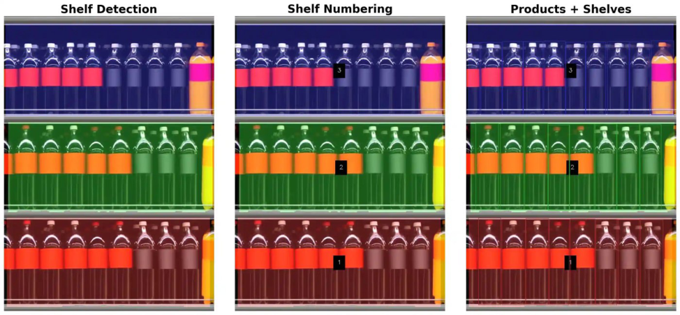
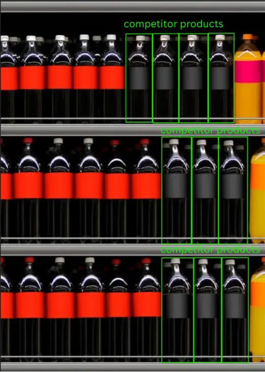

# Shelf Analysis AI for Retail Compliance

HumbleBeeAI delivered a computer-vision Shelf Analysis AI platform integrated with a retail technology company’s distribution SaaS to automate product and shelf-compliance analysis across a reported 500+ retail locations. [PDF p. 1](http://localhost:3344/workspaces/ab6b13a5-514c-4849-96d2-cd4008c5c310/documents/b4d78a05-a82c-4f2c-be2c-da605c86fee6/evidence/e9f03557-99b9-407c-b96c-049b44ad533c/asset)

## Executive Summary

A retail technology company serving more than 600 customers across Central Asia and beyond partnered with HumbleBeeAI to add AI-powered shelf recognition to its cloud distribution platform. The work addressed the effort and limited coverage of manual shelf audits, as well as delayed and inconsistent detection of merchandising violations. The case study describes the platform as implemented and integrated, with reported results across 500+ retail locations; it also says algorithm enhancements and expansion to additional retail formats are ongoing. [PDF p. 2](http://localhost:3344/workspaces/ab6b13a5-514c-4849-96d2-cd4008c5c310/documents/b4d78a05-a82c-4f2c-be2c-da605c86fee6/evidence/1a05c660-5dde-4375-bd50-e7e8b20652a0/asset) [PDF p. 1](http://localhost:3344/workspaces/ab6b13a5-514c-4849-96d2-cd4008c5c310/documents/b4d78a05-a82c-4f2c-be2c-da605c86fee6/evidence/e9f03557-99b9-407c-b96c-049b44ad533c/asset) [PDF p. 5](http://localhost:3344/workspaces/ab6b13a5-514c-4849-96d2-cd4008c5c310/documents/b4d78a05-a82c-4f2c-be2c-da605c86fee6/evidence/a7d89540-2637-4397-8f4a-9c62589436ab/asset)

## Context and Challenge

The retail technology company’s platform supports distributors and manufacturers in FMCG, beverage, pharmaceutical, automotive and similar sectors. Its end clients manage merchandising standards and exclusive brand-positioning agreements across distributed retail networks. [PDF p. 2](http://localhost:3344/workspaces/ab6b13a5-514c-4849-96d2-cd4008c5c310/documents/b4d78a05-a82c-4f2c-be2c-da605c86fee6/evidence/1a05c660-5dde-4375-bd50-e7e8b20652a0/asset)

Before the AI capability, field agents spent hours counting products and checking planogram compliance. Manual audits consumed significant staff time while covering a wide retail network; competitor products could appear in exclusive brand zones and violations were detected inconsistently or late. The client also needed to handle images captured under varied lighting, camera angles and store conditions, alongside differences in product size, packaging and shelf layouts. [PDF p. 2](http://localhost:3344/workspaces/ab6b13a5-514c-4849-96d2-cd4008c5c310/documents/b4d78a05-a82c-4f2c-be2c-da605c86fee6/evidence/29976373-a2c0-4ab5-936f-4941920467e4/asset)

## Solution and Capabilities

HumbleBeeAI integrated an AI shelf-analysis capability into the distribution platform, combining automated product detection with shelf-position analysis and compliance reporting. The case study describes the following capabilities:

- Automated product detection: computer-vision models identify products in submitted retail images; the case study reports 90%+ detection accuracy and support for diverse image formats and environmental conditions. [PDF p. 2](http://localhost:3344/workspaces/ab6b13a5-514c-4849-96d2-cd4008c5c310/documents/b4d78a05-a82c-4f2c-be2c-da605c86fee6/evidence/1b1edddd-10f3-480f-9ba5-e19277fa725d/asset)
- Shelf order and planogram analysis: spatial analysis identifies vertical and horizontal product positions, assigns shelf numbers and checks whether placement matches the intended arrangement. [PDF p. 3](http://localhost:3344/workspaces/ab6b13a5-514c-4849-96d2-cd4008c5c310/documents/b4d78a05-a82c-4f2c-be2c-da605c86fee6/evidence/66f639e8-180c-42fa-a740-e13481526563/asset)
- Competitive-product detection: analysis identifies competitor products in exclusive brand zones, supporting follow-up on merchandising agreement violations. [PDF p. 4](http://localhost:3344/workspaces/ab6b13a5-514c-4849-96d2-cd4008c5c310/documents/b4d78a05-a82c-4f2c-be2c-da605c86fee6/evidence/5d597095-6408-4cc8-92d1-91be839745fe/asset) [PDF p. 4](http://localhost:3344/workspaces/ab6b13a5-514c-4849-96d2-cd4008c5c310/documents/b4d78a05-a82c-4f2c-be2c-da605c86fee6/evidence/0b6b9f7a-83e7-4c97-af68-ed85cf7c35f9/asset)
- Centralized reporting: cloud infrastructure with GPU acceleration processes image submissions and returns automated compliance analytics for monitoring and merchandising decisions. [PDF p. 3](http://localhost:3344/workspaces/ab6b13a5-514c-4849-96d2-cd4008c5c310/documents/b4d78a05-a82c-4f2c-be2c-da605c86fee6/evidence/e3258ac0-8430-4d52-ac07-35a976ea30b3/asset)

The supplied figures illustrate shelf detection and numbering, product-and-shelf analysis, and competitor-product identification.

## Results and Business Impact

The case study reports these operational results: [PDF p. 4](http://localhost:3344/workspaces/ab6b13a5-514c-4849-96d2-cd4008c5c310/documents/b4d78a05-a82c-4f2c-be2c-da605c86fee6/evidence/5d597095-6408-4cc8-92d1-91be839745fe/asset) [PDF p. 1](http://localhost:3344/workspaces/ab6b13a5-514c-4849-96d2-cd4008c5c310/documents/b4d78a05-a82c-4f2c-be2c-da605c86fee6/evidence/e9f03557-99b9-407c-b96c-049b44ad533c/asset)

- Manual audit time decreased by 80% within the first month, according to the executive summary. [PDF p. 1](http://localhost:3344/workspaces/ab6b13a5-514c-4849-96d2-cd4008c5c310/documents/b4d78a05-a82c-4f2c-be2c-da605c86fee6/evidence/e9f03557-99b9-407c-b96c-049b44ad533c/asset)
- Product detection accuracy was reported as 90%+. [PDF p. 1](http://localhost:3344/workspaces/ab6b13a5-514c-4849-96d2-cd4008c5c310/documents/b4d78a05-a82c-4f2c-be2c-da605c86fee6/evidence/e9f03557-99b9-407c-b96c-049b44ad533c/asset)
- The solution was reported across 500+ retail locations; the source also describes immediate identification of compliance violations. [PDF p. 1](http://localhost:3344/workspaces/ab6b13a5-514c-4849-96d2-cd4008c5c310/documents/b4d78a05-a82c-4f2c-be2c-da605c86fee6/evidence/e9f03557-99b9-407c-b96c-049b44ad533c/asset) [PDF p. 5](http://localhost:3344/workspaces/ab6b13a5-514c-4849-96d2-cd4008c5c310/documents/b4d78a05-a82c-4f2c-be2c-da605c86fee6/evidence/a7d89540-2637-4397-8f4a-9c62589436ab/asset)

The case study says automated detection helped protect brand visibility and support enforcement of merchandising agreements. It also mentions increased sales performance, but provides no sales figures or measurement method; that business impact therefore cannot be independently quantified from the supplied material. [PDF p. 1](http://localhost:3344/workspaces/ab6b13a5-514c-4849-96d2-cd4008c5c310/documents/b4d78a05-a82c-4f2c-be2c-da605c86fee6/evidence/e9f03557-99b9-407c-b96c-049b44ad533c/asset) [PDF p. 4](http://localhost:3344/workspaces/ab6b13a5-514c-4849-96d2-cd4008c5c310/documents/b4d78a05-a82c-4f2c-be2c-da605c86fee6/evidence/5d597095-6408-4cc8-92d1-91be839745fe/asset)

## Limitations and Next Steps

The case study does not provide the accuracy-test methodology, a breakdown by store or product category, or details of the measurement process behind the reported audit-time reduction. It also does not quantify sales impact. These results are presented as reported case-study outcomes, not as independently verified measures.

The source describes ongoing enhancements to detection algorithms and planned or continuing expansion across additional retail formats. It does not specify a delivery timeline or identify which additional formats are live. Although the solution is described as capable of supporting unlimited locations, the reported project scope is 500+ retail locations; broader deployment should not be assumed. [PDF p. 5](http://localhost:3344/workspaces/ab6b13a5-514c-4849-96d2-cd4008c5c310/documents/b4d78a05-a82c-4f2c-be2c-da605c86fee6/evidence/a7d89540-2637-4397-8f4a-9c62589436ab/asset) [PDF p. 2](http://localhost:3344/workspaces/ab6b13a5-514c-4849-96d2-cd4008c5c310/documents/b4d78a05-a82c-4f2c-be2c-da605c86fee6/evidence/1b1edddd-10f3-480f-9ba5-e19277fa725d/asset) [PDF p. 1](http://localhost:3344/workspaces/ab6b13a5-514c-4849-96d2-cd4008c5c310/documents/b4d78a05-a82c-4f2c-be2c-da605c86fee6/evidence/e9f03557-99b9-407c-b96c-049b44ad533c/asset)

The PDF text includes the label “Open original HumbleBeeAI page,” but the supplied material does not include a URL. The original page link therefore cannot be reproduced here. [PDF p. 1](http://localhost:3344/workspaces/ab6b13a5-514c-4849-96d2-cd4008c5c310/documents/b4d78a05-a82c-4f2c-be2c-da605c86fee6/evidence/e64fa84b-c93b-4d71-ab6f-0efcbee5b627/asset)

## Conclusion

The delivered integration adds automated product recognition, shelf-position analysis and compliance reporting to a retail distribution platform. In the case study, this work is associated with a reported 80% reduction in manual audit time within the first month and 90%+ detection accuracy, while further algorithm development and retail-format expansion remain ongoing. [PDF p. 1](http://localhost:3344/workspaces/ab6b13a5-514c-4849-96d2-cd4008c5c310/documents/b4d78a05-a82c-4f2c-be2c-da605c86fee6/evidence/e9f03557-99b9-407c-b96c-049b44ad533c/asset) [PDF p. 5](http://localhost:3344/workspaces/ab6b13a5-514c-4849-96d2-cd4008c5c310/documents/b4d78a05-a82c-4f2c-be2c-da605c86fee6/evidence/a7d89540-2637-4397-8f4a-9c62589436ab/asset)

