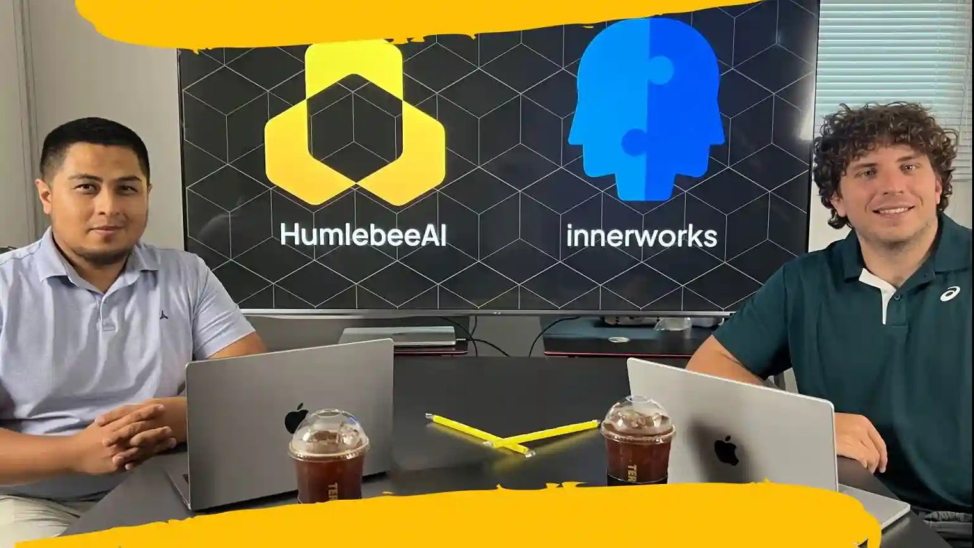

# Innerworks and HumbleBeeAI: Building Fraud-Defense Infrastructure Through R&D Partnership

HumbleBeeAI partnered with Innerworks from January 2024 as its R&D and product arm to develop modular fraud-defense capabilities for exchanges, finance platforms and digital ecosystems.  [PDF p. 1](http://localhost:3344/workspaces/ab6b13a5-514c-4849-96d2-cd4008c5c310/documents/02cf5cf8-7ac4-4c0d-9bb6-5137d7d92c5a/evidence/f5476103-0580-4b18-98c7-ed2fb9e856ae/asset)

## Executive Summary

Innerworks helps digital platforms identify and block bad actors, but when the partnership began it had a foundational SDK rather than a fully integrated solution—and lacked dedicated R&D capacity, senior fraud-and-AI engineering leadership and the infrastructure to grow its modules into a scalable platform. HumbleBeeAI joined in January 2024 to research, design, prototype and build capabilities alongside Innerworks’ teams. The company update reports that Innerworks raised a $4M seed round led by AlbionVC in August 2025; this is a reported company milestone, not a measured attribution of business impact to any individual capability.  [PDF p. 2](http://localhost:3344/workspaces/ab6b13a5-514c-4849-96d2-cd4008c5c310/documents/02cf5cf8-7ac4-4c0d-9bb6-5137d7d92c5a/evidence/5177d43d-341e-4ece-ad3e-1ee32decf6d8/asset) [PDF p. 2](http://localhost:3344/workspaces/ab6b13a5-514c-4849-96d2-cd4008c5c310/documents/02cf5cf8-7ac4-4c0d-9bb6-5137d7d92c5a/evidence/ddff9f68-cd6c-49ff-a941-b43a946e86a7/asset) [PDF p. 1](http://localhost:3344/workspaces/ab6b13a5-514c-4849-96d2-cd4008c5c310/documents/02cf5cf8-7ac4-4c0d-9bb6-5137d7d92c5a/evidence/f5476103-0580-4b18-98c7-ed2fb9e856ae/asset)

The partnership focused on device intelligence, VPN and bot detection, behavioral analysis and adversarial defense, with the aim of helping platforms respond to increasingly sophisticated fraud and tightening exchange regulations.  [PDF p. 1](http://localhost:3344/workspaces/ab6b13a5-514c-4849-96d2-cd4008c5c310/documents/02cf5cf8-7ac4-4c0d-9bb6-5137d7d92c5a/evidence/3b0bfd1c-bd4b-4159-a559-7ce6d27888b7/asset) [PDF p. 2](http://localhost:3344/workspaces/ab6b13a5-514c-4849-96d2-cd4008c5c310/documents/02cf5cf8-7ac4-4c0d-9bb6-5137d7d92c5a/evidence/5177d43d-341e-4ece-ad3e-1ee32decf6d8/asset)

Source: [From Collaboration to Innovation: Inside the Innerworks and HumbleBeeAI Partnership](https://humblebee.ai/case-studies/innerworks-partnership).

## Context and Challenge

Innerworks serves exchanges, finance platforms and digital ecosystems that need to detect account takeover, bots, suspicious locations and other signs of abuse. At the start of the engagement in January 2024, its single SDK provided a foundation for detection and fingerprinting, but the company lacked a dedicated R&D team, senior engineering leadership in fraud and AI, and infrastructure to integrate its modules into a cohesive platform.  [PDF p. 1](http://localhost:3344/workspaces/ab6b13a5-514c-4849-96d2-cd4008c5c310/documents/02cf5cf8-7ac4-4c0d-9bb6-5137d7d92c5a/evidence/f5476103-0580-4b18-98c7-ed2fb9e856ae/asset) [PDF p. 2](http://localhost:3344/workspaces/ab6b13a5-514c-4849-96d2-cd4008c5c310/documents/02cf5cf8-7ac4-4c0d-9bb6-5137d7d92c5a/evidence/5177d43d-341e-4ece-ad3e-1ee32decf6d8/asset)

The surrounding environment increased the stakes: the source describes tightening exchange regulations requiring platforms to prevent fraud and sanctions breaches proactively, while fraudsters using generative AI and identity spoofing were challenging legacy detection systems. The supplied material does not detail a specific pre-partnership manual workflow, incident rate or operational baseline, so none is asserted here.  [PDF p. 2](http://localhost:3344/workspaces/ab6b13a5-514c-4849-96d2-cd4008c5c310/documents/02cf5cf8-7ac4-4c0d-9bb6-5137d7d92c5a/evidence/5177d43d-341e-4ece-ad3e-1ee32decf6d8/asset)

## Solution and Capabilities

Innerworks defined the product vision and goals; HumbleBeeAI acted as a collaborative R&D and product arm, researching, prototyping, iterating and building capabilities with Innerworks’ teams. The source describes modular architecture intended for R&D and collaboration on production integration, rather than claiming that every component was independently verified as deployed in production.  [PDF p. 2](http://localhost:3344/workspaces/ab6b13a5-514c-4849-96d2-cd4008c5c310/documents/02cf5cf8-7ac4-4c0d-9bb6-5137d7d92c5a/evidence/ddff9f68-cd6c-49ff-a941-b43a946e86a7/asset) [PDF p. 2](http://localhost:3344/workspaces/ab6b13a5-514c-4849-96d2-cd4008c5c310/documents/02cf5cf8-7ac4-4c0d-9bb6-5137d7d92c5a/evidence/80ae1796-b7e5-4a80-96cf-93f75f564baa/asset)

### Modular fraud-defense capabilities

- Device fingerprinting and device intelligence: developed as a module to contribute device-level signals to detection and risk analysis. Innerworks’ wider solution is described as leveraging 200+ data points across device, network and behavioral signals; the source does not specify that this is a count of device signals alone.  [PDF p. 2](http://localhost:3344/workspaces/ab6b13a5-514c-4849-96d2-cd4008c5c310/documents/02cf5cf8-7ac4-4c0d-9bb6-5137d7d92c5a/evidence/80ae1796-b7e5-4a80-96cf-93f75f564baa/asset) [PDF p. 2](http://localhost:3344/workspaces/ab6b13a5-514c-4849-96d2-cd4008c5c310/documents/02cf5cf8-7ac4-4c0d-9bb6-5137d7d92c5a/evidence/e0cbe176-4dea-4f9d-8771-e79c61086c0b/asset)
- VPN and true-location detection: designed to help identify network and location signals relevant to geo-compliance and suspicious activity.  [PDF p. 2](http://localhost:3344/workspaces/ab6b13a5-514c-4849-96d2-cd4008c5c310/documents/02cf5cf8-7ac4-4c0d-9bb6-5137d7d92c5a/evidence/80ae1796-b7e5-4a80-96cf-93f75f564baa/asset) [PDF p. 2](http://localhost:3344/workspaces/ab6b13a5-514c-4849-96d2-cd4008c5c310/documents/02cf5cf8-7ac4-4c0d-9bb6-5137d7d92c5a/evidence/e0cbe176-4dea-4f9d-8771-e79c61086c0b/asset)
- Bot detection and behavioral profiling: developed to analyze behavior and support detection of automated or otherwise suspicious activity.  [PDF p. 2](http://localhost:3344/workspaces/ab6b13a5-514c-4849-96d2-cd4008c5c310/documents/02cf5cf8-7ac4-4c0d-9bb6-5137d7d92c5a/evidence/80ae1796-b7e5-4a80-96cf-93f75f564baa/asset) [PDF p. 2](http://localhost:3344/workspaces/ab6b13a5-514c-4849-96d2-cd4008c5c310/documents/02cf5cf8-7ac4-4c0d-9bb6-5137d7d92c5a/evidence/e0cbe176-4dea-4f9d-8771-e79c61086c0b/asset)
- RedTeam and adversarial testing framework: structured to support ethical testing against evolving, including AI-driven, fraud techniques. The source identifies Innerworks’ RedTeam platform as built on BitTensor; it does not provide technical evaluation results for the framework.  [PDF p. 2](http://localhost:3344/workspaces/ab6b13a5-514c-4849-96d2-cd4008c5c310/documents/02cf5cf8-7ac4-4c0d-9bb6-5137d7d92c5a/evidence/80ae1796-b7e5-4a80-96cf-93f75f564baa/asset) [PDF p. 2](http://localhost:3344/workspaces/ab6b13a5-514c-4849-96d2-cd4008c5c310/documents/02cf5cf8-7ac4-4c0d-9bb6-5137d7d92c5a/evidence/e0cbe176-4dea-4f9d-8771-e79c61086c0b/asset)

### R&D and integration foundations

The source describes pipelines for internal data ingestion, feature extraction, model serving, API endpoints and monitoring. Components were designed to operate independently or feed into composite risk-scoring flows, supporting experimentation as well as collaboration on production integration.  [PDF p. 2](http://localhost:3344/workspaces/ab6b13a5-514c-4849-96d2-cd4008c5c310/documents/02cf5cf8-7ac4-4c0d-9bb6-5137d7d92c5a/evidence/80ae1796-b7e5-4a80-96cf-93f75f564baa/asset)

The engagement also emphasized iterative development, using MVPs and feedback to adapt to adversarial behavior, alongside documented research and transparent knowledge transfer. The supplied materials identify no named research-paper authors or publication record; they describe domain research drawing on industry practice, academic papers, red-team methods and advanced heuristics, without providing paper titles or benchmark tables.  [PDF p. 2](http://localhost:3344/workspaces/ab6b13a5-514c-4849-96d2-cd4008c5c310/documents/02cf5cf8-7ac4-4c0d-9bb6-5137d7d92c5a/evidence/80ae1796-b7e5-4a80-96cf-93f75f564baa/asset)

## Results and Business Impact

The supplied company update reports product and financing milestones, but it provides no measured before-and-after fraud rate, detection accuracy, false-positive rate, latency, coverage improvement or financial return. The available outcomes should therefore be read as reported project status and company context—not as quantified business impact or a benchmark evaluation.  [PDF p. 2](http://localhost:3344/workspaces/ab6b13a5-514c-4849-96d2-cd4008c5c310/documents/02cf5cf8-7ac4-4c0d-9bb6-5137d7d92c5a/evidence/4f9b8d7a-5b02-43fd-a402-c1c5d559e211/asset) [PDF p. 1](http://localhost:3344/workspaces/ab6b13a5-514c-4849-96d2-cd4008c5c310/documents/02cf5cf8-7ac4-4c0d-9bb6-5137d7d92c5a/evidence/f5476103-0580-4b18-98c7-ed2fb9e856ae/asset)

- Funding milestone: Innerworks raised a $4M seed round led by AlbionVC in August 2025. The source presents this as investor confidence in the company’s technological foundation and trajectory; it does not establish that HumbleBeeAI’s work alone caused the raise.  [PDF p. 2](http://localhost:3344/workspaces/ab6b13a5-514c-4849-96d2-cd4008c5c310/documents/02cf5cf8-7ac4-4c0d-9bb6-5137d7d92c5a/evidence/4f9b8d7a-5b02-43fd-a402-c1c5d559e211/asset) [PDF p. 1](http://localhost:3344/workspaces/ab6b13a5-514c-4849-96d2-cd4008c5c310/documents/02cf5cf8-7ac4-4c0d-9bb6-5137d7d92c5a/evidence/f5476103-0580-4b18-98c7-ed2fb9e856ae/asset)
- Capabilities in use, as reported: Innerworks uses its full suite across exchanges and digital platforms, including device fingerprinting, VPN detection, bot detection and threat intelligence. No client counts or adoption rates are provided.  [PDF p. 2](http://localhost:3344/workspaces/ab6b13a5-514c-4849-96d2-cd4008c5c310/documents/02cf5cf8-7ac4-4c0d-9bb6-5137d7d92c5a/evidence/4f9b8d7a-5b02-43fd-a402-c1c5d559e211/asset)
- Knowledge transfer and ownership: the company update says research, code, documentation and design artifacts remain in Innerworks’ repositories to support transparency and potential handover or internal scaling.  [PDF p. 2](http://localhost:3344/workspaces/ab6b13a5-514c-4849-96d2-cd4008c5c310/documents/02cf5cf8-7ac4-4c0d-9bb6-5137d7d92c5a/evidence/4f9b8d7a-5b02-43fd-a402-c1c5d559e211/asset)

No independent benchmark findings, research publication status, or measured client business outcomes are supplied. The 200+ figure refers to data points across device, network and behavioral signals in Innerworks’ solution description, not to demonstrated detections or a performance result.  [PDF p. 2](http://localhost:3344/workspaces/ab6b13a5-514c-4849-96d2-cd4008c5c310/documents/02cf5cf8-7ac4-4c0d-9bb6-5137d7d92c5a/evidence/e0cbe176-4dea-4f9d-8771-e79c61086c0b/asset) [PDF p. 1](http://localhost:3344/workspaces/ab6b13a5-514c-4849-96d2-cd4008c5c310/documents/02cf5cf8-7ac4-4c0d-9bb6-5137d7d92c5a/evidence/f5476103-0580-4b18-98c7-ed2fb9e856ae/asset)

## Limitations and Next Steps

The supplied sources do not provide a component-by-component production deployment status, test results, detailed architecture, measured service levels or a forward roadmap. They describe modular systems built for R&D and collaboration on production integration, and report that Innerworks uses its full suite; these statements do not establish that every described pipeline or module is generally available or independently validated in production.  [PDF p. 2](http://localhost:3344/workspaces/ab6b13a5-514c-4849-96d2-cd4008c5c310/documents/02cf5cf8-7ac4-4c0d-9bb6-5137d7d92c5a/evidence/80ae1796-b7e5-4a80-96cf-93f75f564baa/asset) [PDF p. 2](http://localhost:3344/workspaces/ab6b13a5-514c-4849-96d2-cd4008c5c310/documents/02cf5cf8-7ac4-4c0d-9bb6-5137d7d92c5a/evidence/4f9b8d7a-5b02-43fd-a402-c1c5d559e211/asset)

The source presents knowledge and artifact ownership in Innerworks’ repositories as enabling seamless handover or future scaling by its internal team, not as a quantified outcome. No further planned work or timeline is specified in the supplied materials.  [PDF p. 2](http://localhost:3344/workspaces/ab6b13a5-514c-4849-96d2-cd4008c5c310/documents/02cf5cf8-7ac4-4c0d-9bb6-5137d7d92c5a/evidence/4f9b8d7a-5b02-43fd-a402-c1c5d559e211/asset)

## Conclusion

The Innerworks partnership paired product direction from Innerworks with HumbleBeeAI’s collaborative R&D and engineering to build modular capabilities spanning device intelligence, VPN and bot detection, and adversarial testing. The sources report a $4M seed round in August 2025 and use of the full suite, while leaving quantitative fraud-prevention and business-impact results unmeasured.  [PDF p. 2](http://localhost:3344/workspaces/ab6b13a5-514c-4849-96d2-cd4008c5c310/documents/02cf5cf8-7ac4-4c0d-9bb6-5137d7d92c5a/evidence/ddff9f68-cd6c-49ff-a941-b43a946e86a7/asset) [PDF p. 2](http://localhost:3344/workspaces/ab6b13a5-514c-4849-96d2-cd4008c5c310/documents/02cf5cf8-7ac4-4c0d-9bb6-5137d7d92c5a/evidence/80ae1796-b7e5-4a80-96cf-93f75f564baa/asset) [PDF p. 2](http://localhost:3344/workspaces/ab6b13a5-514c-4849-96d2-cd4008c5c310/documents/02cf5cf8-7ac4-4c0d-9bb6-5137d7d92c5a/evidence/4f9b8d7a-5b02-43fd-a402-c1c5d559e211/asset)

Read the [complete partnership case study](https://humblebee.ai/case-studies/innerworks-partnership).

