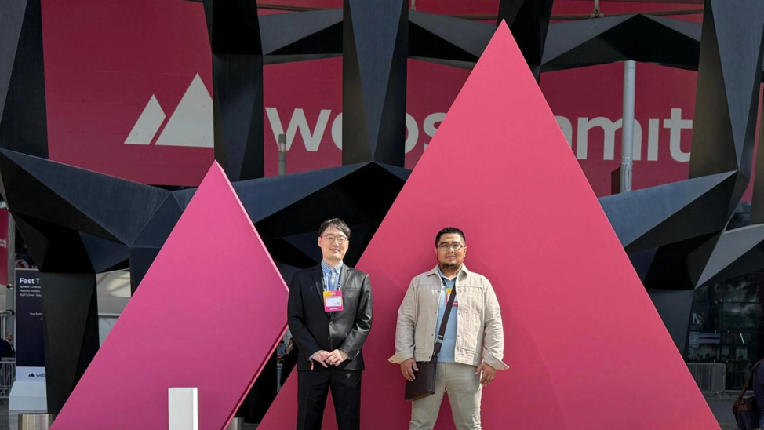

# HumbleBeeAI Venture Studio LLC Launches in Qatar

HumbleBeeAI established a Qatar-based venture studio to support AI venture building and expansion across the Middle East. [PDF p. 1](http://localhost:3344/workspaces/ab6b13a5-514c-4849-96d2-cd4008c5c310/documents/5162d3bf-9a57-42ce-b8ab-3c04c7c6b035/evidence/0ee540f1-02e0-4a88-a8ef-6692aaea0293/asset) [PDF p. 1](http://localhost:3344/workspaces/ab6b13a5-514c-4849-96d2-cd4008c5c310/documents/5162d3bf-9a57-42ce-b8ab-3c04c7c6b035/evidence/4d6a402b-0052-44e2-a463-ff7ffba45798/asset)

## Executive Summary

HumbleBeeAI established HumbleBeeAI Venture Studio LLC in the Qatar Financial Centre (QFC), Doha, as a Middle East hub intended to support the launch, incubation, and scaling of future AI-driven ventures. The initiative is designed to serve HumbleBeeAI’s existing and future ventures, as well as prospective local and international partners, investors, universities, and other stakeholders. The source describes the entity’s establishment; it does not establish that the planned operating activities are already complete. [PDF p. 1](http://localhost:3344/workspaces/ab6b13a5-514c-4849-96d2-cd4008c5c310/documents/5162d3bf-9a57-42ce-b8ab-3c04c7c6b035/evidence/4d6a402b-0052-44e2-a463-ff7ffba45798/asset) [PDF p. 1](http://localhost:3344/workspaces/ab6b13a5-514c-4849-96d2-cd4008c5c310/documents/5162d3bf-9a57-42ce-b8ab-3c04c7c6b035/evidence/4d6a402b-0052-44e2-a463-ff7ffba45798/asset) [PDF p. 2](http://localhost:3344/workspaces/ab6b13a5-514c-4849-96d2-cd4008c5c310/documents/5162d3bf-9a57-42ce-b8ab-3c04c7c6b035/evidence/853bc1ee-d0c1-4b25-8f24-64146beb0da5/asset)

## Context and Challenge

The source frames the project as an international-growth initiative rather than a response to a documented existing workflow failure. It does not describe prior processes, specific affected users, operational constraints, or a measured problem. The stated strategic context is to create a regional base from which HumbleBeeAI can explore partnerships and bring its engineering, product development, and AI talent ecosystem into the Middle East. [PDF p. 1](http://localhost:3344/workspaces/ab6b13a5-514c-4849-96d2-cd4008c5c310/documents/5162d3bf-9a57-42ce-b8ab-3c04c7c6b035/evidence/4d6a402b-0052-44e2-a463-ff7ffba45798/asset) [PDF p. 2](http://localhost:3344/workspaces/ab6b13a5-514c-4849-96d2-cd4008c5c310/documents/5162d3bf-9a57-42ce-b8ab-3c04c7c6b035/evidence/709d4c76-0024-48aa-adf5-e9ecd84c7d34/asset)

## Solution and Capabilities

The delivered milestone documented in the source is establishment of the Qatar entity in the QFC. The venture-studio model and its stated purpose are to provide a foundation for future venture development and regional collaboration. [PDF p. 1](http://localhost:3344/workspaces/ab6b13a5-514c-4849-96d2-cd4008c5c310/documents/5162d3bf-9a57-42ce-b8ab-3c04c7c6b035/evidence/4d6a402b-0052-44e2-a463-ff7ffba45798/asset) [PDF p. 1](http://localhost:3344/workspaces/ab6b13a5-514c-4849-96d2-cd4008c5c310/documents/5162d3bf-9a57-42ce-b8ab-3c04c7c6b035/evidence/0ee540f1-02e0-4a88-a8ef-6692aaea0293/asset)

### Venture building and product support

- Launch and support new AI startups and ventures in Qatar. [PDF p. 1](http://localhost:3344/workspaces/ab6b13a5-514c-4849-96d2-cd4008c5c310/documents/5162d3bf-9a57-42ce-b8ab-3c04c7c6b035/evidence/4d6a402b-0052-44e2-a463-ff7ffba45798/asset)
- Support the future growth of HumbleBeeAI’s existing and upcoming products; the source identifies AI productivity tools, venture-building projects, talent development programs, and future technology ventures as initiatives within the broader ecosystem. [PDF p. 1](http://localhost:3344/workspaces/ab6b13a5-514c-4849-96d2-cd4008c5c310/documents/5162d3bf-9a57-42ce-b8ab-3c04c7c6b035/evidence/0ee540f1-02e0-4a88-a8ef-6692aaea0293/asset)

### Regional partnerships and ecosystem development

- Explore collaboration with local organizations, investors, universities, government programs, strategic partners, and other stakeholders. [PDF p. 1](http://localhost:3344/workspaces/ab6b13a5-514c-4849-96d2-cd4008c5c310/documents/5162d3bf-9a57-42ce-b8ab-3c04c7c6b035/evidence/4d6a402b-0052-44e2-a463-ff7ffba45798/asset) [PDF p. 2](http://localhost:3344/workspaces/ab6b13a5-514c-4849-96d2-cd4008c5c310/documents/5162d3bf-9a57-42ce-b8ab-3c04c7c6b035/evidence/853bc1ee-d0c1-4b25-8f24-64146beb0da5/asset)
- Build a foundation for potential future regional offices, projects, and collaborations. [PDF p. 1](http://localhost:3344/workspaces/ab6b13a5-514c-4849-96d2-cd4008c5c310/documents/5162d3bf-9a57-42ce-b8ab-3c04c7c6b035/evidence/4d6a402b-0052-44e2-a463-ff7ffba45798/asset)

The company update presents Qatar as a location for Middle East market expansion, partnership-building, and access to a growing innovation ecosystem. These are stated strategic aims, not measured outcomes. [PDF p. 2](http://localhost:3344/workspaces/ab6b13a5-514c-4849-96d2-cd4008c5c310/documents/5162d3bf-9a57-42ce-b8ab-3c04c7c6b035/evidence/709d4c76-0024-48aa-adf5-e9ecd84c7d34/asset)

## Results and Business Impact

The source confirms establishment of HumbleBeeAI Venture Studio LLC in the Qatar Financial Centre. It reports no quantified business, operational, employment, investment, or product results, and no impact measurements are provided. [PDF p. 1](http://localhost:3344/workspaces/ab6b13a5-514c-4849-96d2-cd4008c5c310/documents/5162d3bf-9a57-42ce-b8ab-3c04c7c6b035/evidence/4d6a402b-0052-44e2-a463-ff7ffba45798/asset)

- Supported result: a new HumbleBeeAI entity was established in QFC, Doha. [PDF p. 1](http://localhost:3344/workspaces/ab6b13a5-514c-4849-96d2-cd4008c5c310/documents/5162d3bf-9a57-42ce-b8ab-3c04c7c6b035/evidence/4d6a402b-0052-44e2-a463-ff7ffba45798/asset)
- Not reported: performance metrics, completed venture launches, partnership outcomes, investments, or measured business impact.

## Limitations and Next Steps

The company update says the following activities are planned for the coming months, and does not present them as completed: [PDF p. 2](http://localhost:3344/workspaces/ab6b13a5-514c-4849-96d2-cd4008c5c310/documents/5162d3bf-9a57-42ce-b8ab-3c04c7c6b035/evidence/853bc1ee-d0c1-4b25-8f24-64146beb0da5/asset)

- Complete operational setup in Qatar. [PDF p. 2](http://localhost:3344/workspaces/ab6b13a5-514c-4849-96d2-cd4008c5c310/documents/5162d3bf-9a57-42ce-b8ab-3c04c7c6b035/evidence/853bc1ee-d0c1-4b25-8f24-64146beb0da5/asset)
- Build relationships with local partners and stakeholders. [PDF p. 2](http://localhost:3344/workspaces/ab6b13a5-514c-4849-96d2-cd4008c5c310/documents/5162d3bf-9a57-42ce-b8ab-3c04c7c6b035/evidence/853bc1ee-d0c1-4b25-8f24-64146beb0da5/asset)
- Explore office, residency, and investment opportunities. [PDF p. 2](http://localhost:3344/workspaces/ab6b13a5-514c-4849-96d2-cd4008c5c310/documents/5162d3bf-9a57-42ce-b8ab-3c04c7c6b035/evidence/853bc1ee-d0c1-4b25-8f24-64146beb0da5/asset)
- Introduce HumbleBeeAI’s existing products and future ventures to the Qatar market. [PDF p. 2](http://localhost:3344/workspaces/ab6b13a5-514c-4849-96d2-cd4008c5c310/documents/5162d3bf-9a57-42ce-b8ab-3c04c7c6b035/evidence/853bc1ee-d0c1-4b25-8f24-64146beb0da5/asset)

The supplied material does not specify a detailed operating model, launch dates for individual ventures, or technical product capabilities. It includes the label “Open original HumbleBeeAI page,” but no destination URL is present in the provided source, so a verifiable original-page link cannot be reproduced here. [PDF p. 1](http://localhost:3344/workspaces/ab6b13a5-514c-4849-96d2-cd4008c5c310/documents/5162d3bf-9a57-42ce-b8ab-3c04c7c6b035/evidence/83a34921-c6b1-4e8d-ae8b-78782e8bdb4a/asset) [PDF p. 2](http://localhost:3344/workspaces/ab6b13a5-514c-4849-96d2-cd4008c5c310/documents/5162d3bf-9a57-42ce-b8ab-3c04c7c6b035/evidence/853bc1ee-d0c1-4b25-8f24-64146beb0da5/asset)

## Conclusion

Establishing HumbleBeeAI Venture Studio LLC in QFC creates a documented base for HumbleBeeAI’s intended regional venture-building and collaboration efforts. The source confirms the entity’s establishment while identifying operational setup, partnerships, and market introduction as next steps—not reported completed outcomes. [PDF p. 1](http://localhost:3344/workspaces/ab6b13a5-514c-4849-96d2-cd4008c5c310/documents/5162d3bf-9a57-42ce-b8ab-3c04c7c6b035/evidence/4d6a402b-0052-44e2-a463-ff7ffba45798/asset) [PDF p. 2](http://localhost:3344/workspaces/ab6b13a5-514c-4849-96d2-cd4008c5c310/documents/5162d3bf-9a57-42ce-b8ab-3c04c7c6b035/evidence/853bc1ee-d0c1-4b25-8f24-64146beb0da5/asset)

