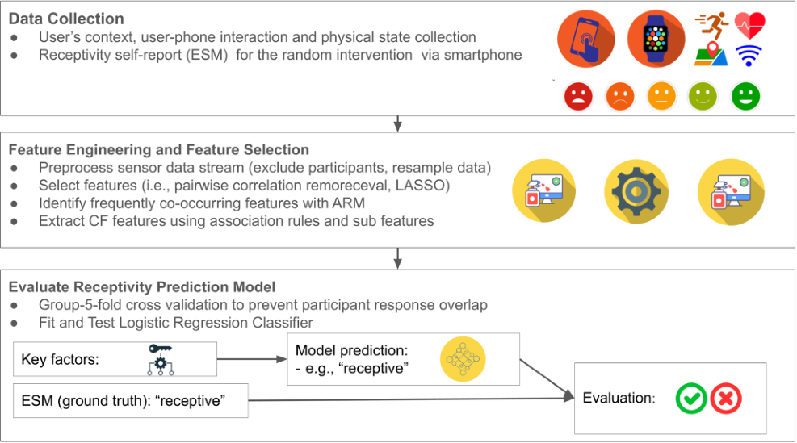

# Contextual Filtered Features for Smartphone User Receptivity Prediction

A published research study evaluates contextually filtered smartphone and smartwatch features for predicting receptivity to just-in-time health interventions. [PDF p. 1](http://localhost:3344/workspaces/ab6b13a5-514c-4849-96d2-cd4008c5c310/documents/06b09a1a-12aa-444e-bd9f-b70209eeed36/evidence/10714c6e-8015-484d-8315-715ac151a1c7/asset)

## Executive Summary

This project addresses a practical question for teams designing mobile health interventions: can a model anticipate when a smartphone user may be receptive, so an intervention can be timed more appropriately? The published study proposes contextually filtered features (CFFs) drawn from user–smartphone interactions and smartwatch sensor data. It evaluates the method on the KEmoPhone dataset; it is a research evaluation, not evidence of a deployed HumbleBeeAI or client product. [PDF p. 1](http://localhost:3344/workspaces/ab6b13a5-514c-4849-96d2-cd4008c5c310/documents/06b09a1a-12aa-444e-bd9f-b70209eeed36/evidence/10714c6e-8015-484d-8315-715ac151a1c7/asset) [PDF p. 1](http://localhost:3344/workspaces/ab6b13a5-514c-4849-96d2-cd4008c5c310/documents/06b09a1a-12aa-444e-bd9f-b70209eeed36/evidence/ac30e210-d387-400e-946c-e9adc49d8157/asset)

- Study authors: Jumabek Alikhanov, Panyu Zhang, Youngtae Noh and Hakil Kim. [PDF p. 1](http://localhost:3344/workspaces/ab6b13a5-514c-4849-96d2-cd4008c5c310/documents/06b09a1a-12aa-444e-bd9f-b70209eeed36/evidence/5a658499-af5f-4a8d-a012-4f94100244fd/asset)
- Published in IEEE Internet of Things Journal, volume 11, issue 7, 1 April 2024; the supplied listing also identifies the work as 2023. [PDF p. 1](http://localhost:3344/workspaces/ab6b13a5-514c-4849-96d2-cd4008c5c310/documents/06b09a1a-12aa-444e-bd9f-b70209eeed36/evidence/ac30e210-d387-400e-946c-e9adc49d8157/asset)
- Original source: https://ieeexplore.ieee.org/abstract/document/10316180

## Context and Challenge

Mobile health interventions depend in part on reaching people at moments when they are receptive. The study frames the challenge as predicting that state ahead of an experience-sampling questionnaire, using user context rather than relying only on conventional time-series summaries. The source describes the research problem and comparison method, but does not establish a previous operational workflow or report a client’s existing process. [PDF p. 1](http://localhost:3344/workspaces/ab6b13a5-514c-4849-96d2-cd4008c5c310/documents/06b09a1a-12aa-444e-bd9f-b70209eeed36/evidence/10714c6e-8015-484d-8315-715ac151a1c7/asset)

- Evaluation data: 3,334 experience-sampling responses from 73 participants collected over one week. [PDF p. 1](http://localhost:3344/workspaces/ab6b13a5-514c-4849-96d2-cd4008c5c310/documents/06b09a1a-12aa-444e-bd9f-b70209eeed36/evidence/10714c6e-8015-484d-8315-715ac151a1c7/asset)
- Comparison baseline: conventional statistical-moment features calculated over an 80-minute window. [PDF p. 1](http://localhost:3344/workspaces/ab6b13a5-514c-4849-96d2-cd4008c5c310/documents/06b09a1a-12aa-444e-bd9f-b70209eeed36/evidence/10714c6e-8015-484d-8315-715ac151a1c7/asset)
- The study evaluates prediction of reported receptivity; it does not test whether the health interventions themselves cause behavioral or health improvements. [PDF p. 1](http://localhost:3344/workspaces/ab6b13a5-514c-4849-96d2-cd4008c5c310/documents/06b09a1a-12aa-444e-bd9f-b70209eeed36/evidence/36f2f199-7576-4109-af69-be4679733d86/asset)

## Solution and Capabilities

The proposed capability is a feature-engineering approach, not a new classifier: it mines context from subwindow features and uses association rules to identify co-occurring features for constructing contextually filtered representations. The research pipeline then evaluates receptivity prediction using machine-learning classifiers. [PDF p. 3](http://localhost:3344/workspaces/ab6b13a5-514c-4849-96d2-cd4008c5c310/documents/06b09a1a-12aa-444e-bd9f-b70209eeed36/evidence/951f662a-1519-45b8-8c8e-0c98b4ca2f05/asset) [PDF p. 4](http://localhost:3344/workspaces/ab6b13a5-514c-4849-96d2-cd4008c5c310/documents/06b09a1a-12aa-444e-bd9f-b70209eeed36/evidence/d143dce5-7785-491c-97e8-55cb2d441a0a/asset)

- Contextual inputs: user–smartphone interactions and smartwatch sensor data provide signals about the user’s context and state. [PDF p. 1](http://localhost:3344/workspaces/ab6b13a5-514c-4849-96d2-cd4008c5c310/documents/06b09a1a-12aa-444e-bd9f-b70209eeed36/evidence/10714c6e-8015-484d-8315-715ac151a1c7/asset)
- Feature construction: association-rule mining identifies frequently co-occurring subwindow features, which are used to extract contextual features. [PDF p. 3](http://localhost:3344/workspaces/ab6b13a5-514c-4849-96d2-cd4008c5c310/documents/06b09a1a-12aa-444e-bd9f-b70209eeed36/evidence/951f662a-1519-45b8-8c8e-0c98b4ca2f05/asset)
- Model evaluation: the reported pipeline uses group five-fold cross-validation to prevent participant-response overlap and tests a logistic-regression classifier as depicted in the pipeline. [PDF p. 2](http://localhost:3344/workspaces/ab6b13a5-514c-4849-96d2-cd4008c5c310/documents/06b09a1a-12aa-444e-bd9f-b70209eeed36/evidence/8813f7cb-f7e5-4c34-adb2-4a74fad5cfba/asset)

## Results and Business Impact

Across multiple classifiers on KEmoPhone, the proposed CFF method achieved an average ROC-AUC of 56.5%, compared with 54.7% for conventional statistical time-series features using an 80-minute window. The paper reports that the improvement was consistent across the classifiers tested. [PDF p. 1](http://localhost:3344/workspaces/ab6b13a5-514c-4849-96d2-cd4008c5c310/documents/06b09a1a-12aa-444e-bd9f-b70209eeed36/evidence/10714c6e-8015-484d-8315-715ac151a1c7/asset)

These are research-model metrics, not measured business outcomes. No client deployment, intervention-engagement uplift, or client business impact has been provided or measured in the supplied material; the study also states that measuring the causal effect of health interventions was outside its scope. [PDF p. 1](http://localhost:3344/workspaces/ab6b13a5-514c-4849-96d2-cd4008c5c310/documents/06b09a1a-12aa-444e-bd9f-b70209eeed36/evidence/36f2f199-7576-4109-af69-be4679733d86/asset)

## Limitations and Next Steps

The evidence is limited to the described dataset and evaluation. The result supports a comparison of feature representations for predicting receptivity, not a guarantee of successful intervention timing in production or improved health outcomes. [PDF p. 1](http://localhost:3344/workspaces/ab6b13a5-514c-4849-96d2-cd4008c5c310/documents/06b09a1a-12aa-444e-bd9f-b70209eeed36/evidence/10714c6e-8015-484d-8315-715ac151a1c7/asset) [PDF p. 1](http://localhost:3344/workspaces/ab6b13a5-514c-4849-96d2-cd4008c5c310/documents/06b09a1a-12aa-444e-bd9f-b70209eeed36/evidence/36f2f199-7576-4109-af69-be4679733d86/asset)

- The study constrained its investigated features to sensor and user–phone interaction data; age, gender, personality scores, and time-of-day or weekday/weekend indicators were not considered. [PDF p. 4](http://localhost:3344/workspaces/ab6b13a5-514c-4849-96d2-cd4008c5c310/documents/06b09a1a-12aa-444e-bd9f-b70209eeed36/evidence/d143dce5-7785-491c-97e8-55cb2d441a0a/asset)
- The abstract said full research code would be released in Jupyter Notebooks upon publication. The supplied material does not confirm its current availability or describe a production implementation, so no delivered product status is claimed. [PDF p. 1](http://localhost:3344/workspaces/ab6b13a5-514c-4849-96d2-cd4008c5c310/documents/06b09a1a-12aa-444e-bd9f-b70209eeed36/evidence/10714c6e-8015-484d-8315-715ac151a1c7/asset)

## Conclusion

This published study demonstrates a research approach for using contextually filtered smartphone and smartwatch features to improve receptivity prediction relative to conventional 80-minute statistical features on the evaluated dataset. It provides a measured model comparison for mobile-health researchers and intervention designers, while client business impact and real-world deployment outcomes remain unreported. [PDF p. 1](http://localhost:3344/workspaces/ab6b13a5-514c-4849-96d2-cd4008c5c310/documents/06b09a1a-12aa-444e-bd9f-b70209eeed36/evidence/10714c6e-8015-484d-8315-715ac151a1c7/asset) [PDF p. 1](http://localhost:3344/workspaces/ab6b13a5-514c-4849-96d2-cd4008c5c310/documents/06b09a1a-12aa-444e-bd9f-b70209eeed36/evidence/36f2f199-7576-4109-af69-be4679733d86/asset)

