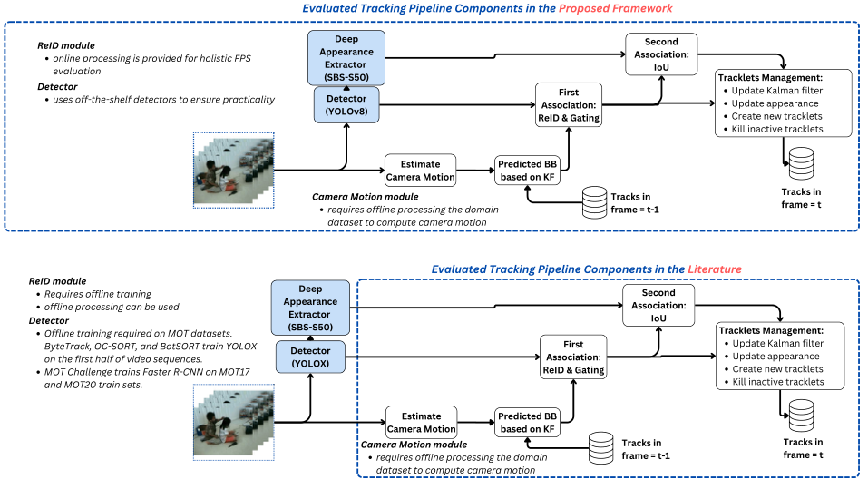

# Evaluating Real-Time Multi-Object Tracking for Practical Edge Deployment

A research evaluation framework for testing real-time multi-object tracking under practical detector, ReID and edge-runtime constraints.

## Executive Summary

HumbleBee R&D researchers developed a practical framework to assess multi-object tracking (MOT) as a complete pipeline, rather than judging tracker components in isolation. The work is intended to help computer-vision practitioners and researchers understand how detection, re-identification (ReID) and tracking choices affect measured accuracy and runtime, especially in edge-device scenarios. This is a published research study, not a reported client deployment or product implementation.  [PDF p. 2](http://localhost:3344/workspaces/ab6b13a5-514c-4849-96d2-cd4008c5c310/documents/96dd77ca-8a40-4cb5-8e6b-4366f590b526/evidence/3b03eae1-4ae5-4b61-a58c-b28f80e50c18/asset)The paper, “Practical Evaluation Framework for Real-Time Multi-Object Tracking: Achieving Optimal and Realistic Performance,” is by Jumabek Alikhanov, Dilshod Obidov, Mirsaid Abdurasulov and Hakil Kim, and was published in IEEE Access, volume 13, in 2025 (DOI: 10.1109/ACCESS.2025.3541177).  [PDF p. 1](http://localhost:3344/workspaces/ab6b13a5-514c-4849-96d2-cd4008c5c310/documents/96dd77ca-8a40-4cb5-8e6b-4366f590b526/evidence/033cafbc-c106-4ece-8438-1501f716789e/asset)Read the [complete public paper](https://ieeexplore.ieee.org/abstract/document/10883969).

## Context and Challenge

MOT systems must maintain object identities across video frames. Appearance-based ReID can help with identity association, but it can add computational cost—an important constraint for real-time applications and edge hardware. The paper notes that common evaluation approaches may not reflect deployment conditions when they omit parts of the pipeline or assess speed only for tracking and matching, rather than including detection and preprocessing. [PDF p. 1](http://localhost:3344/workspaces/ab6b13a5-514c-4849-96d2-cd4008c5c310/documents/96dd77ca-8a40-4cb5-8e6b-4366f590b526/evidence/fcddcdbe-e6dc-4afc-aef9-abf07dc99d8e/asset) [PDF p. 3](http://localhost:3344/workspaces/ab6b13a5-514c-4849-96d2-cd4008c5c310/documents/96dd77ca-8a40-4cb5-8e6b-4366f590b526/evidence/755129d1-0be0-4a5e-b00d-f07f09b3fbfd/asset)

The affected users are teams comparing trackers or considering constrained-device use; the study is an evaluation method and benchmark analysis, not evidence of a specific client's former workflow. Its central challenge is to make comparisons more realistic: use a common off-the-shelf detector, include preprocessing and ReID costs in the assessed pipeline, and measure end-to-end speed alongside tracking quality. [PDF p. 3](http://localhost:3344/workspaces/ab6b13a5-514c-4849-96d2-cd4008c5c310/documents/96dd77ca-8a40-4cb5-8e6b-4366f590b526/evidence/4ae07264-3945-4e3a-bb81-d7d998b171e3/asset) [PDF p. 3](http://localhost:3344/workspaces/ab6b13a5-514c-4849-96d2-cd4008c5c310/documents/96dd77ca-8a40-4cb5-8e6b-4366f590b526/evidence/755129d1-0be0-4a5e-b00d-f07f09b3fbfd/asset)

## Solution and Capabilities

The researchers propose a holistic evaluation framework that follows detection, ReID and tracking operations together. The supplied figure contrasts the proposed assessment with components commonly represented in the literature. [PDF p. 3](http://localhost:3344/workspaces/ab6b13a5-514c-4849-96d2-cd4008c5c310/documents/96dd77ca-8a40-4cb5-8e6b-4366f590b526/evidence/4ae07264-3945-4e3a-bb81-d7d998b171e3/asset)

- Whole-pipeline assessment: includes detector effects and online processing such as preprocessing, cropping and resizing, so evaluation captures costs that can otherwise be missed. [PDF p. 3](http://localhost:3344/workspaces/ab6b13a5-514c-4849-96d2-cd4008c5c310/documents/96dd77ca-8a40-4cb5-8e6b-4366f590b526/evidence/4ae07264-3945-4e3a-bb81-d7d998b171e3/asset)
- Common detector basis: the framework uses off-the-shelf detectors across trackers to support practical comparisons and help isolate tracker performance from detector differences. [PDF p. 3](http://localhost:3344/workspaces/ab6b13a5-514c-4849-96d2-cd4008c5c310/documents/96dd77ca-8a40-4cb5-8e6b-4366f590b526/evidence/4ae07264-3945-4e3a-bb81-d7d998b171e3/asset) [PDF p. 3](http://localhost:3344/workspaces/ab6b13a5-514c-4849-96d2-cd4008c5c310/documents/96dd77ca-8a40-4cb5-8e6b-4366f590b526/evidence/755129d1-0be0-4a5e-b00d-f07f09b3fbfd/asset)
- Runtime measured in context: speed evaluation accounts for the detector as well as tracking stages, addressing the influence of detection and preprocessing on overall FPS. [PDF p. 3](http://localhost:3344/workspaces/ab6b13a5-514c-4849-96d2-cd4008c5c310/documents/96dd77ca-8a40-4cb5-8e6b-4366f590b526/evidence/755129d1-0be0-4a5e-b00d-f07f09b3fbfd/asset)
- LITE ReID integration: Lightweight Integrated Tracking-Feature Extraction integrates appearance features into the tracking pipeline to reduce computational overhead, with the study reporting speeds similar to motion-only systems without compromising accuracy in its experiments. [PDF p. 1](http://localhost:3344/workspaces/ab6b13a5-514c-4849-96d2-cd4008c5c310/documents/96dd77ca-8a40-4cb5-8e6b-4366f590b526/evidence/77577a47-3abf-43fb-8025-b7aa3244ccfb/asset)

## Results and Business Impact

The paper reports benchmark findings, not measured business outcomes for a client. Results are experimental and depend on dataset and configuration; they should not be read as a universal performance guarantee. [PDF p. 1](http://localhost:3344/workspaces/ab6b13a5-514c-4849-96d2-cd4008c5c310/documents/96dd77ca-8a40-4cb5-8e6b-4366f590b526/evidence/77577a47-3abf-43fb-8025-b7aa3244ccfb/asset) [PDF p. 7](http://localhost:3344/workspaces/ab6b13a5-514c-4849-96d2-cd4008c5c310/documents/96dd77ca-8a40-4cb5-8e6b-4366f590b526/evidence/bdefae73-ad1e-4021-bf90-f390d75d0267/asset)

- The framework reports that careful input-resolution and confidence-threshold choices can yield HOTA scores up to 30%, while evaluations without those optimizations may reach 10%. This is a configuration-dependent comparison reported by the study, not a universal 20-point improvement. [PDF p. 1](http://localhost:3344/workspaces/ab6b13a5-514c-4849-96d2-cd4008c5c310/documents/96dd77ca-8a40-4cb5-8e6b-4366f590b526/evidence/77577a47-3abf-43fb-8025-b7aa3244ccfb/asset) [PDF p. 20](http://localhost:3344/workspaces/ab6b13a5-514c-4849-96d2-cd4008c5c310/documents/96dd77ca-8a40-4cb5-8e6b-4366f590b526/evidence/4f0baf47-c7d3-4802-8062-7a5f56c94d32/asset)
- The authors report that LITE-enabled ReID trackers operated at similar speeds to motion-only systems without compromising accuracy in their experiments; this is a benchmark observation, not a measured operating-cost or customer-impact result. [PDF p. 1](http://localhost:3344/workspaces/ab6b13a5-514c-4849-96d2-cd4008c5c310/documents/96dd77ca-8a40-4cb5-8e6b-4366f590b526/evidence/77577a47-3abf-43fb-8025-b7aa3244ccfb/asset)
- The paper emphasizes dataset-specific settings: for example, its analysis found that MOT20 and MOT17 favored different confidence thresholds and resolutions. This reinforces the need to evaluate configurations against the intended data rather than assume one setting works everywhere. [PDF p. 7](http://localhost:3344/workspaces/ab6b13a5-514c-4849-96d2-cd4008c5c310/documents/96dd77ca-8a40-4cb5-8e6b-4366f590b526/evidence/bdefae73-ad1e-4021-bf90-f390d75d0267/asset)

No client business outcome, commercial deployment result or business-impact measurement has been provided. The supported impact is a research contribution: a more deployment-oriented basis for comparing tracking performance and runtime. [PDF p. 2](http://localhost:3344/workspaces/ab6b13a5-514c-4849-96d2-cd4008c5c310/documents/96dd77ca-8a40-4cb5-8e6b-4366f590b526/evidence/3b03eae1-4ae5-4b61-a58c-b28f80e50c18/asset)

## Limitations and Next Steps

The evidence describes a published research framework and experimental findings. It does not establish that the framework or LITE is deployed in a client production environment, nor does it report customer adoption or measured business outcomes.

The study also identifies open research needs. Its discussion calls for better matching strategies that make more effective use of ReID features and adaptive methods that reduce dependence on user-specified settings such as confidence thresholds. These are future research directions, not capabilities established as delivered by the reported work. [PDF p. 16](http://localhost:3344/workspaces/ab6b13a5-514c-4849-96d2-cd4008c5c310/documents/96dd77ca-8a40-4cb5-8e6b-4366f590b526/evidence/4939b552-ba30-4a2c-b6df-18b4eb67bdf1/asset) [PDF p. 20](http://localhost:3344/workspaces/ab6b13a5-514c-4849-96d2-cd4008c5c310/documents/96dd77ca-8a40-4cb5-8e6b-4366f590b526/evidence/4f0baf47-c7d3-4802-8062-7a5f56c94d32/asset)

The reported limitation of LITE is that its detector-derived features are not identity-specific; the paper notes that this limits performance in person search, an application beyond the study’s primary MOT focus. No further deployment plan or delivery schedule has been provided. [PDF p. 16](http://localhost:3344/workspaces/ab6b13a5-514c-4849-96d2-cd4008c5c310/documents/96dd77ca-8a40-4cb5-8e6b-4366f590b526/evidence/4939b552-ba30-4a2c-b6df-18b4eb67bdf1/asset)

## Conclusion

This published HumbleBee R&D research makes MOT evaluation more reflective of practical constraints by assessing detection, ReID, tracking and runtime together. Its benchmark results show why detector settings and lightweight appearance-feature integration merit careful, dataset-specific evaluation, while leaving client business impact and production deployment unclaimed. [PDF p. 2](http://localhost:3344/workspaces/ab6b13a5-514c-4849-96d2-cd4008c5c310/documents/96dd77ca-8a40-4cb5-8e6b-4366f590b526/evidence/3b03eae1-4ae5-4b61-a58c-b28f80e50c18/asset) [PDF p. 1](http://localhost:3344/workspaces/ab6b13a5-514c-4849-96d2-cd4008c5c310/documents/96dd77ca-8a40-4cb5-8e6b-4366f590b526/evidence/77577a47-3abf-43fb-8025-b7aa3244ccfb/asset)

