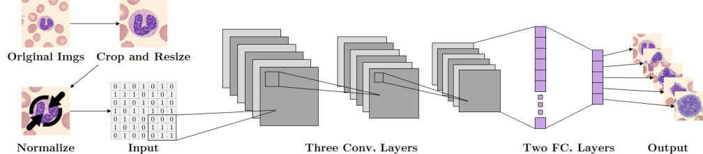
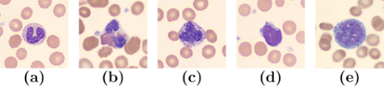
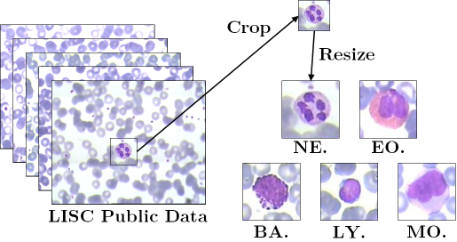

# W-Net White Blood Cell Image Classification

W-Net is a research-stage convolutional neural network evaluated for classifying five white blood cell types from microscope images. [PDF p. 1](http://localhost:3344/workspaces/ab6b13a5-514c-4849-96d2-cd4008c5c310/documents/b74e8726-a2f3-43ac-a810-ff296ba20621/evidence/8caa1489-16a1-4678-b652-dc928ffd761e/asset)

## Executive Summary

W-Net addresses the challenge of assigning white blood cell (WBC) images to five cell classes—a task that remains difficult even as computer-aided blood-image analysis advances. The research evaluates a CNN classifier on a real-world dataset of 6,562 images and reports an average accuracy of 97%. The supplied paper describes experiments and a released model; it does not establish a clinical product, deployment, or HumbleBeeAI delivery. [PDF p. 1](http://localhost:3344/workspaces/ab6b13a5-514c-4849-96d2-cd4008c5c310/documents/b74e8726-a2f3-43ac-a810-ff296ba20621/evidence/8caa1489-16a1-4678-b652-dc928ffd761e/asset) [PDF p. 1](http://localhost:3344/workspaces/ab6b13a5-514c-4849-96d2-cd4008c5c310/documents/b74e8726-a2f3-43ac-a810-ff296ba20621/evidence/f2765b26-100c-49d3-bc38-0cf9d621da33/asset)

The paper is titled “W-Net: A CNN-based Architecture for White Blood Cells Image Classification” and lists Changhun Jung, Mohammed Abuhamad, Jumabek Alikhanov, Aziz Mohaisen, Kyungja Han, and DaeHun Nyang as authors. Publication or preprint status and an original paper URL are not stated in the supplied material. The references do list a W-Net model link: https://bit.ly/2KAffwM. [PDF p. 1](http://localhost:3344/workspaces/ab6b13a5-514c-4849-96d2-cd4008c5c310/documents/b74e8726-a2f3-43ac-a810-ff296ba20621/evidence/8c6e8f8f-71cf-4e4a-a875-eb775372f646/asset)

## Context and Challenge

Classifying WBCs from blood-smear images is demanding, and the distribution of cell types can reflect immune-system condition. The paper positions accurate recognition of the five types as important for analysis, while noting that classification remains challenging. [PDF p. 1](http://localhost:3344/workspaces/ab6b13a5-514c-4849-96d2-cd4008c5c310/documents/b74e8726-a2f3-43ac-a810-ff296ba20621/evidence/8caa1489-16a1-4678-b652-dc928ffd761e/asset) [PDF p. 1](http://localhost:3344/workspaces/ab6b13a5-514c-4849-96d2-cd4008c5c310/documents/b74e8726-a2f3-43ac-a810-ff296ba20621/evidence/f2765b26-100c-49d3-bc38-0cf9d621da33/asset)

The evaluated dataset contained 6,562 real images across neutrophils, eosinophils, basophils, lymphocytes, and monocytes. The classes were not evenly represented: the paper reports class shares ranging from 6% for basophils to 30% for neutrophils. The source does not detail a prior operational workflow, specific clinical users, or time and cost constraints. [PDF p. 1](http://localhost:3344/workspaces/ab6b13a5-514c-4849-96d2-cd4008c5c310/documents/b74e8726-a2f3-43ac-a810-ff296ba20621/evidence/8caa1489-16a1-4678-b652-dc928ffd761e/asset) [PDF p. 3](http://localhost:3344/workspaces/ab6b13a5-514c-4849-96d2-cd4008c5c310/documents/b74e8726-a2f3-43ac-a810-ff296ba20621/evidence/104512ac-889b-4fa0-8f7e-e0beee480260/asset)

## Solution and Capabilities

### Image preparation and classification

W-Net uses image preprocessing followed by three convolutional layers for feature extraction and two fully connected layers with a softmax classifier to assign images to five WBC classes. The preprocessing described in the paper includes cropping, resizing, and normalization. [PDF p. 1](http://localhost:3344/workspaces/ab6b13a5-514c-4849-96d2-cd4008c5c310/documents/b74e8726-a2f3-43ac-a810-ff296ba20621/evidence/f2765b26-100c-49d3-bc38-0cf9d621da33/asset) [PDF p. 3](http://localhost:3344/workspaces/ab6b13a5-514c-4849-96d2-cd4008c5c310/documents/b74e8726-a2f3-43ac-a810-ff296ba20621/evidence/505dca26-9178-4647-bb76-52645ec6ea1c/asset)

### Five-class dataset

The authors evaluated the model on 6,562 RGB images, each reported as 360×361×3, representing neutrophils, eosinophils, basophils, lymphocytes, and monocytes. [PDF p. 3](http://localhost:3344/workspaces/ab6b13a5-514c-4849-96d2-cd4008c5c310/documents/b74e8726-a2f3-43ac-a810-ff296ba20621/evidence/fb151ffc-3e5d-4a92-8444-9d9be2304ee7/asset)

### Further training on public data

The paper also tested transfer to the LISC public dataset. It compared a W-Net trained on LISC from scratch with a model first trained on the authors’ dataset and then further trained on LISC, using the same architecture and 10-fold cross-validation. [PDF p. 4](http://localhost:3344/workspaces/ab6b13a5-514c-4849-96d2-cd4008c5c310/documents/b74e8726-a2f3-43ac-a810-ff296ba20621/evidence/0fd1d194-6ce7-45ac-9f56-5199fa414bcf/asset)

The paper states that the trained W-Net model was released for other researchers; the cited model link is https://bit.ly/2KAffwM. Availability or support beyond that reported release is not established by the supplied source. [PDF p. 4](http://localhost:3344/workspaces/ab6b13a5-514c-4849-96d2-cd4008c5c310/documents/b74e8726-a2f3-43ac-a810-ff296ba20621/evidence/0fd1d194-6ce7-45ac-9f56-5199fa414bcf/asset)

## Results and Business Impact

Reported experimental results: [PDF p. 1](http://localhost:3344/workspaces/ab6b13a5-514c-4849-96d2-cd4008c5c310/documents/b74e8726-a2f3-43ac-a810-ff296ba20621/evidence/8caa1489-16a1-4678-b652-dc928ffd761e/asset)

- On the authors’ private dataset of 6,562 images, W-Net achieved 97% average classification accuracy across the five WBC classes. [PDF p. 1](http://localhost:3344/workspaces/ab6b13a5-514c-4849-96d2-cd4008c5c310/documents/b74e8726-a2f3-43ac-a810-ff296ba20621/evidence/8caa1489-16a1-4678-b652-dc928ffd761e/asset) [PDF p. 1](http://localhost:3344/workspaces/ab6b13a5-514c-4849-96d2-cd4008c5c310/documents/b74e8726-a2f3-43ac-a810-ff296ba20621/evidence/a3f0f84d-ec99-40bb-9416-7b9cd60f5c64/asset)
- On LISC public data, the model trained from scratch achieved 91% average accuracy; the model initially trained on the authors’ dataset and then further trained on LISC achieved 96% average accuracy. [PDF p. 4](http://localhost:3344/workspaces/ab6b13a5-514c-4849-96d2-cd4008c5c310/documents/b74e8726-a2f3-43ac-a810-ff296ba20621/evidence/0fd1d194-6ce7-45ac-9f56-5199fa414bcf/asset) [PDF p. 5](http://localhost:3344/workspaces/ab6b13a5-514c-4849-96d2-cd4008c5c310/documents/b74e8726-a2f3-43ac-a810-ff296ba20621/evidence/0dfc3600-25ea-497f-885c-1eadb1f7da7c/asset)
- These are model-evaluation metrics. The source provides no measured clinical, workflow, financial, or patient outcome, and the results should not be read as evidence of diagnostic use or business impact.

The paper reports a 10-fold evaluation for its public-data experiments. Its conclusions describe W-Net as outperforming ResNet, but the supplied excerpts do not provide the corresponding ResNet accuracy figures, so no numeric comparison is stated here. [PDF p. 4](http://localhost:3344/workspaces/ab6b13a5-514c-4849-96d2-cd4008c5c310/documents/b74e8726-a2f3-43ac-a810-ff296ba20621/evidence/0fd1d194-6ce7-45ac-9f56-5199fa414bcf/asset) [PDF p. 5](http://localhost:3344/workspaces/ab6b13a5-514c-4849-96d2-cd4008c5c310/documents/b74e8726-a2f3-43ac-a810-ff296ba20621/evidence/0dfc3600-25ea-497f-885c-1eadb1f7da7c/asset)

## Limitations and Next Steps

The supplied source documents experimental evaluation, not a deployed clinical system. It does not report external clinical validation, diagnostic performance in practice, integration with laboratory workflows, or business-impact measurements. The paper discusses using the model as a starting point for further training on public data; it does not establish broader product availability, a production roadmap, or planned next steps. [PDF p. 4](http://localhost:3344/workspaces/ab6b13a5-514c-4849-96d2-cd4008c5c310/documents/b74e8726-a2f3-43ac-a810-ff296ba20621/evidence/0fd1d194-6ce7-45ac-9f56-5199fa414bcf/asset) [PDF p. 5](http://localhost:3344/workspaces/ab6b13a5-514c-4849-96d2-cd4008c5c310/documents/b74e8726-a2f3-43ac-a810-ff296ba20621/evidence/0dfc3600-25ea-497f-885c-1eadb1f7da7c/asset)

The title and author list are available in the source PDF, but its publication or preprint status and original paper URL have not been provided. The cited model link is the only direct project link present in the supplied references. [PDF p. 1](http://localhost:3344/workspaces/ab6b13a5-514c-4849-96d2-cd4008c5c310/documents/b74e8726-a2f3-43ac-a810-ff296ba20621/evidence/8c6e8f8f-71cf-4e4a-a875-eb775372f646/asset)

## Conclusion

W-Net is a research-stage approach to five-class WBC image classification, supported by reported experiments on a 6,562-image dataset and further training on LISC public data. The documented contribution is an evaluated CNN architecture and its reported accuracy; deployment and real-world clinical or business impact are not established by the supplied evidence. [PDF p. 1](http://localhost:3344/workspaces/ab6b13a5-514c-4849-96d2-cd4008c5c310/documents/b74e8726-a2f3-43ac-a810-ff296ba20621/evidence/8caa1489-16a1-4678-b652-dc928ffd761e/asset) [PDF p. 4](http://localhost:3344/workspaces/ab6b13a5-514c-4849-96d2-cd4008c5c310/documents/b74e8726-a2f3-43ac-a810-ff296ba20621/evidence/0fd1d194-6ce7-45ac-9f56-5199fa414bcf/asset)

