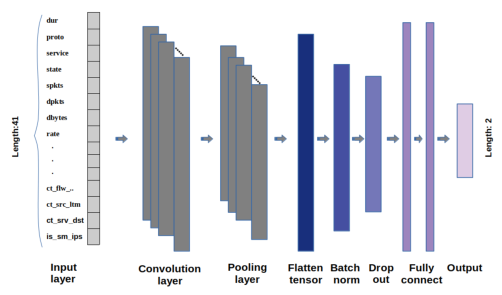

# 1D CNN Network Intrusion Detection with Normalization on Imbalanced UNSW-NB15 Data

A research prototype evaluates normalized 1D-CNN intrusion detection on balanced and imbalanced UNSW-NB15 network-traffic data. [PDF p. 1](http://localhost:3344/workspaces/ab6b13a5-514c-4849-96d2-cd4008c5c310/documents/c5708598-1321-4762-a649-84c301061134/evidence/8eff2167-12de-4208-8bdf-43cf92c8a556/asset)

## Executive Summary

This project examines whether one-dimensional convolutional neural networks (1D-CNNs), using batch normalization, can classify normal and attack traffic when the training data are imbalanced. The work is an experimental evaluation on the UNSW-NB15 benchmark, not evidence of a deployed HumbleBeeAI client system. The paper is by Azizjon Meliboev, Jumabek Alikhanov and Wooseong Kim; the provided evidence is arXiv:2003.00476v1 dated 1 March 2020, and its listing links to an IEEE conference record. [View the IEEE record](https://ieeexplore.ieee.org/abstract/document/9064976) [PDF p. 1](http://localhost:3344/workspaces/ab6b13a5-514c-4849-96d2-cd4008c5c310/documents/c5708598-1321-4762-a649-84c301061134/evidence/a3461e8f-fe8a-4d8b-80a2-216f485ac4a0/asset) [PDF p. 1](http://localhost:3344/workspaces/ab6b13a5-514c-4849-96d2-cd4008c5c310/documents/c5708598-1321-4762-a649-84c301061134/evidence/8eff2167-12de-4208-8bdf-43cf92c8a556/asset)

The experiments compare 1D-CNN variants and a CNN–LSTM combination with Random Forest (RF) and Support Vector Machine (SVM) classifiers. They consider balanced and imbalanced data; the paper reports benchmark metrics, not measured operational or business outcomes. [PDF p. 1](http://localhost:3344/workspaces/ab6b13a5-514c-4849-96d2-cd4008c5c310/documents/c5708598-1321-4762-a649-84c301061134/evidence/6ea83cd5-bfe9-47fb-b5a5-cbed05d1de56/asset)

## Context and Challenge

Intrusion detection teams need to identify malicious activity among normal network records. Signature-based approaches can miss previously unknown behavior, while anomaly-based detection looks for deviations from normal traffic. The study frames flexible detection as a challenge and tests supervised learning on labeled traffic rather than describing a prior customer workflow or production deployment. [PDF p. 1](http://localhost:3344/workspaces/ab6b13a5-514c-4849-96d2-cd4008c5c310/documents/c5708598-1321-4762-a649-84c301061134/evidence/6ea83cd5-bfe9-47fb-b5a5-cbed05d1de56/asset)

The core experimental constraint is class imbalance: the authors state that attack and normal records occur in unequal amounts. Their evaluation uses UNSW-NB15, with records labeled as normal or attack, and reports results separately for imbalanced and balanced data. This benchmark setup does not establish how a model would perform on a particular organization's live traffic. [PDF p. 3](http://localhost:3344/workspaces/ab6b13a5-514c-4849-96d2-cd4008c5c310/documents/c5708598-1321-4762-a649-84c301061134/evidence/6fc812f4-764c-436f-9f6b-d5910d37fa08/asset)

## Solution and Capabilities

The study builds supervised classifiers from network-traffic features and compares their performance under two class distributions. The documented work includes these capabilities:

- 1D-CNN classification: packet-derived feature vectors of shape 42 × 1 are used to classify records as normal or attack.
- Normalization and regularization: the documented best 1D-CNN model combines convolutional and max-pooling layers with batch normalization, dropout and fully connected classification layers.
- Class-balance comparison: the authors evaluate imbalanced data and data balanced using random oversampling, then compare model metrics across the settings. [PDF p. 3](http://localhost:3344/workspaces/ab6b13a5-514c-4849-96d2-cd4008c5c310/documents/c5708598-1321-4762-a649-84c301061134/evidence/6fc812f4-764c-436f-9f6b-d5910d37fa08/asset) [PDF p. 5](http://localhost:3344/workspaces/ab6b13a5-514c-4849-96d2-cd4008c5c310/documents/c5708598-1321-4762-a649-84c301061134/evidence/ef94d6de-e948-4c07-b023-09651605f4af/asset)
- Model benchmarking: the experiments include 1D-CNN variants, a CNN–LSTM combination, RF and SVM. Each experiment is described as running up to 200 epochs with a learning rate of 0.0001. [PDF p. 1](http://localhost:3344/workspaces/ab6b13a5-514c-4849-96d2-cd4008c5c310/documents/c5708598-1321-4762-a649-84c301061134/evidence/8eff2167-12de-4208-8bdf-43cf92c8a556/asset)

The figure illustrates the model pipeline. The paper also describes using high-level header-based packet data and states that the approach does not rely on IP addresses or payload data. [PDF p. 6](http://localhost:3344/workspaces/ab6b13a5-514c-4849-96d2-cd4008c5c310/documents/c5708598-1321-4762-a649-84c301061134/evidence/b3f8bd15-5a3e-4211-a87e-05209a422add/asset)

## Results and Business Impact

Reported findings are benchmark results on UNSW-NB15, not measured business impact. The table below gives the study's reported scores; the exact comparison matters because the leading model changes with the data balance and metric. [PDF p. 6](http://localhost:3344/workspaces/ab6b13a5-514c-4849-96d2-cd4008c5c310/documents/c5708598-1321-4762-a649-84c301061134/evidence/cea1ec58-e1a8-4ddb-9539-2c13cf790023/asset)

- Imbalanced data: the 3-layer 1D-CNN reports 85.86% accuracy, 80.33% precision, 98.42% recall and 88.46% F-score. RF reports 87.82% accuracy, 89.56% precision, 87.39% recall and 87.27% F-score; SVM reports 68.04%, 90.11%, 47.13% and 61.89%, respectively. Thus, the 3-layer CNN has higher recall and F-score than RF in this table, but lower accuracy and precision.
- Balanced data: the 3-layer 1D-CNN reports 91.2% accuracy, 87.53% precision, 96.17% recall and 91.59% F-score. In the same table, RF reports 87.39%, 88.88%, 87.39% and 87.27%; SVM reports 61.69%, 62.15%, 59.82% and 60.96%, respectively.
- The paper reports that the best balanced-data 1D-CNN identifies 96% of attack records correctly and identifies 86% of normal records correctly; it also reports corresponding misses and false detections. These are benchmark observations, not evidence of an alerting system's field performance. [PDF p. 6](http://localhost:3344/workspaces/ab6b13a5-514c-4849-96d2-cd4008c5c310/documents/c5708598-1321-4762-a649-84c301061134/evidence/aa4d7717-62b9-4a67-bc30-279dea54b8e6/asset)

No client-specific impact, live-traffic evaluation, operational deployment outcome or business metric is provided in the available evidence. The results should therefore be read as experimental model performance only.

## Limitations and Next Steps

The findings are limited to the reported UNSW-NB15 experiments and the metrics shown; they do not establish detection quality on other datasets or live networks. Performance also varies with data balancing and the choice of metric: on imbalanced data, RF has higher reported accuracy and precision than the 3-layer 1D-CNN, while the CNN has higher recall and F-score.

The source describes experimental models, not a production-ready intrusion-detection service. No deployment, integration, monitoring, latency, throughput, or customer validation details are provided. The supplied materials do not specify planned next steps, so further validation or implementation should not be treated as completed or committed work.

## Conclusion

This research provides a benchmark-based evaluation of normalized 1D-CNN approaches for binary network intrusion detection on imbalanced and balanced UNSW-NB15 data. It documents where the models perform well—and where comparisons depend on the metric—while leaving real-world operational and business impact unmeasured. [PDF p. 1](http://localhost:3344/workspaces/ab6b13a5-514c-4849-96d2-cd4008c5c310/documents/c5708598-1321-4762-a649-84c301061134/evidence/8eff2167-12de-4208-8bdf-43cf92c8a556/asset)

