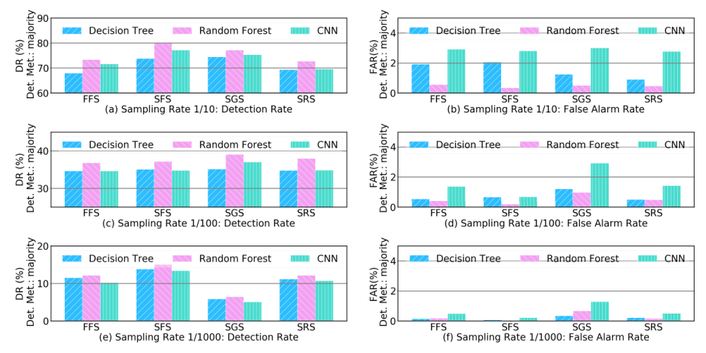

# Evaluating Traffic Sampling Effects on ML-Based Network Intrusion Detection

Evaluating How Traffic Sampling Shapes Machine-Learning Network Intrusion Detection

## Executive Summary

This research examines a practical question for network security teams and researchers: when flow records are built from sampled packets rather than complete traffic, how do sampling choices affect machine-learning network intrusion detection rates and false alarms? The study evaluates sampling methods and classifiers and finds that some short malicious flows can become invisible, while Random Forest paired with SketchFlow provides a favorable detection-rate and false-alarm-rate combination in the tested settings. This is a published research study, not evidence of a deployed HumbleBeeAI client system or measured client business outcomes. [PDF p. 1](http://localhost:3344/workspaces/ab6b13a5-514c-4849-96d2-cd4008c5c310/documents/2bd2034f-7a1b-4b82-8985-e22e6e0a92c6/evidence/487d5639-2d3d-439a-8504-9a892ab21a03/asset)

The paper, “Investigating the Effect of Traffic Sampling on Machine Learning-Based Network Intrusion Detection Approaches,” is by Jumabek Alikhanov, Rhongho Jang, Mohammed Abuhamad, David Mohaisen, Daehun Nyang and Youngtae Noh. It was published online on 23 December 2021 and appeared in IEEE Access, volume 10, in 2022. [View the publication](https://ieeexplore.ieee.org/abstract/document/9661375). [PDF p. 1](http://localhost:3344/workspaces/ab6b13a5-514c-4849-96d2-cd4008c5c310/documents/2bd2034f-7a1b-4b82-8985-e22e6e0a92c6/evidence/cc580c78-a44a-4d55-b7e4-bd8be9c1b412/asset)

## Context and Challenge

Flow-based intrusion detection relies on records containing traffic characteristics to classify connections as normal or malicious. In practice, devices that measure and export flow information may sample packets to reduce the bandwidth, memory and processing burden of monitoring high-volume traffic. That means a flow record may be computed from only part of a flow, although many machine-learning detection approaches are evaluated as if their input represents full traffic. [PDF p. 1](http://localhost:3344/workspaces/ab6b13a5-514c-4849-96d2-cd4008c5c310/documents/2bd2034f-7a1b-4b82-8985-e22e6e0a92c6/evidence/c82103c2-5b46-4f22-bef8-a80b832055a4/asset) [PDF p. 2](http://localhost:3344/workspaces/ab6b13a5-514c-4849-96d2-cd4008c5c310/documents/2bd2034f-7a1b-4b82-8985-e22e6e0a92c6/evidence/46004ecf-b618-49d9-9a2c-adcaa6730f7e/asset)

The challenge is consequential for network practitioners: when too few packets from a malicious connection are observed, that flow may not be exported or available for analysis at all. In the study’s experiments, short malicious flows were particularly vulnerable, including under sampling rates of 1/10 and 1/100. The research therefore addresses both detection quality among available records and whether malicious flows remain visible to the detector. [PDF p. 1](http://localhost:3344/workspaces/ab6b13a5-514c-4849-96d2-cd4008c5c310/documents/2bd2034f-7a1b-4b82-8985-e22e6e0a92c6/evidence/487d5639-2d3d-439a-8504-9a892ab21a03/asset)

## Solution and Capabilities

The authors developed a flow-level evaluation procedure intended to assess machine-learning NIDS consistently even when sampling and flow-export settings change. They applied it to packet traces from CIC-IDS-2018 and compared sampling methods and classifiers on sampled flow records rather than assuming complete packet visibility. [PDF p. 2](http://localhost:3344/workspaces/ab6b13a5-514c-4849-96d2-cd4008c5c310/documents/2bd2034f-7a1b-4b82-8985-e22e6e0a92c6/evidence/8c5b583f-7537-42de-81d5-0d32f1b2c640/asset)

- Sampling comparison: four approaches—Simple Random Sampling (SRS), Fast Filtered Sampling (FFS), SketchFlow Sampling (SFS) and Sketch-Guided Sampling (SGS)—were assessed at rates 1/10, 1/100 and 1/1000. [PDF p. 1](http://localhost:3344/workspaces/ab6b13a5-514c-4849-96d2-cd4008c5c310/documents/2bd2034f-7a1b-4b82-8985-e22e6e0a92c6/evidence/487d5639-2d3d-439a-8504-9a892ab21a03/asset)
- Classifier comparison: Decision Tree, Random Forest and a convolutional neural network (CNN) were tested to examine detection rate and false alarm rate across sampler and sampling-rate combinations. [PDF p. 1](http://localhost:3344/workspaces/ab6b13a5-514c-4849-96d2-cd4008c5c310/documents/2bd2034f-7a1b-4b82-8985-e22e6e0a92c6/evidence/487d5639-2d3d-439a-8504-9a892ab21a03/asset)
- Flow-level assessment: evaluating at the connection/flow level provides a way to account for malicious flows that sampling prevents from being exported, rather than scoring only records that survive sampling. [PDF p. 2](http://localhost:3344/workspaces/ab6b13a5-514c-4849-96d2-cd4008c5c310/documents/2bd2034f-7a1b-4b82-8985-e22e6e0a92c6/evidence/8c5b583f-7537-42de-81d5-0d32f1b2c640/asset)

## Results and Business Impact

The results are benchmark findings from the study’s evaluated dataset and settings. They indicate how sampling affected flow visibility and classifier performance; the paper does not report a client deployment or measured business impact. [PDF p. 1](http://localhost:3344/workspaces/ab6b13a5-514c-4849-96d2-cd4008c5c310/documents/2bd2034f-7a1b-4b82-8985-e22e6e0a92c6/evidence/487d5639-2d3d-439a-8504-9a892ab21a03/asset)

- Short malicious flows could go unnoticed even at sampling rates 1/10 and 1/100; the paper also reports that 50% of malicious flows were not exported at 1/10 sampling in its sampling experiments. [PDF p. 1](http://localhost:3344/workspaces/ab6b13a5-514c-4849-96d2-cd4008c5c310/documents/2bd2034f-7a1b-4b82-8985-e22e6e0a92c6/evidence/487d5639-2d3d-439a-8504-9a892ab21a03/asset)
- Across multiple sampling rates, SketchFlow generally produced higher detection rates and lower false-alarm rates than the other evaluated sampling approaches. Random Forest paired with SketchFlow was identified as the strongest sampler-classifier combination in the evaluated settings. [PDF p. 1](http://localhost:3344/workspaces/ab6b13a5-514c-4849-96d2-cd4008c5c310/documents/2bd2034f-7a1b-4b82-8985-e22e6e0a92c6/evidence/487d5639-2d3d-439a-8504-9a892ab21a03/asset)
- The authors report flow-visibility losses of 20%, 50% and 80% at sampling rates 1/10, 1/100 and 1/1000, respectively. These are study measurements of visibility, not business-impact or operational performance metrics. [PDF p. 2](http://localhost:3344/workspaces/ab6b13a5-514c-4849-96d2-cd4008c5c310/documents/2bd2034f-7a1b-4b82-8985-e22e6e0a92c6/evidence/8c5b583f-7537-42de-81d5-0d32f1b2c640/asset)

No client-specific outcomes, production detection improvement, cost savings or operational impact have been provided or measured.

## Limitations and Next Steps

These findings should not be treated as a universal recommendation for every network. The comparison covers four samplers, three classifiers and sampling rates of 1/10, 1/100 and 1/1000, using the study’s experimental data and evaluation procedure. Performance may differ under other traffic patterns, network equipment, attack mixes or deployment constraints. [PDF p. 1](http://localhost:3344/workspaces/ab6b13a5-514c-4849-96d2-cd4008c5c310/documents/2bd2034f-7a1b-4b82-8985-e22e6e0a92c6/evidence/487d5639-2d3d-439a-8504-9a892ab21a03/asset) [PDF p. 2](http://localhost:3344/workspaces/ab6b13a5-514c-4849-96d2-cd4008c5c310/documents/2bd2034f-7a1b-4b82-8985-e22e6e0a92c6/evidence/8c5b583f-7537-42de-81d5-0d32f1b2c640/asset)

The supplied material establishes the work as published research and provides no client implementation, pilot, production status or project-specific next-step plan. Applying these results in another environment would require local evaluation; no such follow-on work is reported here.

## Conclusion

This published study makes the sampling trade-off visible for machine-learning intrusion detection: sampling reduces monitoring demands but can also hide malicious flows and alter detection and false-alarm behavior. Its flow-level evaluation and comparative findings offer researchers and network practitioners evidence to consider when testing NIDS under sampled traffic, while remaining bounded by the conditions evaluated in the paper. [PDF p. 1](http://localhost:3344/workspaces/ab6b13a5-514c-4849-96d2-cd4008c5c310/documents/2bd2034f-7a1b-4b82-8985-e22e6e0a92c6/evidence/487d5639-2d3d-439a-8504-9a892ab21a03/asset) [PDF p. 2](http://localhost:3344/workspaces/ab6b13a5-514c-4849-96d2-cd4008c5c310/documents/2bd2034f-7a1b-4b82-8985-e22e6e0a92c6/evidence/8c5b583f-7537-42de-81d5-0d32f1b2c640/asset)

