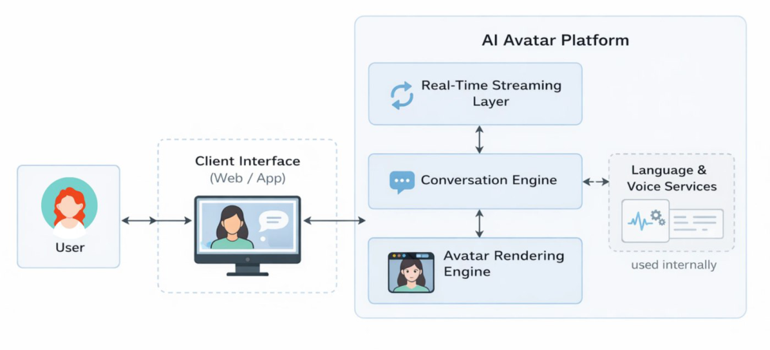

# AI Avatar: Real-Time Photorealistic Conversational Experiences

HumbleBeeAI’s AI Avatar is a real-time conversational avatar platform designed to give organizations a lifelike, interactive way to communicate with audiences. [PDF p. 1](http://localhost:3344/workspaces/ab6b13a5-514c-4849-96d2-cd4008c5c310/documents/8fabe22b-34e8-4d87-b0c5-d3a96a934b4c/evidence/c7c448e7-a21a-4f46-be35-8c9fc571b7e5/asset)

## Executive Summary

HumbleBeeAI describes AI Avatar as a platform for organizations that need to deliver information, assistance, or learning through a more human-centered digital interaction. It addresses two limitations in digital engagement: conventional video production can be slow and difficult to scale, while text chat interfaces lack visual presence. The platform is described as supporting real-time, two-way avatar conversations and use cases spanning education, customer service, marketing, and internal communications. [PDF p. 2](http://localhost:3344/workspaces/ab6b13a5-514c-4849-96d2-cd4008c5c310/documents/8fabe22b-34e8-4d87-b0c5-d3a96a934b4c/evidence/4cd15b96-0460-44e6-bc76-59ec30ec15cd/asset) [PDF p. 1](http://localhost:3344/workspaces/ab6b13a5-514c-4849-96d2-cd4008c5c310/documents/8fabe22b-34e8-4d87-b0c5-d3a96a934b4c/evidence/c7c448e7-a21a-4f46-be35-8c9fc571b7e5/asset)

The project document also refers to personalized lessons and real-time feedback for language learning. It links to an online demo, but does not specify deployment status, customer adoption, or whether all described capabilities are available in production. [PDF p. 1](http://localhost:3344/workspaces/ab6b13a5-514c-4849-96d2-cd4008c5c310/documents/8fabe22b-34e8-4d87-b0c5-d3a96a934b4c/evidence/2c39a053-ed55-4be6-8497-0c864c5b038a/asset) Demo: [https://avatar.humblebee.ai/](https://avatar.humblebee.ai/) [PDF p. 4](http://localhost:3344/workspaces/ab6b13a5-514c-4849-96d2-cd4008c5c310/documents/8fabe22b-34e8-4d87-b0c5-d3a96a934b4c/evidence/275d1bac-72c5-4fcf-9a7d-ca5d03eb77a7/asset)

## Context and Challenge

Organizations seeking more personal digital interactions face a trade-off between rich but resource-intensive video and scalable but less expressive text-based interfaces. Traditional video workflows are described as slow, expensive, and difficult to scale; scripted or static experiences also cannot provide the dynamic exchange the project aims to support. The affected audiences include customers, learners, and other users engaging with an organization’s digital services. [PDF p. 2](http://localhost:3344/workspaces/ab6b13a5-514c-4849-96d2-cd4008c5c310/documents/8fabe22b-34e8-4d87-b0c5-d3a96a934b4c/evidence/4cd15b96-0460-44e6-bc76-59ec30ec15cd/asset)

The source identifies studios, actors, and complex production workflows as barriers to creating video experiences. It does not provide a specific client, baseline workflow, user-volume profile, or operational constraints for an individual deployment. [PDF p. 1](http://localhost:3344/workspaces/ab6b13a5-514c-4849-96d2-cd4008c5c310/documents/8fabe22b-34e8-4d87-b0c5-d3a96a934b4c/evidence/c7c448e7-a21a-4f46-be35-8c9fc571b7e5/asset)

## Solution and Capabilities

AI Avatar combines a browser-facing interaction with conversational processing and avatar presentation. The source describes a streaming-first architecture in which users communicate by voice or text, with the system handling input in real time rather than relying solely on delayed, request-based interactions. [PDF p. 3](http://localhost:3344/workspaces/ab6b13a5-514c-4849-96d2-cd4008c5c310/documents/8fabe22b-34e8-4d87-b0c5-d3a96a934b4c/evidence/61145bce-a11b-4d84-90cc-dec33a29c910/asset)

### Real-time conversational interaction

- The avatar is described as listening, responding, and speaking in two-way conversations, rather than presenting only static playback or delayed responses. [PDF p. 2](http://localhost:3344/workspaces/ab6b13a5-514c-4849-96d2-cd4008c5c310/documents/8fabe22b-34e8-4d87-b0c5-d3a96a934b4c/evidence/6f5c8b87-da43-4b4f-918d-794884c36321/asset)
- Voice and text input are supported through a browser-based interface, according to the architecture description. [PDF p. 3](http://localhost:3344/workspaces/ab6b13a5-514c-4849-96d2-cd4008c5c310/documents/8fabe22b-34e8-4d87-b0c5-d3a96a934b4c/evidence/61145bce-a11b-4d84-90cc-dec33a29c910/asset)

### Lifelike visual presence

The platform is presented as a realistic talking-head avatar with expressive facial movement. Its visual-quality description emphasizes stable facial structure, natural motion, and speech-aligned mouth movement intended to keep what users see consistent with what they hear. [PDF p. 2](http://localhost:3344/workspaces/ab6b13a5-514c-4849-96d2-cd4008c5c310/documents/8fabe22b-34e8-4d87-b0c5-d3a96a934b4c/evidence/6f5c8b87-da43-4b4f-918d-794884c36321/asset) [PDF p. 4](http://localhost:3344/workspaces/ab6b13a5-514c-4849-96d2-cd4008c5c310/documents/8fabe22b-34e8-4d87-b0c5-d3a96a934b4c/evidence/179a8e6c-b919-49f1-86bb-9c68c9f915c6/asset) [PDF p. 4](http://localhost:3344/workspaces/ab6b13a5-514c-4849-96d2-cd4008c5c310/documents/8fabe22b-34e8-4d87-b0c5-d3a96a934b4c/evidence/fbdcacb3-20f9-4f2e-a597-354336c33031/asset)

### On-demand visual processing and deployment options

The architecture description says visual processing is applied selectively when the avatar is speaking, with static visual elements reused. This approach is presented as a way to reduce compute use and support concurrent sessions on shared infrastructure; the source does not quantify resource savings or concurrency capacity. [PDF p. 3](http://localhost:3344/workspaces/ab6b13a5-514c-4849-96d2-cd4008c5c310/documents/8fabe22b-34e8-4d87-b0c5-d3a96a934b4c/evidence/443f0b4d-5f45-4f93-82d9-036d72edaad0/asset)

The document lists web applications, kiosks, learning platforms, customer portals, and social content as deployment contexts, with live and pre-configured interactions. These are described as supported use contexts, not as confirmed deployments for a named customer. [PDF p. 2](http://localhost:3344/workspaces/ab6b13a5-514c-4849-96d2-cd4008c5c310/documents/8fabe22b-34e8-4d87-b0c5-d3a96a934b4c/evidence/3b0f556a-3f4a-4f7b-a7dc-66289f2a9e50/asset)

## Results and Business Impact

The project document reports technical performance and visual-quality figures, but does not provide the test conditions, measurement methodology, independent validation, or customer-level business-impact data needed to assess broader outcomes. [PDF p. 3](http://localhost:3344/workspaces/ab6b13a5-514c-4849-96d2-cd4008c5c310/documents/8fabe22b-34e8-4d87-b0c5-d3a96a934b4c/evidence/338307bd-dd14-4735-a0f1-702b15ad4ddb/asset) [PDF p. 4](http://localhost:3344/workspaces/ab6b13a5-514c-4849-96d2-cd4008c5c310/documents/8fabe22b-34e8-4d87-b0c5-d3a96a934b4c/evidence/92c1b16e-9821-4bd7-a893-88cb47a03ced/asset) [PDF p. 4](http://localhost:3344/workspaces/ab6b13a5-514c-4849-96d2-cd4008c5c310/documents/8fabe22b-34e8-4d87-b0c5-d3a96a934b4c/evidence/1e02e88a-43b6-4a59-9109-eef452a6413d/asset)

- End-to-end latency: consistent sub-1.5 second latency, as reported in the project document. The document attributes 3–4% of total pipeline latency to avatar generation and 32–44% to the LLM component. [PDF p. 3](http://localhost:3344/workspaces/ab6b13a5-514c-4849-96d2-cd4008c5c310/documents/8fabe22b-34e8-4d87-b0c5-d3a96a934b4c/evidence/338307bd-dd14-4735-a0f1-702b15ad4ddb/asset)
- Avatar quality measures reported: PSNR 38.32 and MS-SSIM 0.9821. The source also says facial-tracking metrics (LMD, AUE) and an audio-visual synchronization metric (LSE-C) were used, but does not report their numerical values in the supplied text.

These are technical measurements, not demonstrated business outcomes. Although the PDF asserts faster content creation, lower production costs, higher engagement, operational scalability, and client confidence, it provides no quantified results, comparative study, or named client evidence for those claims. Business impact has therefore not been independently established from the supplied material. [PDF p. 4](http://localhost:3344/workspaces/ab6b13a5-514c-4849-96d2-cd4008c5c310/documents/8fabe22b-34e8-4d87-b0c5-d3a96a934b4c/evidence/1e02e88a-43b6-4a59-9109-eef452a6413d/asset)

## Limitations and Next Steps

The supplied material describes the platform and links to a demo, but does not identify which features are generally available, which are pilot-only, or what has been deployed for a customer. It also does not provide security, privacy, accessibility, uptime, concurrency, or supported-language details. These should be confirmed before relying on the platform in a particular production setting. [PDF p. 4](http://localhost:3344/workspaces/ab6b13a5-514c-4849-96d2-cd4008c5c310/documents/8fabe22b-34e8-4d87-b0c5-d3a96a934b4c/evidence/275d1bac-72c5-4fcf-9a7d-ca5d03eb77a7/asset) [PDF p. 2](http://localhost:3344/workspaces/ab6b13a5-514c-4849-96d2-cd4008c5c310/documents/8fabe22b-34e8-4d87-b0c5-d3a96a934b4c/evidence/3b0f556a-3f4a-4f7b-a7dc-66289f2a9e50/asset)

The source does not provide a roadmap or named next steps. Further deployment plans and measured business outcomes have not been supplied.

## Conclusion

AI Avatar is presented as a way to combine conversational interaction with a lifelike visual presence in digital experiences. The source documents a streaming-based architecture and reports technical latency and avatar-quality metrics, while production status and business results remain unspecified or unmeasured in the supplied material. [PDF p. 3](http://localhost:3344/workspaces/ab6b13a5-514c-4849-96d2-cd4008c5c310/documents/8fabe22b-34e8-4d87-b0c5-d3a96a934b4c/evidence/61145bce-a11b-4d84-90cc-dec33a29c910/asset) [PDF p. 3](http://localhost:3344/workspaces/ab6b13a5-514c-4849-96d2-cd4008c5c310/documents/8fabe22b-34e8-4d87-b0c5-d3a96a934b4c/evidence/338307bd-dd14-4735-a0f1-702b15ad4ddb/asset)

Original project page and demo: [https://avatar.humblebee.ai/](https://avatar.humblebee.ai/) [PDF p. 4](http://localhost:3344/workspaces/ab6b13a5-514c-4849-96d2-cd4008c5c310/documents/8fabe22b-34e8-4d87-b0c5-d3a96a934b4c/evidence/275d1bac-72c5-4fcf-9a7d-ca5d03eb77a7/asset)

