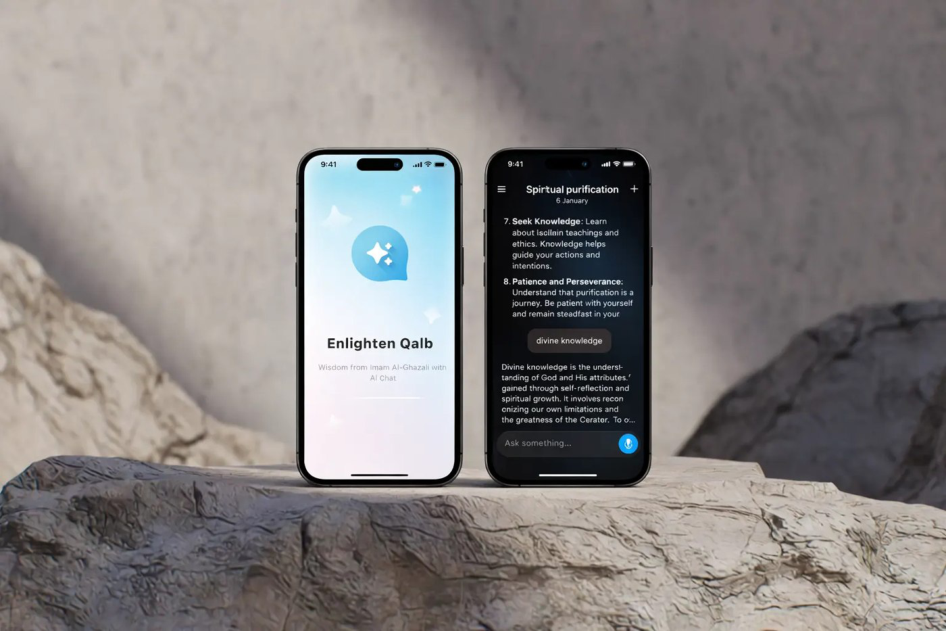

# Enlighten Qalb: A Memory-Based AI Companion for Spiritual Growth

Enlighten Qalb is a memory-enabled AI spiritual companion designed to provide people seeking faith-aligned reflection with personalized guidance grounded in curated spiritual sources. [PDF p. 2](http://localhost:3344/workspaces/ab6b13a5-514c-4849-96d2-cd4008c5c310/documents/14127b64-26ef-4d63-9e59-8d4642da28c3/evidence/7615dc48-baea-49b7-9955-d9553cf76261/asset)

## Executive Summary

Enlighten Qalb serves people seeking spiritual reflection and personal growth. Its purpose is to address the limitations of generic, one-off chatbot interactions by carrying context across conversations and offering personalized guidance rooted in spiritual material. The project is described as an in-use product in the supplied project material, and the brief identifies it as production-ready. [PDF p. 2](http://localhost:3344/workspaces/ab6b13a5-514c-4849-96d2-cd4008c5c310/documents/14127b64-26ef-4d63-9e59-8d4642da28c3/evidence/7615dc48-baea-49b7-9955-d9553cf76261/asset) [PDF p. 3](http://localhost:3344/workspaces/ab6b13a5-514c-4849-96d2-cd4008c5c310/documents/14127b64-26ef-4d63-9e59-8d4642da28c3/evidence/7c9f3beb-7e58-41dc-b0cd-a38061d2eb99/asset)

The product combines curated spiritual sources, personal memory, and grounded AI responses. The supplied overview also describes two guidance modes, multilingual support, and emotional progress analytics as a foundation for future development; it does not establish that those analytics are currently available. [PDF p. 2](http://localhost:3344/workspaces/ab6b13a5-514c-4849-96d2-cd4008c5c310/documents/14127b64-26ef-4d63-9e59-8d4642da28c3/evidence/7615dc48-baea-49b7-9955-d9553cf76261/asset)

Project details are presented on HumbleBeeAI’s public project page: [https://humblebee.ai/projects/enlighten-qalb](https://humblebee.ai/projects/enlighten-qalb).

## Context and Challenge

The project addresses a continuity problem in digital wellness and assistant experiences: conversations can start from zero each time, requiring users to repeat their reflections, struggles, and goals. This can make it difficult to build sustained, context-aware support. [PDF p. 3](http://localhost:3344/workspaces/ab6b13a5-514c-4849-96d2-cd4008c5c310/documents/14127b64-26ef-4d63-9e59-8d4642da28c3/evidence/b6915366-1dbd-460b-aa1e-359892fc7f35/asset)

The intended users are people who want spiritual guidance that reflects their beliefs, cultural context, and preferred learning style. The source material also identifies privacy as a constraint because emotional reflections are personal, and users may be uncomfortable storing them in systems they perceive as opaque or not privacy-first. [PDF p. 3](http://localhost:3344/workspaces/ab6b13a5-514c-4849-96d2-cd4008c5c310/documents/14127b64-26ef-4d63-9e59-8d4642da28c3/evidence/48bdd4ea-38e0-4043-8816-37c4e2810882/asset) [PDF p. 3](http://localhost:3344/workspaces/ab6b13a5-514c-4849-96d2-cd4008c5c310/documents/14127b64-26ef-4d63-9e59-8d4642da28c3/evidence/f4dc8cdf-a27b-473f-92b2-33920b705adf/asset)

## Solution and Capabilities

Enlighten Qalb is presented as a companion for ongoing reflection rather than a general-purpose question-and-answer tool. Its described capabilities connect memory and curated knowledge to the practical need for continuity and faith-aligned responses. [PDF p. 4](http://localhost:3344/workspaces/ab6b13a5-514c-4849-96d2-cd4008c5c310/documents/14127b64-26ef-4d63-9e59-8d4642da28c3/evidence/0b64d9f0-0e50-4a84-9121-9f1d8e8d70f2/asset) [PDF p. 3](http://localhost:3344/workspaces/ab6b13a5-514c-4849-96d2-cd4008c5c310/documents/14127b64-26ef-4d63-9e59-8d4642da28c3/evidence/7c9f3beb-7e58-41dc-b0cd-a38061d2eb99/asset)

- Personalized memory and adaptation: the system is described as retaining preferences, past reflections, emotional themes, goals, struggles, and communication style so it can build on previous conversations and adapt explanations to user preferences. [PDF p. 6](http://localhost:3344/workspaces/ab6b13a5-514c-4849-96d2-cd4008c5c310/documents/14127b64-26ef-4d63-9e59-8d4642da28c3/evidence/df666180-0cb7-4826-9b37-fa8badd312df/asset)
- Curated spiritual knowledge: the project material says the assistant draws on structured, searchable classical sources, starting with The Alchemy of Happiness, and retrieves relevant passages to ground its answers. The stated source scope is not evidence of a guarantee that responses will never be incorrect. [PDF p. 1](http://localhost:3344/workspaces/ab6b13a5-514c-4849-96d2-cd4008c5c310/documents/14127b64-26ef-4d63-9e59-8d4642da28c3/evidence/5b8b2331-3366-482d-821d-117a7e841f3b/asset) [PDF p. 1](http://localhost:3344/workspaces/ab6b13a5-514c-4849-96d2-cd4008c5c310/documents/14127b64-26ef-4d63-9e59-8d4642da28c3/evidence/37336d44-f180-4ad9-aa1c-062172198b57/asset)
- Privacy-oriented design: the source describes secure conversation storage, a local-first approach where possible, controlled cloud synchronization, and a policy against selling user data. These are descriptions in the project material; no independent privacy audit or technical specification was supplied. [PDF p. 7](http://localhost:3344/workspaces/ab6b13a5-514c-4849-96d2-cd4008c5c310/documents/14127b64-26ef-4d63-9e59-8d4642da28c3/evidence/66fdefd3-2d47-4f3f-af8c-57b9ea44f452/asset)
- Guidance experience: the overview describes Ustath and Enthusiast modes and multilingual support. A supplied product image shows the mobile interface and spiritual-reflection content. [PDF p. 2](http://localhost:3344/workspaces/ab6b13a5-514c-4849-96d2-cd4008c5c310/documents/14127b64-26ef-4d63-9e59-8d4642da28c3/evidence/7615dc48-baea-49b7-9955-d9553cf76261/asset)

## Results and Business Impact

The supplied sources describe product capabilities and intended value, but provide no measured client business outcomes, usage metrics, or evaluation results. Claims about reducing stress or strengthening patience and trust are presented as intended benefits, not reported or measured impact. [PDF p. 7](http://localhost:3344/workspaces/ab6b13a5-514c-4849-96d2-cd4008c5c310/documents/14127b64-26ef-4d63-9e59-8d4642da28c3/evidence/b1a0b286-6455-4ff5-89ba-c94192dd07e9/asset)

- Reported product status: the project overview calls Enlighten Qalb an in-use product; the brief labels it production-ready. No deployment scope, user counts, or operational metrics are provided. [PDF p. 2](http://localhost:3344/workspaces/ab6b13a5-514c-4849-96d2-cd4008c5c310/documents/14127b64-26ef-4d63-9e59-8d4642da28c3/evidence/7615dc48-baea-49b7-9955-d9553cf76261/asset)
- Reported functionality: the source material describes memory-based continuity and personalized, curated-source guidance. It does not provide an outcome study establishing how these features affect users or business performance. [PDF p. 6](http://localhost:3344/workspaces/ab6b13a5-514c-4849-96d2-cd4008c5c310/documents/14127b64-26ef-4d63-9e59-8d4642da28c3/evidence/df666180-0cb7-4826-9b37-fa8badd312df/asset) [PDF p. 1](http://localhost:3344/workspaces/ab6b13a5-514c-4849-96d2-cd4008c5c310/documents/14127b64-26ef-4d63-9e59-8d4642da28c3/evidence/5b8b2331-3366-482d-821d-117a7e841f3b/asset)
- Research evidence: no research paper, named research authors, publication status, or benchmark findings were supplied. Accordingly, no research benchmark can be reported as client business impact.

## Limitations and Next Steps

The source material identifies monthly emotional summaries, mood and stress trends, reflection-consistency tracking, and growth indicators as a future feature. These analytics are marked as coming soon, not as delivered functionality. [PDF p. 7](http://localhost:3344/workspaces/ab6b13a5-514c-4849-96d2-cd4008c5c310/documents/14127b64-26ef-4d63-9e59-8d4642da28c3/evidence/d54b015a-2218-4a56-9bc1-5b37a23b698a/asset)

The project vision also mentions expanding the curated library beyond The Alchemy of Happiness. The material does not specify a delivery date or confirm that additional texts have been added. [PDF p. 3](http://localhost:3344/workspaces/ab6b13a5-514c-4849-96d2-cd4008c5c310/documents/14127b64-26ef-4d63-9e59-8d4642da28c3/evidence/4fa722d8-224f-49f3-bb17-0b7af8583c89/asset)

The supplied sources do not provide technical validation of the memory or privacy controls, measured product outcomes, or details about how future analytics will be implemented. These remain areas where further product evidence and evaluation would be needed.

## Conclusion

Enlighten Qalb is described as an in-use, production-ready AI companion that aims to make spiritual reflection more continuous and personalized through retained context and curated faith-aligned material. The documented product capabilities support that purpose; business impact has not been measured in the supplied sources. [PDF p. 2](http://localhost:3344/workspaces/ab6b13a5-514c-4849-96d2-cd4008c5c310/documents/14127b64-26ef-4d63-9e59-8d4642da28c3/evidence/7615dc48-baea-49b7-9955-d9553cf76261/asset) [PDF p. 3](http://localhost:3344/workspaces/ab6b13a5-514c-4849-96d2-cd4008c5c310/documents/14127b64-26ef-4d63-9e59-8d4642da28c3/evidence/7c9f3beb-7e58-41dc-b0cd-a38061d2eb99/asset)

