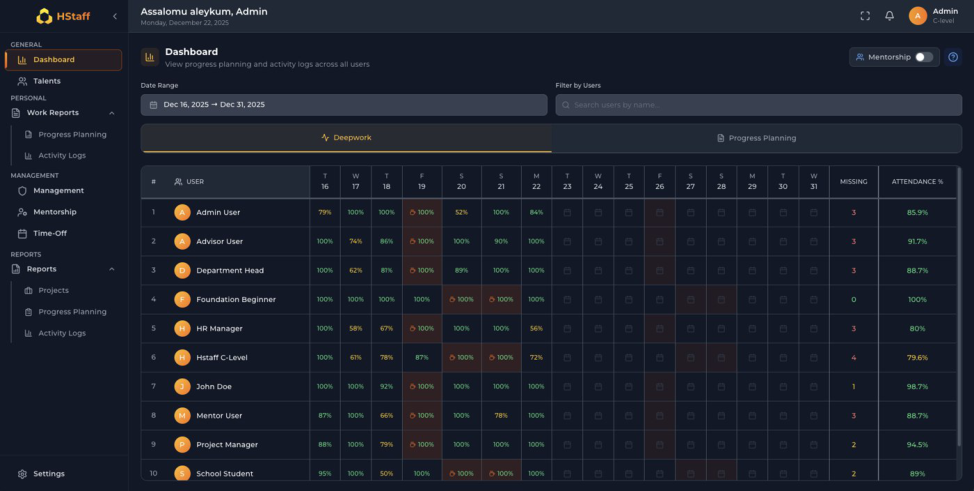

# HStaff Workforce Analytics Platform for Distributed Team Management

HStaff brings distributed-team activity and progress reporting into a shared analytics dashboard for team leaders. [PDF p. 1](http://localhost:3344/workspaces/ab6b13a5-514c-4849-96d2-cd4008c5c310/documents/f12aaa4e-b999-4f34-9be8-63afa9a86d7e/evidence/bb22044f-3165-4a84-84a9-ce79b66bf59e/asset)

## Executive Summary

HStaff is a workforce analytics platform for leaders managing distributed teams. It brings together Hubstaff activity data, Discord progress reports and team analytics in a dashboard designed to help managers understand team activity and performance. [PDF p. 1](http://localhost:3344/workspaces/ab6b13a5-514c-4849-96d2-cd4008c5c310/documents/f12aaa4e-b999-4f34-9be8-63afa9a86d7e/evidence/1a14a763-06bd-4751-939f-16dcbae22e1d/asset) [PDF p. 1](http://localhost:3344/workspaces/ab6b13a5-514c-4849-96d2-cd4008c5c310/documents/f12aaa4e-b999-4f34-9be8-63afa9a86d7e/evidence/bb22044f-3165-4a84-84a9-ce79b66bf59e/asset)

The project brief identifies HStaff as production-ready. The available material describes the platform and its capabilities but provides no measured client business-impact results. [PDF p. 1](http://localhost:3344/workspaces/ab6b13a5-514c-4849-96d2-cd4008c5c310/documents/f12aaa4e-b999-4f34-9be8-63afa9a86d7e/evidence/1a14a763-06bd-4751-939f-16dcbae22e1d/asset)

Original project page: https://humblebee.ai/projects/hstaff

## Context and Challenge

Distributed-team managers often need to assemble a view of work from separate systems: Hubstaff tracks time and activity, Discord hosts daily progress reports, and team relationships may sit in internal systems. The source describes this fragmentation as making it difficult to see team performance as a whole. [PDF p. 2](http://localhost:3344/workspaces/ab6b13a5-514c-4849-96d2-cd4008c5c310/documents/f12aaa4e-b999-4f34-9be8-63afa9a86d7e/evidence/efe49f50-b2ac-4bdf-aa35-5d285b6c1e34/asset) [PDF p. 2](http://localhost:3344/workspaces/ab6b13a5-514c-4849-96d2-cd4008c5c310/documents/f12aaa4e-b999-4f34-9be8-63afa9a86d7e/evidence/97b23065-e904-420c-8ae0-352178bce73b/asset)

The reported operational challenges included manual collection and calculation across platforms, limited centralized visibility into daily report submissions, and desktop-only access that made it harder to check metrics while away from a desktop. [PDF p. 2](http://localhost:3344/workspaces/ab6b13a5-514c-4849-96d2-cd4008c5c310/documents/f12aaa4e-b999-4f34-9be8-63afa9a86d7e/evidence/97b23065-e904-420c-8ae0-352178bce73b/asset)

## Solution and Capabilities

HStaff consolidates work activity and progress information into one web interface. The described capabilities include the following: [PDF p. 2](http://localhost:3344/workspaces/ab6b13a5-514c-4849-96d2-cd4008c5c310/documents/f12aaa4e-b999-4f34-9be8-63afa9a86d7e/evidence/efe49f50-b2ac-4bdf-aa35-5d285b6c1e34/asset)

- Unified team view: A dashboard presents tracked hours, deepwork percentages, recent activity and progress-planning compliance, with navigation to detailed reports. [PDF p. 2](http://localhost:3344/workspaces/ab6b13a5-514c-4849-96d2-cd4008c5c310/documents/f12aaa4e-b999-4f34-9be8-63afa9a86d7e/evidence/9610a7c5-0ce9-42ff-a574-dfebd4522a96/asset) [PDF p. 2](http://localhost:3344/workspaces/ab6b13a5-514c-4849-96d2-cd4008c5c310/documents/f12aaa4e-b999-4f34-9be8-63afa9a86d7e/evidence/d08ce581-81af-454a-82ae-e5d5dd90efce/asset)
- Synchronized activity and reports: Hubstaff activity is automatically integrated, with hourly synchronization of tracked hours and project allocations. Discord daily progress reports are synchronized, with real-time updates described when new reports are submitted. [PDF p. 3](http://localhost:3344/workspaces/ab6b13a5-514c-4849-96d2-cd4008c5c310/documents/f12aaa4e-b999-4f34-9be8-63afa9a86d7e/evidence/512e5df4-2fdc-4ba3-b65f-174e2af64b09/asset) [PDF p. 4](http://localhost:3344/workspaces/ab6b13a5-514c-4849-96d2-cd4008c5c310/documents/f12aaa4e-b999-4f34-9be8-63afa9a86d7e/evidence/2988dde4-416d-418d-ac0d-fc79ea68fb36/asset)
- Activity analysis and reporting: The platform describes automatic calculation of focused work versus routine tasks, project-based deepwork classification, and individual or project reports with date-range selection. [PDF p. 6](http://localhost:3344/workspaces/ab6b13a5-514c-4849-96d2-cd4008c5c310/documents/f12aaa4e-b999-4f34-9be8-63afa9a86d7e/evidence/276911a9-f002-4b38-b12b-00afa0468eae/asset)
- Filtering and access: One-click filters are described for finding high performers or team members needing support, and the interface is specified as responsive across desktop, tablet and mobile. [PDF p. 7](http://localhost:3344/workspaces/ab6b13a5-514c-4849-96d2-cd4008c5c310/documents/f12aaa4e-b999-4f34-9be8-63afa9a86d7e/evidence/d4f96de4-f9c5-4b93-97b9-1fa97130c0c6/asset) [PDF p. 7](http://localhost:3344/workspaces/ab6b13a5-514c-4849-96d2-cd4008c5c310/documents/f12aaa4e-b999-4f34-9be8-63afa9a86d7e/evidence/d4f96de4-f9c5-4b93-97b9-1fa97130c0c6/asset)

The supplied dashboard image illustrates the combined team view and progress-planning display. [PDF p. 2](http://localhost:3344/workspaces/ab6b13a5-514c-4849-96d2-cd4008c5c310/documents/f12aaa4e-b999-4f34-9be8-63afa9a86d7e/evidence/6660d8eb-01b6-4624-b34b-ea9ca4d0c944/asset)

## Results and Business Impact

The documented platform capabilities support consolidated visibility into activity, report submission and team metrics. The source also lists real-time team visibility, mobile access, progress tracking and clearer performance trends as user benefits. [PDF p. 7](http://localhost:3344/workspaces/ab6b13a5-514c-4849-96d2-cd4008c5c310/documents/f12aaa4e-b999-4f34-9be8-63afa9a86d7e/evidence/743cad45-cef1-4e77-a950-4f37a93922a4/asset)

No measured client business-impact results, baseline comparisons or quantified efficiency outcomes were provided. The available evidence therefore supports describing the product capabilities, not assigning a measured business result.

## Limitations and Next Steps

The project brief identifies HStaff as production-ready; the PDF also describes a responsive platform and its synchronization and analytics features. The supplied material does not specify a separate roadmap, planned enhancements, deployment scope, or performance measurements. [PDF p. 1](http://localhost:3344/workspaces/ab6b13a5-514c-4849-96d2-cd4008c5c310/documents/f12aaa4e-b999-4f34-9be8-63afa9a86d7e/evidence/1a14a763-06bd-4751-939f-16dcbae22e1d/asset)

Accordingly, no additional next steps can be stated as planned work based on the available information. The project brief's production-ready status is not, by itself, evidence of measured operational or business impact.

## Conclusion

HStaff addresses the challenge of fragmented distributed-team reporting by bringing Hubstaff activity, Discord progress reports and team analytics together in a shared dashboard. Its documented capabilities are intended to make team activity and progress easier for leaders to review; measured client business impact has not been provided. [PDF p. 1](http://localhost:3344/workspaces/ab6b13a5-514c-4849-96d2-cd4008c5c310/documents/f12aaa4e-b999-4f34-9be8-63afa9a86d7e/evidence/bb22044f-3165-4a84-84a9-ce79b66bf59e/asset) [PDF p. 2](http://localhost:3344/workspaces/ab6b13a5-514c-4849-96d2-cd4008c5c310/documents/f12aaa4e-b999-4f34-9be8-63afa9a86d7e/evidence/efe49f50-b2ac-4bdf-aa35-5d285b6c1e34/asset)

