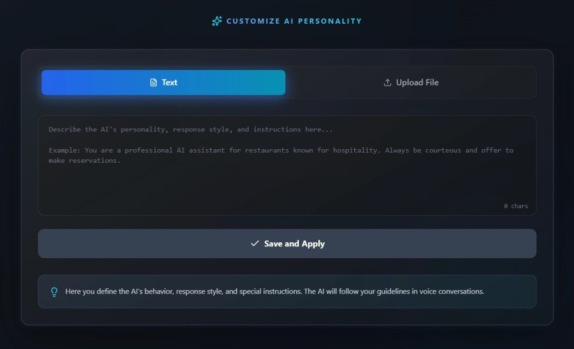
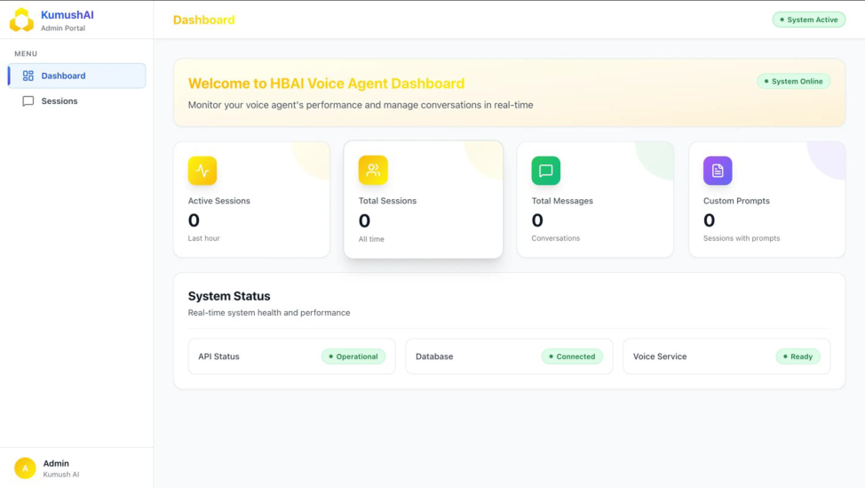

# Kumush AI: Native Uzbek Voice Automation at Scale

Kumush AI is a centralized voice automation platform designed to help organizations serve Uzbek-speaking customers through natural conversations and task-oriented support. [PDF p. 1](http://localhost:3344/workspaces/ab6b13a5-514c-4849-96d2-cd4008c5c310/documents/7e618968-e5e5-4fcc-8f48-a47ea861bfd4/evidence/c8f65be7-5ace-4d44-87c0-858f8096df0d/asset) [PDF p. 2](http://localhost:3344/workspaces/ab6b13a5-514c-4849-96d2-cd4008c5c310/documents/7e618968-e5e5-4fcc-8f48-a47ea861bfd4/evidence/c2215075-b2dd-4247-a945-ad9325376c08/asset)

## Executive Summary

Kumush AI addresses the gap between generic voice automation and the needs of Uzbek-speaking audiences. The project describes a voice-enabled natural-language platform for organizations that need customer conversations to reflect local language, dialects, phrasing and business workflows. The source describes deployments with early customers and reports results from live deployments; its status label is “prod demo,” so the precise deployment scope is not fully clarified. [PDF p. 1](http://localhost:3344/workspaces/ab6b13a5-514c-4849-96d2-cd4008c5c310/documents/7e618968-e5e5-4fcc-8f48-a47ea861bfd4/evidence/c8f65be7-5ace-4d44-87c0-858f8096df0d/asset) [PDF p. 1](http://localhost:3344/workspaces/ab6b13a5-514c-4849-96d2-cd4008c5c310/documents/7e618968-e5e5-4fcc-8f48-a47ea861bfd4/evidence/be2f4dab-b536-40d9-b058-928b5f150d1b/asset) [PDF p. 1](http://localhost:3344/workspaces/ab6b13a5-514c-4849-96d2-cd4008c5c310/documents/7e618968-e5e5-4fcc-8f48-a47ea861bfd4/evidence/6349bf02-1fcb-4d61-b838-34c64f2a8873/asset) [PDF p. 5](http://localhost:3344/workspaces/ab6b13a5-514c-4849-96d2-cd4008c5c310/documents/7e618968-e5e5-4fcc-8f48-a47ea861bfd4/evidence/f8a39c71-bc3c-4c50-a15d-bd85c918e33a/asset)

The platform is intended for organizations serving Uzbek speakers, with the source naming education, healthcare, banking, hospitality and retail among the relevant sectors. A public demo is linked from the project source. [PDF p. 1](http://localhost:3344/workspaces/ab6b13a5-514c-4849-96d2-cd4008c5c310/documents/7e618968-e5e5-4fcc-8f48-a47ea861bfd4/evidence/c8f65be7-5ace-4d44-87c0-858f8096df0d/asset) [PDF p. 5](http://localhost:3344/workspaces/ab6b13a5-514c-4849-96d2-cd4008c5c310/documents/7e618968-e5e5-4fcc-8f48-a47ea861bfd4/evidence/d99bdb6d-d737-40c2-8042-cabea29e3ed1/asset) Try the demo at [kumush.ai](https://kumush.ai/). [PDF p. 5](http://localhost:3344/workspaces/ab6b13a5-514c-4849-96d2-cd4008c5c310/documents/7e618968-e5e5-4fcc-8f48-a47ea861bfd4/evidence/d99bdb6d-d737-40c2-8042-cabea29e3ed1/asset)

## Context and Challenge

For businesses serving Uzbek-speaking customers, effective voice automation requires more than basic speech recognition or translated scripts. The source identifies regional dialects, colloquial language, culturally appropriate phrasing and locally aligned workflows as core challenges; without these, automated interactions may not understand callers or complete the task they contacted the business to perform. [PDF p. 1](http://localhost:3344/workspaces/ab6b13a5-514c-4849-96d2-cd4008c5c310/documents/7e618968-e5e5-4fcc-8f48-a47ea861bfd4/evidence/c8f65be7-5ace-4d44-87c0-858f8096df0d/asset)

The project is presented as moving beyond conversational demos toward multi-turn dialogue and outcome-driven actions, including calls, application flows, reservations and business workflows. The source does not provide a detailed account of a specific customer's previous process or quantify the operational burden before deployment. [PDF p. 1](http://localhost:3344/workspaces/ab6b13a5-514c-4849-96d2-cd4008c5c310/documents/7e618968-e5e5-4fcc-8f48-a47ea861bfd4/evidence/c8f65be7-5ace-4d44-87c0-858f8096df0d/asset) [PDF p. 1](http://localhost:3344/workspaces/ab6b13a5-514c-4849-96d2-cd4008c5c310/documents/7e618968-e5e5-4fcc-8f48-a47ea861bfd4/evidence/be2f4dab-b536-40d9-b058-928b5f150d1b/asset)

## Solution and Capabilities

Kumush AI is described as a centrally managed, multi-client voice service. Client-specific agents can be configured without separate installations or duplicated platform code. The capabilities below reflect the project source's described scope; it does not specify which features are enabled in every customer deployment. [PDF p. 4](http://localhost:3344/workspaces/ab6b13a5-514c-4849-96d2-cd4008c5c310/documents/7e618968-e5e5-4fcc-8f48-a47ea861bfd4/evidence/1b697f09-3b38-40c5-a8ab-335bfca13c5b/asset) [PDF p. 2](http://localhost:3344/workspaces/ab6b13a5-514c-4849-96d2-cd4008c5c310/documents/7e618968-e5e5-4fcc-8f48-a47ea861bfd4/evidence/c2215075-b2dd-4247-a945-ad9325376c08/asset)

### Native Uzbek conversations

- Handles standard Uzbek, major regional dialects, code-switching and colloquial speech to support more natural, culturally appropriate conversations. [PDF p. 2](http://localhost:3344/workspaces/ab6b13a5-514c-4849-96d2-cd4008c5c310/documents/7e618968-e5e5-4fcc-8f48-a47ea861bfd4/evidence/c2215075-b2dd-4247-a945-ad9325376c08/asset)
- Maintains context across turns to support branching conversations and multi-step processes without repeatedly asking for the same information. [PDF p. 3](http://localhost:3344/workspaces/ab6b13a5-514c-4849-96d2-cd4008c5c310/documents/7e618968-e5e5-4fcc-8f48-a47ea861bfd4/evidence/266c3099-624b-4aba-bfa1-c1f52934118f/asset)

### Client-specific agents and business knowledge

- Configures each client's voice persona, tone, formality, prompts and instruction set so the agent can follow the organization's brand and interaction guidance. [PDF p. 2](http://localhost:3344/workspaces/ab6b13a5-514c-4849-96d2-cd4008c5c310/documents/7e618968-e5e5-4fcc-8f48-a47ea861bfd4/evidence/c2215075-b2dd-4247-a945-ad9325376c08/asset) [PDF p. 4](http://localhost:3344/workspaces/ab6b13a5-514c-4849-96d2-cd4008c5c310/documents/7e618968-e5e5-4fcc-8f48-a47ea861bfd4/evidence/1b697f09-3b38-40c5-a8ab-335bfca13c5b/asset)
- Allows client knowledge resources and business tools—such as schedules, CRM systems and catalogs—to inform responses with relevant information. [PDF p. 3](http://localhost:3344/workspaces/ab6b13a5-514c-4849-96d2-cd4008c5c310/documents/7e618968-e5e5-4fcc-8f48-a47ea861bfd4/evidence/266c3099-624b-4aba-bfa1-c1f52934118f/asset)

### Voice workflows and task completion

- Supports incoming voice calls and can interoperate with existing telephony and contact points. [PDF p. 3](http://localhost:3344/workspaces/ab6b13a5-514c-4849-96d2-cd4008c5c310/documents/7e618968-e5e5-4fcc-8f48-a47ea861bfd4/evidence/266c3099-624b-4aba-bfa1-c1f52934118f/asset)
- The described task scope includes scheduling and reservations, registrations and applications, support-request creation, account and case-status retrieval, data updates and transaction confirmations. The source says the agent can interact with client systems to validate inputs, persist changes and confirm outcomes. [PDF p. 2](http://localhost:3344/workspaces/ab6b13a5-514c-4849-96d2-cd4008c5c310/documents/7e618968-e5e5-4fcc-8f48-a47ea861bfd4/evidence/c37d6642-9dbb-4708-ba17-fd8e107bcdc5/asset)
- Can escalate complex or sensitive cases to human agents while preserving conversational context. [PDF p. 3](http://localhost:3344/workspaces/ab6b13a5-514c-4849-96d2-cd4008c5c310/documents/7e618968-e5e5-4fcc-8f48-a47ea861bfd4/evidence/266c3099-624b-4aba-bfa1-c1f52934118f/asset)

### Administration and controls

- An administrative dashboard is described for managing organizations, agents, phone routing and call history, supporting monitoring, quality review and iterative improvement. [PDF p. 3](http://localhost:3344/workspaces/ab6b13a5-514c-4849-96d2-cd4008c5c310/documents/7e618968-e5e5-4fcc-8f48-a47ea861bfd4/evidence/ef248b75-8990-4093-a1ad-dd8bdcf64b6a/asset)
- Configurable data-retention, access-control and personally identifiable information (PII) handling policies are listed for client-specific regulatory needs; the source does not identify particular certifications or regulatory approvals. [PDF p. 4](http://localhost:3344/workspaces/ab6b13a5-514c-4849-96d2-cd4008c5c310/documents/7e618968-e5e5-4fcc-8f48-a47ea861bfd4/evidence/1b697f09-3b38-40c5-a8ab-335bfca13c5b/asset)

## Results and Business Impact

The project source reports the following observations from live deployments. These are reported deployment results, not a stated aggregate across all customers; measurement methods, dates and deployment sample sizes are not provided. [PDF p. 5](http://localhost:3344/workspaces/ab6b13a5-514c-4849-96d2-cd4008c5c310/documents/7e618968-e5e5-4fcc-8f48-a47ea861bfd4/evidence/f8a39c71-bc3c-4c50-a15d-bd85c918e33a/asset)

- 100% inbound call coverage in a production deployment, with the source stating that missed inquiries were eliminated and all potential leads were captured. [PDF p. 5](http://localhost:3344/workspaces/ab6b13a5-514c-4849-96d2-cd4008c5c310/documents/7e618968-e5e5-4fcc-8f48-a47ea861bfd4/evidence/f8a39c71-bc3c-4c50-a15d-bd85c918e33a/asset)
- Approximately 85% of calls were fully resolved by the agent without human handoff. [PDF p. 5](http://localhost:3344/workspaces/ab6b13a5-514c-4849-96d2-cd4008c5c310/documents/7e618968-e5e5-4fcc-8f48-a47ea861bfd4/evidence/f8a39c71-bc3c-4c50-a15d-bd85c918e33a/asset)
- Average caller response time dropped from hours with legacy methods to seconds. [PDF p. 5](http://localhost:3344/workspaces/ab6b13a5-514c-4849-96d2-cd4008c5c310/documents/7e618968-e5e5-4fcc-8f48-a47ea861bfd4/evidence/f8a39c71-bc3c-4c50-a15d-bd85c918e33a/asset)
- Customer/student satisfaction scores increased by roughly 40% following deployment. [PDF p. 5](http://localhost:3344/workspaces/ab6b13a5-514c-4849-96d2-cd4008c5c310/documents/7e618968-e5e5-4fcc-8f48-a47ea861bfd4/evidence/f8a39c71-bc3c-4c50-a15d-bd85c918e33a/asset)
- Support operating costs were reduced by about 90%, which the source attributes to automation of routine interactions and reduced staffing needs. [PDF p. 5](http://localhost:3344/workspaces/ab6b13a5-514c-4849-96d2-cd4008c5c310/documents/7e618968-e5e5-4fcc-8f48-a47ea861bfd4/evidence/f8a39c71-bc3c-4c50-a15d-bd85c918e33a/asset)

The source also reports concurrent-session scalability and consistent, brand-aligned interactions across clients, but supplies no concurrency count or other technical scale measurement. These statements should be read separately from the reported customer and cost outcomes above. [PDF p. 5](http://localhost:3344/workspaces/ab6b13a5-514c-4849-96d2-cd4008c5c310/documents/7e618968-e5e5-4fcc-8f48-a47ea861bfd4/evidence/f8a39c71-bc3c-4c50-a15d-bd85c918e33a/asset)

## Limitations and Next Steps

The source describes the service as production-ready and deployed with early customers, while also marking the project status “prod demo.” The public demo is available at kumush.ai, but a demo alone does not establish that every listed capability is available in production. Deployment-by-deployment availability is not specified. [PDF p. 1](http://localhost:3344/workspaces/ab6b13a5-514c-4849-96d2-cd4008c5c310/documents/7e618968-e5e5-4fcc-8f48-a47ea861bfd4/evidence/be2f4dab-b536-40d9-b058-928b5f150d1b/asset) [PDF p. 1](http://localhost:3344/workspaces/ab6b13a5-514c-4849-96d2-cd4008c5c310/documents/7e618968-e5e5-4fcc-8f48-a47ea861bfd4/evidence/6349bf02-1fcb-4d61-b838-34c64f2a8873/asset) [PDF p. 5](http://localhost:3344/workspaces/ab6b13a5-514c-4849-96d2-cd4008c5c310/documents/7e618968-e5e5-4fcc-8f48-a47ea861bfd4/evidence/d99bdb6d-d737-40c2-8042-cabea29e3ed1/asset)

The provided material does not name customer deployments, specify the evaluation period or methodology behind the reported results, or detail technical limits and planned next steps. The source mentions client-specific privacy and compliance controls but does not provide certification details. No further roadmap is stated. [PDF p. 5](http://localhost:3344/workspaces/ab6b13a5-514c-4849-96d2-cd4008c5c310/documents/7e618968-e5e5-4fcc-8f48-a47ea861bfd4/evidence/f8a39c71-bc3c-4c50-a15d-bd85c918e33a/asset) [PDF p. 4](http://localhost:3344/workspaces/ab6b13a5-514c-4849-96d2-cd4008c5c310/documents/7e618968-e5e5-4fcc-8f48-a47ea861bfd4/evidence/1b697f09-3b38-40c5-a8ab-335bfca13c5b/asset)

## Conclusion

Kumush AI's supported value proposition is language-first voice automation for Uzbek-speaking customers: conversations can be tailored to local speech and each organization's brand, while the described service connects dialogue to business tasks. The source reports positive operational results in live deployments, while leaving the scope and measurement detail of those results unspecified. [PDF p. 1](http://localhost:3344/workspaces/ab6b13a5-514c-4849-96d2-cd4008c5c310/documents/7e618968-e5e5-4fcc-8f48-a47ea861bfd4/evidence/c8f65be7-5ace-4d44-87c0-858f8096df0d/asset) [PDF p. 2](http://localhost:3344/workspaces/ab6b13a5-514c-4849-96d2-cd4008c5c310/documents/7e618968-e5e5-4fcc-8f48-a47ea861bfd4/evidence/c2215075-b2dd-4247-a945-ad9325376c08/asset) [PDF p. 5](http://localhost:3344/workspaces/ab6b13a5-514c-4849-96d2-cd4008c5c310/documents/7e618968-e5e5-4fcc-8f48-a47ea861bfd4/evidence/f8a39c71-bc3c-4c50-a15d-bd85c918e33a/asset)

Original project source: [Kumush AI website and demo](https://kumush.ai/) [PDF p. 5](http://localhost:3344/workspaces/ab6b13a5-514c-4849-96d2-cd4008c5c310/documents/7e618968-e5e5-4fcc-8f48-a47ea861bfd4/evidence/d99bdb6d-d737-40c2-8042-cabea29e3ed1/asset) The PDF references an original HumbleBeeAI project page, but its URL was not included in the supplied material. [PDF p. 1](http://localhost:3344/workspaces/ab6b13a5-514c-4849-96d2-cd4008c5c310/documents/7e618968-e5e5-4fcc-8f48-a47ea861bfd4/evidence/d4a66de6-1282-4a70-be3e-70d84950cc31/asset)

